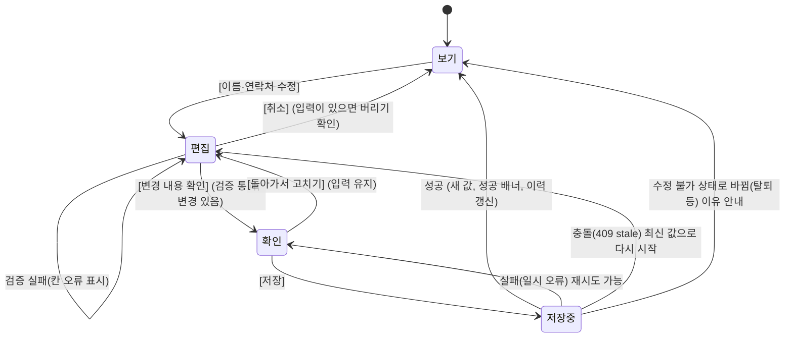

# 관리자 회원 상세: 이름·연락처 수정 — 화면 정의서 (service-planner)

- 작성: service-planner / 기준일 2026-11-26 / 상태: **초안(대표 확인 대기)**
- 근거 결정: 대표 결정 2026-11-26 — 관리자 회원 상세에 이름·연락처 수정 기능을 넣고, 접속 기록을 남긴다. 회원은 고객센터에 전화하고, 관리자가 본인 확인 뒤 고친다. (`bara-edu-lms.signup-verify-password.md` 후속 과제)
- 배경 문서: 같은 문서의 '위험 감수 기록', 개인정보처리방침 `bara-edu-lms.legal-privacy.md` 정정 요구 조항, 전화 응대 스크립트 `bara-edu-lms.signup-verify-password-copy.md` 6장
- 다음 단계: ux-writer(문구) → ui-ux-designer(와이어프레임) → backend-developer(API 계약 검토) → frontend-developer → privacy-security-officer 점검 → qa-reviewer. **개인정보를 다루므로 privacy-security-officer 점검 없이 배포하지 않는다.**
- 이 문서는 문서만 만들었다. 코드는 바꾸지 않았다.

---

## 0. 현재 코드 조사 결과 (결정의 근거)

| 항목 | 확인한 사실 | 파일 |
|---|---|---|
| 이름·연락처 저장 위치 | `profiles.name`(not null), `profiles.phone`(null 가능) 이 화면에 쓰이는 원본. `auth.users.raw_user_meta_data`의 `name`/`phone`은 **가입 때 `handle_new_user` 트리거가 profiles를 처음 만들 때만 읽는다.** 그 뒤에는 앱이 읽는 곳이 없다 | `api/db/02-schema.sql` 74행·238행, `api/db/01-auth.sql` |
| 가입 시도 테이블 | 미인증 계정은 `auth.signup_attempts`에 이름·연락처·비밀번호 해시를 7일 보관. **가입 확정(`completeSignup`) 때 profiles의 name·phone을 시도 값으로 덮어쓴다** | `api/src/auth/signup-link.ts` 130~139행 |
| 관리자 재설정으로 가입을 마친 경우 | 시도 값 덮어쓰기가 없다. 그래서 첫 가입 시도 값이 profiles에 남는다(이 기능이 필요한 이유) | 위험 감수 기록 |
| 마이페이지 | 이름·이메일·휴대전화는 읽기 전용, "변경은 고객센터로 문의해 주세요". 주소·사진만 본인이 고칠 수 있다(`updateContactInfo`) | `app/(user)/my/page.tsx` 346행, `app/actions/account.ts` |
| 관리자 회원 상세 | 이름·연락처·주소는 **원문 그대로** 보인다(마스킹 없음). 상세를 열면 `logAdminAccess(..., '조회', ...)`가 기록된다. 지금 있는 쓰기 동작은 비밀번호 재설정 메일 발송, (인증 처리) 두 개뿐이며 둘 다 `'수정'` 으로 기록한다 | `app/(admin)/admin/members/[id]/page.tsx`, `app/actions/admin-members.ts`, `lib/supabase/admin-queries.ts` 918~961행 |
| 접속 기록 테이블 | `admin_access_logs(admin_id, target_user_id, action, detail text, ip_address, created_at)`. 관리자만 select·insert(`admin_id = auth.uid()`), update·delete 정책 없음, 1년 지난 건 매일 03:10 자동 삭제 | `api/db/02-schema.sql` 1697~1760행 |
| 관리자 쓰기 경로 | 계정 관련 쓰기는 앱 서버 액션 → API `/v1/admin/users/:id/...`(`requireAdmin`이 `is_admin()` 확인) → `withService` 트랜잭션. 접속 기록은 앱이 API 성공 뒤에 `logAdminAccess`로 남긴다 | `api/src/auth/routes.ts` 177~214행 |
| 역할 | `user_role` 은 `learner`, `admin` **두 개뿐**. 운영자 등급 구분 없음. 운영자 목록(`/admin/operators`)은 읽기 전용이고 권한 부여·해제는 DB에서 직접 한다 | `api/db/02-schema.sql` 17행, `app/(admin)/admin/operators/page.tsx` |
| 수료증 | `certificates(id, user_id, course_id, issued_at, file_url, is_manual_override, note)`. **이름 스냅샷 없음, 발급 번호 없음, 진위 확인 페이지 없음.** `file_url`은 읽기만 하고 어디서도 쓰지 않는다(PDF 생성 코드 없음). 이름은 화면을 열 때마다 profiles에서 읽는다(관리자 수료 관리 `userName`). 마이페이지 수료증 탭에는 강좌명·발급일만 있다 | `api/db/02-schema.sql` 174행, `lib/supabase/classroom-queries.ts` 453~471행, `app/(admin)/admin/certificates/page.tsx` |
| 입금자명 | **저장하는 컬럼이 없다.** 신청 안내에서 "입금자명을 강좌 안내와 동일하게 입력"이라고 말할 뿐이다. 관리자는 신청·입금 화면의 회원 이름과 은행 입금 내역을 눈으로 대조한다 | `components/home/ApplyGuideSection.tsx`, `app/(admin)/admin/enrollments` |
| 시험·자가진단 | 시험 응시 기록은 `user_id` 로만 연결, 이름 저장 없음. 자가진단 결과는 **응답자가 입력한 이름·연락처를 `diagnosis_results.respondent_name/phone`에 별도로 저장**(회원과 연결돼도 따로 보관, 탈퇴 때 null 처리) | `api/db/02-schema.sql` 1780행 이후, `api/src/auth/withdraw.ts` 52행 |
| 기존 검증 | 가입: 이름 trim 후 2~100자, 연락처 trim 후 30자 이하(비어 있어도 됨, 형식 검사 없음). 한도는 `LIMITS = { name: 100, phone: 30 }` | `api/src/auth/routes.ts` 26~27행, `lib/form-messages.ts` |
| profiles 보호 트리거 | `protect_profile_privileged_columns`는 관리자가 아니면 role·status·email을 되돌린다. name·phone은 건드리지 않는다. 탈퇴는 `auth.users`를 먼저 잠그고 `profiles`를 잠근다 | `api/db/02-schema.sql` 283행, `api/src/auth/withdraw.ts` 42~47행 |
| 메일 | SES 템플릿은 `confirm`·`recovery`·`already_registered` 3종, `deliver()`는 대기열에 넣고 응답을 기다리지 않는다. 메시지에 `link`가 필수 | `api/src/mail/mailer.ts`, `api/src/mail/ses.ts` |

---

## 1. 수정 대상 필드와 검증 규칙

### 1.1 범위

| 필드 | 수정 가능 | 저장 위치 | 비고 |
|---|---|---|---|
| 이름 | 가능 | `profiles.name`, `auth.users.raw_user_meta_data.name` | 필수 |
| 휴대전화 | 가능 | `profiles.phone`, `auth.users.raw_user_meta_data.phone` | 비울 수 있다(회원가입도 선택 입력이라서) |
| 주소 | **이번 범위 밖, 변경 없음** | `profiles.address` | 이미 회원이 마이페이지 "신청 정보 수정"에서 직접 고친다. 관리자 화면은 읽기 전용 유지 |
| 자격증 발급용 사진 | 범위 밖 | `profiles.photo_path` | 회원이 직접 교체 |
| 이메일 | **범위 밖(판단: 제외)** | `auth.users.email`, `profiles.email` | 아래 1.3 |
| 역할·상태 | 범위 밖 | | 기존 방식 유지 |

### 1.2 이름·연락처와 주소의 관계

- 이름·연락처는 **관리자만**, 주소·사진은 **회원 본인만** 고친다. 두 경로는 서로 겹치지 않는다. 같은 `profiles` 행을 건드려도 서로의 컬럼은 건드리지 않게 **API는 `set name=..., phone=...` 만** 쓴다(주소·사진 컬럼을 같은 update에 넣지 않는다).
- 관리자 회원 상세에서 주소는 계속 읽기 전용으로 보인다. 편집 영역에는 넣지 않는다. 주소 정정 요구가 오면 "마이페이지에서 직접 고칠 수 있다"고 안내한다(전화 응대 보조 문구).
- 마이페이지의 안내 문구 "이름·이메일·휴대전화 변경은 고객센터로 문의해 주세요."는 그대로 둔다. 사실과 맞다.

### 1.3 이메일 변경은 범위 밖으로 둔다 (판단과 이유)

- 이메일은 로그인 ID이며 인증 메일·재설정 메일의 수신처이고, 전화 본인 확인의 **유일한 기준**이다. 관리자가 바꿀 수 있으면 본인 확인 기준 자체를 바꿀 수 있어서 계정 탈취 경로가 된다.
- 이메일 변경은 새 주소 인증, 세션 정리, 대소문자 정규화 유니크(`users_email_lower_key`)와 `profiles.email` 복제 동기화가 따로 필요하다. 이번 기능의 대표 결정 범위(이름·연락처)를 넘는다.
- 요구가 생기면 별도 기획으로 다룬다(`후속 과제`).

### 1.4 검증 규칙 (화면과 API가 같은 규칙을 쓴다. 서버가 최종 판단)

| 필드 | 규칙 | 오류 필드 키 | 비고 |
|---|---|---|---|
| 이름 | 앞뒤 공백 제거 후 2~100자. 줄바꿈·탭 등 제어 문자 불가. 가운데 연속 공백은 한 칸으로 줄인다 | `name` | 가입 규칙(2~100자)과 동일. 가입 때 허용된 이름은 수정에서도 허용 |
| 이름(추가) | `탈퇴한 회원` 과 같은 값 불가 | `name` | 탈퇴 익명화 값과 혼동 방지 |
| 휴대전화 | 앞뒤 공백 제거 후 **비어 있거나 7~30자**. 허용 문자: 숫자, 공백, `-`, `+`, `(`, `)`. 숫자가 7개 이상 | `phone` | 해외 이주민 번호(+국가번호)도 받으려고 형식을 한국 번호로 좁히지 않는다. 가입은 형식 검사가 없으므로 **기존에 저장된 값이 이 규칙을 못 지켜도** 수정하지 않는 한(변경 없음) 오류를 내지 않는다 |
| 전화 비우기 | 허용. 비우면 `profiles.phone = null`, meta의 `phone` 키 삭제. 확인 단계에서 "(비움)"으로 표시 | | |
| 변경 없음 | 이름·연락처 모두 현재 값과 같으면 저장하지 않고 "바뀐 내용이 없어요" | `none` | 접속 기록·메일도 남기지 않는다 |
| 정정 사유 | 필수. 3.2절 | `reason` | |
| 본인 확인 체크 | 필수. 3.1절 | `verified` | |

---

## 2. 화면 정의

위치: `app/(admin)/admin/members/[id]/page.tsx`의 기본 정보 카드(이메일·연락처·이메일 인증·주소 목록)와 이름 제목 영역. 새 라우트는 만들지 않는다. 편집은 같은 화면 안에서 연다.

### 2.1 구성 요소

| 요소 | 위치 | 설명 |
|---|---|---|
| 이름(보기) | 제목 `h1` | 기존대로 이름을 표시 |
| 연락처(보기) | 기본 정보 카드 | 기존 그대로(원문) |
| `[이름·연락처 수정]` 버튼 | 기본 정보 카드 오른쪽 위 | 보조 버튼(기존 `비밀번호 재설정 메일 발송`과 같은 스타일). 수정 불가 회원은 비활성 + 이유(5장). 이 화면의 `ConfirmDialog` 비활성 표기 방식(`disabled`, `disabledReason`)을 따른다 |
| 편집 폼 | 기본 정보 카드를 대체(카드 안에서 전환) | 이름 입력, 휴대전화 입력, 정정 사유 선택, 메모(선택, '기타'면 필수), 본인 확인 체크, `[변경 내용 확인]`, `[취소]` |
| 확인 단계 | 편집 폼 아래 같은 카드, 또는 `<dialog>` | 변경 전후 비교표, 영향 안내, `[저장]`, `[돌아가서 고치기]` |
| 변경 이력 | 별도 섹션 "정보 수정 이력" | 4.3절 |
| 결과 배너 | 페이지 상단 | 기존 `success`/`error` 배너 패턴 재사용 |

구현 방식: 기존 관리자 화면은 서버 액션 + `redirect(?success=/?error=)` 패턴이다. 편집 폼은 입력 상태(보기→편집→확인)가 필요하므로 **클라이언트 컴포넌트 하나**로 만든다(`MemberProfileEditor`, 가칭). 저장은 서버 액션 하나이며, 서버 액션은 성공·실패 모두 `redirect`가 아니라 **결과 값**을 돌려주어 입력값을 잃지 않게 한다(5xx 재시도 때 사유·메모 재입력 방지). 성공 때만 `redirect(?success=profile-updated)` 한다. 이 결정은 frontend-developer와 확정한다.

### 2.2 상태 전이 (mermaid)



### 2.3 상태별 표시

| 상태 | 화면 | 동작 |
|---|---|---|
| **보기** | 기존 화면과 같다. 이름·연락처 옆에 수정 버튼은 카드 단위로 하나만 둔다 | `[이름·연락처 수정]` → 편집 |
| **보기(수정 불가)** | 버튼 비활성, 가까이에 한 줄 이유(5장 표). 호버 `title`만으로 두지 않는다(시니어·터치 환경을 고려해 이유를 글자로 항상 보이게) | 없음 |
| **편집** | 이름·휴대전화 입력칸에 **현재 값이 미리 채워진다.** 안내: "회원에게 가입 이메일 `{email}`로 본인 확인을 마친 뒤 고쳐 주세요." 정정 사유 선택(필수), 본인 확인 체크(필수) | 입력은 로컬 상태. 필드를 벗어날 때(blur) 검증 |
| 편집(검증 실패) | 오류가 있는 칸 아래 한 줄 + `aria-invalid`, 첫 오류 칸에 포커스. 칸마다 문구가 다르다(7장) | 오류가 풀려야 `[변경 내용 확인]` 활성 |
| 편집(변경 없음) | `[변경 내용 확인]` 비활성 + "바뀐 내용이 없어요" | |
| **확인(변경 전후 비교)** | 표: 항목 / 변경 전 / 변경 후. **바뀐 항목만 강조**, 안 바뀐 항목은 "변경 없음". 아래 영향 안내(6장 요약), 사유·본인 확인 결과 요약 | `[저장]`(기본 포커스 아님, 오조작 방지) / `[돌아가서 고치기]` |
| **저장 중** | `[저장]` 버튼 비활성, "저장하는 중이에요" | 이중 제출 방지(서버 쪽 멱등은 4.4절) |
| **성공** | 보기 상태로 복귀, 새 값 반영, 상단 성공 배너(초록, 기존 패턴), 이력에 새 항목. 메일을 못 보냈으면 노란 보조 배너(8장) | `?success=profile-updated`, 새로고침해도 배너가 반복되지 않게 페이지 이동 뒤에는 쿼리 제거는 기존 패턴과 동일(현재 구현이 쿼리를 그대로 둔다면 같은 수준으로 둔다) |
| **실패** | 7장 표. 입력값과 사유를 유지한 채 편집/확인 상태에 머문다 | |
| **취소** | 입력을 바꾼 적이 있으면 "고친 내용이 사라져요. 취소할까요?" 확인, 없으면 즉시 보기로 | 서버 호출 없음, 접속 기록 없음 |
| **편집 중 이탈**(뒤로가기·링크) | 브라우저 기본 `beforeunload` 경고 | 변경 있는 편집·확인 상태에서만 |

### 2.4 접근성·사용성 (관리자가 전화를 받으며 쓰는 화면)

- 입력칸 라벨은 `label`로 연결. 오류는 `role="alert"` 또는 `aria-live="polite"`로 안내(기존 가입 화면의 틀림 안내 패턴 `role=alert`과 맞춘다).
- 키보드만으로 편집→확인→저장 가능. 다이얼로그는 기존 네이티브 `<dialog>` 방식(`ConfirmDialog`)과 같은 방식이면 포커스 가두기가 기본 제공된다. 확인 단계를 다이얼로그로 만들 때는 `ConfirmDialog`가 입력 필드를 담지 못하므로 새 컴포넌트를 쓰거나 같은 카드 안에서 단계를 전환한다(ui-ux-designer 결정).
- 확인 단계에서 이름은 **큰 글씨**로 보여 전화 상대에게 되읽어 주기 쉽게 한다("홍길동님 맞으시죠?").

---

## 3. 본인 확인 절차와 정정 사유

### 3.1 본인 확인

- **전화로 하는 확인은 가입 이메일 일치만 한다**(대표 결정 6번과 같은 기준. 이름·연락처는 확인 기준으로 쓰지 않는다. 미인증 때의 값이 공격자 값일 수 있어서).
- 화면에서는 **체크박스 하나를 필수**로 둔다: "회원에게 가입 이메일로 본인 확인을 마쳤어요." 체크는 시스템이 진위를 검증하지는 않는다(전화 응대를 시스템이 알 수 없다). 목적은 (1) 절차를 건너뛰지 않게 하는 점검, (2) 접속 기록에 "본인 확인 완료"를 남기는 책임 기록이다.
- 이름·연락처를 고칠 때 **이메일만으로 본인 확인하는 것은 재설정 메일보다 약하다**(재설정 메일은 메일함 주인에게 가지만, 전화로 이메일 주소만 대는 것은 주소를 아는 제3자도 할 수 있다). 이 위험은 3개 장치로 줄인다.
  1. 변경 안내 메일을 가입 이메일로 보낸다(8장) — 진짜 주인이 변경을 알 수 있다.
  2. 접속 기록에 처리자·시각·IP·사유를 남긴다(4장).
  3. 이름 변경 때 영향 안내(6장)를 보여 준다.
- 위 판단은 대표 확인 질문 Q2에 올린다(이메일만으로 충분한지, 추가 확인 한 가지를 둘지).

### 3.2 정정 사유: 필수

사유를 필수로 정한다. 이유는 (1) 개인정보 열람·수정 책임 추적(제8조 5항 접속 기록의 목적), (2) 운영자가 습관적으로 눌러 고치는 것을 막는 마찰, (3) 나중에 정정 요구 처리 대장으로 쓸 수 있다.

| 사유 코드 | 화면 라벨 | 메모 |
|---|---|---|
| `member_request` | 회원 요청 | 선택 |
| `typo_fix` | 오기 정정 | 선택 |
| `signup_attempt_value` | 가입 때 남이 입력한 값 정정 | 선택. 미인증 회원이 재설정 메일로 가입을 마친 경우(위험 감수 기록)용 |
| `other` | 기타 | **메모 필수**, 5~100자 |

- 메모(`memo`)는 최대 100자, 한 줄. **개인정보(이름·전화번호·주소 등)를 적지 말라는 안내를 칸 아래에 둔다.** 서버는 메모를 NFKC 정규화한 뒤 전화·계좌·주민번호처럼 보이는 것(공백·`-`·`.`·`(`·`)`를 지운 숫자열이 9자리 이상, `+82`, 주민번호 형태)과 이메일 형태(`@` 앞뒤 공백, `(at)`·`[at]` 포함)는 거절한다(날짜 `2026-11-26`은 8자리라 허용). 정확한 정규식은 api.md 3장(`memo_has_pii`). 메모는 접속 기록 `detail`에 들어가므로 PII 방지가 핵심이다.
- 기본 선택값은 없다(고르게 한다). 가장 흔한 "회원 요청"이 미리 선택돼 있으면 확인 없이 지나가기 쉽다.

---

## 4. 접속 기록과 변경 이력

### 4.1 접속 기록에 무엇을 남기나

| 시점 | `action` | `detail` 형식 | 비고 |
|---|---|---|---|
| 상세 열람 | `조회` | 기존: `회원 상세(주소/사진/신청내역/수료이력)` | 변경 없음 |
| 저장 성공 | `수정` | `이름·연락처 수정: {바뀐 항목} / 사유: {사유 라벨}[ / 메모: {메모}] / 본인확인: 이메일` | 아래 4.2 |
| 편집 열기, 취소, 확인 단계, 검증 실패, 변경 없음 | **기록하지 않는다** | | 값이 바뀌지 않았다. 원문은 이미 상세 조회 때 기록됨 |
| 서버가 거절한 수정 시도(권한 없음, 상태 불가) | 기록하지 않는다 | | 서버 로그에 코드만 남긴다. 단, 비관리자의 호출(403)은 서버 경고 로그 |

### 4.2 변경 전후 값은 남기지 않는다 (개인정보 최소화 판단)

- 판단: 접속 기록에 이름·연락처의 **이전 값·새 값 원문을 넣지 않는다.** `detail`에는 "무엇이(항목) 왜(사유) 바뀌었는지"만 남긴다. 예: `이름·연락처 수정: 이름, 연락처 / 사유: 회원 요청 / 본인확인: 이메일`.
- 이유: (1) `admin_access_logs`는 **2년간 지울 수 없는** 보관 대상이고 모든 관리자가 읽는다. 정정은 "틀린 값"을 없애는 일인데 기록에 틀린 값을 2년 보존하면 정정 요구의 취지에 반한다. (2) 탈퇴 시 `target_user_id`는 `set null`로 끊기지만 `detail`의 값 원문은 남는다. 익명화한 회원의 이름이 로그에 남는 모순이 생긴다. (3) 바뀐 사실과 책임자만 있으면 감사 목적이 충족된다.
- 절충안(선택, Q3): 마스킹 전후 값(이름 `홍*동`, 전화 `010-****-5678`)을 남기는 방법도 있다. 이 경우 잘못 고친 것을 되돌릴 때 힌트가 되지만 값이 일부 남는다. 기본 안은 **남기지 않음**이다.
- 잘못 고친 경우의 복구: 값이 기록에 없으므로 **회원에게 다시 정확한 값을 확인해서 다시 수정한다.** 이것도 이력에 한 건으로 남는다.
- API는 접속 기록을 **같은 DB 트랜잭션 안에서** 쓴다(4.4절). 기록이 실패하면 변경도 되돌려진다 — 마스킹 해제와 같은 원칙("기록 성공 시에만 허용", 2026-11-19 점검).

### 4.3 회원 상세에 "정보 수정 이력" 보여 줄지: 보여 준다

- 위치: 상세 맨 아래(수료 이력 아래), 섹션 제목 `정보 수정 이력`.
- 내용: 최근 5건. 일시(KST), 처리한 관리자 이름, 바뀐 항목(이름/연락처), 사유 라벨(메모가 있으면 함께). **값은 없다.** 5건보다 많으면 `[더 보기]`(전체, 1년 보관 범위 내).
- 이유: 응대 중 "이 회원은 이미 한 번 고쳤다/누가 언제 고쳤나"를 바로 알아야 하고(반복 정정은 의심 신호), 별도 감사 화면이 지금 없다(admin_access_logs를 보는 화면 없음).
- 데이터 출처: `admin_access_logs`에서 `target_user_id = {id}` 이고 `action = '수정'` 이며 `detail`이 `이름·연락처 수정:`으로 시작하는 건. **detail 문자열 파싱은 약하므로** 구현은 다음 중 하나를 backend-developer가 고른다.
  - (권장) `admin_access_logs`에 JSON 컬럼 없이 `action = '정보수정'`처럼 **구분 가능한 별도 action 값**을 쓰고, `detail`은 `fields=name,phone;reason=member_request;memo=...;verified=email` 같은 고정 형식(키=값)으로 쓴다. 화면은 이 형식만 해석한다.
  - 또는 전용 테이블 `profile_edit_logs`를 만든다. 보관·삭제 정책이 접속 기록과 달라져 관리 대상이 늘므로 비권장.
- 이력 열람 자체는 상세 조회 기록(`조회`)에 포함된다. 따로 기록하지 않는다.
- 탈퇴 회원: 이력은 `target_user_id`가 남아 있는 동안 보인다(탈퇴해도 `profiles` 행은 남음). 수정은 불가이므로 이력만 읽기로 보인다.
- 2년이 지난 기록은 자동 삭제되므로 이력도 사라진다. 섹션 하단에 "접속 기록은 2년간 보관돼요"를 작게 적는다.

### 4.4 저장 규칙 (동시성·멱등)

- **낙관적 잠금**: `profiles`에는 `updated_at`이 없다. 요청에 `expected`(편집을 연 시점의 이름·연락처)를 담고, 서버가 행을 잠근 뒤 현재 값과 비교한다. 다르면 `409 stale`과 현재 값을 돌려준다.
- 잠금 순서는 `auth.users` 먼저, `profiles` 다음(탈퇴 `withdraw.ts`와 같은 순서, 교착 방지).
- 같은 요청이 두 번 와도(더블클릭, 재시도) 두 번째는 `expected`가 이미 새 값과 달라 `409 stale`이 되고, 서버는 **현재 값이 요청한 새 값과 같으면 성공으로 처리하되 기록·메일을 또 남기지 않는다**(`unchanged`).

---

## 5. 권한과 수정 가능 대상

### 5.1 권한

- **role = `admin` 만** 가능. 서버에서 `requireAdmin`(`is_admin()`)을 쓴다. 화면 숨김은 보조이고 최종 판단은 API다.
- **운영자 등급 구분은 없다.** `user_role`은 `learner | admin` 두 개이며 등급·권한 범위 테이블이 없다. 따라서 "모든 관리자가 가능"하다. 이 기능은 개인정보를 쓰므로 책임 추적을 접속 기록(관리자 ID·IP)에 의존한다. 등급 구분이 필요한지는 대표 확인 질문 Q5로 올린다(이번 범위에서 만들지 않는다).
- 직접 호출(CSRF/서버 액션 직접 POST) 방어: 관리자 세션 쿠키 필수, 서버 액션은 기존 `requireAdminClient()`로 시작한다.

### 5.2 수정 가능 대상과 이유 문구

| 대상 | 수정 | 버튼 | 이유 문구(보이는 글자) |
|---|---|---|---|
| 활동중 + 인증 완료 learner | 가능 | 활성 | |
| **탈퇴 회원**(`status='withdrawn'`) | 불가 | 비활성 | 탈퇴한 회원이라 고칠 수 없어요 (개인정보가 이미 지워졌어요) |
| **가입 마무리 전 회원**(`emailConfirmed===false`) | 불가 | 비활성 | 아직 가입을 마무리하지 않은 회원이에요. 가입을 마친 뒤에 고칠 수 있어요 |
| 이메일 인증 상태 확인 실패(`emailConfirmed===null`) | 불가 | 비활성 | 인증 상태를 확인하지 못했어요. 잠시 후 다시 열어 주세요 |
| role=`admin` 대상(운영자 계정) | 불가 | 비활성 | 운영자 계정은 이 화면에서 고칠 수 없어요 |
| 이메일 없는 행(`profile.email` 없음, 비정상 데이터) | 불가 | 비활성 | 가입 이메일이 없어 본인 확인을 할 수 없어요 |

미인증 회원을 막는 이유: 가입 확정(`completeSignup`) 때 `profiles`의 name·phone이 `signup_attempts` 값으로 **덮어써진다**. 관리자가 미인증 상태에서 고쳐도 회원이 가입을 마치는 순간 사라진다(그리고 첫 시도자 값이 아니라 본인이 마지막으로 보낸 시도 값이 들어가므로 본인이 가입을 다시 하면 어차피 맞는 값이 들어간다). 반면 **관리자 재설정 메일로 가입을 마친 경우는 덮어쓰기가 없어 틀린 값이 남는다** — 이 기능의 본래 목적이 바로 이 경우이고, 가입을 마친 뒤에는 수정이 열린다. 서버도 `auth.users.email_confirmed_at is null` 이면 `409 not_confirmed`로 거절한다.

운영자 계정 대상을 막는 이유: 운영자는 접속 기록의 행위자(`admin_id`)이며 이름이 책임 표시에 쓰인다. 감사 기록을 만든 사람의 이름을 다른 관리자가 바꾸는 것은 피한다. 필요하면 DB 직접 수정(현재 운영자 권한 관리 방식과 동일). Q5와 함께 확인한다.

---

## 6. 이름 변경의 영향

`profiles.name`은 **화면을 열 때마다 읽는 값**이고 이름 스냅샷을 저장하는 곳이 이 시스템에는 없다. 따라서 이름을 바꾸면 이름이 보이는 모든 화면이 즉시 새 이름을 보여 준다. 이것이 대부분의 항목에서 "후속 작업이 필요 없음"의 이유이다.

| 영향 대상 | 현재 동작 | 결정 | 화면·작업 |
|---|---|---|---|
| **이미 발급된 수료증** | `certificates`에 이름 스냅샷·발급 번호·진위 확인 페이지가 **없다.** `file_url`은 쓰이지 않는다. 시스템 안 화면(관리자 수료 관리, 회원 상세 수료 이력, 마이페이지 수료증 탭)은 강좌명·발급일 중심이고, 이름은 조회 시점의 `profiles.name` | **재발급 기능은 만들지 않는다.** 시스템에는 이름이 박힌 수료증 산출물이 없어 되돌릴 대상이 없다 | 확인 단계에 수료 이력이 1건 이상이면 안내: "수료 이력이 {N}건 있어요. 수료증은 변경된 이름으로 보여요. 이미 종이나 파일로 발급해 드린 수료증이 있으면 이름이 달라질 수 있어요." 실제 수료증 문서를 시스템 밖(수동)으로 만들어 주는지는 **Q4로 확인**. 외부 발급이 있다면 재발급은 운영 절차이며 `certificates.note`에 기록할 수 있다(후속) |
| **발급 번호·진위 확인 페이지** | 없음(검색 확인) | 해당 없음 | 나중에 만들게 되면 발급 시점 이름 스냅샷을 같이 저장하도록 별도 기획(후속 과제) |
| **진행 중인 수강신청** | `enrollments`는 `user_id`로 연결. 이름은 조회 시 join | 신청은 유지, 상태 변화 없음 | 확인 단계에 `pending` 신청이 있으면 경고: "입금 대기 중인 신청이 {N}건 있어요. 승인할 때 입금자명이 **바뀐 이름**과 맞는지 보세요. 회원에게 이전 이름으로 입금해도 된다고 안내해 주세요" |
| **입금자명** | 저장하는 값이 없고 관리자가 이름과 입금 내역을 눈으로 대조 | 별도 처리 없음 | 위 경고로 갈음. 입금자명 매칭 코드는 없다 |
| **시험 응시 기록** | `user_id` 연결, 이름 없음 | 영향 없음 | 없음 |
| **자가진단 결과** | `diagnosis_results.respondent_name/phone`은 **응답자가 그때 입력한 값을 따로 보관**한다(회원 연결 후에도 별개) | **동기화하지 않는다**(응답 당시 기록, 수정 대상이 아님). 회원 상세에서 이름이 다르게 보일 수 있다 | 확인 단계 안내에 포함하지 않는다. 정정 요구가 자가진단 응답자명까지 미치는지는 **Q6** |
| **auth.users 메타데이터** | `raw_user_meta_data.name/phone`은 가입 때 한 번 읽히고 그 뒤 읽는 곳이 없다. 탈퇴 때는 `'{}'` 로 비운다 | **같은 트랜잭션에서 함께 갱신한다**(일치 유지, 나중에 읽는 코드가 생겨도 안전) | 전화를 비운 경우 `phone` 키를 지운다. 가입 확정 시의 meta 구성 방식(`{name, phone?}`)과 같은 모양을 쓴다 |
| **profiles** | 화면 원본 | 갱신 | `update profiles set name = $2, phone = $3 where id = $1`. 주소·사진 컬럼 불포함 |
| **마이페이지** | 본인 이름 표시 | 다음에 열면 새 이름 | 별도 작업 없음 |
| **로그인 세션** | 세션은 `user_id` 기반 | 로그아웃 불필요 | 세션 정보에 이름을 캐시한다면 backend가 확인(`api/src/ops/profiles.ts`는 매번 읽음) |
| **관리자 화면 검색** | `name ilike` 검색 | 새 이름으로 검색됨 | 별도 작업 없음 |

휴대전화 변경의 영향: 자가진단 연락처 기본값(`/selfcheck/start`이 profiles의 phone을 채워 줌)만 새 값이 쓰이고, 다른 연동은 없다. 알림톡·문자 발송 기능은 없음(검색 확인).

---

## 7. 엣지케이스·오류 처리표

| # | 상황 | 감지 | 처리 | 사용자에게 보이는 것 |
|---|---|---|---|---|
| 1 | 탈퇴 회원 | 서버: `status='withdrawn'` | 버튼 비활성(5.2). 직접 호출은 `409 withdrawn` | 5.2의 이유 문구 |
| 2 | 가입 마무리 전(미인증, 비밀번호 없음) | 서버: `email_confirmed_at is null` | 버튼 비활성. 직접 호출은 `409 not_confirmed` | 5.2의 이유 문구. 상단 노란 안내(가입 마무리 전 안내)와 겹치므로 **버튼 옆에만** 한 줄 둔다 |
| 3 | 편집 중에 회원이 탈퇴하거나 인증 상태가 바뀜 | 저장 시 서버가 잠그고 재확인 | `409 withdrawn`/`not_confirmed` → 편집을 닫고 보기로, 이유 배너 | "그 사이 회원 상태가 바뀌어 저장하지 못했어요. 화면을 새로 열었어요" |
| 4 | **동시 편집**(다른 관리자가 먼저 저장) | `expected` ≠ 현재 값 → `409 stale`(현재 값 동봉) | 편집을 닫지 않고 **현재 값으로 폼을 다시 채우고** 사유는 유지. 확인 단계였다면 편집 단계로 되돌린다 | "다른 관리자가 먼저 고쳤어요. 최신 내용으로 다시 불러왔어요. 한 번 더 확인해 주세요" + 이력에 방금 건 표시 |
| 5 | 같은 값으로 저장(변경 없음) | 클라이언트·서버 둘 다 비교 | `[변경 내용 확인]` 비활성, 서버는 `200 unchanged` | "바뀐 내용이 없어요" |
| 6 | 이름 검증 실패 | 클라이언트 blur·서버 | 칸 오류 | 이름 2~100자(빈 값, 1자, 101자, 줄바꿈, `탈퇴한 회원`) |
| 7 | 전화 검증 실패 | 〃 | 칸 오류 | 허용 문자·7~30자·숫자 7개 미만 |
| 8 | 사유 미선택, 본인 확인 미체크, '기타'인데 메모 없음 | 〃 | 칸 오류. 저장 불가 | 각 칸 문구(10장) |
| 9 | 메모에 전화번호·이메일 형태 | 서버 `400 memo_has_pii`(클라이언트도 같은 규칙) | 칸 오류 | "메모에는 이름이나 전화번호를 적지 말아 주세요" |
| 10 | 관리자가 아닌 호출(세션 만료 포함) | 서버 401/403 | 401은 로그인으로(`/sign-in`), 403은 수정 불가 안내. 서버 경고 로그 | 401: 로그인 화면. 403: "관리자 권한이 필요해요" |
| 11 | 대상 회원이 없음(잘못된 id, 삭제됨) | `404 not_found` | 기존 `notFound()` 흐름 | 기존 404 |
| 12 | **접속 기록 쓰기 실패** | 같은 트랜잭션 안 insert 실패 | **변경 전체를 롤백**하고 `503 log_failed` | "처리하지 못했어요. 접속 기록을 남기지 못해서 저장하지 않았어요. 잠시 후 다시 시도해 주세요" |
| 13 | API 연결 실패(네트워크, 5xx) | `catch` | 저장 안 됨(트랜잭션). 입력 유지, 같은 확인 단계에서 `[다시 시도]` | 기존 문구 "처리 중 문제가 발생했어요. 잠시 후 다시 시도해 주세요." |
| 14 | 응답을 못 받았지만 서버에서는 저장된 경우(타임아웃) | 재시도 때 `expected` 불일치 | 서버는 "현재 값 = 요청한 새 값"이면 `200 unchanged`로 성공 처리, 기록·메일 중복 없음(4.4절) | 성공 배너(이력에서 확인) |
| 15 | 변경 안내 메일 실패 | `deliver()` 오류. 대기열 방식이라 응답은 성공 | **저장은 성공으로 둔다.** 메일은 부가 | 성공 배너 + 노란 보조 배너 "변경은 저장됐지만 안내 메일을 보내지 못했을 수 있어요" (대기열이면 감지 불가하므로 API가 `mailQueued: boolean`을 돌려준다) |
| 16 | **마스킹 상태에서 편집** | 현재 회원 상세는 마스킹이 없다(원문 표시). 연락처 마스킹은 자가진단 리드·결과에만 있다 | 이 화면에 마스킹이 생기더라도(예: 향후 상세 연락처 마스킹) **편집 폼은 마스킹 값을 절대 채우지 않는다.** 편집을 연다는 것은 원문 열람이므로 `원문 보기` 절차(기존 reveal 토큰, 접속 기록 성공 시에만)를 거쳐 원문을 채운다. 마스킹된 `010-****-5678`을 저장해 데이터가 오염되는 것을 막기 위해 서버는 `*` 문자가 든 연락처를 `400 phone_masked`로 거절한다 | 현재는 해당 없음. 방어 규칙만 서버에 넣는다 |
| 17 | 이름·전화의 값이 같은 두 회원 | 유니크 제약 없음 | 허용(동명이인) | |
| 18 | 이름을 **가입 때와 다른 사람** 이름으로 바꾸는 악용 | 본인 확인은 이메일만 | 완화 장치만(3.1절): 변경 안내 메일, 접속 기록, 사유 필수 | |
| 19 | 전화를 비우는 요청 | 입력 빈 값 | 허용. 확인 단계에서 "연락처: 010-... → (비움)"을 눈에 띄게 | |
| 20 | 새로고침·뒤로가기로 이미 저장된 폼 재제출 | 서버 액션 재전송 | 4.4절 멱등 | |
| 21 | 서버 액션 응답 후 `redirect` 와 입력 보존 충돌 | | 오류는 값으로 돌려주고 성공만 `redirect` (2.1절) | |
| 22 | 이름에 이모지·특수문자·한자·외국어 | | **허용**(해외 이주민 대상). 길이는 유니코드 문자 기준 `[...name].length`로 셈. 제어 문자만 거절 | |

---

## 8. 회원에게 알릴지: 변경 안내 메일을 보낸다

- 결정: **저장 성공 시 가입 이메일(`profiles.email`)로 변경 안내 메일을 보낸다.** 보내는 시점은 DB 커밋 뒤.
- 이유: (1) 전화 본인 확인이 이메일 주소 확인에 그쳐 제3자의 도용 가능성이 있다(3.1절). 메일은 **메일함의 진짜 주인**에게 변경을 알리는 유일한 장치이다. (2) 개인정보 보호법 취지(정정 처리 결과 통지)에도 맞다.
- 메일 내용: 항목명과 시각만. **이전·새 값은 넣지 않는다**(메일은 전달 중에 남고 4.2절 최소화 원칙). 본인이 요청하지 않았으면 고객센터 전화(`siteConfig.phone`, 운영시간)로 연락하게 한다.
- 보내지 않는 경우: 변경 없음, 탈퇴 회원, 메일 주소 없음(수정 불가라 도달하지 않음).
- 구현 영향: `api/src/mail/mailer.ts`의 `MailMessage`에 템플릿(가칭 `profile_changed`)을 추가한다. 지금 `link`가 필수라서 이 메일은 `link = {origin}/sign-in` 같은 고정 링크를 쓰거나 `link`를 선택으로 바꿔야 한다(backend 검토). `api/src/mail/ses.ts`의 템플릿과 메일 본문 테스트 갱신 필요.
- 메일 실패는 저장을 되돌리지 않는다(7장 #15).
- 메일을 보내는 것이 부담이면(Q7) 대안은 보내지 않고 이력만 남기는 것이다. 이때 3.1절의 보완 장치가 하나 줄어든다.

---

## 9. API 계약 초안 (backend-developer 검토용)

기존 패턴을 따른다. 앱 서버 액션 → `lib/db/auth.ts`의 `adminUpdateProfile()`(가칭) → API `/v1/admin/users/:id/...`(`requireAdmin`) → `withService` 트랜잭션. 앱은 `x-bara-client-ip`와 세션을 넘기는 기존 `apiFetch` 규칙을 쓴다.

### 9.1 `PATCH /v1/admin/users/:id/profile`

요청

```json
{
  "name": "홍길동",
  "phone": "010-1234-5678",
  "expected": { "name": "홍길순", "phone": null },
  "reason": "member_request",
  "memo": null,
  "identityVerified": true
}
```

| 필드 | 규칙 |
|---|---|
| `name` | 1.4절 규칙. 보내지 않으면 변경 안 함(부분 수정 허용) |
| `phone` | 문자열 또는 `null`(비움). 보내지 않으면 변경 안 함 |
| `expected` | **필수.** 편집을 연 시점의 `name`·`phone`(보낸 필드 전부). 서버 비교용(낙관적 잠금) |
| `reason` | `member_request \| typo_fix \| signup_attempt_value \| other` |
| `memo` | `reason='other'`이면 5~100자 필수, 그 외 선택(최대 100자). PII 형태 거절 |
| `identityVerified` | `true`만 허용(`false`·없음은 400). 접속 기록의 `본인확인: 이메일`에 쓴다 |
| `origin` | 메일 링크용(기존 `sendResetBody`와 같은 `originAllowed` 검사) |

엄격한 스키마(`.strict()`, 모르는 키 거절): `role`, `status`, `email`, `address`, `photo_path`를 보내도 거절한다(권한 상승·우회 방지).

서버 처리 순서(한 트랜잭션, `withService`)

1. `requireAdmin`(밖에서 먼저).
2. `auth.users` 행을 `for update`로 잠근다(없으면 `404`). 이어서 `profiles` 행을 `for update`.
3. 상태 검사: 대상 `role='admin'` → `409 target_is_admin`. `status='withdrawn'` → `409 withdrawn`. `email_confirmed_at is null` → `409 not_confirmed`.
4. 현재 값과 `expected` 비교. 다르면 현재 값이 요청 값과 같은지 본다: 같으면 `200 unchanged`(멱등), 다르면 `409 stale` + 현재 값.
5. 요청 값이 현재 값과 모두 같으면 `200 unchanged`(기록 없음).
6. `update profiles set name, phone ... where id = $1`(바뀐 컬럼만). `update auth.users set raw_user_meta_data = ..., updated_at = now()`(name·phone 키만 갱신, 다른 키 보존. 전화를 비우면 `phone` 키 삭제).
7. `admin_access_logs`에 insert(관리자 `admin_id`, `target_user_id`, `action`, `detail`, `ip_address`). 실패하면 전체 롤백 → `503 log_failed`.
8. 커밋 뒤 메일 `deliver`(대기열). 실패해도 응답은 성공.

응답

| 코드 | 본문 | 의미 |
|---|---|---|
| 200 | `{ "ok": true, "changed": ["name","phone"], "profile": { "name": "...", "phone": "..." }, "mailQueued": true }` | 저장 성공 |
| 200 | `{ "ok": true, "changed": [], "unchanged": true, "profile": {...} }` | 변경 없음 또는 이미 같은 값 |
| 400 | `{ "error": { "code": "validation", "message": "...", "field": "name\|phone\|reason\|memo\|identityVerified\|expected" } }` | 형식 위반. `memo_has_pii`, `phone_masked`는 `message`로 구분 |
| 401 | `unauthenticated` | 세션 없음·만료 |
| 403 | `forbidden` | 관리자 아님 |
| 404 | `not_found` | 회원 없음 |
| 409 | `{ "error": { "code": "conflict", "message": "stale", "current": { "name": "...", "phone": "..." } } }` | 동시 편집. 현재 값 동봉 |
| 409 | `message: "withdrawn" \| "not_confirmed" \| "target_is_admin"` | 수정 불가 상태 |
| 429 | | 관리자별 쓰기 한도(예: 분당 20회) — 선택 |
| 503 | `message: "log_failed"` | 접속 기록 실패로 롤백 |

주의(backend 확인 필요)

- 서비스 경로(`withService`)에서는 `auth.uid()`가 비어 `protect_profile_privileged_columns`가 role·status·email을 되돌리는 쪽으로 동작한다. 이 요청은 name·phone만 쓰므로 영향이 없다. 단, 접속 기록 insert는 RLS가 `admin_id = auth.uid()`를 요구하므로 `withService`에서 직접 넣을 때는 서비스 권한으로 admin_id를 명시해 넣는다(`withUser`로 관리자 컨텍스트에서 넣는 방안도 가능, 같은 트랜잭션 보장이 우선).
- `detail` 형식은 4.3절의 `키=값` 고정 형식. `action` 값은 `정보수정`으로 별도 구분하는 안을 권장한다.
- 메모·사유 라벨을 `detail`에 넣을 때 구분자(`;`, `=`) 이스케이프 필요.

### 9.2 `GET /v1/admin/users/:id/profile-edits?limit=5`

관리자 전용. `admin_access_logs`에서 `target_user_id=:id and action='정보수정'` 최근 순.

```json
{ "items": [ { "at": "2026-11-26T05:12:00Z", "adminName": "관리자A", "fields": ["name"], "reason": "member_request", "memo": null } ], "hasMore": false }
```

앱이 이미 `getAdminMemberDetail`에서 Supabase 호환 클라이언트로 `admin_access_logs`를 읽을 수 있으면(RLS가 관리자 select 허용) 별도 API 없이 `lib/supabase/admin-queries.ts`에 조회 함수를 추가하는 방법도 된다. `adminName`은 `profiles`에서 join한다(탈퇴한 관리자는 "(탈퇴)").

### 9.3 서버 액션 (앱)

`app/actions/admin-members.ts`에 `updateMemberProfile(memberId, input)` 추가. 반환: `{ ok: true } | { ok: false, reason: 'validation'|'stale'|'withdrawn'|'not_confirmed'|'target_is_admin'|'log_failed'|'failed'|'forbidden', field?, current? }`. 기존 두 액션처럼 `requireAdminClient()`로 시작한다. 접속 기록은 이 액션에서 따로 `logAdminAccess`를 부르지 않는다(API 안에서 이미 남김, 중복 방지).

---

## 10. 문구 초안 (최종은 ux-writer가 정한다)

어조는 기존 관리자 화면 규칙(`~요`, 이모지 없음, 오류는 원인 + 할 일)을 따른다.

| 위치 | 초안 |
|---|---|
| 수정 버튼 | 이름·연락처 수정 |
| 편집 안내(위) | 회원에게 가입 이메일(`{email}`)로 본인 확인을 마친 뒤에 고쳐 주세요. |
| 이름 라벨 / 도움말 | 이름 / 2자 이상 100자 이하로 입력해요. |
| 휴대전화 라벨 / 도움말 | 휴대전화 / 비워 두면 연락처가 지워져요. 숫자, 공백, -, +, ( ) 만 쓸 수 있어요. |
| 사유 라벨 | 고치는 이유 |
| 사유 선택지 | 회원 요청 / 오기 정정 / 가입 때 남이 입력한 값 정정 / 기타 |
| 메모 라벨 / 도움말 | 메모 (기타는 꼭 적어 주세요) / 이름이나 전화번호는 적지 말아 주세요. 접속 기록에 2년 남아요. |
| 본인 확인 체크 | 회원에게 가입 이메일로 본인 확인을 마쳤어요. |
| 확인 버튼 / 취소 | 변경 내용 확인 / 취소 |
| 확인 단계 제목 | 아래 내용으로 바꿀까요? |
| 비교표 머리 | 항목 / 변경 전 / 변경 후 |
| 바뀌지 않은 항목 | 변경 없음 |
| 전화를 비울 때 | (비움) |
| 이름 변경 영향 안내 | 이름이 바뀌면 신청 내역, 수료 이력, 수료 관리 화면에 바뀐 이름으로 보여요. |
| 대기 신청 경고 | 입금 대기 중인 신청이 {N}건 있어요. 입금자명이 바뀐 이름과 맞는지 승인할 때 확인해 주세요. |
| 수료 이력 경고 | 수료 이력이 {N}건 있어요. 이미 종이나 파일로 드린 수료증이 있으면 이름이 다를 수 있어요. |
| 메일 안내(확인 단계 하단) | 저장하면 {email}로 변경 안내 메일이 가요. 바뀐 내용은 적지 않아요. |
| 저장 / 돌아가기 | 저장 / 돌아가서 고치기 |
| 저장 중 | 저장하는 중이에요 |
| 성공 | 이름·연락처를 수정했어요. |
| 성공(변경 없음) | 바뀐 내용이 없어요. |
| 성공 + 메일 불확실 | 수정했어요. 다만 안내 메일을 보내지 못했을 수 있어요. 회원에게 따로 알려 주세요. |
| 취소 확인 | 고친 내용이 사라져요. 취소할까요? |
| 이름 오류 | 이름은 2자 이상 100자 이하로 입력해 주세요. |
| 이름 오류(금지 값) | 이 이름은 쓸 수 없어요. |
| 전화 오류 | 휴대전화는 숫자 7개 이상, 30자 이하로 입력해 주세요. 숫자, 공백, -, +, ( ) 만 쓸 수 있어요. |
| 사유 오류 | 고치는 이유를 골라 주세요. |
| 메모 오류(기타) | 기타를 고르면 메모를 5자 이상 적어 주세요. |
| 메모 오류(개인정보) | 메모에는 이름이나 전화번호를 적지 말아 주세요. |
| 확인 체크 오류 | 본인 확인을 마친 뒤에 체크해 주세요. |
| 동시 편집 | 다른 관리자가 먼저 고쳤어요. 최신 내용으로 다시 불러왔어요. 한 번 더 확인해 주세요. |
| 상태 변경 | 그 사이 회원 상태가 바뀌어 저장하지 못했어요. |
| 접속 기록 실패 | 접속 기록을 남기지 못해서 저장하지 않았어요. 잠시 후 다시 시도해 주세요. |
| 일반 실패 | 처리 중 문제가 발생했어요. 잠시 후 다시 시도해 주세요. |
| 이력 섹션 제목 / 빈 값 | 정보 수정 이력 / 수정한 적이 없어요. |
| 이력 한 줄 | 2026.11.26 14:12 · 관리자A · 이름 수정 · 회원 요청 |
| 이력 하단 | 접속 기록은 2년간 보관돼요. |
| 변경 안내 메일 제목 | [바라 평생교육원] 회원 정보가 수정됐어요 |
| 변경 안내 메일 본문 | 회원님의 정보(이름, 연락처)가 {일시}에 수정됐어요. 본인이 요청하지 않았다면 고객센터({전화}, {운영시간})로 바로 연락해 주세요. 바뀐 내용은 보안을 위해 메일에 적지 않아요. |

### 10.1 전화 응대 스크립트 보강안 (운영자용, 위 6장 스크립트에 이어서)

1. "가입하신 이메일 주소를 불러 주시겠어요?" 이메일이 회원 상세와 일치하는지만 본다(이름은 묻지 않고 기준으로 삼지 않는다).
2. 일치하면 "바꾸실 이름(또는 번호)을 말씀해 주세요." 받아 적은 값을 회원에게 **되읽어 확인**한다.
3. 편집에서 사유를 고르고 체크한 뒤 `[변경 내용 확인]`에서 화면의 변경 후 이름을 한 번 더 확인하고 저장한다.
4. "고쳤어요. 가입 이메일로 안내 메일이 가요. 수료증이나 입금이 걸려 있으면 바뀐 이름 기준으로 보인다고 안내해 주세요."
5. 이메일을 모르거나 일치하지 않으면 수정하지 않는다(5.2절의 이유 없이 돌려보내지 않고, 가입 때 이메일을 확인한 뒤 다시 전화해 달라고 안내).

---

## 11. 기존 화면·문서와의 정합성 체크

| 점검 | 결과 |
|---|---|
| 관리자 화면 `success`/`error` 배너 패턴 | 재사용. `SUCCESS_MESSAGE`에 `profile-updated` 추가 필요 |
| 가입 규칙(이름 2~100자, 연락처 30자) | 수정 규칙이 가입보다 약하지 않다(이름 동일, 연락처는 형식 추가) |
| 마스킹 해제는 접속 기록 성공 시에만 | 같은 원칙으로 "기록 실패 시 변경 롤백" |
| 탈퇴 익명화 | 탈퇴는 수정 불가, `탈퇴한 회원`을 이름으로 못 씀 |
| 가입 확정 덮어쓰기 | 미인증 수정 불가로 충돌 회피 |
| 마이페이지 문구 | 변경 없음 |
| 미인증 안내 문구(copy 5장) | "이름이 달라도 이메일만 확인" 문구가 그대로 유효. 가입을 마친 뒤 이 화면에서 고칠 수 있다는 한 줄을 덧붙일 수 있다(copy 문서 7장 마지막 확인 항목 해소) |
| 처리방침 정정 요구 약속 | 이 기능으로 응할 수단이 생긴다. 제5조 SES 위탁 업무 추가와 제6조 제2항 갱신이 필요하다(privacy-security-officer 2026-11-26), 시행 방식은 대표 결정. 단, 접속 기록에 "개인정보 수정" 항목이 들어가므로 제8조 5항 기술에 영향 없는지 privacy-security-officer 점검 |

### 11.1 같이 갱신해야 하는 문서 (Do 단계 문서 동기화 원칙)

이번 작업에서 수정하지 않았다. 구현 승인 시 함께 갱신한다.

- `bara-edu-lms.signup-verify-password.md` 후속 과제(대표 결정 항목에 "정의서 작성 완료" 표시)
- `bara-edu-lms.signup-verify-password-copy.md` 5·6장 스크립트와 7장 확인 항목
- `bara-edu-lms.menu-features.md`, `bara-edu-lms.flows.md`의 관리자 회원 관리 기능 목록(F-ADM 계열)
- `bara-edu-lms.legal-privacy.md` 변경 이력 줄(접속 기록 대상 확대)
- `bara-edu-lms.design.md`의 Error Handling 표

---

## 12. 후속 과제 (이번 범위 밖)

- 이메일 변경 기획(새 주소 인증, 세션 정리, 대소문자 유니크).
- 수료증 발급 번호, 발급 시점 이름 스냅샷, 진위 확인 페이지(필요 시).
- 접속 기록 열람 화면(전체 감사용).
- 운영자 등급·권한 분리(Q5).
- 회원 본인이 이름·연락처를 직접 고치는 기능(이메일 재인증 후, 마이페이지). 대표 결정은 "전화 후 관리자 수정"이다.

---

## 13. 대표·PO 확인이 필요한 질문

| # | 질문 | 권장안 | 영향 |
|---|---|---|---|
| Q1 | 가입 마무리 전 회원은 수정 불가로 해도 되나요? (가입 확정 때 덮어써져서 의미가 없음) | 불가 | 5.2 |
| Q2 | 전화 본인 확인을 가입 이메일 일치 하나로 충분하다고 보나요? 이름·연락처 변경은 재설정 메일보다 약합니다. 대체 장치로 변경 안내 메일을 둡니다 | 이메일 일치 + 변경 안내 메일 | 3.1, 8 |
| Q3 | 접속 기록에 이전·새 값을 남기지 않아도 되나요? (잘못 고쳤을 때 값으로 복구할 수 없음. 마스킹 값만 남기는 절충안도 가능) | 남기지 않음 | 4.2 |
| Q4 | 수료증은 시스템 밖(종이/PDF)으로 따로 만들어 드리나요? 그렇다면 이름 변경 후 재발급 절차가 필요한지 | 시스템에는 발급물이 없어 재발급 기능 없음 | 6 |
| Q5 | 운영자 등급 구분이 필요한가요? 현재는 모든 관리자가 수정 가능하고, 운영자 계정 자체는 이 화면에서 수정 불가입니다 | 등급 없음 유지 | 5 |
| Q6 | 정정 요구가 자가진단 결과의 응답자명·연락처(응답 당시 값)에까지 미치나요? | 이번에는 제외 | 6 |
| Q7 | 변경 안내 메일을 보내도 되나요? (SES 템플릿 추가, 메일 본문에 값 없음) | 보냄 | 8 |
| Q8 | 정정 사유를 필수로 두어도 되나요? (응대 시 선택 한 번이 늘어남) | 필수 | 3.2 |

---

## 결정(ceo-advisor 위임 판단, 2026-11-26)

- 판단자: ceo-advisor (대표 위임: "추천안으로 정하고 진행하되, 애매하면 ceo-advisor 판단"). 되돌리기 어렵거나 대표만 아는 사실이 필요한 항목은 "대표 확인 필요"로 남긴다.
- 종합: **Go(조건부)**. 7건 확정, 1건(Q4) 대표 확인 필요. Q4는 구현을 막지 않는다(확인 단계 안내 문구가 이미 두 경우를 모두 덮는다).

| # | 결정 | 근거 | 상태 |
|---|---|---|---|
| Q1 | **가입 마무리 전 회원은 수정 불가** (권장안 채택) | 가입 확정(`completeSignup`) 때 시도 값으로 덮어써져 고쳐도 사라진다. 이 기능의 대상인 "재설정 메일로 가입을 마친 회원"은 가입을 마친 뒤라 막히지 않는다 | 확정 |
| Q2 | **가입 이메일 일치 + 변경 안내 메일(필수)** 로 충분하다고 본다. 추가 확인 항목은 두지 않는다 | 대표 결정 6(이메일만 확인)과 같은 기준이고, 이름·연락처는 로그인·인증 수단이 아니어서 도용돼도 계정 탈취로 이어지지 않는다(전화번호로 가는 문자·알림 기능 없음). 남는 위험은 진짜 주인에게 가는 안내 메일과 접속 기록으로 감지·복구 가능. 단, 안내 메일은 이 결정의 전제이므로 Q7을 빼면 이 결정도 다시 본다 | 확정 |
| Q3 | **접속 기록에 이전·새 값을 남기지 않는다** (마스킹 절충안도 채택하지 않음) | 접속 기록은 2년간 지울 수 없고 탈퇴 후에도 `detail`이 남아, 틀린 값을 보존하면 정정 요구 취지와 탈퇴 익명화에 어긋난다. 제8조 5항이 요구하는 것은 "수행업무" 기록이지 값이 아니다. 잘못 고친 경우는 회원에게 다시 확인해 재수정(이력 1건 추가)으로 충분하다 | 확정 |
| Q4 | 시스템에는 이름이 박힌 발급물이 없으므로 **재발급 기능은 만들지 않는다.** 다만 시스템 밖(종이·PDF)에서 수료증을 만들어 드리는지, 그렇다면 이름 변경 후 재발급을 해 드릴지는 대표만 안다 | 코드에는 PDF 생성·이름 스냅샷이 없다(0장). 외부 발급이 있으면 재발급은 운영 절차(`certificates.note` 기록)로 다루고 시스템 변경은 하지 않는다. 확인 단계의 "이미 종이나 파일로 드린 수료증" 안내 문구는 어느 답이든 유효하므로 구현을 막지 않는다 | **대표 답(2026-11-25): 수료증·자격증을 오프라인에서 종이로도 발급한다.** 재발급 기능은 만들지 않고, 확인 단계·전화 응대에서 종이 발급분 재발급 필요 여부를 회원과 확인하도록 안내한다(문구는 copy 문서 2장·7장 8번). 재발급 절차는 오프라인 운영 업무 |
| Q5 | **운영자 등급을 나누지 않는다.** 운영자 계정은 이 화면에서 수정 불가 유지 | 관리자가 대표 포함 소수라 등급 분리의 이득보다 구현·운영 비용이 크다. 책임 추적은 접속 기록(관리자 ID·IP·사유)으로 충족된다. 관리자 수가 늘거나 외부 인력이 관리자 권한을 받으면 다시 본다(12장 후속 과제 유지) | 확정 |
| Q6 | **이번 기능 범위에서 제외.** 단, 정정 요구 자체를 거절하지는 않는다: 회원이 자가진단 응답자명·연락처 정정을 요구하면 개별 운영 처리(개발 담당이 해당 행 수정, 접속 기록 남김)로 응한다 | 처리방침 제6조의 정정 요구권은 회사가 가진 모든 개인정보에 미치므로 "대상 아님"으로 거절할 수 없다. 그러나 응답 당시 기록이고 요구 빈도가 낮을 것으로 보여 화면을 만드는 것은 과투자. 요구가 반복되면 그때 화면화 | 확정 |
| Q7 | **보낸다.** 내용은 항목명과 시각만, 값은 넣지 않는다 | Q2의 유일한 사후 감지 장치이고 정정 처리 결과 통지 취지에도 맞다. 비용은 SES 템플릿 1종 추가뿐. **조건**: 처리방침 제위탁 표의 Amazon SES 업무가 "회원가입 인증·비밀번호 재설정 메일 발송"으로 한정돼 있으므로, "회원 정보 변경 안내" 추가 여부를 privacy-security-officer가 검토하고 필요하면 배포 전에 방침 문구를 갱신·게시한다 | 확정(조건부) |
| Q8 | **필수.** 기본 선택값 없음, '기타'만 메모 필수 | 선택 한 번의 마찰은 작고, 개인정보 수정의 책임 추적과 정정 요구 처리 대장 역할이 그 비용보다 크다. 메모 PII 거절 규칙(3.2절) 유지 | 확정 |

### 다음 행동

1. **대표**: Q4 한 가지만 답해 주세요. "수료증을 종이나 PDF로 따로 만들어 드린 적이 있나요? 있다면 이름이 바뀐 회원에게 다시 만들어 드릴까요?"
2. **ux-writer → ui-ux-designer**: 이 결정대로 문구·와이어프레임 진행(Q4 답을 기다리지 않는다).
3. **backend-developer**: 9장 API 계약 검토 시 `profile_changed` 메일 템플릿(`link` 필수 여부), `action='정보수정'` 별도 값, 같은 트랜잭션 접속 기록 insert를 확정해 frontend-developer와 공유.
4. **privacy-security-officer**: 배포 전 점검에 (a) Q7 조건의 SES 위탁 업무 문구, (b) 11장 제8조 5항 영향, (c) Q6 개별 처리 절차의 접속 기록 방법을 포함. 치명적 이슈가 남으면 배포하지 않는다.
5. **문서 동기화**: 구현 승인 시 11.1절 목록과 함께 처리방침 변경 이력(Q7 조건)을 갱신.

---

## 디자인 스펙

- 작성: ui-ux-designer / 기준일 2026-11-26 / 상태: **초안(ux-writer 문구 확정 대기)**
- 입력: 위 정의서 1~13장과 '결정(ceo-advisor 위임 판단)' 절(최종). 이 절은 결정과 충돌하지 않는다.
- 문서만 썼다. 코드는 바꾸지 않았다.
- **문구는 모두 정의서 10장 초안을 그대로 쓴 것이며, 최종 문구는 ux-writer가 정한다(F8).** 아래 따옴표 문구는 초안이다.
- 토큰은 `app/globals.css`의 `@theme`에 있는 것만 쓴다(색: `indigo pink sky arc-1~5 success warning danger info n-0~n-9`, 반지름: `xs md lg xl pill`, 그림자: `sm md lg`). `@theme`에 글자 크기·간격 토큰은 없으므로 글자 크기는 기존 관리자 화면처럼 `text-[15px]` 임의 값, 간격은 Tailwind 기본 눈금을 쓴다. **TBD**: 글자 크기·간격 토큰이 생기기 전까지 developer는 이 문서에 없는 값을 임의로 쓰지 않는다.

### D1. 이 화면의 단 하나의 핵심 행동과 구조 결정

| 상태 | 핵심 행동 | 결정과 이유 |
|---|---|---|
| 보기 | `[이름·연락처 수정]` 누르기 | 기본 정보 카드의 제목줄 오른쪽에 둔다. 이름·연락처가 보이는 바로 그 카드라서 "무엇을 고치는지"가 한눈에 보인다 |
| 편집 | 값 고치고 `[변경 내용 확인]` | 같은 카드가 폼으로 바뀐다. 페이지 이동·모달 없음. 전화를 받는 중이라 화면 위치가 바뀌지 않아야 한다 |
| 확인 | `[저장]` | **다이얼로그가 아니라 같은 카드 안의 2단계.** 이유: `ConfirmDialog`는 폭 320px에 입력·표를 못 담고, 확인 단계에는 비교 표 + 경고 2종 + 요약이 있어 휴대폰에서 모달 안 스크롤이 생긴다. 큰 글씨로 새 이름을 되읽어 주는 용도라 넓은 면이 필요하다 |
| 결과 | 결과 읽고 다음 일로 | 성공은 페이지 상단 배너, 실패는 실패한 자리(폼·확인 카드) 안에 인라인 |

### D2. 공통 규칙 (관리자 기준 14~15px, 버튼 48px)

기준은 `bara-edu-lms.error-pages.md` 관리자 영역(버튼 `min-h-12`, 글씨 15px, 정보 14px, 14px 미만 금지). **새로 만드는 요소는 모두 이 기준**을 따른다. 기존 회원 상세의 13px 요소(신청 내역 등)는 이번에 고치지 않는다(페이지 안에서 크기가 섞이는 점은 후속으로 맞춘다).

| 요소 | Tailwind |
|---|---|
| 카드 | `rounded-lg border border-n-3 bg-n-0 p-4 sm:p-5`. 편집·확인 중에는 `border-2 border-indigo p-[15px] sm:p-[19px]`(테두리 두께만큼 패딩을 줄여 높이가 튀지 않게) |
| 카드 제목(h2) | `text-[15px] font-semibold text-n-9` |
| 라벨 | `text-[14px] font-semibold text-n-8` |
| 도움말 | `text-[14px] leading-[1.6] text-n-6` (흰 바탕·`n-1` 바탕 모두 4.5:1 이상) |
| 입력칸 | `h-12 w-full rounded-md border border-n-3 bg-n-0 px-3.5 text-[16px] text-n-9 placeholder:text-n-5 sm:text-[15px] focus:outline-none focus:border-indigo focus:ring-2 focus:ring-indigo/30`. 휴대폰에서 16px 미만이면 iOS가 확대하므로 모바일만 16px |
| 입력칸 오류 | 위 + `border-danger ring-1 ring-danger`, `aria-invalid="true"` |
| 오류 문구 | `flex gap-1.5 text-[14px] font-medium text-n-9` + 앞에 `text-danger` 느낌표 아이콘(16px, `aria-hidden`). **글씨 색은 `n-9`로 둔다.** `danger`(#e14b3c)와 `success`(#1da463)를 흰 바탕 14px 글씨로 쓰면 대비가 4.5:1에 못 미친다(danger 약 4.0:1). 색은 테두리·아이콘에만 쓴다 |
| 기본(주) 버튼 | `inline-flex min-h-12 items-center justify-center rounded-pill bg-indigo px-5 text-[15px] font-semibold text-white hover:bg-arc-1`. `pink`는 흰 글씨 대비가 약 4.4:1이라 15px에는 쓰지 않는다(기존 `ConfirmDialog` 확인 버튼은 그대로 둔다) |
| 보조 버튼 | `inline-flex min-h-12 items-center justify-center rounded-pill border border-n-3 bg-n-0 px-5 text-[15px] font-medium text-n-8 hover:bg-n-1` |
| 비활성 버튼 | `aria-disabled="true"` + `cursor-not-allowed border border-n-3 bg-n-2 text-n-6`. **HTML `disabled`를 쓰지 않는다**: 키보드 포커스를 받아야 스크린리더가 이유를 읽는다. 클릭은 `preventDefault` |
| 포커스 | 모든 버튼·링크·체크·라디오에 `focus-visible:outline-2 focus-visible:outline-offset-2 focus-visible:outline-indigo` (기존 관리자 입력칸의 `outline-none + 테두리색만`은 약해서 링을 더한다) |
| 알림 상자(Notice) | 기존 `role="note"` 패턴: `flex gap-3 rounded-md border border-n-3 border-l-4 border-l-{tone} bg-n-1 px-4 py-3 text-[14px] leading-[1.6] text-n-8`. tone은 `info`(안내), `warning`(주의), `danger`(실패), `success`(성공). 이 기능에서 5곳 이상 쓰므로 **`components/admin/Notice.tsx`로 추출**(props: `tone`, `role`, `title?`, `children`). 새로 만드는 컴포넌트는 이것과 에디터(`MemberProfileEditor`)뿐이다 |
| 알림 상자 문자 색 | 전부 `n-8`/`n-9`(톤 색은 왼쪽 선·아이콘만) |

재사용 점검: `StatusBadge`(전후 표의 "바뀜" 표식, 이력 항목), `ConfirmDialog`(취소 확인, 아래 D4-5), 기존 `success`/`error` 쿼리 배너(성공). `CopyButton`은 이번 화면에 쓸 곳이 없다(이메일은 읽어 주는 값이지 복사할 값이 아님). Figma 매핑: 에디터 = 카드 컴포넌트 변형 3개(View/Edit/Confirm), Notice = 알림 상자 변형 4개.

### D3. 보기 상태

**핵심 행동**: `[이름·연락처 수정]` 누르기.

```
h1  홍길동  [활동중]                                  (기존 그대로)
[성공/주의 배너 자리]                                  (기존 패턴)
┌ 기본 정보 카드 ──────────────────────────────────────┐
│ 기본 정보(h2)                    [이름·연락처 수정]   │  제목줄 = flex justify-between
│ (수정 불가일 때만) 한 줄 이유 p#edit-disabled-reason  │
│ 이메일 / 연락처                                       │
│ 이메일 인증 / 주소                                    │
│ (탈퇴 회원) 탈퇴일                                    │
└───────────────────────────────────────────────────────┘
(가입 마무리 전 안내 note, 비밀번호 재설정 메일 발송 — 기존 그대로)
```

- 카드에 h2 "기본 정보"를 새로 추가한다(스크린리더 이동 단위, 편집 버튼이 어느 영역 것인지 알림).
- 기존 `dl`은 `grid-cols-2`인데 이메일이 길면 모바일에서 넘친다. `grid-cols-1 gap-3 sm:grid-cols-2`로 바꾸고 `dd`에 `break-all`을 준다(모바일 대응).
- 버튼 위치는 카드 제목줄 오른쪽. 모바일(`<sm`)에서는 제목 아래 줄로 내려 **전체 너비**(`w-full sm:w-auto`)가 되게 한다: 제목줄 `flex flex-col gap-3 sm:flex-row sm:items-center sm:justify-between`.
- 활성 버튼: 보조 버튼 스타일 + 연필 아이콘 없음(글자만, 라벨이 곧 설명). `aria-expanded`는 쓰지 않는다(다른 페이지로 가는 게 아니라 같은 카드가 바뀌므로 포커스 이동으로 안내).

**수정 불가 처리** (정의서 5.2의 6가지. 한 번에 한 가지 이유만, 아래 순서로 첫 번째만 보인다)

| 우선순위 | 조건 | 이유 줄(초안) |
|---|---|---|
| 1 | `status='withdrawn'` | 탈퇴한 회원이라 고칠 수 없어요 (개인정보가 이미 지워졌어요) |
| 2 | 대상 role=`admin` | 운영자 계정은 이 화면에서 고칠 수 없어요 |
| 3 | `emailConfirmed===false` | 아직 가입을 마무리하지 않은 회원이에요. 가입을 마친 뒤에 고칠 수 있어요 |
| 4 | `emailConfirmed===null` | 인증 상태를 확인하지 못했어요. 잠시 후 다시 열어 주세요 |
| 5 | 이메일 없음 | 가입 이메일이 없어 본인 확인을 할 수 없어요 |

- 이유 줄: `<p id="edit-disabled-reason" class="flex gap-2 text-[14px] leading-[1.6] text-n-7">` + 자물쇠 아이콘(`text-n-6`, `aria-hidden`). 제목줄 바로 아래, 카드 안. **버튼 옆·아래에 항상 글자로 보인다**(`title`만 쓰지 않음. 정의서 2.3).
- 버튼: 비활성 스타일(D2), `aria-disabled="true" aria-describedby="edit-disabled-reason"`. 탭으로 닿고 스크린리더가 "이름·연락처 수정, 사용할 수 없음, {이유}"를 읽는다.
- 3번(가입 마무리 전) 이유 줄은 기존 노란 안내(`role="note"`)와 같은 화면에 나온다. 노란 안내는 그대로 두고 이유 줄은 한 줄로만 둔다(정의서 7장 #2).
- 기존 `ConfirmDialog`의 비활성 표기는 `<span title>`이라 키보드로 닿지 않고 이유가 숨겨져서 **쓰지 않는다**. 이 기능의 비활성 버튼은 위 방식으로 에디터 안에서 직접 그린다.
- 서버가 막는 경우(직접 호출)도 같은 이유를 돌려주므로, 화면 조건과 서버 이유 코드는 1:1 대응(`withdrawn`, `target_is_admin`, `not_confirmed`).

### D4. 편집 상태

**핵심 행동**: 값을 고치고 `[변경 내용 확인]`.

```
┌ 이름·연락처 수정 (h2, 카드 테두리 indigo) ─────────────┐
│ [info 알림] 회원에게 가입 이메일 {email}로 본인 확인을 │
│   마친 뒤에 고쳐 주세요.                              │
│ 이름 *            [홍길동____________]                 │
│   2자 이상 100자 이하로 입력해요.                      │
│ 휴대전화          [010-1234-5678______]                │
│   비워 두면 연락처가 지워져요. 숫자, 공백, -, +, ( )   │
│ 고치는 이유 *  (라디오 4개, 선택 없음)                 │
│   ( ) 회원 요청   ( ) 오기 정정                        │
│   ( ) 가입 때 남이 입력한 값 정정   ( ) 기타           │
│ 메모 (기타는 꼭 적어 주세요)  [____________]  0/100    │
│   이름이나 전화번호는 적지 말아 주세요. 접속 기록에…   │
│ [ ] 회원에게 가입 이메일로 본인 확인을 마쳤어요.       │
│ [취소]                     [변경 내용 확인]            │
└───────────────────────────────────────────────────────┘
```

**4-1. 알림과 이메일 표시**: `info` Notice, `role="note"`. 이메일은 `font-semibold text-n-9 break-all`로 굵게(전화로 되읽어 대조하는 값). 이메일은 입력칸이 아니라 글자로만 둔다.

**4-2. 이름·휴대전화**
- 현재 값이 미리 채워져 있다(정의서 2.3). 라벨 `<label htmlFor>` 연결. 필수 표시는 `*`만 쓰지 않고 라벨 글자에 "(필수)"를 붙인다(색·기호만으로 전달 금지): "이름 (필수)", "휴대전화 (선택)".
- 이름: `type="text" autoComplete="off" maxLength` 없음(서버·클라이언트가 문자 수로 검증, 붙여넣기로 넘쳐도 오류로 안내). `aria-describedby="name-help name-error"`.
- 휴대전화: `type="tel" inputMode="tel" autoComplete="off"`. **`autoComplete="off"`**: 브라우저가 관리자 본인의 이름·번호를 자동으로 채워 넣는 사고를 막는다. 휴대폰 키보드는 숫자 패드가 뜬다(`+ ( ) -`는 기본 `tel` 패드에 있다).
- 값이 바뀐 칸에는 라벨 옆에 작은 "바뀜" 표식을 두지 않는다(확인 단계에서 보여 준다. 편집 중 표시는 소음).
- 검증은 blur 때. 입력 중에는 오류를 띄우지 않는다(타이핑 방해).

**4-3. 고치는 이유 (기본값 없음)**
- **셀렉트가 아니라 라디오 4개.** 이유: 선택지가 4개로 적어 한눈에 다 보이고, 기본값 없음이 "아직 안 골랐음" 상태로 자연스럽게 표현되며(셀렉트는 "선택하세요" 가짜 옵션이 필요), 휴대폰에서 네이티브 피커보다 누르기 쉽다.
- `<fieldset aria-describedby="reason-error"><legend class="text-[14px] font-semibold text-n-8">고치는 이유 (필수)</legend>`. 각 항목은 `<label class="flex min-h-12 items-center gap-3 rounded-md border border-n-3 px-4 text-[15px] text-n-9 has-[:checked]:border-indigo has-[:checked]:bg-n-1">` + `<input type="radio" name="reason" class="size-5 accent-indigo">`. 행 전체가 눌린다(48px).
- 배치: 모바일 1열 세로, `sm` 이상 2열 그리드(`grid gap-2 sm:grid-cols-2`). "가입 때 남이 입력한 값 정정"은 긴 라벨이라 줄바꿈을 허용한다.
- 키보드: 화살표 키로 라디오 이동(네이티브). 한 번 선택하면 해제할 수 없다(고른 뒤에는 바꾸기만).

**4-4. 메모**
- 한 줄 `input`(`maxLength` 없음, 길이는 검증으로. 100자 넘으면 오류). 항상 보인다(레이아웃이 튀지 않음). 라벨 "메모 (기타는 꼭 적어 주세요)". '기타'를 고르면 라벨 옆에 "(필수)"가 붙고 `aria-required="true"`가 된다.
- 오른쪽 아래 글자 수 `0/100`(`text-[14px] text-n-6 tabular-nums`). `aria-live`는 쓰지 않는다(읽기 소음).
- 아래 도움말에 개인정보 금지·1년 보관 안내(정의서 10장 초안). **도움말은 항상 보이게** 둔다(오류가 나서야 알리지 않기).

**4-5. 본인 확인 체크**
- `<label class="flex min-h-12 items-start gap-3 rounded-md border border-n-3 bg-n-1 px-4 py-3 text-[15px] text-n-9">` + `<input type="checkbox" class="mt-0.5 size-6 accent-indigo">`. 체크하면 `border-indigo bg-n-0`.
- 폼 맨 아래, 버튼 바로 위. 이유: 사유와 값을 입력한 뒤에 마지막으로 "확인 끝냈나"를 점검하는 위치. 맨 위에 두면 습관적으로 먼저 체크한다.
- 기본 해제. 편집을 다시 열면(취소 후 재시작) 항상 해제.

**4-6. 저장·취소 버튼 (편집 단계)**
- 오른쪽에 `[변경 내용 확인]`(주), 왼쪽에 `[취소]`(보조). 모바일은 세로 `flex-col-reverse gap-2`로 **주 버튼이 위**, 둘 다 `w-full`. 모바일에서 `sticky bottom-0 -mx-4 border-t border-n-3 bg-n-0 px-4 py-3`(`sm:` 이상 `static`, 테두리·여백 제거). 관리자 레이아웃의 스크롤 컨테이너에서 sticky가 동작하는지 frontend가 확인(안 되면 일반 배치).
- **검증 오류가 있어도 `[변경 내용 확인]`은 활성으로 둔다**(정의서 2.3의 "오류가 풀려야 활성"에서 한 가지 조정). 비활성 버튼은 이유를 못 알려 사용자가 막힌다. 누르면 전체 검증 → 오류 칸 표시 → 첫 오류 칸에 포커스. 다만 **변경 없음일 때만** 비활성(`aria-disabled`) + 버튼 왼쪽/위에 글자 "바뀐 내용이 없어요"(`text-[14px] text-n-7`, `aria-describedby`로 연결). 이름·연락처가 현재 값과 같으면 사유·체크 오류는 보여 주지 않는다(바꿀 게 없는데 오류만 늘리지 않기).
- `[취소]`: 입력을 바꾼 적이 없으면 즉시 보기로. 바꿨으면 `ConfirmDialog`로 "고친 내용이 사라져요. 취소할까요?"(확인 버튼 "취소하기", `tone="neutral"`). `ConfirmDialog`의 안쪽 버튼이 `h-[38px]`·13px이라 관리자 기준에 못 미친다. **`ConfirmDialog`에 선택 props `size="lg"`를 추가**(기본값은 현재와 동일, 기존 사용처 영향 없음. `error-pages.md`의 CopyButton 확장과 같은 방식)해 버튼 `min-h-12 text-[15px]`, 폭 `w-[min(320px,calc(100vw-32px))]`로 쓴다. 입력이 바뀐 때만 `ConfirmDialog`를, 아닐 때는 일반 보조 버튼을 그린다.
- Enter 키: 입력칸에서 Enter는 폼 제출 = `[변경 내용 확인]`까지만 진행(저장은 확인 단계의 별도 버튼). Esc는 아무 동작 안 함(실수로 입력을 잃지 않게).

**4-7. 검증 오류 표시** (정의서 1.4·7장)
- 칸 아래 오류 문구(D2 스타일) + 입력칸 `aria-invalid="true"`, `aria-describedby`에 도움말 id와 오류 id를 함께. 오류 요소는 `id`와 `role="alert"`를 가진다(나타날 때 읽힘).
- 오류가 2곳 이상이면 폼 맨 위에 요약 `danger` Notice(`role="alert"`, 제목 "입력을 확인해 주세요 (N곳)", 칸으로 가는 링크 목록 `<a href="#name">`)를 더한다. 1곳이면 요약 없이 해당 칸만.
- 오류가 풀리면 그 칸의 오류를 blur 또는 다음 제출 때 지운다. 포커스는 `[변경 내용 확인]` 누른 뒤 **첫 오류 칸**(라디오 그룹이면 첫 라디오, 체크박스면 체크박스).
- 서버 400의 `field`(`name phone reason memo identityVerified`)도 같은 자리에 같은 방식으로 표시한다(`memo_has_pii`, `phone_masked` 메시지 포함). 메모 PII는 클라이언트도 같은 규칙으로 먼저 거른다.

### D5. 확인 단계 (변경 전후 비교)

**핵심 행동**: 큰 글씨의 새 값을 회원과 되읽어 맞춘 뒤 `[저장]`.

```
┌ 아래 내용으로 바꿀까요? (h2, tabIndex -1, 진입 시 포커스) ┐
│ 홍길순님 → 홍길동님        (새 이름 24px 굵게)           │
│ ┌ 이름 [바뀜] ─────────────────────────────────────┐    │
│ │ 변경 전  홍길순        변경 후  홍길동           │    │
│ └──────────────────────────────────────────────────┘    │
│ ┌ 연락처 [바뀜] ───────────────────────────────────┐    │
│ │ 변경 전  010-1111-2222   변경 후  (비움)          │    │
│ └──────────────────────────────────────────────────┘    │
│   (안 바뀐 항목: "연락처 변경 없음" 한 줄)               │
│ 이유·확인 요약: 회원 요청 / 메모 … / 이메일로 본인 확인  │
│ [warning] 입금 대기 신청 N건 …   (이름이 바뀔 때·N≥1)   │
│ [info]    수료 이력 N건 …        (이름이 바뀔 때·N≥1)   │
│ [info]    이름이 바뀌면 신청 내역, 수료 이력, … 보여요   │
│ 저장하면 {email}로 변경 안내 메일이 가요. …              │
│ [돌아가서 고치기]                         [저장]         │
└──────────────────────────────────────────────────────────┘
```

- 구현: 같은 에디터 안에서 편집 폼을 `hidden`(상태·입력값은 유지)으로 숨기고 확인 패널을 그린다. 카드 위쪽에 작은 단계 표시 "2단계 중 2단계: 확인"(`text-[14px] text-n-6`, 편집 단계는 "1단계 중 ..." 아님, 두 단계만 표시: "1/2 입력", "2/2 확인").
- **진입 시 포커스는 `h2`에**(`tabIndex={-1}`). `[저장]`에 두지 않는다(엔터 한 번으로 저장되는 사고 방지. 정의서 2.3). 카드 맨 위로 `scrollIntoView({block:'start'})`.
- 큰 이름 줄: `text-[24px] font-bold leading-[1.3] text-n-9 break-words`. 이름이 안 바뀌면 줄을 "연락처만 바꿔요"로 대체. 이 줄은 `aria-label`을 붙이지 않고 글자 그대로 읽힌다.
- 비교 항목(`dl`): 항목마다 `div.rounded-md.border.p-3`. 바뀐 항목은 `border-l-4 border-l-indigo bg-n-1` + `StatusBadge tone="warning"`로 "바뀜". 안 바뀐 항목은 접어서 `text-[14px] text-n-6` 한 줄 "{항목} 변경 없음".
  - 내부: `grid gap-2 sm:grid-cols-2`. 각 칸은 `dt`(변경 전/변경 후, `text-[14px] text-n-6`)와 `dd`(값, 변경 후만 `text-[18px] font-bold text-n-9`, 변경 전은 `text-[16px] text-n-7`). **취소선을 쓰지 않는다**(숫자를 읽기 어렵다). 화살표 아이콘 없이 두 칸의 위치와 "변경 전/후" 글자로 구분(색 의존 금지).
  - 모바일은 위아래로 쌓는다(변경 전 위, 변경 후 아래).
  - 전화를 비우는 경우: 변경 후 값 "(비움)" + 경고 톤 `StatusBadge`로 "연락처가 지워져요"(정의서 7장 #19). 값 없이 비어 있던 전화에 새 값을 넣는 경우 변경 전은 "(없음)".
  - 전화번호는 `tabular-nums`, 줄바꿈 방지 `whitespace-nowrap`이 아니라 `break-all`(국제번호가 길 때 대비).
- 이유·확인 요약: `dl`(`text-[14px]`), "고치는 이유 / 회원 요청", "메모 / …"(있을 때), "본인 확인 / 가입 이메일로 확인함".
- **경고 조건(이름이 바뀔 때만 보임. 전화만 바꾸면 세 안내 모두 숨긴다. 정의서 6장 근거)**
  1. 대기 신청: `pending` 신청 N≥1이면 `warning` Notice, `role="note"`, 제목 없이 한 문단. 문구 "입금 대기 중인 신청이 {N}건 있어요. 입금자명이 바뀐 이름과 맞는지 승인할 때 확인해 주세요."
  2. 수료 이력: N≥1이면 `info` Notice. 문구는 copy 문서 2장(Q4 답 반영: 종이 수료증·자격증 재발급 필요 여부 확인 요청)
  3. 일반 영향 안내: N 상관없이 `info`가 아닌 **Notice 없이 일반 문단**(`text-[14px] text-n-7`)으로 "이름이 바뀌면 신청 내역, 수료 이력, 수료 관리 화면에 바뀐 이름으로 보여요."
  - 두 Notice와 문단의 순서는 위험도 순(대기 신청 → 수료 → 일반). N은 회원 상세가 이미 가진 `enrollments`·`certificates` 배열로 센다(추가 조회 없음, 서버 컴포넌트가 `pendingCount`, `certificateCount`를 에디터 props로 넘김).
- 메일 안내: `text-[14px] text-n-7`(이메일 굵게). 이름·연락처 값이 메일에 안 간다는 점을 같은 문장에 넣는다.
- 버튼: 오른쪽 `[저장]`(주), 왼쪽 `[돌아가서 고치기]`(보조). 모바일 세로, 주 버튼 위, 전체 너비(편집 단계와 같은 sticky 규칙).
- `[돌아가서 고치기]`: 편집 단계로 복귀, 입력값 유지, 포커스는 이름 입력칸.
- **저장 중**: `[저장]`을 `aria-disabled="true"`로 바꾸고 글자를 "저장하는 중이에요"로 + 작은 스피너(`size-4 animate-spin`, `motion-reduce:animate-none`, `aria-hidden`). `[돌아가서 고치기]`도 `aria-disabled`. 카드에 `aria-busy="true"`. 이중 제출은 `isPending` 가드로 차단. 화면 밖 `div.sr-only[aria-live=polite]`가 "저장하는 중이에요"를 읽는다.
- 상태 전환(편집→확인, 확인→편집)은 같은 `sr-only` 영역이 "확인 단계예요", "입력 단계예요"를 읽는다.
- 변경 있는 편집·확인 상태의 `beforeunload` 경고(정의서 2.3)는 그대로.

### D6. 결과 화면

공통: 결과 알림은 **일어난 자리**에 둔다. 성공은 페이지 상단 배너(기존 패턴), 실패와 충돌은 카드 안 맨 위(입력값이 눈앞에 있는 곳).

**6-1. 성공**
- 서버 액션이 성공하면 `redirect(?success=profile-updated)`(정의서 2.1). 메일을 확실히 못 보낸 경우 `&mail=unsure`를 더한다(`mailQueued:false`일 때, 정의서 7장 #15. frontend가 확정).
- 상단 배너(기존 `success` 배너 + 큰 글씨 대응): `rounded-md border border-success bg-success/10 px-4 py-3 text-[15px] font-medium text-n-9`, `role="status"`, `tabIndex={-1}`. 기존 배너의 `text-success 13px`는 대비가 낮으므로 **새 배너 문자는 `n-9`**로(기존 두 배너는 후속에서 같이 맞춘다). `SUCCESS_MESSAGE`에 `'profile-updated': '이름·연락처를 수정했어요.'` 추가.
- 메일 불확실이면 바로 아래에 `warning` 배너(`border-warning bg-warning/10`, `role="status"`): "수정했어요. 다만 안내 메일을 보내지 못했을 수 있어요. 회원에게 따로 알려 주세요." 이때 위 성공 배너는 "이름·연락처를 수정했어요."만, 경고는 별도 줄.
- 성공 뒤 포커스는 성공 배너로(`useEffect`로 `focus()`, 스크롤 맨 위). 카드는 보기 상태로 돌아가 새 값이 보이고, 이력 섹션에 새 건이 맨 위에 있다. h1의 이름도 새 이름이다.
- 변경 없음(`unchanged`)이면 에디터가 알리는 것으로 끝낸다: 보기로 돌아가지 않고 편집 단계에 머물며 `[변경 내용 확인]` 옆 "바뀐 내용이 없어요"(D4-6). 서버가 `unchanged`를 돌려주는 경우(타임아웃 재시도, 정의서 7장 #14)는 성공 배너로 보여 준다.

**6-2. 동시 편집 (409 stale, 현재 값으로 다시 채우기)**
- 편집·확인 어느 단계였든 **편집 단계로** 돌아간다(확인 단계였다면 확인 패널을 닫는다). 입력칸은 서버가 준 **현재 값으로 다시 채운다**(정의서 7장 #4). 고치는 이유와 메모는 유지한다. **본인 확인 체크는 해제**한다: 값이 달라졌으므로 회원과 다시 확인해야 하기 때문이다(결정에 없는 보수적 조정이며 frontend가 이견이 있으면 알려 달라).
- 카드 맨 위에 `warning` Notice, `role="alert"`, `tabIndex={-1}`, 진입 시 포커스(스크린리더가 즉시 읽음):
  - 제목: "다른 관리자가 먼저 고쳤어요"
  - 본문: "최신 내용으로 다시 불러왔어요. 한 번 더 확인해 주세요."
  - 그 아래 `dl`로 **방금 내가 입력한 값**을 보여 준다("내가 입력한 값: 이름 홍길동 / 연락처 010-…"). 이유: 폼은 현재 값으로 바뀌었기 때문에 관리자가 회원에게 들은 값을 다시 물어보지 않고 다시 입력할 수 있다. 이 값은 화면 메모리에만 있고 저장·전송하지 않는다.
- 현재 값으로 바뀐 입력칸 라벨 옆에 `StatusBadge tone="warning"` "다른 관리자가 바꿈"을 붙인다(값이 달라진 필드만. 입력하면 사라진다).
- 이력 섹션을 새로고침(`router.refresh()`)해 방금 다른 관리자의 건이 보이게 한다. 이 Notice는 닫기 버튼이 없고 다음 `[변경 내용 확인]`을 누르면 사라진다.
- 모바일: Notice 전체 너비, 값 목록은 한 줄씩 쌓는다.

**6-3. 검증 오류**: D4-7 그대로(편집 단계에서 칸별). 서버 400이 확인 단계에서 오면(클라이언트가 놓친 경우) 편집 단계로 돌아가 해당 칸에 표시하고 첫 오류 칸에 포커스.

**6-4. 저장 실패(일시 오류·접속 기록 실패·연결 실패)**
- 확인 단계에 머문다. 입력값·사유·체크는 모두 유지(정의서 2.1, 7장 #12~13).
- 확인 패널 맨 위에 `danger` Notice, `role="alert"`, `tabIndex={-1}`, 포커스: 접속 기록 실패 "접속 기록을 남기지 못해서 저장하지 않았어요. 잠시 후 다시 시도해 주세요." / 일반 실패 "처리 중 문제가 발생했어요. 잠시 후 다시 시도해 주세요."
- `[저장]`의 글자는 "다시 저장"으로 바뀐다. 다른 동작 변화 없음. 이 화면에 문의번호·전화 블록은 넣지 않는다(오류 화면 R-3-b 관리자 변형과 같은 최소 구성).
- 401: 로그인 화면으로 이동. 403: "관리자 권한이 필요해요" `danger` 배너 + 편집 닫기.

**6-5. 회원 상태가 바뀜 (409 withdrawn / not_confirmed / target_is_admin)**: 편집을 닫고 보기 상태로 복귀하며 카드 위 `warning` 배너(`role="alert"`, 포커스): "그 사이 회원 상태가 바뀌어 저장하지 못했어요." 화면 값은 서버에서 다시 읽고(`router.refresh()`) 비활성 사유가 D3 표대로 보인다.

**6-6. 메일 발송 실패**: 저장은 성공이므로 6-1의 `warning` 보조 배너가 전부. 성공 배너를 `danger`로 만들지 않는다(저장이 실패한 것처럼 읽히는 것을 막기 위해). 보조 배너는 이력 섹션을 가리키지 않는다.

### D7. 정보 수정 이력 (최근 5건, 값 없음)

**핵심 행동**: 이 회원이 이미 고쳐졌는지, 누가·언제·왜 고쳤는지 확인.

```
정보 수정 이력 (h2)
┌─────────────────────────────────────────────────┐
│ 이름 수정 · 회원 요청                             │
│ 메모: (있을 때만)                                 │
│ 2026.11.26 14:12 · 관리자A                       │
└─────────────────────────────────────────────────┘
(최대 5건)  [더 보기]
접속 기록은 2년간 보관돼요.
```

- 위치: 페이지 맨 아래(수료 이력 아래, 정의서 4.3). 탈퇴 회원도 이력만 읽기로 보인다.
- 제목 `h2.text-[15px].font-semibold.text-n-9`(기존 섹션과 같음). 목록 `ul.flex.flex-col.gap-2`, 항목 `li.rounded-lg.border.border-n-3.p-3.text-[14px]`(기존 항목은 13px이지만 새 요소는 14px).
- 항목: 첫 줄 `font-medium text-n-9` "{이름|연락처|이름·연락처} 수정 · {사유 라벨}", 둘째 줄(메모가 있을 때) `text-n-6` "메모: {메모}", 마지막 줄 `text-n-6 tabular-nums` "{일시 KST} · {관리자 이름}". **값(이름·전화 원문)은 어디에도 없다.** 탈퇴한 관리자는 "(탈퇴)".
- 데스크톱은 일시·관리자를 항목 오른쪽(`sm:flex sm:justify-between`), 모바일은 줄바꿈으로 쌓는다. 메모가 길면 `break-words`.
- 비어 있을 때: "수정한 적이 없어요."(`text-[14px] text-n-6`, 기존 빈 문구와 같은 형태).
- `[더 보기]`: 5건보다 많을 때만. 보조 버튼 `min-h-12`, 누르면 같은 목록이 아래로 늘어나고(인라인 확장) 버튼은 "처음 5건만 보기"로 바뀐다. `aria-expanded`와 `aria-controls`를 쓴다. **구현 주의**: 상세 페이지를 `?history=all`로 다시 열면 `조회` 접속 기록이 한 번 더 남는다. 서버 액션(`loadMoreProfileEdits`)이나 클라이언트 호출로 목록만 가져오는 방식을 권한다(backend 확인).
- 하단 문구 "접속 기록은 2년간 보관돼요."는 `text-[14px] text-n-6`.
- 접근성: 목록은 `ul`/`li`, 항목 안의 날짜는 `<time dateTime>`.

### D8. 모바일(관리자가 휴대폰으로 볼 때)

관리자 콘솔의 기본 지원 폭은 1280px 이상(운영 콘솔 archetype)이지만, 이 기능은 외출·전화 응대 중 휴대폰 사용이 있어 **320px부터** 깨지지 않게 한다(예외 승인 범위: 회원 상세 한 페이지의 이 기능 영역).

| 항목 | 규칙 |
|---|---|
| 폭 | 페이지 `max-w-[640px]`는 그대로. 카드 패딩 `p-4`, 320px에서 가로 스크롤이 없게(`min-w-0`, 긴 값 `break-all`/`break-words`) |
| 버튼 | 폼·확인 단계 모두 세로 풀폭, 주 버튼이 위(`flex-col-reverse`), `min-h-12`, 사이 `gap-2`. 하단 sticky 액션 바(D4-6) |
| 입력 | 높이 48px, 글자 16px(iOS 확대 방지), `inputMode="tel"` |
| 라디오·체크 | 행 전체 48px 이상, 컨트롤 `size-5`~`size-6` |
| 확인 단계 | 변경 전/후를 위아래로 쌓음. 새 이름 24px 줄은 두 줄까지 줄바꿈 허용 |
| 보기 상태 | 정보 `dl` 1열, 수정 버튼 풀폭이 제목 아래 |
| 키보드 | 가상 키보드가 올라와도 포커스 칸이 가려지지 않게 `scroll-mt-24`(sticky 바와 상단 GNB 높이 고려, 숫자는 레이아웃 확인 뒤 frontend 확정) |
| 다이얼로그 | `ConfirmDialog size="lg"`의 폭은 `min(320px, 100vw-32px)` |

### D9. 접근성 요약 (포커스 이동과 aria)

| 순간 | 포커스 | 읽히는 것 |
|---|---|---|
| 보기 → 편집 | 이름 입력칸 | `sr-only` live: "입력 단계예요". 카드 제목이 `h2`로 바뀜 |
| 검증 실패 | 첫 오류 칸 | 오류 `role="alert"`, `aria-invalid`, `aria-describedby` |
| 편집 → 확인 | 확인 `h2`(`tabIndex=-1`) | "확인 단계예요" |
| 확인 → 편집(돌아가기) | 이름 입력칸 | "입력 단계예요" |
| 저장 중 | 그대로 | `aria-busy`, "저장하는 중이에요" |
| 저장 성공 | 상단 성공 배너(`tabIndex=-1`) | `role="status"` |
| 409 stale | 카드 위 warning Notice | `role="alert"` |
| 저장 실패 | 카드 위 danger Notice | `role="alert"` |
| 취소 | 보기의 `[이름·연락처 수정]` 버튼 | |
| 비활성 버튼 | 탭으로 도달 가능 | "사용할 수 없음" + `aria-describedby` 이유 |

- 색만으로 상태를 전하지 않는다(오류=아이콘+글자, 바뀜=`StatusBadge` 글자, 선택=테두리+체크).
- 대비: 본문 `n-9`/`n-8`/`n-7`/`n-6` on `n-0`/`n-1`은 모두 4.5:1 이상. `n-5`는 placeholder 전용, `danger`/`success`/`pink`는 15px 이하 글자 색으로 쓰지 않는다.
- 터치 영역: 모든 조작 요소 48px 이상. 단 인라인 링크(오류 요약의 칸 이동 링크)는 `py-2`로 44px 이상.
- 움직임: 스피너만 `motion-reduce:animate-none`. 그 외 전환 애니메이션 없음.

### D10. Figma(F3~F8) 반영 메모

| 항목 | 이 문서가 채운 것 | 남은 것 |
|---|---|---|
| 프레임 목록(회원 상세 안) | 보기 / 보기(수정 불가 5종) / 편집 / 편집(오류) / 확인(이름 변경+경고 포함) / 확인(전화만) / 저장 중 / 409 stale / 저장 실패 / 성공+메일 불확실 / 이력(5건·빈) — 데스크톱 640 와 모바일 360 각각 | Figma 파일에 실제 프레임 작성은 이 작업에 포함되지 않음 |
| 토큰 | 위 D2는 `@theme`만 사용 | 글자 크기·간격 토큰 TBD |
| 컴포넌트 | `MemberProfileEditor`, `Notice`(신규 2종), `ConfirmDialog size="lg"`(선택 prop 확장) | developer 구현 |
| F8 문구 | 초안 = 정의서 10장 | ux-writer 확정 필요. 특히 모바일 한 줄 길이, "가입 때 남이 입력한 값 정정" 라벨 |

### D11. 사용성 지적 (확인 요청)

1. 정의서 2.3의 "오류가 풀려야 `[변경 내용 확인]` 활성"은 막힌 이유를 숨기므로 D4-6처럼 "눌러서 오류를 보여 주는" 방식으로 바꿨다. 변경 없음만 비활성이다.
2. 정의서 6장은 모든 이름 변경에 영향 안내를 보이라고 했으나, 전화만 바꿀 때는 이름 관련 안내 3종을 숨겼다(관련 없는 경고는 경고 피로를 만든다).
3. 409 때 본인 확인 체크를 해제하는 것은 이 스펙의 추가 판단이다(위 6-2). 반대 의견이 있으면 위임 결정과 별개로 PO가 정한다.
4. 기존 `ConfirmDialog`의 비활성 `<span title>`은 키보드·터치에서 이유가 안 보인다. 이 기능은 쓰지 않지만 다른 관리자 화면에서도 같은 문제가 있다(후속).
5. 확인 단계의 큰 이름은 개인정보를 화면에 크게 띄우는 일이다. 전화 응대 중 관리자 본인 화면이라 허용하되, 화면 공유·캡처 시 노출될 수 있음을 privacy-security-officer 점검 목록에 올린다.
