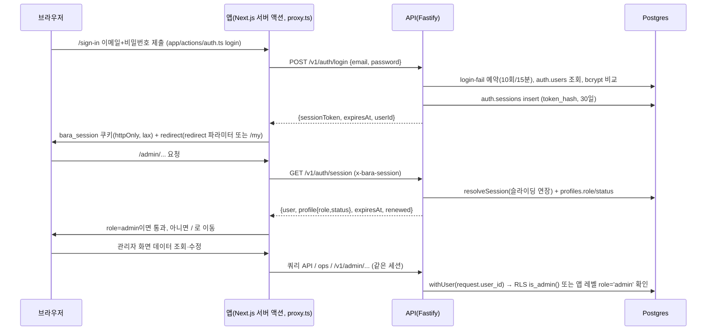
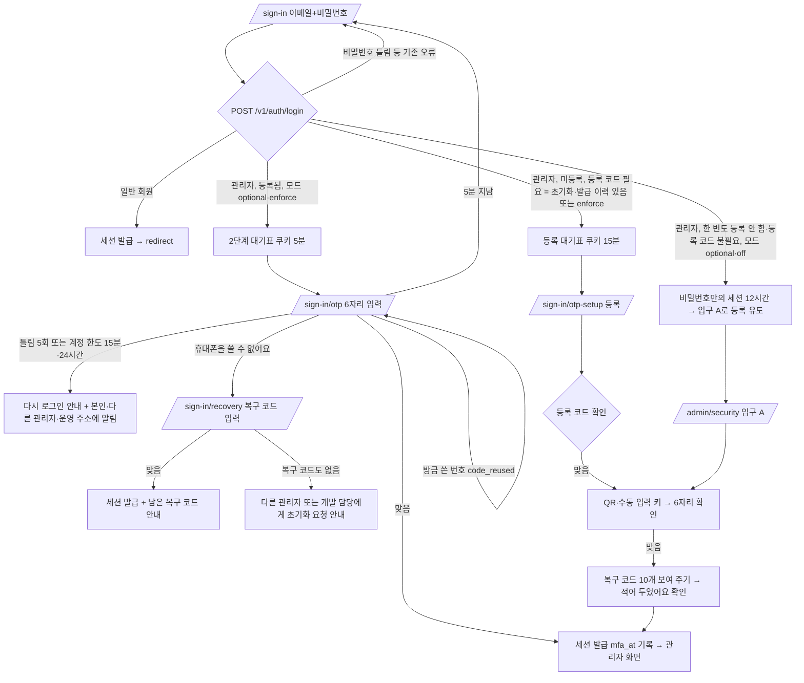

# 관리자 계정 2단계 인증(인증 앱 OTP) 기획서

- 작성일: 2026-11-26
- 작성: service-planner
- 근거: 대표 결정 2026-11-26 "인증 앱(OTP) 지금 기획". Google Authenticator 같은 인증 앱의 6자리 번호(TOTP, RFC 6238)를 쓴다.
- 배경: 개인정보·보안 점검 I-3. 지금은 메일함만 장악하면 재설정 링크(`/reset-password`)로 관리자 비밀번호를 바꾸고 관리자 권한까지 얻을 수 있다. 본인 확인 정책은 이메일만이고 휴대폰 본인인증은 하지 않는다(대표 결정 2026-11-26). 이 기능은 "메일함 탈취 = 관리자 탈취"를 끊는 것이 목표다.
- 법적 근거(검토 중): 개인정보의 안전성 확보조치 기준 제6조(접근통제)의 "외부에서 개인정보처리시스템에 접속할 때 안전한 인증수단 적용". 변호사 확인을 기다린다. 이 문서는 법적 의무 여부와 관계없이 보안 목적만으로도 성립하게 설계했다. 같은 조의 자동 접속 차단(일정 시간 미사용 시) 요구 여부도 함께 확인 요청한다(질문 2).
- 상태: **API 구현 완료(2026-11-26, 브랜치 `feat/admin-totp`, 배포 전 qa-reviewer·privacy-security-officer 리뷰 대기)**. 구현 결정은 4.11, 구현 상태는 9.5. 이전 상태: 구현 준비 완료(2026-11-26 갱신). 대표 결정(Q1~Q6), 문구(`bara-edu-lms.admin-totp-copy.md`), 디자인 스펙(T-0~T-13), privacy-security-officer 설계 점검(`bara-edu-lms.admin-totp-security-review.md`, 조건부 승인)의 Important I-1~I-8과 Minor M-1~M-11을 모두 반영했다. 반영한 자리에는 "(보안 점검 I-n 반영)" / "(보안 점검 M-n 반영)"을 붙였다. 반영 목록은 1.2, 문구·디자인 미결 사항의 결정은 1.3에 있다. 문서만 바꿨고 코드는 바꾸지 않았다.
- 다음 단계: backend-developer(4장 API 계약을 이 문서대로 확정, 바꿀 것이 있으면 이 문서를 먼저 고친다) → frontend-developer → qa-reviewer → privacy-security-officer 구현 뒤 코드 점검 → 배포. **인증 정보(비밀 키·복구 코드)를 새로 다루므로 privacy-security-officer 점검 없이 배포하지 않는다.**
- 구현 기준: backend·frontend developer는 이 문서 하나로 구현한다. 2장(규칙) → 4장(API 계약) → 9장(바꿀 파일) 순서로 읽는다. 2장과 4장이 어긋나면 4장이 아니라 **2장의 규칙**이 기준이며, 어긋남을 발견하면 service-planner에게 알린다.
- 문구: 이 문서의 문구는 초안이다. 최종 문구는 ux-writer가 정한다. 말투는 `bara-edu-lms.signup-enumeration-copy.md`(쉬운 `~해요`체, 이모지·느낌표 없음, 사용자를 탓하지 않기)를 따른다.
- 용어: 화면에서는 "2단계 인증", "인증 앱", "6자리 번호", "복구 코드"라고 쓴다. "TOTP", "OTP", "시크릿"은 화면에 쓰지 않는다.

---

## 0. 현재 구조 (코드 확인 결과)

### 0.1 로그인부터 관리자 화면까지



### 0.2 확인한 사실

| 항목 | 확인한 내용 | 위치 |
|---|---|---|
| 로그인 API | `POST /v1/auth/login {email, password}`. IP `login-ip` 50회/15분, 이메일 `login-fail` 10회/15분(성공하면 이번 예약을 풀어 준다). 성공하면 곧바로 세션을 만든다. 역할(role)은 보지 않는다 | `api/src/auth/routes.ts` 125~133행, `api/src/auth/service.ts` `login` 124~156행 |
| 세션 | 32바이트 무작위 토큰, `auth.sessions`에 SHA-256 해시만 저장. 기본 30일(`SESSION_TTL_DAYS`), 남은 기간이 절반 아래면 30일로 다시 늘린다(슬라이딩). 세션에 "어떻게 로그인했는지" 정보가 없다 | `api/src/auth/sessions.ts`, `api/src/config.ts` 61행, `api/db/01-auth.sql` 16~21행 |
| 세션 확인 | 모든 API 요청의 `onRequest` 훅이 `x-bara-session`을 `resolveSession`으로 풀어 `req.auth.userId`를 채운다. 역할·로그인 방식은 보지 않는다 | `api/src/http/guard.ts` |
| 세션을 만드는 곳 | (1) 로그인 성공, (2) 가입 마무리(`/v1/auth/signup-link/complete`, 미인증 계정만) 두 곳뿐이다. 재설정 성공은 세션을 만들지 않고 모든 세션을 지운다 | `service.ts`, `signup-link.ts`, `service.ts` `resetPassword` |
| 앱 쿠키 | `bara_session`(httpOnly, `sameSite=lax`, 운영 secure). 로그인 서버 액션이 `safeRedirect`로 검증한 경로로 보낸다(기본 `/my`) | `lib/db/auth.ts` `login`, `app/actions/auth.ts` 167~192행 |
| proxy 관리자 판단 | `/admin`으로 시작하는 경로에서 `GET /v1/auth/session`의 `profile.role !== 'admin'`이면 `/`로 보낸다. 세션이 죽었으면(401 `unauthenticated`) 쿠키를 지우고 `/sign-in?redirect=` | `proxy.ts` 66~98행 |
| 관리자 레이아웃 | proxy와 별도로 레이아웃에서 role을 다시 확인한다(이중 방어) | `app/(admin)/layout.tsx` |
| 관리자 권한 판단(DB) | `is_admin()` = `profiles.role = 'admin'` (`auth.uid()` = 트랜잭션의 `request.user_id`). 거의 모든 RLS 정책이 이것에 의존한다 | `api/db/02-schema.sql` 203~213행 |
| 관리자 권한 판단(앱 레벨) | `/v1/admin/...`은 `requireAdmin`(=`is_admin()`), ops는 각자 `select role from profiles`로 확인 | `routes.ts` 179~191행, `api/src/ops/admin-profile.ts` 80~84행 등 |
| 결론 | **관리자 권한은 "세션의 주인이 role=admin인가" 하나로만 정해진다.** 세션이 비밀번호만으로 발급되므로, 2단계 인증은 반드시 **세션 발급 시점(API)** 과 **세션 확인 시점(API guard)** 에 걸어야 한다. 앱 화면(proxy)에만 걸면 쿼리 API를 직접 부르는 경로가 남는다 |
| 역할 값 | `user_role`은 `learner`, `admin` 두 개뿐. `profiles.status`는 `active`/`withdrawn`. 관리자 지정·해제는 DB에서 직접 한다(화면 없음) | `02-schema.sql` 17·74~82·446~453행, `app/(admin)/admin/operators/page.tsx` 12~14행 |
| 재설정 | 재설정 링크 성공 시 비밀번호 변경, 모든 세션 삭제, 모든 메일 토큰 무효, `login-fail` 기록 삭제. 관리자 계정이면 같은 트랜잭션에서 `admin_access_logs`에 `action='비밀번호재설정'`, `detail='재설정 메일 링크'`, `admin_id=target_user_id=본인`, IP를 남긴다 | `service.ts` 183~217행 (`ADMIN_RESET_ACTION`) |
| 접속 기록 | `admin_access_logs(admin_id not null → profiles, target_user_id, action text, detail text, ip_address, created_at)`. update·delete 정책 없음, 2년 뒤 자동 삭제. action 값은 공백 없는 한국어(`조회`, `수정`, `정보수정`, `비밀번호재설정`) | `02-schema.sql` 1697~1717행 |
| 비밀 값 관리 | 서비스 키를 SSM Parameter Store(`/bara-edu/api/service-key`, SecureString, 인스턴스 역할)에서 `WithDecryption`으로 시작할 때 읽는다(`BARA_SERVICE_KEY_PARAM`). 읽기 실패·32바이트 미만이면 시작을 거절한다. 같은 방식으로 새 키를 늘릴 수 있다 | `api/src/secrets.ts`, `api/README.md` 76행 |
| 메일 | SES. `confirm`, `recovery`, `already_registered`, `password_changed`, `profile_changed` 템플릿. `deliver()`는 응답 뒤에 큐로 보내고 기다리지 않는다 | `api/src/mail/ses.ts`, `routes.ts` 62~66행 |
| `auth` 스키마 | `bara_edu_service` 소유. 관리자 쿼리 API(RLS 경유)로는 읽을 수 없다. 2단계 인증 데이터는 이 스키마에 둔다 | `api/db/01-auth.sql` |

---

## 1. 핵심 설계 (한눈에)

1. **대상**: `profiles.role = 'admin'`인 모든 계정. 선택이 아니라 필수다. 일반 회원(learner)에게는 이번에 제공하지 않는다(질문 6).
2. **세션은 2단계를 통과한 뒤에만 만든다.** 관리자는 비밀번호가 맞아도 세션 대신 5분짜리 "2단계 대기표(challenge)"를 받는다. 6자리 번호(또는 복구 코드)를 맞혀야 세션이 생긴다. 예외는 유예(`optional`)·비상(`off`) 모드의 "한 번도 등록한 적 없고 등록 코드도 요구되지 않는 관리자"뿐이다(2.14).
3. **두 번째 방어선**: 세션에 `mfa_at`(2단계 통과 시각)을 기록하고, API guard가 "role=admin인데 `mfa_at`이 비어 있는 세션"을 죽은 세션으로 취급한다(모드별 규칙은 2.3). 도입 전에 만든 세션, 로그인 중에 관리자로 승격된 계정, 가입 마무리로 생긴 세션이 모두 이 규칙으로 막힌다.
4. **비밀번호 재설정은 2단계 인증을 건드리지 않는다.** 메일함을 가진 공격자는 비밀번호는 바꿀 수 있어도 인증 앱이 없어 세션을 받지 못한다. **메일로 2단계 인증을 해제·초기화하는 경로는 어디에도 만들지 않는다.**
5. **복구**: (1) 등록 때 받는 복구 코드 10개(1회용), (2) 다른 관리자의 "2단계 인증 초기화"(본인 6자리 번호로 재확인), (3) 관리자가 한 명뿐이면 개발 담당의 DB 직접 작업(정해진 명령, 접속 기록 필수). 초기화된 계정은 **등록 코드**(다른 관리자 또는 개발 담당이 전화·대면으로 전달)가 있어야 다시 등록할 수 있다(질문 1). **이 규칙은 운영 모드와 상관없이 적용한다**(보안 점검 I-1 반영).
6. **비밀 키 저장**: 인증 앱 비밀 키는 AES-256-GCM으로 암호화해 `auth` 스키마에 둔다. 암호화 키는 기존 방식 그대로 SSM Parameter Store SecureString에서 시작할 때 읽는다. 암호문과 HMAC에는 모두 키 버전을 붙인다(보안 점검 I-5 반영).
7. **재사용 방지**: 마지막으로 받아 준 30초 칸(time step)을 저장하고, 그 칸 이하의 번호는 다시 받지 않는다. 재사용은 `code_reused`로 따로 알려 준다(1.3).
8. **시도 제한**: 대기표당 5회, 계정당 10회/15분 **+ 24시간 30회**, IP당 50회/15분. 계정 한도에 걸리면 본인과 다른 관리자·운영 주소에 알린다(보안 점검 I-6·I-7 반영).
9. **세션 기억**: "이 기기 기억하기"는 두지 않는다. 로그인할 때마다 6자리 번호를 묻는다. 관리자 세션은 최대 12시간(연장 없음) + 1시간 미사용 시 만료이며, **모든 모드에서 매 요청마다** 판정한다(보안 점검 I-2 반영).
10. **보안 알림은 메일함 한 곳에만 보내지 않는다**: 같은 내용을 다른 활성 관리자 전원과 운영 주소(`ADMIN_SECURITY_ALERT_TO`)에도 보낸다(2.13, 보안 점검 I-6 반영).
11. **운영 모드는 운영에서 반드시 명시한다**: `ADMIN_MFA_MODE`가 없거나 `off`/`optional`/`enforce`가 아니면 API가 시작하지 않는다(2.14, 보안 점검 I-3 반영).

### 1.1 전체 흐름



(보안 점검 I-1 반영) 로그인 중 등록(C2)은 **항상 등록 코드 단계를 거친다.** 등록 코드 없이 등록할 수 있는 것은 입구 A(이미 받은 비밀번호 세션, 한 번도 등록한 적 없고 등록 코드도 요구되지 않는 계정)뿐이다.

### 1.2 보안 점검 반영 목록

`bara-edu-lms.admin-totp-security-review.md`(2026-11-26, 조건부 승인)의 지적과 이 문서에서 반영한 자리. 배포 게이트 "I-1~I-8을 API 계약·기획서에 반영"은 이 표로 확인한다.

| # | 지적 요약 | 결정 | 반영한 곳 |
|---|---|---|---|
| I-1 | 유예·롤백 모드에서 초기화된 계정이 등록 코드 없이 재등록 | 입구 A는 **한 번도 등록한 적 없고 등록 코드도 요구되지 않는 계정**에만, 모든 모드에서. `auth.mfa_account_state.ticket_required_at`으로 판단 | 1.1, 2.4, 2.7, 2.11, 2.14, 4.1, 4.4, 7.3 |
| I-2 | 도입 전 세션·입구 A 승격 세션이 30일 수명 유지 | `optional` 시작 때 관리자 세션 전부 삭제(시작 시 자동), 입구 A 확정 때 새 세션 발급, 12시간·1시간을 모든 모드에서 매 요청 판정, "사용"의 정의(M-1) | 2.3, 2.4, 2.14, 4.4, 4.9, 5.4, 7.1 |
| I-3 | `ADMIN_MFA_MODE` 기본값 미정(fail-open) | 운영에서 값이 없거나 세 값이 아니면 시작 거절. 시작 로그, `enforce`가 아니면 경고 로그 + 관리자 배너, 모드 변경은 대표 승인 기록 의무 | 2.14, 3.7, 4.5, 7.1, 7.3, 9.1 |
| I-4 | 휴대폰 분실 뒤 새 휴대폰 등록 수단 없음 | 인증 앱 바꾸기(입구 C)는 **지금 6자리 또는 아직 쓰지 않은 복구 코드 1개**로 재확인. 세션만으로는 불가 | 2.4, 2.7.1, 3.3, 3.5, 4.4 |
| I-5 | 키 교체 시 복구 코드 HMAC 재계산 불가 | 복구 코드·등록 코드 HMAC에 `key_version`, 옛 키는 읽기용으로 유지, HKDF info에 용도·버전, 교체 주기 연 1회·유출 의심 즉시 | 2.4, 2.6, 2.11, 9.1 |
| I-6 | 경보 메일이 탈취됐을 수 있는 메일함으로만 감 | 본인 + **다른 활성 관리자 전원** + `ADMIN_SECURITY_ALERT_TO`(환경 변수, 하드코딩 없음). 둘 다 없으면 본인 메일만 보내고 그 사실을 접속 기록(`alert=self_only`)에만 남긴다. 관리자 대시보드 "최근 7일 보안 이벤트" | 2.5, 2.9, 2.10, 2.13, 3.8, 4.8 |
| I-7 | 15분 한도만으로는 장기 추측 공격을 못 막음 | 계정당 **24시간 30회** 추가(24시간 잠금), 재확인 실패도 `mfa-fail`로 셈, CLI `mfa-unlock` | 2.7.3, 2.9, 2.10, 4.2 |
| I-8 | 강제 전 점검이 "본인 등록인지" 확인 안 함 | `mfa-report`에 등록 일시·IP·경로, 최근 로그인 IP 출력, 대표가 행마다 확인. 본인이 안 한 `already_enrolled`는 사고 처리 | 2.7.3, 2.11, 5.2, 7.1, 7.2 |
| M-1 | 미사용 판정의 "사용" 정의 | 관리자 화면 이동(앱이 표시한 요청)과 관리자 API만. 갱신은 1분에 1회 | 2.3 |
| M-2 | 대기표·등록 대기·등록 코드 묶기 | `enrollment.challenge_hash`, 등록 코드 `enrollment_id`·`verified_at`, `used_at`은 confirm 트랜잭션. verify는 role·등록·모드 재확인 | 2.11, 4.2, 4.4 |
| M-3 | 등록 코드 SHA-256 저장은 DB 유출 시 즉시 역산 | HKDF `enroll-ticket` 하위 키 HMAC + `key_version` | 2.6, 2.11 |
| M-4 | AAD에 용도 없음 | AAD = `user_id`·`key_version`·용도(`factor`/`enrollment`), 확정 때 새 IV로 재암호화 | 2.6 |
| M-5 | CLI 흔적이 사람 기록에만 의존 | SSM Session Manager 접속·세션 기록, `mfa-ticket`은 등록된 계정 거절, `--reason` 고정 키 | 2.7.3 |
| M-6 | 운영에서 평문 키 환경 변수 허용 | 운영은 SSM 파라미터만, 평문 키 변수가 있으면 시작 거절, 정확히 32바이트, `auth.mfa_key_check` | 2.6 |
| M-7 | 마스터 키 오프라인 사본 | 두지 않는다. IAM `ssm:DeleteParameter` 거부, KMS 삭제 대기 기간 | 2.6, 7.2 |
| M-8 | 복구 코드 로그인 세션 표시 칸 없음 | `auth.sessions.mfa_method` | 2.3, 2.11 |
| M-9 | 재사용 응답이 오라클이 되지 않게 | 재사용 판정은 ±1칸 안에서 맞은 칸이 `last_used_step` 이하일 때만. 3칸 모두 상수 시간 비교 | 2.8 |
| M-10 | 처리방침 접속 기록 1년 문구 | **이미 해결.** 처리방침 v9(2026-11-26 게시)가 2년으로 적었다. 남은 개정은 6장 | 6 |
| M-11 | [파일로 받기] 서버 URL 위험 | [파일로 받기]를 아예 뺀다(1.3) | 2.4, T-5.4 |

### 1.3 문구·디자인 미결 사항 결정 (2026-11-26)

카피 문서 10장과 디자인 스펙 T-12의 미결 사항을 아래처럼 정했다. 문구가 바뀌는 것은 카피 문서에도 반영했다.

| # | 사항 | 결정 | 반영 |
|---|---|---|---|
| D1 | 방금 쓴 번호(카피 10-1) | 재사용은 `wrong_code`와 다른 오류 **`code_reused`**(403, 실패 횟수 안 셈)로 준다. 화면은 "방금 쓴 번호예요" 문구(MFA-LOGIN-ERR-USED 등)를 쓴다. FALLBACK 문구는 쓰지 않는다. 판정 범위는 M-9로 제한해 오라클을 막는다 | 2.8, 4.2, 카피 1.4·2.2 |
| D2 | 초기화 여부 표시(카피 10-2) | 로그인 응답 `enroll_required`에 **`enrollReason: "first" \| "reset"`**을 넣는다. `reset`이면 MFA-REENROLL-* 문구 | 4.1, 카피 3 |
| D3 | 자동 로그아웃 이유(카피 10-3) | 401에 **`reason: "max" \| "idle"`**을 싣고, proxy가 `/sign-in?redirect=…&ended=max\|idle`로 넘긴다. 로그인 화면은 MFA-SESSION-MAX/IDLE를 쓴다. 이유를 모르면 기존 배너 그대로. 기존 배너 문구("세션이 만료되었어요") 변경은 이번 범위 밖(후속) | 2.3, 4.9, 9.2, 카피 6 |
| D4 | 관리자 메일 문의처(카피 10-4) | 별도 관리자 연락처가 생기기 전까지 **공통 문의처 블록(`SUPPORT_PHONE`·`SUPPORT_HOURS`)을 그대로** 쓴다. 관리자 전용 연락처는 후속 과제 → 2026-11-27 반영: 서버 설정 `ADMIN_CONTACT_PHONE`이 있으면 관리자 메일만 `관리자 문의(개발 담당) 전화: …` 한 줄로 바꾼다(카피 7.0) | 4.8, 카피 7.0 |
| D5 | `mfa_locked` 메일 주소(카피 10-5) | **링크·주소 없이 글로만** 안내한다(화면의 버튼 이름) | 4.8, 카피 7.4 |
| D6 | 인쇄 안내지 이름(카피 10-6) | 관리자 **이름은 인쇄하고 이메일은 인쇄하지 않는다** | T-5.4, 카피 8 |
| D7 | 복구 코드 재발급 메일(카피 10-7) | 보내지 않는다(카피 7.0 제안 채택). 접속 기록 `복구코드재발급`과 3.8 보안 이벤트 카드로 확인한다 | 4.8 |
| D8 | 유예 배너 N(카피 10-8) | `graceUntil`은 **ISO 8601 시각**(예: `2026-12-03T00:00:00+09:00`, 서울 0시로 둔다). N = ⌈(graceUntil − 지금) / 24시간⌉. 날짜 `{date}`는 서울 기준으로 쓴다. N ≤ 0이면 MFA-BANNER-GRACE-0 | 2.14, 4.5, 카피 5 |
| D9 | 복구 코드 [파일로 받기](T-12 #1) | **뺀다**(디자이너 안). 인쇄·복사·손으로 적기만 | 2.4, 3.4, 카피 1.5 |
| D10 | [초기화] 버튼 색(T-12 #3) | **인디고**(`ADMIN_PRIMARY_BTN`), 위험은 경고 상자로(디자이너 안) | T-0 #7, 카피 4.2 |
| D11 | 미등록 대상의 초기화 버튼(T-12 #4) | 같은 API. 대상이 미등록·초기화됨이면 버튼 문구를 "등록 코드 만들기"로(MFA-RESET-BTN-TICKET) | 3.6, 카피 4.1 |
| D12 | 인쇄가 안 되는 브라우저(T-12 #6) | [인쇄]를 숨기고 MFA-RC-PRINT-ALT(종이에 적기 안내) | 카피 1.5 |
| D13 | 관리자 화면의 큰 코드 글씨(T-12 #7), 진행 표시 단계 수(T-12 #8) | 디자이너 안대로(예외 허용, 입구별 계산) | T-0 #2, T-5.0 |

---

## 2. 핵심 설계 (상세)

### 2.1 대상

| 계정 | 2단계 인증 | 비고 |
|---|---|---|
| `role='admin'`, `status='active'` | **필수.** 등록 전에는 세션을 받을 수 없다(강제 시작 이후, 7장) | 관리자도 강좌 수강 등 일반 회원 기능을 같은 계정으로 쓰지만, 로그인 자체가 2단계를 거치므로 구분하지 않는다 |
| `role='admin'`, `status='withdrawn'` | 해당 없음 | 기존대로 proxy가 세션을 끊는다. 탈퇴 시 2단계 인증 데이터도 지운다(2.11) |
| `role='learner'` | 없음 | 로그인 흐름·응답 변화 없음 |
| learner → admin 승격(DB 직접) | 승격 즉시 필수 | 승격 전 세션은 `mfa_at`이 없고 12시간을 넘었을 가능성이 높아 guard가 끊는다(2.3). 승격 작업 때 CLI `mfa-ticket`으로 등록 코드를 함께 발급하므로, 유예 모드에서도 입구 B(등록 코드)로만 등록한다(보안 점검 I-1 반영) |
| admin → learner 강등 | 2단계 인증 데이터 삭제 | 강등 작업 절차에 포함(2.7.4). 남아 있어도 learner 로그인에는 쓰지 않는다. `ticket_required_at`은 남겨 다시 승격되면 등록 코드가 필요하다 |

### 2.2 로그인 흐름과 단계 사이의 상태

**원칙: 비밀번호 단계는 세션을 만들지 않는다. 단계 사이에는 "2단계 대기표"만 들고 간다.**

| 항목 | 정의 |
|---|---|
| 발급 시점 | `POST /v1/auth/login`에서 비밀번호가 맞고, 계정이 인증 완료이고, `role='admin'`일 때. 세션 대신 대기표를 준다. 모드·계정 상태별 분기는 아래 "로그인 분기" 표 |
| 대기표 형식 | 32바이트 무작위(base64url). DB(`auth.mfa_challenges`)에는 SHA-256 해시만 저장(32바이트 무작위라 HMAC 불필요, 보안 점검 M-3). `purpose`: `verify`(등록된 관리자) / `enroll`(미등록 관리자, 등록 코드 필요) |
| 유효 시간 | `verify` 5분, `enroll` 15분(앱 설치·QR 촬영 시간을 고려). 1회용: 세션을 발급하면 즉시 `used_at` |
| 실패 횟수 | 대기표마다 `fail_count`. 5회 틀리면 대기표 폐기 → 비밀번호부터 다시 |
| 묶는 정보 | `user_id`, 발급 IP(기록용. IP가 바뀌어도 막지는 않는다: 모바일 망 전환이 잦다) |
| 브라우저 보관 | 앱이 httpOnly 쿠키 `bara_mfa`(secure, `sameSite=lax`, `path=/`, Max-Age = 대기표 남은 시간)로 보관한다. URL·hidden 필드·localStorage에 넣지 않는다. 이메일도 다음 화면으로 넘기지 않는다 |
| 2단계 성공 | 앱이 `bara_mfa`를 지우고 `bara_session`을 쓴다. 이동할 곳은 로그인 때의 `redirect` 값(경로만, `/sign-in/otp?redirect=`로 넘기고 마지막 단계에서 `safeRedirect`로 다시 검사). 없으면 관리자는 `/admin` |
| 비밀번호 실패 한도와의 관계 | 비밀번호가 맞으면 지금처럼 `login-fail` 예약을 풀어 준다. 6자리 번호는 별도 한도(2.9)로 센다 |
| 이메일 열거 | 관리자라는 사실(대기표 응답)은 **비밀번호가 맞은 사람에게만** 드러난다. 비밀번호가 틀리면 지금과 같은 `invalid_credentials` |
| JS 없이 | 모든 단계가 `<form action>` 서버 액션으로 동작한다(인앱 브라우저 대비, 기존 인증 화면과 같은 방식) |

로그인 분기(비밀번호가 맞은 `role='admin'` 계정, 보안 점검 I-1·I-3 반영). "등록 코드 필요"는 `auth.mfa_account_state.ticket_required_at is not null`(2.11)이다. 한 번이라도 등록했거나, 초기화됐거나, 등록 코드가 발급된 적이 있으면 설정되고 **지워지지 않는다**(등록이 확정돼도 남긴다. 다시 초기화되면 곧바로 입구 B가 되게).

| 계정 상태 | `off` | `optional` | `enforce` |
|---|---|---|---|
| 등록됨(`mfa_factors` 있음) | 세션(비밀번호만, `mfa_at` 없음, 12시간) | `mfa: "required"` 대기표 | `mfa: "required"` 대기표 |
| 미등록, 등록 코드 필요 | `mfa: "enroll_required"` 대기표 | `mfa: "enroll_required"` 대기표 | `mfa: "enroll_required"` 대기표 |
| 미등록, 등록 코드 불필요(한 번도 등록·초기화·발급 이력 없음) | 세션(비밀번호만, 12시간) | 세션(비밀번호만, 12시간) → 입구 A | `mfa: "enroll_required"` 대기표. 이때 등록 코드가 없으므로 CLI `mfa-ticket`으로 발급받아야 한다 |

- `off`에서도 "등록 코드 필요" 계정은 세션을 받지 못한다. `off`는 6자리 검증 버그용 비상 모드이며(7.3) 초기화된 계정을 비밀번호만으로 열어 주는 수단이 아니다.
- `enforce`의 "미등록, 등록 코드 불필요" 칸에 해당하는 계정이 생기는 경우는 강제 전 점검(7.1)을 빠뜨렸거나 DB에서 바로 승격한 경우뿐이다. 이때 `mfa_account_state` 행이 없으면 로그인 시 `ticket_required_at = now()`로 만든다(이후 유예로 되돌려도 입구 A가 열리지 않게).

대기표를 쿠키에 두는 이유: hidden 필드는 HTML·브라우저 기록·확장 프로그램에 남을 수 있고, URL은 접근 로그·Referer로 샌다. httpOnly 쿠키는 스크립트가 읽지 못하고 5분 뒤 스스로 사라진다. 대기표만으로는 아무 권한도 없고(6자리가 있어야 함) 5회 실패로 폐기되므로 탈취돼도 피해가 작다.

### 2.3 세션 단위 기억: 두 번째 방어선

| 항목 | 정의 |
|---|---|
| 세션 컬럼 추가 | `auth.sessions.mfa_at timestamptz null`(2단계 통과 시각), `mfa_method text null check (mfa_method in ('totp','recovery','enroll'))`(어떻게 통과했는지, 보안 점검 M-8 반영), `created_at timestamptz not null default now()`(이미 있으면 그대로), `last_seen_at timestamptz not null default now()`. 2단계(번호·복구 코드·등록 확정)를 통과해 만든 세션만 `mfa_at`·`mfa_method`를 가진다 |
| guard 규칙(`mfa_at`) | `resolveSession`이 세션 주인의 `profiles.role`, `mfa_factors` 존재 여부, `mfa_account_state.ticket_required_at`을 한 번에 읽는다. `role='admin'`이고 `mfa_at is null`인 세션은 모드별로: **`enforce`** 항상 죽은 세션. **`optional`** "미등록이고 등록 코드 불필요"(2.2 로그인 분기)일 때만 살리고 그 밖에는 죽은 세션. **`off`** 살린다. 죽은 세션은 `userId=null`로 처리하고 그 행을 지운다(이유 `mfa_required`). 앱은 기존 규칙(401 `unauthenticated` = 죽은 세션)대로 쿠키를 지우고 로그인으로 보낸다 |
| guard 규칙(수명, 보안 점검 I-2 반영) | `role='admin'`인 세션은 **모든 모드에서, 매 요청마다** 판정한다. `now() >= created_at + 12시간`이면 이유 `max`, `now() >= last_seen_at + 1시간`이면 이유 `idle`로 죽은 세션(행 삭제). 두 조건이 동시면 `max`. 관리자 세션은 슬라이딩 연장(`sessions.ts`의 절반 규칙)을 하지 않고 `renewed=false`, `expires_at = created_at + 12시간`으로 만든다. 승격으로 관리자가 된 30일 세션도 이 규칙으로 판정되므로 `created_at`이 12시간을 넘었으면 바로 끊긴다. learner 세션은 지금과 같다 |
| "사용"의 정의(보안 점검 M-1 반영) | `last_seen_at`은 아래 요청에서만 갱신한다. (1) 앱 proxy가 `/admin`으로 시작하는 화면 요청에서 `GET /v1/auth/session`을 부를 때 헤더 `x-bara-activity: admin`을 붙인 경우. 단 프리페치(`next-router-prefetch: 1` 또는 `purpose: prefetch`·`sec-purpose: prefetch` 헤더)는 붙이지 않는다. (2) `/v1/admin/*`, 관리자 전용 ops(`/v1/op/:name` 중 role 확인을 하는 것), `/v1/query`의 쓰기 요청, `/v1/auth/mfa/*`의 세션 요청. 공개 페이지·`/my`·`/learn` 화면 요청과 `/v1/query` 읽기는 "사용"이 아니다. 쓰기 부하를 줄이려고 `last_seen_at < now() - 1분`일 때만 갱신한다. 판정(위 행)은 갱신 **전에** 한다 |
| 만료 이유 전달(1.3 D3) | guard가 이번 요청에서 세션을 지운 이유를 `req.auth.endedReason`(`max` \| `idle` \| `mfa_required` \| null)에 담는다. `GET /v1/auth/session`의 401 본문에 `reason`으로 싣는다(`max`·`idle`만, 그 밖에는 생략). 행을 지웠으므로 이유는 그 한 번의 응답에만 실린다. 동시 요청 등으로 놓치면 앱은 기존 만료 배너를 쓴다 |
| 막아 주는 경우 | (1) 도입 전에 비밀번호만으로 만든 관리자 세션, (2) 로그인해 있는 동안 관리자로 승격된 계정, (3) 가입 마무리 경로로 생긴 세션, (4) 앞으로 누가 실수로 세션 발급 경로를 하나 더 만드는 경우, (5) 유예 중 초기화된 계정의 남은 비밀번호 세션 |
| 비용 | 요청마다 `profiles`·`mfa_factors`·`mfa_account_state` 조인 1회 추가(기본 키 조회). 대상 관리자가 소수라 영향은 작다. backend-developer가 실측 |
| "이 기기 기억하기" | **두지 않는다.** 관리자는 소수이고, 기기 기억 쿠키는 기기 도난·공용 PC 위험을 되살린다 |
| 관리자 세션 기간 | **최대 12시간(연장 없음) + 1시간 미사용 시 만료**(대표 결정 Q2). 위 수명 규칙으로 구현한다. 앱 쿠키 만료는 로그인 응답의 `expiresAt`(= 발급 + 12시간)을 그대로 쓴다. 30분으로 줄이는 것은 회원 정보 대량 조회 화면이 늘면 검토(보안 점검 5장) |
| 모드 전환 때 세션 정리(보안 점검 I-2 반영) | 2.14 "모드 전환" 참고. 처음 `optional`로 시작하는 순간 기존 관리자 세션은 모두 지워진다 |

### 2.4 등록 흐름 (QR, 확인 번호, 복구 코드)

등록은 세 입구가 있다. 화면 단계는 같고, "누가 등록을 허락했는가"만 다르다.

| 입구 | 언제 | 허락 근거 |
|---|---|---|
| A. 관리자 화면 안에서 | `optional`·`off` 모드에서 비밀번호만의 세션을 받은 관리자. `/admin/security` | 기존 세션(비밀번호만). **한 번도 등록한 적 없고 등록 코드도 요구되지 않는 계정(`mfa_factors` 없음, `ticket_required_at is null`)에만, 모든 모드에서** 허용한다(보안 점검 I-1 반영). 이 조건이면 그 계정은 처음부터 비밀번호만으로 관리자였으므로 오늘의 위험보다 나빠지지 않는다. `optional` 시작 때 기존 세션을 모두 지우므로(2.14) 입구 A의 세션은 유예 시작 뒤 새로 로그인해 받은 12시간 세션뿐이다(보안 점검 I-2 반영). **확정되면 그 세션과 같은 사용자의 다른 세션을 모두 지우고 새 관리자 세션(`mfa_method='enroll'`, 12시간)을 발급한다.** 기존 세션에 `mfa_at`을 채우지 않는다 |
| B. 로그인 중 | 로그인 분기(2.2)에서 `enroll_required`를 받은 관리자. `/sign-in/otp-setup` | `enroll` 대기표 + **등록 코드**(질문 1). 등록 코드는 다른 관리자의 초기화(2.7.2) 또는 개발 담당의 CLI(2.7.3)로만 생긴다. 모드와 상관없이 같다 |
| C. 인증 앱 바꾸기 | 등록된 관리자가 새 휴대폰으로 옮길 때, 또는 휴대폰을 잃고 복구 코드로 로그인한 뒤. `/admin/security` | 현재 세션 + **지금 인증 앱의 6자리 번호 또는 아직 쓰지 않은 복구 코드 1개**(보안 점검 I-4 반영). 복구 코드는 이 재확인이 성공하는 순간 쓴 것으로 처리한다(`used_at`). 세션만으로는 바꿀 수 없다. 복구 코드가 0개이고 휴대폰도 없으면 바꿀 수 없으며 다른 관리자의 초기화를 안내한다. 재확인 실패는 `mfa-fail`로 센다(2.9). 새 등록을 확인하기 전까지 옛 등록은 그대로 둔다. 확정되면 같은 사용자의 다른 세션을 지운다(지금 세션은 유지하고 `mfa_method`는 바꾸지 않는다) |

단계:

1. **준비 안내**: 인증 앱을 설치하라는 안내. 권장 앱 이름(질문 5)과 "이미 설치했어요" 버튼. 앱 스토어 링크는 공식 스토어 주소만.
2. **(입구 B만) 등록 코드 입력**: 8자리 숫자. 맞으면 다음 단계.
3. **QR 보여 주기**: API가 새 비밀 키(20바이트)를 만들고 "등록 대기" 상태로 암호화해 저장(10분, AAD 용도 `enrollment`, 보안 점검 M-4 반영). 등록 대기는 로그인 중이면 그 대기표(`challenge_hash`)에, 세션 입구면 그 세션 사용자에 묶는다(보안 점검 M-2 반영). 사용자당 유효한 등록 대기는 1개이며, 새로 만들면 이전 것은 지운다. 앱 서버가 `otpauth://totp/바라평생교육원:{email}?secret=...&issuer=바라평생교육원&digits=6&period=30&algorithm=SHA1` 주소를 **서버에서 QR 이미지(SVG)로 그린다.** 외부 QR 생성 서비스는 쓰지 않는다(비밀 키가 외부로 나간다).
   - 같은 휴대폰으로 화면을 보고 있으면 QR을 찍을 수 없다. 그래서 (a) 수동 입력 키(4글자씩 띄어 쓴 32진 문자, [복사] 버튼), (b) "이 휴대폰의 인증 앱에 바로 추가" 링크(`otpauth://`, 지원하는 앱에서만 열림)를 함께 준다.
   - 화면 캐시 금지(`no-store`), 검색 제외(`noindex`), Referer 금지.
4. **확인 번호 입력**: 인증 앱에 뜬 6자리를 입력. 맞으면 등록 확정(`confirmed_at`), 그 30초 칸을 "마지막 사용"으로 기록(2.8). 확정 때 비밀 키를 **새 IV, AAD 용도 `factor`로 다시 암호화**해 `mfa_factors`에 넣고 등록 대기 행은 지운다(보안 점검 M-4 반영). 등록 경로(`via`)와 요청 IP를 `mfa_factors`에 남긴다(보안 점검 I-8 반영). `mfa_account_state.ever_enrolled_at`·`ticket_required_at`을 채운다(이미 있으면 그대로). 등록 코드가 있었다면 같은 트랜잭션에서 `used_at`을 찍는다(보안 점검 M-2 반영).
5. **복구 코드 10개 보여 주기**: 한 번만 보여 준다. [인쇄], [복사] 제공. **[파일로 받기]는 두지 않는다**(1.3 D9, 보안 점검 M-11). "복구 코드를 종이에 적거나 인쇄해 안전한 곳에 두었어요" 체크를 해야 [관리자 화면으로] 버튼이 켜진다. 체크하면 앱이 `POST /v1/auth/mfa/recovery-codes/ack`를 불러 서버에 "보관 확인"을 남긴다(M6 배너 조건, 4.5).
6. 입구 B와 입구 A는 이 시점에 새 세션을 발급한다(입구 B: `mfa_method='enroll'`, 대기표 소모. 입구 A: 기존 세션 삭제 후 새 세션, 보안 점검 I-2 반영). 앱은 확정 응답의 세션 토큰으로 쿠키를 쓰고 복구 코드는 서버 액션 결과 상태로만 화면에 그린다. URL·쿠키·로그에 복구 코드를 남기지 않는다.
7. 등록 확정은 보안 알림 `mfa_enrolled`를 본인·다른 관리자·운영 주소로 보낸다(2.13, 보안 점검 I-6 반영).

복구 코드 규칙:

| 항목 | 정의 |
|---|---|
| 개수 | 10개, 각각 1회용 |
| 형식 | 10글자, 헷갈리는 글자(0/O, 1/I/L)를 뺀 대문자+숫자 31종(`23456789ABCDEFGHJKMNPQRSTUVWXYZ`), `ABCDE-FGHJK`처럼 5글자씩 하이픈. 약 49.5비트. `crypto.randomInt`로 글자마다 고른다(모듈로 편향 금지) |
| 저장 | 원문 저장 안 함. HMAC-SHA256(키는 2.6의 `recovery-code` 하위 키) 결과만 `auth.mfa_recovery_codes`에 저장하고, **만들 때 쓴 키 버전을 `key_version`에 함께 저장**한다(보안 점검 I-5 반영). 검증은 행의 `key_version` 키로 계산한다. DB만 유출돼서는 원문을 추측할 수 없게 한다 |
| 소모 | `update auth.mfa_recovery_codes set used_at = now() where user_id = $1 and code_hmac = $2 and used_at is null returning id`로 원자적으로 처리한다(조회 뒤 갱신 금지). 버전이 여럿이면 사용자의 남은 행의 버전 목록마다 HMAC을 계산해 `code_hmac = any($2)`로 한 번에 비교한다 |
| 입력 | 대소문자·하이픈·공백 무시 |
| 다시 받기 | `/admin/security`에서 6자리 번호로 재확인 후 새 10개 발급(현재 키 버전), 옛 코드 전부 삭제 |
| 남은 개수 안내 | 3개 이하이면 관리자 화면 상단에 "복구 코드가 {n}개 남았어요. 새로 받아 두세요" 배너 |

### 2.5 비밀번호 재설정·변경과의 관계

| 동작 | 2단계 인증 데이터 | 이유 |
|---|---|---|
| 재설정 링크로 비밀번호 변경(`/v1/auth/reset-password`) | **그대로 둔다.** 세션 삭제(기존), `login-fail` 삭제(기존)는 유지. **2단계 실패 한도(`mfa-fail`)는 지우지 않는다** | 메일함 주인은 증명됐지만 메일함 탈취가 바로 이 기능이 막으려는 위협이다 |
| 관리자가 다른 사람에게 재설정 메일 발송(`send-reset`) | 그대로 | 위와 같음 |
| 로그인한 상태의 비밀번호 변경(`change-password`) | 그대로 | 이미 2단계를 통과한 세션에서만 가능 |
| 재설정 후 첫 로그인 | 새 비밀번호 + 6자리 번호 | 공격자는 여기서 막힌다 |
| 메일로 2단계 인증 해제 | **만들지 않는다** | 만들면 구멍이 되돌아온다. 화면·메일 어디에도 "메일로 초기화" 문구를 두지 않는다 |
| 재설정 완료 알림 메일 | 관리자 계정이면 `password_changed` 본문에 한 줄 추가(MFA-MAIL-CHANGED-ADMIN-LINE): "2단계 인증은 그대로예요. 로그인할 때 인증 앱의 6자리 번호가 필요해요." | 진짜 주인이 받으면 안심, 본인이 안 바꿨다면 신고 계기 |
| 다른 관리자·운영 주소 알림 | 관리자 계정의 재설정 링크 성공(`비밀번호재설정` 기록이 남는 경우)은 보안 알림 `admin_password_reset`으로 다른 관리자·운영 주소에 보낸다(2.13, 보안 점검 I-6 반영) | 메일함을 장악한 사람은 본인 메일을 지울 수 있다 |
| 접속 기록 | 기존 `비밀번호재설정` 그대로. 다른 수신자가 없으면 `detail`에 `;alert=self_only`를 붙인다(2.13) | — |

### 2.6 비밀 키 저장과 암호화 키 관리

| 항목 | 정의 |
|---|---|
| 저장 위치 | `auth.mfa_factors`(확정된 등록), `auth.mfa_enrollments`(등록 대기, 10분). `auth` 스키마라 관리자 쿼리 API·RLS 경로로는 읽을 수 없다 |
| 암호화 | AES-256-GCM. 암호화할 때마다 새 12바이트 무작위 IV(같은 IV를 다시 쓰는 코드 경로 없음, 재암호화 때도 새 IV). AAD = `"bara-mfa|" + 용도 + "|" + user_id + "|v" + key_version`, 용도는 `factor` 또는 `enrollment`(보안 점검 M-4 반영). 다른 사람의 행이나 다른 테이블로 옮겨 붙여도 풀리지 않는다. 컬럼: `secret_ciphertext bytea`, `secret_iv bytea`, `key_version smallint` |
| 마스터 키 | **기존 SSM Parameter Store 방식 재사용.** SecureString `/bara-edu/api/mfa-key-v1`(32바이트 무작위, base64). 설정: `BARA_MFA_KEY_PARAMS="1=/bara-edu/api/mfa-key-v1"`(버전=파라미터 이름, 쉼표로 여러 개), `BARA_MFA_KEY_CURRENT=1`(새로 암호화·HMAC할 때 쓰는 버전). 시작할 때 목록의 모든 파라미터를 `WithDecryption`으로 읽는다(`secrets.ts`의 `resolveServiceKey`와 같은 패턴, 값·SDK 오류 문구는 로그에 안 남김). 로컬·테스트만 평문 `BARA_MFA_KEYS="1=<base64>"` 허용 |
| 운영 제약(보안 점검 M-6 반영) | `NODE_ENV=production`에서 (1) `BARA_MFA_KEYS`가 있으면 시작 거절, (2) `BARA_MFA_KEY_PARAMS`가 없거나 `BARA_MFA_KEY_CURRENT`가 목록에 없으면 시작 거절, (3) 어느 키든 base64를 풀어 **정확히 32바이트**가 아니면 시작 거절. 키는 API(EC2)에만 두고 Amplify 환경 변수·빌드 로그에 넣지 않는다 |
| 하위 키(보안 점검 I-5·M-3 반영) | 마스터 키에서 HKDF-SHA256으로 용도·버전별 키를 나눈다. `info`: `bara-mfa/totp-secret/v{n}`(암호화), `bara-mfa/recovery-code/v{n}`(복구 코드 HMAC), `bara-mfa/enroll-ticket/v{n}`(등록 코드 HMAC), `bara-mfa/key-check/v{n}`(검증값). 한 키를 두 용도로 쓰지 않는다 |
| 시작 시 키 검증(보안 점검 M-6 반영) | `auth.mfa_key_check(key_version pk, ciphertext, iv, created_at)`에 버전마다 한 행. 시작할 때 읽은 버전마다 그 행을 복호화해 정해진 평문(`bara-mfa-key-check`)과 같은지 본다. 다르면 시작 거절(키가 바뀌었거나 잘못 넣음). 현재 버전의 행이 없으면 만든다. 시작 로그에는 "읽은 키 버전 목록"만 남긴다(값 없음) |
| 키 교체(보안 점검 I-5 반영) | 주기: **정기 교체 연 1회, 유출이 의심되면 즉시.** 절차: (1) 새 SSM 파라미터 `/bara-edu/api/mfa-key-v2` 만들기 (2) `BARA_MFA_KEY_PARAMS`에 `2=...` 추가, `BARA_MFA_KEY_CURRENT=2`, 재시작 (3) CLI `mfa-rekey` 실행: `mfa_factors`를 새 키·새 IV로 재암호화, `mfa_enrollments`는 지움(10분짜리), 끝에 "옛 버전 행 수"(복구 코드·등록 코드)를 출력 (4) 복구 코드·등록 코드는 원문이 없어 재계산할 수 없으므로 **옛 키를 읽기용으로 남겨 둔다.** 옛 버전 복구 코드는 쓰이거나 재발급되면 사라진다. 각 관리자에게 복구 코드 새로 받기를 안내해 옛 버전 행 수가 0이 되면 옛 버전을 설정에서 빼고 SSM 파라미터와 `mfa_key_check` 행을 지운다. 유출 의심 교체이면 옛 키를 오래 둘 수 없으므로 모든 관리자에게 복구 코드 재발급을 즉시 요구하고, 등록 코드는 다시 발급한다 |
| KMS 직접 호출을 쓰지 않는 이유 | 로그인마다 KMS 호출이 생기고(지연·비용·장애 지점), 이미 SSM SecureString이 KMS로 보호된다. 키가 API 프로세스 메모리에만 있다는 점은 서비스 키와 같은 수준으로 받아들인다 |
| 키 분실·사본(보안 점검 M-7 반영) | 오프라인 사본은 **두지 않는다**(관리자 소수라 잃어도 CLI로 전원 재등록하면 복구되고, 사본은 유출 경로만 늘린다). 대신 IAM에서 `ssm:DeleteParameter`를 거부하고, SSM 파라미터를 보호하는 KMS 키에 삭제 대기 기간을 둔다(운영 문서). 잃으면 모든 등록을 풀 수 없다 → 2.7.3 절차로 전원 재등록 |
| 백업·로그 | DB 백업에는 암호문·HMAC만 있다. 비밀 키·복구 코드·등록 코드·6자리 번호·대기표·`otpauth://` 주소·QR SVG·마스터 키·하위 키는 어떤 로그(서버·앱·접근 로그·오류 추적·Amplify SSR 로그)에도 남기지 않는다(오류 로그는 종류만) |

### 2.7 분실·기기 교체 시 복구

#### 2.7.1 본인이 할 수 있는 것

| 상황 | 방법 |
|---|---|
| 새 휴대폰으로 바꿈, 옛 휴대폰도 있음 | 로그인 → `/admin/security` → [인증 앱 바꾸기] → 옛 휴대폰 번호로 확인 → 새 휴대폰 등록(2.4 입구 C) |
| 인증 앱 백업 기능으로 새 휴대폰에 옮겨짐 | 그대로 쓰면 된다(같은 비밀 키) |
| 휴대폰 분실·초기화, 복구 코드 있음 | 로그인 2단계에서 [휴대폰을 쓸 수 없어요] → 복구 코드 1개로 로그인 → `/admin/security` [인증 앱 바꾸기] → 재확인에서 [휴대폰이 없어요, 복구 코드로 확인]을 골라 **복구 코드 1개를 더** 입력 → 새 휴대폰 등록(2.4 입구 C, 보안 점검 I-4 반영). 복구 코드 2개가 든다. 새로 받기 체크는 기본으로 켜 둔다(3.4) |
| 휴대폰 분실, 복구 코드 1개만 남음 | 그 1개로 로그인하면 0개가 되어 바꾸기 재확인을 할 수 없다. 로그인 뒤 다른 관리자 또는 개발 담당에게 초기화를 요청한다(M6 배너가 안내) |
| 휴대폰도 복구 코드도 없음 | 본인은 할 수 없다. 다른 관리자 또는 개발 담당에게 초기화를 요청 |

#### 2.7.2 다른 관리자의 초기화

| 항목 | 정의 |
|---|---|
| 위치 | 관리자 회원 상세(`/admin/members/[id]`)에서 대상이 `role='admin'`일 때만 "2단계 인증" 카드가 보인다. 운영자 목록(`/admin/operators`)에 "2단계 인증" 열(등록됨/미등록/초기화됨)을 추가해 상세로 들어가게 한다 |
| 할 수 없는 경우 | 자기 자신은 초기화할 수 없다(본인은 `/admin/security` 사용). 탈퇴 계정, learner는 대상이 아니다 |
| 본인 확인(대상) | 대상 관리자와 **전화 또는 대면**으로 확인한다. 메일로 받은 요청만으로 초기화하지 않는다(화면 안내 문구로 명시). 관리자는 서로 아는 소수이므로 목소리·얼굴 확인이 현실적인 수단이다 |
| 재확인(초기화하는 관리자) | 초기화하는 관리자의 **현재 6자리 번호**를 다시 입력한다. 열어 둔 화면을 남이 쓰는 경우를 막는다. 실패는 초기화하는 관리자의 `mfa-fail`로 센다(보안 점검 I-7 반영). 재사용은 `code_reused` |
| 사유 | 필수 선택: 휴대폰 분실(`lost_phone`), 휴대폰 교체(옛 휴대폰 없음, `new_phone`), 인증 앱 삭제(`app_deleted`), 기타(`other`, 메모 필수 5~200자, 개인정보 적지 않기 안내). `admin-profile-edit`의 정정 사유와 같은 방식. 메모는 접속 기록 `detail`에 넣지 않는다(사유 키만) |
| 서버 동작(한 트랜잭션) | 대상의 등록·등록 대기·복구 코드 삭제, 대상의 모든 세션 삭제, 대상의 대기표 폐기, 대상의 기존 등록 코드 삭제 후 새 등록 코드 1개 발급(24시간, 1회용, HMAC+`key_version` 저장, 보안 점검 M-3 반영), `mfa_account_state.ticket_required_at = now()`, `reset_at = now()`(보안 점검 I-1 반영), 접속 기록 `2단계인증초기화` insert(실패하면 전체 롤백). 대상이 미등록이어도 같은 동작이다(등록 코드 발급이 목적, 1.3 D11) |
| 결과 화면 | 등록 코드 8자리를 **한 번만** 보여 준다. "이 번호를 {대상 이름}님께 전화로 불러 주세요. 메일·문자로 보내지 마세요." 화면을 닫으면 다시 볼 수 없고, 필요하면 다시 초기화한다(옛 코드 무효) |
| 알림 | 보안 알림 `mfa_reset`: 대상 가입 이메일(시각, 처리한 관리자 이름은 넣지 않고 "다른 관리자"로만, 링크 없음, 등록 코드 없음) + 대상이 아닌 다른 활성 관리자 전원(처리한 관리자 포함) + 운영 주소(2.13, 보안 점검 I-6 반영) |
| 대상의 다음 로그인 | 비밀번호 → 등록 화면(입구 B) → 등록 코드 → QR → 확인 → 복구 코드 |

등록 코드가 필요한 이유: 초기화 직후 대상 계정은 "인증 앱이 없는 관리자"다. 이때 등록에 비밀번호만 요구하면, 대상의 메일함을 가진 공격자가 재설정 링크로 비밀번호를 바꾸고 먼저 등록해 버릴 수 있다. 등록 코드는 전화로만 전달되므로 메일함만으로는 얻을 수 없다.

#### 2.7.3 관리자가 한 명뿐일 때: DB 직접 작업

다른 관리자가 없으면 개발 담당이 서버에서 정해진 명령으로만 처리한다. SQL을 손으로 치지 않는다.

| 단계 | 내용 |
|---|---|
| 1. 요청 접수 | 대표(대상 관리자)가 개발 담당에게 **전화 또는 대면**으로 요청. 메일·메신저 요청만으로는 진행하지 않는다 |
| 2. 본인 확인 | 개발 담당이 대표의 목소리·얼굴로 확인. 확인 방법과 일시를 운영 기록(아래 5)에 남긴다 |
| 0. 접속(보안 점검 M-5 반영) | 운영 서버 접속은 **SSM Session Manager로만** 한다(SSH 키 접속 금지). Session Manager 세션 기록·CloudTrail을 켜 둔다. 등록 코드가 세션 로그에 남지 않도록, 등록 코드를 출력하는 명령은 세션 로그 기록을 끈 세션에서 실행하고 명령이 출력 직전에 경고 한 줄을 보인다(운영 문서에 절차로 적는다) |
| 3. 명령 실행 | `npm run admin-mfa -- mfa-reset --email <대상> --operator "<작업자 이름>" --reason <사유키>`. `--reason`은 고정 키만 받는다: `lost_phone`, `new_phone`, `app_deleted`, `sole_admin_locked`, `key_lost`, `incident`(그 밖은 거절, 보안 점검 M-5 반영). 하는 일은 2.7.2의 서버 동작과 같다: 등록·복구 코드·세션·대기표 삭제, 등록 코드 발급, `ticket_required_at`·`reset_at` 설정, 접속 기록 insert. 대상이 `role='admin'`·`active`가 아니면 거절 |
| 4. 등록 코드 전달 | 명령이 터미널에 한 번만 출력한다. 개발 담당이 전화·대면으로 불러 준다. 터미널 기록(쉘 히스토리·로그)에 남지 않게 표준 출력만 쓰고, 화면을 지운다 |
| 5. 기록 | (a) `admin_access_logs`: `admin_id = target_user_id = 대상`(관리자 행이 하나뿐이어서 자기 자신을 기록 주체로 둔다. 기존 `비밀번호재설정` 기록과 같은 방식), `action='2단계인증초기화'`, `detail='by=db;operator=<작업자>;reason=<사유키>'`, `ip_address=null`. (b) 운영자 접근 기록 문서(기존 "비밀번호 찾기 배포 운영자 접근 기록"과 같은 형식)에 일시·작업자·요청자·본인 확인 방법·사유를 적는다 |
| 6. 알림 | 보안 알림 `mfa_reset`(2.7.2와 같음: 대상, 다른 관리자, 운영 주소) |

CLI 명령 전체(`api/src/db/cli.ts`). 모든 명령은 `--operator`(작업자 이름, 필수)를 받고 접속 기록을 남기며, 기록 insert가 실패하면 롤백한다. 비밀 값은 출력하지 않는다(예외: `mfa-reset`·`mfa-ticket`의 등록 코드 1회 출력).

| 명령 | 하는 일 | 거절 조건 | 접속 기록 |
|---|---|---|---|
| `mfa-reset --email --operator --reason` | 위 3 | 관리자·활성 아님, `--reason` 키 아님 | `2단계인증초기화` `by=db;operator=…;reason=…` |
| `mfa-ticket --email --operator` | 등록 코드만 발급(첫 관리자, 승격, 강제 이후 새 관리자). 기존 등록 코드는 지우고 새로 발급, `ticket_required_at` 설정 | 관리자·활성 아님, **이미 등록된 계정**(그 경우 `mfa-reset`을 쓴다, 보안 점검 M-5 반영) | `2단계인증등록코드발급` `by=db;operator=…` |
| `mfa-clear --email --operator` | 강등 절차용. 등록·등록 대기·복구 코드·대기표·등록 코드 삭제. `mfa_account_state`는 남기고 `ticket_required_at`을 채운다 | 대상이 아직 `role='admin'`이면 거절(먼저 강등) | `2단계인증초기화` `by=db;operator=…;reason=demoted` (`admin_id`=대상) |
| `mfa-unlock --email --operator --reason` | 계정 잠금 해제: 그 사용자의 `rate_events`(`mfa-fail`) 삭제(보안 점검 I-7 반영). 등록 정보는 건드리지 않는다. 비밀번호가 샜을 수 있으므로 운영 문서에 "잠금 해제 전 비밀번호 재설정"을 권장으로 적는다. `--reason`: `owner_locked`, `attack_suspected` | 활성 관리자 아님(탈퇴 포함, 2026-11-27 N-5) | `2단계인증잠금해제` `by=db;operator=…;reason=…` |
| `mfa-report` | 강제 전 점검표(보안 점검 I-8 반영). 활성 관리자마다 한 줄: 이름, 이메일, 등록 여부, 등록 일시, **등록 경로(`via`)·등록 IP**, 남은 복구 코드 수, 복구 코드 보관 확인 여부, 6자리로 로그인한 횟수와 **최근 로그인 일시·IP**(접속 기록 `로그인` 최근 3건), `ticket_required_at`, 현재 모드. 비밀 값 없음 | — | 남기지 않음(읽기) |
| `mfa-rekey --operator` | 2.6 키 교체 3단계 | 현재 키 버전이 1개뿐 | 남기지 않음(서버 로그에 버전·행 수만) |
| `admin-sessions-revoke --operator` | `role='admin'` 사용자의 세션 전부 삭제(수동 비상용. 모드 전환 때는 자동, 2.14) | — | `관리자세션일괄종료` `by=db;operator=…;sessions=N`(세션이 지워진 관리자마다 1건, 지운 세션이 없으면 없음. 2026-11-27 개인정보 점검 권고 3, 이전에는 남기지 않음). 기록이 실패하면 세션 종료도 되돌려지므로(다른 명령과 같음) 그때는 접속 기록 DB 점검이 먼저 |

#### 2.7.4 강등·탈퇴

- 강등(DB에서 role을 learner로): 같은 CLI의 `mfa-clear --email` 실행을 강등 절차에 넣는다. 남아 있어도 learner 로그인에는 쓰이지 않지만 불필요한 인증 정보를 보관하지 않기 위해서다. `mfa_account_state`(시각 표시뿐, 비밀 값 없음)는 남겨 다시 승격되면 등록 코드를 요구한다.
- 탈퇴: `withdrawAccount` 트랜잭션에서 등록·대기·복구 코드·대기표·등록 코드·`mfa_account_state`를 함께 삭제한다(`on delete cascade`만으로는 탈퇴가 행을 지우지 않으므로 명시 삭제).

### 2.8 재사용 방지

| 항목 | 정의 |
|---|---|
| 번호 규칙 | 6자리, 30초, HMAC-SHA1(인증 앱 호환성이 가장 좋다. Google Authenticator는 SHA256 QR을 무시하는 경우가 있다) |
| 시계 오차 | 현재 칸 ±1(앞뒤 30초, 총 90초) 허용 |
| 저장 | `auth.mfa_factors.last_used_step bigint`(마지막으로 받아 준 칸 번호 = floor(unix초/30)) |
| 판정 | 행을 `for update`로 잠근 뒤, 현재 칸 `t`의 `t-1`, `t`, `t+1` **세 칸을 모두** 계산해 상수 시간 비교한다(맞는 칸을 찾아도 루프를 멈추지 않는다, 보안 점검 M-9 반영). 맞는 칸 `s`가 있고 `s > last_used_step`이면 성공, `last_used_step = s`로 갱신. 맞는 칸이 여럿이면 가장 큰 칸을 쓴다 |
| 재사용 판정 범위(보안 점검 M-9 반영) | "재사용"은 **세 칸 안에서 맞은 칸 `s`가 `s <= last_used_step`인 경우만**이다. 과거 칸 전체를 뒤져 "예전에 쓴 번호"인지 판정하지 않는다. 세 칸 모두 안 맞으면 그냥 `wrong_code` |
| 거절 응답(1.3 D1) | 재사용은 **`code_reused`**(403)로 따로 준다. 실패 횟수(대기표 `fail_count`, `mfa-fail`)에는 넣지 않는다(정상 사용자가 두 번 누른 경우가 대부분). 이 응답이 알려 주는 것은 "지금 맞는 번호를 누군가 방금 썼다"뿐이고, 번호를 모르는 사람에게는 나오지 않는다. 서버 로그 `mfa_fail kind=reused`는 남긴다 |
| 같은 칸을 쓰는 다른 동작 | 로그인 직후 30초 안에 재확인(복구 코드 다시 받기, 인증 앱 바꾸기, 다른 관리자 초기화)을 하면 같은 번호는 `code_reused`. 화면 문구 MFA-LOGIN-ERR-USED / MFA-CONFIRM-ERR-USED / MFA-RESET-ERR-CODE-USED |
| 복구 코드 | 1회용(`used_at`, 2.4 "소모"). 이미 쓴 복구 코드는 `wrong_code`(횟수 셈). 복구 코드는 `code_reused`를 쓰지 않는다(쓴 코드인지 알려 주면 종이를 주운 사람에게 힌트가 된다) |
| 비교 | 상수 시간 비교(`timingSafeEqual`) |

### 2.9 시도 제한

| 한도 | 기준 | 값 | 걸렸을 때 |
|---|---|---|---|
| 대기표당 | `mfa_challenges.fail_count` | 5회 | 대기표 폐기. "비밀번호부터 다시 로그인해 주세요" |
| 계정당 15분 | `rate_events` bucket `mfa-fail`, key `user_id` | 10회 / 15분 | 15분 동안 그 계정의 번호·복구 코드 입력 거절(429 `mfa_locked`, `lockScope: "account"`). 보안 알림 `mfa_locked`(본인 + 다른 관리자 + 운영 주소, 계정당 1시간에 1번, 2.13). 접속 기록 `2단계인증잠김 limit=account`(잠기는 순간 1번) |
| 계정당 24시간(보안 점검 I-7 반영) | 같은 bucket `mfa-fail`, key `user_id`, 창 24시간 | 30회 / 24시간 | **24시간 동안** 거절(429 `mfa_locked`, `lockScope: "daily"`). 보안 알림 `mfa_locked`(daily 문구). 접속 기록 `2단계인증잠김 limit=daily`. 해제는 시간이 지나거나 CLI `mfa-unlock`. `rate_events` 보관이 25시간이라 같은 테이블로 센다 |
| IP당 | bucket `mfa-ip`, key `rateKeyForIp` | 50회 / 15분 | 429 `rate_limited`(IP 한도). `x-bara-client-ip`가 있을 때만 걸리므로 실제 방어선은 계정 한도다 |
| 등록 코드 | bucket `mfa-ticket-fail`, key `user_id` | 5회 / 1시간 | 등록 코드 폐기, 새로 발급받아야 함 |
| 등록 확인 번호 | 등록 대기 행 `fail_count` | 5회 | 등록 대기 폐기, QR부터 다시 |
| `mfa-fail`로 세는 실패(보안 점검 I-7 반영) | 로그인 6자리(`verify`), 복구 코드(`recover`), 인증 앱 바꾸기 재확인(6자리·복구 코드), 복구 코드 재발급 재확인, 다른 관리자 초기화의 재확인(초기화하는 관리자 계정으로 셈) | — | `code_reused`·형식 오류(400)는 세지 않는다 |
| 잠김 판정 순서 | 요청을 받으면 먼저 24시간 → 15분 한도를 확인하고, 걸려 있으면 번호를 비교하지 않고 429. 실패를 기록한 직후 한도에 닿으면 그 요청은 `wrong_code` 대신 429로 답하고 알림·기록을 남긴다 | — | — |
| 성공 시 | 15분 창의 `mfa-fail` 예약은 풀어 준다(`login`의 reserve/release 패턴). **24시간 창의 누적은 지우지 않는다**(성공 사이사이 추측을 섞는 공격 방지) | — | — |
| 재설정 | 비밀번호 재설정은 `mfa-fail`을 지우지 않는다(2.5) | — | — |

계정당 한도의 부작용: 비밀번호를 아는 공격자가 일부러 틀려 진짜 관리자를 15분(24시간 한도면 24시간) 막을 수 있다. 데이터는 지켜지고 가용성만 떨어진다. 알림이 다른 관리자·운영 주소에도 가므로 비밀번호 재설정과 CLI `mfa-unlock`으로 대응한다(보안 점검 8장, 받아들인 위험). 24시간 30회 한도에서 추측 성공 확률은 하루 약 0.009%(30 × 3/1,000,000), 1년 약 3%이고, 잠김 알림이 매일 다른 관리자에게 가므로 그 전에 발견된다.

"성공 시 15분 창 예약을 푼다"의 구현: `rate_events`에 컬럼을 늘리지 않는다. 15분 창 해제는 그 사용자의 최근 15분 `mfa-fail` 행의 bucket을 `mfa-fail-released`로 바꾸는 update로 한다. 15분 판정은 `mfa-fail`만, 24시간 판정은 `mfa-fail`과 `mfa-fail-released`를 함께 센다. `mfa-unlock`은 두 bucket을 모두 지운다.

### 2.10 접속 기록 action 값

기존 규칙(공백 없는 한국어, `admin_access_logs`, 실패하면 함께 롤백)을 따른다. 값(비밀 키·번호·복구 코드·등록 코드)은 남기지 않는다.

| action | admin_id | target_user_id | detail 예 | 언제 |
|---|---|---|---|---|
| `로그인` | 본인 | 본인 | `mfa=totp` / `mfa=recovery;left=7` / `mfa=enroll` / `mfa=none;mode=optional`(입구 A 대상의 비밀번호만 로그인) / `mfa=none;mode=off` | 관리자 세션을 만들 때마다(2단계 통과, 등록 확정, 비밀번호만 세션 모두). IP 포함 |
| `2단계인증등록` | 본인 | 본인 | `via=session` / `via=ticket` / `via=replace;check=totp` / `via=replace;check=recovery` | 등록 확정 |
| `복구코드재발급` | 본인 | 본인 | `count=10` / `count=10;via=replace` | 새 복구 코드 발급 |
| `2단계인증초기화` | 처리한 관리자(DB 작업이면 본인) | 대상 | `reason=lost_phone;by=admin` / `by=db;operator=홍길동;reason=lost_phone` / `by=db;operator=…;reason=demoted` | 다른 관리자 초기화, DB 작업, 강등 정리 |
| `2단계인증등록코드발급` | 본인(DB 작업) | 대상 | `by=db;operator=...` | 신규 관리자·승격·강제 시작 때 |
| `2단계인증잠김` | 본인 | 본인 | `limit=account` / `limit=daily` | 계정당 한도에 걸린 순간(한도마다 1회, 보안 점검 I-7 반영) |
| `2단계인증잠금해제` | 본인(DB 작업) | 대상 | `by=db;operator=…;reason=owner_locked` | CLI `mfa-unlock`(보안 점검 I-7 반영) |
| `관리자세션일괄종료` | 본인(DB 작업) | 본인 | `by=db;operator=…;sessions=N` | CLI `admin-sessions-revoke`(2026-11-27). 대시보드 보안 사건 목록에는 넣지 않음 |

- 로그인 기록: **남긴다**(보안 점검 6장 결정). 제8조 접속기록(접속 일시·접속지)을 채운다. 개별 실패(잠김 전)는 접속 기록이 아니라 서버 구조화 로그 `{ event: 'mfa_fail', userId, kind: 'wrong_code' | 'reused' | 'challenge_invalid' | 'ticket_invalid', ipKey }`로만 남긴다(입력값 없음). 로그아웃·세션 만료는 남기지 않는다.
- 보안 알림(2.13)을 받을 다른 사람이 없어 본인에게만 보낸 경우, 그 사건의 기록 `detail` 끝에 `;alert=self_only`를 붙인다(보안 점검 I-6 반영). 대상 사건: `2단계인증등록`, `2단계인증초기화`, `2단계인증잠김`, `로그인`(복구 코드), `비밀번호재설정`(관리자).
- `2단계인증잠김`의 `admin_id`가 공격자가 아니라 계정 주인이라는 점을 운영자가 오해하지 않도록, 화면에 보여 줄 때는 "이 계정에서 번호가 여러 번 틀렸어요"로 표시한다.
- 기록 실패는 같은 트랜잭션을 롤백한다. 단 `2단계인증잠김`은 거절 응답(429) 자체를 막지 않는다: 잠김 기록이 실패하면 서버 오류 로그를 남기고 429를 그대로 준다(잠김이 풀리면 안 되므로).

### 2.11 데이터 모델 (구현 기준)

모두 `auth` 스키마, 소유 `bara_edu_service`. 모든 `user_id`는 `fk → auth.users on delete cascade`. 패치 `api/db/patches/2026-11-26-admin-mfa.sql`과 `api/db/01-auth.sql`을 함께 고친다.

| 테이블 | 컬럼 | 제약·비고 |
|---|---|---|
| `auth.mfa_factors` | `user_id uuid pk`, `secret_ciphertext bytea not null`, `secret_iv bytea not null`, `key_version smallint not null`, `confirmed_at timestamptz not null`, `last_used_step bigint not null`, `last_used_at timestamptz not null`, `enrolled_via text not null check (enrolled_via in ('session','ticket','replace'))`, `enrolled_ip inet null`, `created_at timestamptz not null default now()` | 사용자당 1개. `enrolled_via`·`enrolled_ip`는 `mfa-report`용(보안 점검 I-8 반영). 인증 앱 바꾸기 확정은 행을 덮어쓴다 |
| `auth.mfa_enrollments` | `id uuid pk default gen_random_uuid()`, `user_id uuid not null unique`, `challenge_hash text null references auth.mfa_challenges(token_hash) on delete cascade`, `entry text not null check (entry in ('A','B','C'))`, `secret_ciphertext bytea not null`, `secret_iv bytea not null`, `key_version smallint not null`, `fail_count smallint not null default 0`, `expires_at timestamptz not null`(10분), `created_at` | 등록 대기. 사용자당 1개(`unique`, 새로 만들면 이전 삭제). 입구 B는 `challenge_hash` 필수(그 대기표의 `ticket_verified_at`이 있어야 만들 수 있다), A·C는 null(세션 사용자로 묶음, 보안 점검 M-2 반영). 확정되면 삭제 |
| `auth.mfa_recovery_codes` | `id bigint identity pk`, `user_id uuid not null`, `code_hmac bytea not null`, `key_version smallint not null`, `used_at timestamptz null`, `created_at` | 사용자당 10행. `unique (user_id, code_hmac)`. `key_version`은 보안 점검 I-5 반영 |
| `auth.mfa_challenges` | `token_hash text pk`(SHA-256), `user_id uuid not null`, `purpose text not null check (purpose in ('verify','enroll'))`, `fail_count smallint not null default 0`, `ip inet null`, `ticket_verified_at timestamptz null`, `expires_at timestamptz not null`, `used_at timestamptz null`, `created_at` | verify 5분, enroll 15분. `ticket_verified_at`은 enroll 대기표에서 등록 코드가 맞았을 때(4.4.1). 만료 1일 뒤 정리 |
| `auth.mfa_enroll_tickets` | `user_id uuid pk`, `code_hmac bytea not null`, `key_version smallint not null`, `issued_by uuid null`(관리자 id, null=CLI), `fail_count smallint not null default 0`, `enrollment_id uuid null`, `verified_at timestamptz null`, `expires_at timestamptz not null`(24시간), `used_at timestamptz null`, `created_at` | 사용자당 1개(pk가 `user_id`라 새로 발급하면 이전 행을 덮어쓴다). HMAC은 보안 점검 M-3 반영. `start`에서 맞으면 `verified_at`과 `enrollment_id`를 채우고, `confirm` 트랜잭션에서 `used_at`(보안 점검 M-2 반영). 만료·사용 1일 뒤 정리 |
| `auth.mfa_account_state` | `user_id uuid pk`, `ever_enrolled_at timestamptz null`, `ticket_required_at timestamptz null`, `reset_at timestamptz null`, `recovery_codes_issued_at timestamptz null`, `recovery_codes_acked_at timestamptz null`, `updated_at timestamptz not null default now()` | 계정의 2단계 이력(보안 점검 I-1 반영). `ticket_required_at`이 있으면 입구 A 불가. 비밀 값 없음. 강등 때 남기고 탈퇴 때 삭제 |
| `auth.mfa_key_check` | `key_version smallint pk`, `ciphertext bytea not null`, `iv bytea not null`, `created_at` | 시작 시 키 검증(보안 점검 M-6 반영) |
| `auth.mfa_runtime` | `id smallint pk check (id = 1)`, `mode text not null`, `changed_at timestamptz not null` | 마지막으로 시작한 모드. 모드 전환 감지용(2.14) |
| `auth.sessions`(변경) | 추가 `mfa_at timestamptz null`, `mfa_method text null check (mfa_method in ('totp','recovery','enroll'))`, `last_seen_at timestamptz not null default now()` | `created_at`은 이미 있다. 보안 점검 I-2·M-8 반영 |

정리 작업(`api/src/jobs/scheduler.ts`, 매일): 만료 1일 지난 `mfa_challenges`, `mfa_enrollments`(만료 즉시), 만료·사용 1일 지난 `mfa_enroll_tickets`. `rate_events`는 기존 25시간 정리 그대로.

락 순서: 기존 규칙(토큰 → 가입 시도 → 사용자 → profiles)에 `mfa_*`를 "사용자" 다음에 둔다: `mfa_challenges` → `mfa_enroll_tickets` → `mfa_enrollments` → `mfa_factors` → `mfa_recovery_codes` → `mfa_account_state` → `profiles`. backend-developer가 `tokens.ts`의 락 순서 주석을 갱신한다.

### 2.12 라이브러리 후보 (버전은 개발 단계에서 확정)

| 용도 | 후보 | 이유·주의 |
|---|---|---|
| TOTP 계산·검증 | (1) `otpauth`, (2) `otplib`, (3) `node:crypto`로 직접 구현(RFC 6238, 30줄 내외) | (1) 의존성이 없고 `otpauth://` 주소 생성까지 지원. (2) 가장 널리 쓰였지만 메이저 버전 전환기라 API가 바뀌었는지 확인 필요. (3) 의존성 0, RFC 테스트 벡터로 검증 가능. 어느 쪽이든 재사용 방지(2.8)는 라이브러리 밖에서 직접 구현해야 한다(라이브러리의 "window" 검증은 칸 번호를 돌려주는지 확인) |
| QR 그리기 | **확정: `uqr` 0.1.3**(정확한 버전 고정, frontend-developer 2026-11-26) | 의존성 0, ESM, 행렬만 계산하고 앱이 SVG `<path>` 하나로 그린다(`lib/qr.ts`, `server-only`). 외부 QR API·네트워크 호출 없음, 브라우저 번들에 들어가지 않는다(서버 컴포넌트·서버 액션에서만 import). `qrcode`는 의존성이 여러 개(yargs 등 CLI 포함)라 공급망 표면이 커서 제외. 비밀 키는 SVG와 설정 키 표시로만 쓰이고 로그·캐시에 남지 않는다(no-store) |
| 암호화·HMAC·HKDF | `node:crypto` | 추가 의존성 불필요 |
| 32진 인코딩 | 위 TOTP 라이브러리에 포함되거나 직접 구현 | RFC 4648 base32(패딩 없음) |

### 2.13 보안 알림 수신자 (보안 점검 I-6 반영)

위협 모델이 "메일함 탈취"이므로 보안 알림을 그 메일함에만 보내지 않는다.

| 항목 | 정의 |
|---|---|
| 대상 사건 | `mfa_enrolled`(등록·인증 앱 바꾸기 확정), `mfa_reset`(다른 관리자·CLI 초기화), `mfa_recovery_used`(복구 코드로 로그인, 인증 앱 바꾸기 재확인에 복구 코드 사용), `mfa_locked`(15분·24시간 한도), `admin_password_reset`(관리자 계정의 재설정 링크 성공) |
| 받는 사람 1: 본인 | 계정 주인의 가입 이메일. 기존 템플릿(카피 7.1~7.4, 재설정은 기존 `password_changed` + 한 줄). `admin_password_reset`은 본인에게 따로 보내지 않는다(이미 `password_changed`가 간다) |
| 받는 사람 2: 다른 관리자 | `role='admin'`, `status='active'`, 이메일 인증 완료인 **다른 관리자 전원**(사건의 주인 제외, 초기화를 처리한 관리자는 포함). 템플릿 `admin_security_alert`(카피 7.6): "관리자 {이름}님 계정에서 …". 비밀 값·IP·링크 없음 |
| 받는 사람 3: 운영 주소 | 환경 변수 **`ADMIN_SECURITY_ALERT_TO`**(이메일 주소, 쉼표로 최대 5개). 코드에 주소를 적지 않는다. 받는 메일은 2와 같은 `admin_security_alert`. 값이 있는데 형식이 틀리면 운영에서 시작 거절. 비어 있으면 보내지 않는다. 주소가 관리자 이메일과 같으면 한 번만 보낸다 |
| 아무도 없을 때 | 다른 활성 관리자가 없고 `ADMIN_SECURITY_ALERT_TO`도 비어 있으면 본인에게만 보내고, 그 사건의 접속 기록 `detail`에 `;alert=self_only`를 붙인다(2.10). 사건 자체는 접속 기록에 이미 남는다. 3.8 보안 이벤트 카드에 "다른 사람에게 알리지 못했어요" 표시 |
| 보내는 방식 | 기존 `deliver()`(응답 뒤 큐, 기다리지 않음). 수신자마다 한 통(받는 사람 목록을 서로 노출하지 않는다). 발송 실패는 서버 로그(종류만) |
| 묶음 | `mfa_locked`는 계정당 1시간에 1번(15분 한도와 24시간 한도는 따로 센다). 나머지는 사건마다 |
| 수신자 계산 시점 | 사건을 처리하는 트랜잭션 안에서 계산해(그래야 `alert=self_only`를 같은 기록에 넣을 수 있다) 커밋 뒤 큐에 넣는다 |
| 권장 | 관리자가 대표 한 명뿐인 동안에는 `ADMIN_SECURITY_ALERT_TO`에 개발 담당 주소를 넣는다(배포 점검표 7.1) |

### 2.14 운영 모드 `ADMIN_MFA_MODE` (보안 점검 I-3·I-2 반영)

| 항목 | 정의 |
|---|---|
| 값 | `off` / `optional` / `enforce` 셋 중 하나. 대소문자 구분, 앞뒤 공백 없음 |
| 운영에서 값 없음·오타 | `NODE_ENV=production`에서 값이 없거나 셋이 아니면 **API 시작을 거절**한다(실패 시 닫힘). 개발·테스트에서 값이 없으면 `enforce`로 본다 |
| 모드별 동작 요약 | 로그인 분기는 2.2, guard는 2.3. `off`: 등록 코드가 필요 없는 관리자는 비밀번호만으로 세션(비상용). `optional`: 등록된 관리자와 등록 코드가 필요한 관리자는 2단계, 한 번도 등록·초기화·발급 이력이 없는 관리자만 비밀번호 세션 + 입구 A. `enforce`: 모든 관리자 2단계 |
| 시작 로그 | 시작할 때 서버 로그에 `{ event: 'mfa_mode', mode, keyVersions: [..] }`. `enforce`가 아니면 매 시작마다 경고 로그 `{ event: 'mfa_mode_weak', mode }` |
| 관리자 화면 표시 | `enforce`가 아니면 모든 관리자 화면 상단에 모드 배너(3.7: `off`는 MFA-BANNER-MODE-OFF, `optional`의 등록된 관리자에게는 MFA-BANNER-MODE-OPTIONAL). `GET /v1/auth/mfa/status`의 `mode`로 판단 |
| 모드 전환 감지와 세션 정리(보안 점검 I-2 반영) | 시작할 때 `auth.mfa_runtime.mode`와 설정 값을 비교한다(advisory lock으로 한 프로세스만). 다르면 한 트랜잭션에서 (1) **`role='admin'` 사용자의 `mfa_at is null` 세션을 모두 삭제**하고 (2) `mfa_runtime`을 새 모드·시각으로 갱신한다. 처음 `optional`로 시작할 때는 기존 관리자 세션이 모두 `mfa_at is null`이므로 **모든 관리자 세션이 지워진다**(보안 점검 I-2(a)). `enforce` 전환, `off`에서 복귀할 때도 비밀번호만의 세션이 모두 지워진다. 삭제 수를 서버 로그에 남긴다. 행이 없으면(첫 시작) 다른 것으로 본다 |
| 유예 종료 시각 `ADMIN_MFA_GRACE_UNTIL` | ISO 8601 시각(예 `2026-12-03T00:00:00+09:00`, 서울 0시로 둔다). `optional`에서만 쓰며 운영에서 `optional`인데 값이 없거나 형식이 틀리면 시작 거절. 화면 안내용이며 **이 시각이 지나도 서버가 스스로 `enforce`로 바뀌지 않는다**(모드 전환은 사람이 7.1 절차로). `status.graceUntil`로 내려 준다. N 계산은 1.3 D8 |
| 바꾸는 방법 | 환경 변수 + 재시작만. DB·화면에서 바꿀 수 없다. 관리자 화면에 "2단계 인증 끄기" 스위치는 만들지 않는다 |
| 바꿀 때 기록(보안 점검 I-3 반영) | `off`·`optional`로 바꿀 때는 **대표 승인**을 받고, 승인 일시·바꾼 시각·이유·작업자를 운영자 접근 기록 문서에 적는다(의무). `enforce`로 바꿀 때도 시각을 적는다 |

---

## 3. 화면 목록과 상태

공통 규칙(시니어 관리자 기준):

| 항목 | 정의 |
|---|---|
| 글자·터치 | 인증 화면은 기존 `(auth)` 카드 레이아웃의 `lg` 크기(입력·버튼 높이 56px 이상, 본문 16px 이상). 관리자 화면 카드는 관리자 기준(14~15px, 버튼 48px, `admin-profile-edit` D2) |
| 한 화면 한 할 일 | 입력 칸 하나, 주 버튼 하나 |
| 6자리 입력 칸 | **칸 하나**(6칸 쪼개기 금지: 붙여넣기·스크린리더·확대 시 불편). `inputMode="numeric"`, `autoComplete="one-time-code"`, `pattern="[0-9]*"`, `maxLength` 7(가운데 공백 허용), 보이는 `<label>`. 공백·하이픈은 자동 제거. 6자리가 되어도 자동 제출하지 않는다(시니어가 확인할 시간) |
| 오류 | 칸 아래 아이콘+글, `aria-invalid`·`aria-describedby`. 색만으로 구분하지 않는다. 오류 뒤 칸으로 포커스, 입력값은 지운다(번호는 30초마다 바뀌므로) |
| 남은 시간 | 인증 앱의 30초 카운트는 앱에 있으므로 화면에는 표시하지 않는다. 대기표 5분 만료만 "5분 안에 입력해 주세요"로 한 번 안내 |
| 상태 알림 | 화면이 바뀌면 제목에 포커스, 서버 오류는 `role="alert"` |
| 헤더 | 새 인증 화면 모두 `Cache-Control: no-store`, `X-Robots-Tag: noindex`, `Referrer-Policy: no-referrer`(`next.config.ts`의 `CONFIRM_PAGE_HEADERS` 재사용) |
| 전화 안내 | 관리자 대상 화면이므로 고객센터 번호 대신 "다른 관리자 또는 개발 담당에게 연락해 주세요"(연락처는 화면에 적지 않는다) |

### 3.1 화면 목록

| ID | 화면 | 경로(제안) | 누가 |
|---|---|---|---|
| M1 | 로그인 2단계: 6자리 입력 | `/sign-in/otp` | `bara_mfa`(verify) 쿠키가 있는 사람 |
| M2 | 로그인 2단계: 복구 코드 입력 | `/sign-in/recovery` | 같음 |
| M3 | 2단계 인증 등록(로그인 중) | `/sign-in/otp-setup` | `bara_mfa`(enroll) 쿠키 |
| M4 | 내 2단계 인증(보안 설정) | `/admin/security` | 로그인한 관리자 |
| M5 | 관리자 회원 상세의 "2단계 인증" 카드 + 초기화 | `/admin/members/[id]` | 로그인한 관리자, 대상이 관리자일 때 |
| M6 | 관리자 화면 상단 배너 | `AdminShell` | 모드가 `enforce`가 아님, 유예 기간 미등록 관리자, 복구 코드 3개 이하, 복구 코드로 로그인한 세션, 복구 코드 보관 확인 안 함 |
| M7 | 관리자 대시보드 "최근 7일 보안 이벤트" 카드(보안 점검 I-6 반영) | `/admin` | 로그인한 관리자 |
| (변경) | 로그인 | `/sign-in` | 관리자 응답 분기 추가. `ended=max\|idle`이면 자동 로그아웃 이유 배너(1.3 D3) |

`proxy.ts`: `/sign-in/*`는 공개 경로라 그대로 통과한다. `bara_mfa`가 없거나 만료된 상태로 M1~M3에 들어오면 서버 컴포넌트가 "로그인 시간이 지났어요" 상태를 보여 준다(리다이렉트 대신 안내 후 버튼).

### 3.2 M1 로그인 2단계: 6자리 입력

| 요소 | 내용 | 동작 |
|---|---|---|
| 제목 | 인증 앱 번호를 입력해 주세요 | `h1` |
| 안내 | 휴대폰의 인증 앱(예: Google Authenticator)을 열고 '바라 평생교육원'에 보이는 6자리 번호를 입력해 주세요. | 등록 때 정한 앱 이름을 넣지 않는다(서버가 모름) |
| 입력 칸 | 라벨 "6자리 번호" | 공통 규칙 |
| 주 버튼 | 확인 / 제출 중 "확인하는 중이에요" | 중복 제출 방지 |
| 보조 링크 1 | 휴대폰을 쓸 수 없나요? 복구 코드로 로그인 | M2 (대기표 유지) |
| 보조 링크 2 | 처음부터 다시 로그인 | `bara_mfa` 삭제 후 `/sign-in` |
| 도움말(접힘) | 번호가 계속 틀린다면: 휴대폰의 날짜와 시간을 '자동'으로 맞춰 주세요. / 번호가 바뀌기 직전이면 새 번호가 나올 때 입력해 주세요. | 시계 오차가 가장 흔한 원인 |

| 상태 | 표시 | 다음 |
|---|---|---|
| 기본 | 위 요소 | — |
| 형식 오류(6자리 숫자 아님) | 칸 아래 "숫자 6자리를 입력해 주세요"(서버 호출 없음) | 그대로 |
| 틀림(`wrong_code`, 남은 횟수 있음) | "번호가 맞지 않아요. 앱에 지금 보이는 번호를 입력해 주세요. ({n}번 더 시도할 수 있어요)" | 칸 비우고 포커스 |
| 방금 쓴 번호(403 `code_reused`, 1.3 D1) | MFA-LOGIN-ERR-USED "방금 쓴 번호예요. 인증 앱에 새 번호가 나오면 입력해 주세요." 남은 횟수는 줄지 않으므로 표시하지 않는다 + 도움말 펼침 | 칸 비우고 포커스 |
| 대기표 5회 실패 | 제목 "다시 로그인해 주세요" / "번호가 여러 번 맞지 않았어요. 안전을 위해 처음부터 다시 로그인해 주세요." | [로그인 화면으로] |
| 계정 한도 15분(429 `mfa_locked`, `lockScope=account`) | MFA-LOGIN-ERR-LOCKED(`{m}` = `retryAfterMinutes`) + LOCKED-2 | [로그인 화면으로], [비밀번호 새로 정하기] |
| 계정 한도 24시간(429 `mfa_locked`, `lockScope=daily`, 보안 점검 I-7 반영) | MFA-LOGIN-ERR-LOCKED-DAILY + LOCKED-2 | 같음 |
| IP 한도(429) | "요청이 많아요. 잠시 후 다시 시도해 주세요"(`MSG_RATE_LIMITED`) | 입력 유지 |
| 대기표 만료·없음(401 `challenge_invalid`, 또는 쿠키 없음) | 제목 "로그인 시간이 지났어요" / "5분이 지나 다시 로그인해야 해요." | [다시 로그인] |
| 연결 불가(503) | "지금 연결이 원활하지 않아요. 잠시 후 다시 눌러 주세요"(`MSG_UNAVAILABLE`) | 입력 유지(번호가 바뀌었을 수 있다는 안내 한 줄) |
| 기타 실패 | "잠시 후 다시 시도해 주세요" | 입력 유지 |
| 성공 | — | `redirect` 값 또는 `/admin` |

### 3.3 M2 복구 코드 입력

| 요소·상태 | 내용 |
|---|---|
| 제목 | 복구 코드로 로그인 |
| 안내 | 2단계 인증을 등록할 때 받아 적어 둔 10자리 코드 중 하나를 입력해 주세요. 한 번 쓴 코드는 다시 쓸 수 없어요. |
| 입력 칸 | 라벨 "복구 코드", `autoComplete="off"`, `autocapitalize="characters"`, `spellcheck="false"`. 하이픈·공백·소문자 허용 |
| 주 버튼 | 로그인 |
| 보조 | 인증 앱 번호로 돌아가기(M1), 처음부터 다시 로그인 |
| 하단 안내 | 복구 코드도 없다면, 다른 관리자에게 2단계 인증 초기화를 부탁해 주세요. 관리자가 한 명뿐이라면 개발 담당에게 전화해 주세요. 메일로는 초기화할 수 없어요. |
| 틀림 | "코드가 맞지 않아요. 이미 쓴 코드인지 확인해 주세요. ({n}번 더 시도할 수 있어요)" (M1과 같은 대기표 실패 횟수를 같이 쓴다) |
| 잠김·만료·연결 불가 | M1과 같음 |
| 성공 | `/admin`으로 이동하고 M6 배너 MFA-REC-DONE(남은 {n}개, [인증 앱 다시 등록하기] → 입구 C, 재확인은 복구 코드 1개 또는 6자리, 보안 점검 I-4 반영). n이 0이면 MFA-REC-DONE-ZERO: 인증 앱 바꾸기 재확인 수단이 없으므로 다른 관리자 또는 개발 담당에게 초기화를 부탁하라고 안내한다(버튼 없음) |

### 3.4 M3 2단계 인증 등록 (로그인 중, M4의 등록도 같은 단계 컴포넌트)

진행 표시: "1/4 앱 준비 → 2/4 등록 코드(입구 B만) → 3/4 QR 찍기 → 4/4 복구 코드 보관". 단계마다 [이전] 버튼(복구 코드 단계 제외).

| 단계 | 요소 | 상태·예외 |
|---|---|---|
| 앱 준비 | 제목 "관리자 계정은 2단계 인증이 필요해요" / 안내 "로그인할 때 비밀번호와 함께 휴대폰 인증 앱의 6자리 번호를 입력해요. 메일함이 남에게 넘어가도 관리자 화면은 안전하게 지킬 수 있어요." / 권장 앱 이름과 공식 스토어 링크 / [앱을 설치했어요] | 질문 5에 따라 앱 안내 문구 확정 |
| 등록 코드 | 라벨 "등록 코드(8자리)" / 안내 "다른 관리자나 개발 담당에게 전화로 받은 번호를 입력해 주세요." | 틀림: "등록 코드가 맞지 않아요({n}번 남음)". 5회 또는 만료: "등록 코드를 쓸 수 없어요. 새 등록 코드를 다시 받아 주세요." 코드가 없는 사람: "등록 코드가 없나요? 다른 관리자 또는 개발 담당에게 연락해 주세요." |
| QR | QR 이미지(가로 200px 이상, 대비 높은 흑백, `alt="인증 앱 등록용 QR 코드"`) / 순서 안내 "1. 인증 앱에서 [+] 또는 [코드 추가]를 눌러요. 2. [QR 코드 스캔]을 고르고 이 그림을 비춰요." / 접힘 "QR을 찍을 수 없나요?" → 수동 입력 키(4글자씩, 고정폭 글꼴, [복사]), 계정 이름 "바라 평생교육원", 종류 "시간 기준" / 휴대폰 화면 폭이면 [이 휴대폰의 인증 앱에 바로 추가] 버튼(`otpauth://`) / 아래 "앱에 보이는 6자리 번호" 입력 칸 + [등록 확인] | 틀림: "번호가 맞지 않아요. 앱에 '바라 평생교육원'이 추가됐는지, 휴대폰 시간이 자동으로 맞춰져 있는지 확인해 주세요({n}번 남음)". 5회 실패 또는 10분 경과: "등록 시간이 지났어요. QR을 새로 만들어 다시 등록해 주세요." [QR 새로 만들기](이전 QR은 무효) |
| 복구 코드 | 제목 "복구 코드를 적어 두세요" / 안내 "휴대폰을 잃어버렸을 때 이 코드로 로그인할 수 있어요. 지금 한 번만 보여 드려요. 각 코드는 한 번씩만 쓸 수 있어요." / 10개 목록(2열, 고정폭, 번호 매김) / [인쇄], [복사] ([파일로 받기] 없음, 1.3 D9) / 체크 "복구 코드를 종이에 적거나 인쇄해 안전한 곳에 두었어요" / [관리자 화면으로](체크 전 비활성, `aria-disabled` + 이유) / 주의 "휴대폰 사진첩이나 메일에 저장하지 마세요." | 새로고침·뒤로 가기: 다시 보여 주지 않는다. MFA-RC-RELOAD + [관리자 화면으로] |
| 공통 | 등록 대기표(15분) 만료 시 "로그인 시간이 지났어요. 다시 로그인해 주세요" |

입구 A(유예 기간, M4에서 시작, 한 번도 등록한 적 없는 계정만)는 "등록 코드" 단계가 없고, 확정되면 **기존 세션을 지우고 새 세션을 발급**한다(앱이 응답의 세션 토큰으로 쿠키를 다시 쓴다, 보안 점검 I-2 반영). 입구 C(인증 앱 바꾸기)는 첫 단계 앞에 재확인 단계(e)가 붙는다: 기본은 "지금 인증 앱의 6자리 번호", 링크 [휴대폰이 없어요. 복구 코드로 확인할게요]로 "아직 쓰지 않은 복구 코드" 칸으로 바꿀 수 있다(보안 점검 I-4 반영). 남은 복구 코드가 0개면 이 링크 대신 MFA-CHANGE-NORC 안내(초기화 요청). 확정되면 옛 등록을 새 등록으로 바꾸고 같은 사용자의 다른 세션을 지운다. 복구 코드는 새로 발급할지 선택: 6자리로 확인했으면 기본 해제, **복구 코드로 확인했으면 기본 체크**(휴대폰을 잃은 경우라 종이도 위험할 수 있다).

### 3.5 M4 내 2단계 인증 (`/admin/security`)

관리자 사이드바(`AdminShell`)에 "내 보안 설정" 메뉴 추가.

| 요소 | 내용 | 동작 |
|---|---|---|
| 상태 | 등록됨(등록일 `2026년 12월 1일`, 마지막 사용 `오늘 오후 2시 12분`) / 미등록(유예 기간: "{날짜}까지 등록해 주세요") | 서버 렌더 |
| 남은 복구 코드 | "{n}개 남았어요" (3개 이하 경고색+아이콘) | — |
| 버튼 1 | 인증 앱 바꾸기(새 휴대폰) | 입구 C. 재확인은 6자리 또는 복구 코드(3.4, 보안 점검 I-4 반영) |
| 버튼 2 | 복구 코드 새로 받기 | 6자리 재확인 → 새 10개 표시(3.4 복구 코드 단계와 같은 화면) → 옛 코드 무효 안내. 휴대폰이 없으면 버튼 1로 바꾸면서 새로 받는다 |
| 버튼 3(미등록이고 `canSelfEnroll`일 때만) | 지금 등록하기 | 입구 A. `canSelfEnroll=false`(등록 코드 필요)인 미등록 상태는 비밀번호 세션이 있을 수 없으므로 화면에 나오지 않는다 |
| 최근 보안 이벤트 | 내 계정의 최근 7일 보안 이벤트(3.8과 같은 데이터, 내 것만) | 읽기 전용 |
| 안내 | "2단계 인증은 끌 수 없어요. 휴대폰을 잃어버렸다면 복구 코드로 로그인하거나 다른 관리자에게 초기화를 부탁해 주세요." | 해제 버튼은 두지 않는다 |

| 상태 | 표시 |
|---|---|
| 로딩 | 서버 렌더(스피너 없음) |
| 상태 조회 실패 | "2단계 인증 정보를 불러오지 못했어요. 잠시 후 새로고침해 주세요" + 버튼 숨김 |
| 재확인 번호 틀림·재사용·잠김 | M1과 같은 문구 |

### 3.6 M5 관리자 회원 상세의 "2단계 인증" 카드

대상이 `role='admin'`이고 `status='active'`일 때만 보인다(대상이 관리자이면 이름·연락처 수정은 이미 `target_is_admin`으로 막혀 있다).

| 요소 | 내용 |
|---|---|
| 카드 제목 | 2단계 인증 |
| 상태 | 등록됨(등록일·마지막 사용일) / 미등록 / 초기화됨(등록 코드 대기, 만료 시각) |
| 버튼 | [2단계 인증 초기화](대상이 등록됨) / [등록 코드 만들기](대상이 미등록·초기화됨, 1.3 D11, 같은 API) — 대상이 나 자신이면 숨기고 "내 설정은 [내 보안 설정]에서 바꿀 수 있어요" 링크 |
| 초기화 확인(대화상자 또는 같은 카드 안 단계) | (1) 안내 "초기화하면 이 관리자는 모든 기기에서 로그아웃되고, 다시 로그인할 때 인증 앱을 새로 등록해야 해요. 반드시 전화나 대면으로 본인임을 확인한 뒤 진행해 주세요. 메일로 받은 요청만으로는 초기화하지 마세요." (2) 체크 "{이름}님과 전화 또는 대면으로 본인임을 확인했어요"(필수) (3) 사유 선택(필수) + 기타 메모 (4) "내 인증 앱 번호 6자리"(필수) (5) [초기화] (위험 버튼 스타일) / [취소] |
| 결과 | "초기화했어요. 아래 등록 코드를 {이름}님께 전화로 불러 주세요. 이 화면을 닫으면 다시 볼 수 없어요." 등록 코드 8자리(큰 글씨, 4자리씩 띄움), 유효 "내일 오후 2시 12분까지" / [확인했어요] |
| 오류 | 내 번호 틀림: MFA-RESET-ERR-CODE-WRONG / 방금 쓴 번호(`code_reused`): MFA-RESET-ERR-CODE-USED / 잠김(`mfa_locked`, 15분·24시간): MFA-RESET-ERR-LOCKED·-LOCKED-DAILY / 대상이 이미 탈퇴·강등됨(409): "이 계정은 더 이상 관리자가 아니에요. 새로고침해 주세요" / 접속 기록 실패(503 `log_failed`): "기록을 남기지 못해 초기화하지 않았어요. 잠시 후 다시 시도해 주세요" / 연결 불가 |
| 운영자 목록 | `/admin/operators`에 "2단계 인증" 열(등록됨 / 미등록 / 초기화됨) 추가 |

### 3.7 M6 관리자 화면 배너 (`AdminShell` 상단)

| 조건(`GET /v1/auth/mfa/status`로 판단) | 문구 | 버튼 |
|---|---|---|
| `mode='off'`(보안 점검 I-3 반영) | MFA-BANNER-MODE-OFF | 없음 |
| `signedInWithRecovery`이고 `recoveryCodesLeft=0` | MFA-REC-DONE-ZERO | 없음(초기화 요청 안내) |
| `signedInWithRecovery` | MFA-REC-DONE | [인증 앱 다시 등록하기] |
| `mode='optional'`, 미등록, `canSelfEnroll` | MFA-BANNER-GRACE-N / -1 / -0 (+ -DATE) | [지금 등록하기] |
| `recoveryCodesAcked=false` | MFA-BANNER-RCNOTSAVED | [복구 코드 새로 받기] |
| `recoveryCodesLeft` 1~3 | MFA-BANNER-RCLOW | [복구 코드 새로 받기] |
| `mode='optional'`, 등록됨(보안 점검 I-3 반영) | MFA-BANNER-MODE-OPTIONAL | 없음 |
| 등록 후 7일 이내 첫 접속 | 없음(과한 안내 지양) | — |

한 번에 하나만, 위 표의 위에서부터 첫 번째로 맞는 것을 보여 준다(T-9.4의 우선순위를 이 표로 대체한다).

### 3.8 M7 관리자 대시보드 "최근 7일 보안 이벤트" 카드 (보안 점검 I-6 반영)

| 항목 | 내용 |
|---|---|
| 위치 | `/admin` 대시보드 첫 줄 카드. `MemberProfileEditor`의 `cardCls` 틀 |
| 데이터 | `admin_access_logs`(관리자 RLS `is_admin()`로 읽기 가능, 기존 `lib/supabase/admin-queries.ts`에 함수 추가). 조건: `created_at >= now() - 7일`, `action in ('2단계인증등록','2단계인증초기화','2단계인증등록코드발급','2단계인증잠김','2단계인증잠금해제','비밀번호재설정')` 또는 `action='로그인' and detail like 'mfa=recovery%'`. 최신순 20건 |
| 한 줄 | 일시(`11월 26일 오후 2시 12분`) · 대상 관리자 이름(`target_user_id` → profiles.name) · 사건 이름(MFA-EVENT-* 문구) · `alert=self_only`이면 "다른 사람에게 알리지 못했어요" 표시 |
| 빈 값 | MFA-EVENT-EMPTY "최근 7일 동안 보안 이벤트가 없어요." |
| 조회 실패 | MFA-EVENT-LOADERR, 카드만 실패(대시보드 나머지는 정상) |
| 표시하지 않는 것 | IP, `detail` 원문(사유 키·작업자 이름은 사건 이름 옆 괄호로 사유만 표시) |
| 조회 기록 | 대시보드 조회는 기존 규칙대로 별도 `조회` 기록을 남기지 않는다(회원 개인정보가 아닌 관리자 계정 보안 기록) |

---

## 4. API 계약 (구현 기준)

backend-developer는 이 장을 계약으로 삼아 구현하고, 바꿀 것이 있으면 구현 전에 이 문서를 고쳐 frontend-developer와 공유한다.

### 4.0 공통 규칙

| 항목 | 내용 |
|---|---|
| 호출자 | 앱 서버 → API. 헤더 `x-bara-service-key`(필수), `x-bara-client-ip`(있으면 IP 제한·기록에 사용), 로그인 후 동작은 `x-bara-session` |
| 오류 본문 | `{ "error": { "code", "message", "field"?, ...extra } }`(기존 `sendError`). `code`는 기존 값(`unauthenticated` 401, `forbidden` 403, `validation` 400, `rate_limited` 429, `not_found` 404, `conflict` 409, `unavailable` 503)만 쓰고, **앱은 `message`로 분기한다**(아래 표의 `message` 값은 계약이다). `extra`에 문자열 값(`lockScope`, `reason`)을 넣으려면 `sendError`의 `extra` 타입을 `Record<string, number \| string>`으로 넓힌다 |
| 비밀 값 전달 | 대기표·6자리·복구 코드·등록 코드는 **본문으로만** 받는다(쿼리·헤더 금지, 접근 로그에 남지 않게). 응답의 비밀 값(`challengeToken`, `secretBase32`, `otpauthUri`, `recoveryCodes`, `enrollTicket`, `sessionToken`)도 본문에만 |
| 캐시 | `/v1/auth/mfa/*`, `/v1/auth/login`, `/v1/admin/users/:id/mfa*` 응답은 `Cache-Control: no-store` |
| 6자리 형식 | 공백·하이픈을 지운 뒤 `^[0-9]{6}$`. 아니면 400 `validation` `field: "code"`(실패 횟수 안 셈) |
| 복구 코드 형식 | 1~40자. 대문자로 바꾸고 하이픈·공백을 지운 뒤 `^[2-9A-HJKMNP-Z]{10}$`(2.4의 31종 문자) 아니면 `wrong_code`로 본다(형식 오류도 추측 시도이므로 횟수에 넣는다). 빈 값은 400 |
| 등록 코드 형식 | 공백 지운 뒤 `^[0-9]{8}$`, 아니면 400 `field: "enrollTicket"` |
| 잠김 응답 | 429 `{ code: "rate_limited", message: "mfa_locked", lockScope: "account" \| "daily", retryAfterMinutes: number }`. IP 한도는 429 `{ code: "rate_limited", message: "rate_limited" }`(기존과 같음) |
| 관리자 세션 만료 | 4.9 |

### 4.1 `POST /v1/auth/login` (응답 확장)

| 항목 | 내용 |
|---|---|
| 요청 | 변경 없음 `{ email, password }` |
| 200 일반 회원 | 변경 없음 `{ sessionToken, expiresAt, userId }` |
| 200 관리자, 비밀번호만 세션(2.2 분기: `off`, 또는 `optional`의 입구 A 대상) | `{ sessionToken, expiresAt, userId }`(모양 같음, `expiresAt` = 발급 + 12시간). 접속 기록 `로그인 mfa=none;mode=…` |
| 200 관리자, 등록됨 | `{ mfa: "required", challengeToken, challengeExpiresAt }` — 세션 없음 |
| 200 관리자, 등록 필요 | `{ mfa: "enroll_required", challengeToken, challengeExpiresAt, enrollReason: "first" \| "reset" }` — 세션 없음. **언제나 등록 코드 단계가 있다**(보안 점검 I-1 반영, 초안의 `ticketRequired`는 항상 참이라 뺐다). `enrollReason`: `mfa_account_state.ever_enrolled_at`이 있으면 `reset`(카피 MFA-REENROLL-*), 없으면 `first`(1.3 D2) |
| 오류 | 변경 없음(`invalid_credentials`, 미인증, 429 등). 비밀번호가 틀리면 관리자 여부를 드러내지 않는다 |
| 호환 | 앱의 `login()`은 `mfa` 필드가 있으면 쿠키 `bara_mfa`를 쓰고 2단계 화면으로 보낸다. 옛 앱이 새 API를 받으면 `sessionToken`이 없어 실패로 처리된다 → 앱을 먼저 배포한다(7장) |

### 4.2 `POST /v1/auth/mfa/verify`

| 항목 | 내용 |
|---|---|
| 요청 | `{ challengeToken: string(1~200), code: string }` |
| 서버 확인(보안 점검 M-2 반영) | 대기표(`purpose='verify'`, 만료·사용 안 됨) → 잠김(2.9) → 계정 재확인: `role='admin'`·`status='active'`·`mfa_factors` 있음·모드가 `off`가 아님. 재확인이 깨지면 대기표를 폐기하고 401 `account_changed` |
| 200 | `{ sessionToken, expiresAt, userId }`. 세션 `mfa_at=now()`, `mfa_method='totp'`, 12시간. 대기표 `used_at`. 접속 기록 `로그인 mfa=totp` |
| 400 | `validation`, `field: "code"` |
| 401 | `unauthenticated` + `message`: `challenge_invalid`(없음·만료·사용됨·purpose 불일치) / `challenge_exhausted`(이번 실패로 5회가 되어 폐기됨. 그 뒤 요청은 `challenge_invalid`) / `account_changed`(강등·탈퇴·초기화됨·모드 변경) |
| 403 | `forbidden` + `message: "wrong_code"`, `attemptsLeft`(대기표 남은 횟수 1~4) / `message: "code_reused"`, `attemptsLeft`(줄지 않은 값, 1.3 D1) |
| 429 | 4.0 잠김 응답 / IP 한도 |
| 503 | `unavailable` |

### 4.3 `POST /v1/auth/mfa/recover`

| 항목 | 내용 |
|---|---|
| 요청 | `{ challengeToken, recoveryCode: string(1~40) }` (서버가 대문자·하이픈·공백 정규화) |
| 200 | `{ sessionToken, expiresAt, userId, recoveryCodesLeft }`. 코드 `used_at`(원자적, 2.4), 세션 `mfa_method='recovery'`, 접속 기록 `로그인 mfa=recovery;left=n`, 보안 알림 `mfa_recovery_used`(2.13) |
| 오류 | 4.2와 같다. 단 `code_reused`는 없다(이미 쓴 복구 코드는 `wrong_code`, 2.8). `wrong_code`는 M1과 같은 대기표 실패 횟수를 쓴다 |

### 4.4 등록

입구별 호출 순서:

| 입구 | 순서 |
|---|---|
| B(로그인 중) | `enroll/ticket` → `enroll/start` → (새로고침이면 `enroll/current`) → `enroll/confirm`(세션 발급) → `recovery-codes/ack` |
| A(세션, 한 번도 등록 안 함) | `enroll/start`(빈 본문) → `enroll/confirm`(기존 세션 삭제 + 새 세션 발급) → `recovery-codes/ack` |
| C(세션, 인증 앱 바꾸기) | `enroll/start`(`currentCode` 또는 `recoveryCode`) → `enroll/confirm`(복구 코드는 `rotateRecoveryCodes`일 때만) → (새로 받았으면) `recovery-codes/ack` |

#### 4.4.1 `POST /v1/auth/mfa/enroll/ticket` (입구 B, 등록 코드 확인)

| 항목 | 내용 |
|---|---|
| 요청 | `{ challengeToken, enrollTicket: string }` |
| 서버 | 대기표(`purpose='enroll'`) 확인 → 계정 재확인(`role='admin'`, `active`, 미등록) → `mfa-ticket-fail` 한도 → 사용자의 등록 코드 행을 행의 `key_version` 키로 HMAC 비교(상수 시간). 맞으면 `mfa_enroll_tickets.verified_at=now()`, `mfa_challenges.ticket_verified_at=now()`(이 대기표에 묶음) |
| 200 | `{ ok: true }` |
| 400 | `validation`, `field: "enrollTicket"` |
| 401 | `challenge_invalid` / `account_changed` |
| 403 | `forbidden` `message: "ticket_invalid"`, `attemptsLeft`(등록 코드 행 `fail_count` 기준 남은 횟수) |
| 409 | `conflict` `message: "ticket_unusable"`(등록 코드 없음·만료·사용됨·5회 실패로 폐기, 1시간 5회 한도 포함). 화면 MFA-TICKET-ERR-DEAD |
| 429 | IP 한도 |

#### 4.4.2 `POST /v1/auth/mfa/enroll/start`

| 항목 | 내용 |
|---|---|
| 요청(로그인 중, B) | `{ challengeToken, renew?: boolean }`. 이 대기표의 `ticket_verified_at`이 있어야 한다. 이 대기표에 묶인 유효한 등록 대기가 있고 `renew`가 아니면 **같은 것을 돌려준다**(새로고침, 5.2). `renew: true`([QR 새로 만들기])면 지우고 새로 만든다 |
| 요청(세션, A) | `{}`. 조건: `role='admin'`, `mfa_factors` 없음, `ticket_required_at is null`(보안 점검 I-1 반영). 같은 사용자의 유효한 입구 A 등록 대기가 있으면 같은 것을 돌려준다(`renew`로 새로) |
| 요청(세션, C) | `{ currentCode: string }` 또는 `{ recoveryCode: string }` **중 정확히 하나**(보안 점검 I-4 반영). 둘 다 없거나 둘 다 있으면 400 `field: "currentCode"`. `currentCode`는 2.8 규칙(재사용 → `code_reused`), `recoveryCode`는 맞으면 그 자리에서 `used_at`(2.4 소모). 실패는 `mfa-fail`(2.9). 성공하면 등록 대기에 `entry='C'`를 남겨 새로고침 때 재확인을 다시 묻지 않는다(`enroll/current`) |
| 200 | `{ enrollmentId, otpauthUri, secretBase32, expiresAt, entry: "A" \| "B" \| "C" }`. `otpauthUri` = `otpauth://totp/{encodeURIComponent('바라 평생교육원:' + email)}?secret={base32}&issuer={encodeURIComponent('바라 평생교육원')}&digits=6&period=30&algorithm=SHA1`. 앱이 QR(SVG)로 그린다 |
| 400 | `validation`(`field`: `currentCode` / `recoveryCode`) |
| 401 | (B) `challenge_invalid` / `account_changed` / (A·C) `unauthenticated`(세션 없음) |
| 403 | `forbidden` `message: "not_admin"` / (B) `message: "ticket_not_verified"` / (C) `wrong_code` / `code_reused` |
| 409 | `conflict` `message`: (A) `already_enrolled` / (A) `ticket_required`(등록 코드가 필요한 계정, 방어용. guard가 보통 먼저 막는다) / (C) `not_enrolled` |
| 429 | 4.0 잠김 응답(C) / IP 한도 |
| 503 | `unavailable` |

#### 4.4.3 `POST /v1/auth/mfa/enroll/current` (새로고침 때 같은 등록 대기 다시 그리기)

| 항목 | 내용 |
|---|---|
| 요청 | 로그인 중 `{ challengeToken }` / 세션 `{}` |
| 200 | 4.4.2와 같은 모양(유효한 등록 대기가 있을 때) |
| 404 | `not_found` `message: "no_enrollment"`(없음·만료). 앱은 B면 `ticket_verified_at` 여부에 따라 등록 코드 단계 또는 [QR 새로 만들기], A면 앱 준비 단계, C면 재확인 단계로 간다. 대기표의 등록 코드 확인 여부는 `{ ticketVerified: boolean }`으로 404 본문에 함께 준다 |
| 401 | `challenge_invalid` / `unauthenticated` |

POST인 이유: 대기표를 본문으로만 받기 위해서다(4.0).

#### 4.4.4 `POST /v1/auth/mfa/enroll/confirm`

| 항목 | 내용 |
|---|---|
| 요청 | `{ enrollmentId, code, challengeToken?, rotateRecoveryCodes?: boolean }`. B는 `challengeToken` 필수, A·C는 세션. `rotateRecoveryCodes`는 C에서만 의미(A·B는 항상 새로 발급) |
| 서버(한 트랜잭션, 보안 점검 M-2 반영) | 등록 대기가 B면 `challenge_hash = 이 대기표`, A·C면 `user_id = 세션 사용자`인지 확인 → 만료·`fail_count` 확인 → 번호 확인(±1칸) → `mfa_factors` 생성(C는 덮어쓰기, 새 IV·AAD `factor`, `enrolled_via`, `enrolled_ip`, `last_used_step`) → 복구 코드 10개(A·B, C에서 `rotateRecoveryCodes`) 현재 키 버전으로 발급(옛 행 삭제), `recovery_codes_issued_at` → `mfa_account_state` 갱신 → B: 등록 코드 `used_at`, 대기표 `used_at`, 새 세션(`mfa_method='enroll'`) / A: 같은 사용자의 모든 세션 삭제 후 새 세션(`mfa_method='enroll'`, 보안 점검 I-2 반영) / C: 지금 세션을 뺀 같은 사용자의 세션 삭제 → 접속 기록 `2단계인증등록`(+`로그인 mfa=enroll` A·B) → 등록 대기 삭제. 커밋 뒤 보안 알림 `mfa_enrolled`(2.13) |
| 200 | `{ recoveryCodes: string[10] \| null, sessionToken?, expiresAt?, userId? }`. A·B는 세션 필드 있음(앱이 쿠키를 다시 쓴다). C에서 `rotateRecoveryCodes=false`면 `recoveryCodes: null` |
| 400 | `validation`, `field: "code"` |
| 401 | `challenge_invalid` / `unauthenticated` |
| 403 | `wrong_code`, `attemptsLeft`(등록 대기 `fail_count` 기준). 5회째 실패는 409 `enrollment_expired` |
| 404 | `not_found`(다른 사용자·다른 대기표의 `enrollmentId`) |
| 409 | `enrollment_expired`(10분 경과 또는 5회 실패, 등록 대기 삭제됨) / `already_enrolled`(A·B에서 그새 다른 경로로 등록됨) |
| 429 | IP 한도 |
| 503 | `unavailable` / `log_failed`(기록 실패, 전체 롤백) |

`secretBase32`·`otpauthUri`는 수동 입력·QR용이다. 앱은 이 값을 로그·쿠키·URL·오류 추적에 남기지 않고 서버 렌더에만 쓴다. QR SVG도 같다.

### 4.5 로그인 후 (`x-bara-session`, 관리자만)

| 엔드포인트 | 요청 | 200 | 주요 오류 |
|---|---|---|---|
| `GET /v1/auth/mfa/status` | 세션 | `{ mode: "off" \| "optional" \| "enforce", enrolled: boolean, enrolledAt: string \| null, lastUsedAt: string \| null, recoveryCodesLeft: number, recoveryCodesAcked: boolean, canSelfEnroll: boolean, graceUntil: string \| null, signedInWithRecovery: boolean, sessionExpiresAt: string }`. 시각은 ISO 8601. `canSelfEnroll` = 입구 A 조건(2.4). `graceUntil`은 `mode='optional'`일 때만 값(1.3 D8). `signedInWithRecovery` = 지금 세션 `mfa_method='recovery'`. `recoveryCodesAcked` = `recovery_codes_acked_at >= recovery_codes_issued_at`(미등록이면 true) | 401, 403 `not_admin` |
| `POST /v1/auth/mfa/recovery-codes` | `{ code }`(6자리) | `{ recoveryCodes: string[10] }`. 옛 코드 삭제, 현재 키 버전, `recovery_codes_issued_at`, 기록 `복구코드재발급`. 메일 없음(1.3 D7) | 400, 403 `wrong_code` / `code_reused`, 409 `not_enrolled`, 429 잠김 |
| `POST /v1/auth/mfa/recovery-codes/ack` | `{}` | `{ ok: true }`. `recovery_codes_acked_at = now()` | 401, 403 `not_admin` |

`GET /v1/auth/session`은 응답 모양을 바꾸지 않는다(초안의 `mfaEnrolled`는 뺐다. 배너는 `mfa/status`로 판단). 바뀌는 것은 guard 규칙(2.3)과 401 본문의 `reason`(4.9), 요청 헤더 `x-bara-activity`(2.3 "사용"의 정의)다.

### 4.6 관리자 API (`/v1/admin`, `requireAdmin`)

#### 4.6.1 `POST /v1/admin/users/:id/mfa-reset`

| 항목 | 내용 |
|---|---|
| 권한 | `requireAdmin` + 요청한 관리자 세션에 `mfa_at` 있음(`off` 모드에서도 이 API는 `mfa_at` 없는 세션을 거절한다: 403 `mfa_session_required`) |
| 요청 | `{ code: string(6), reason: "lost_phone" \| "new_phone" \| "app_deleted" \| "other", memo?: string(5~200, other면 필수), identityChecked: true }` |
| 200 | `{ ok: true, enrollTicket: "12345678", ticketExpiresAt }` |
| 400 | `validation`(`field`: `code` / `reason` / `memo` / `identityChecked`) |
| 403 | `wrong_code`(요청한 관리자의 번호, `mfa-fail`로 셈) / `code_reused` / `forbidden`(관리자 아님) / `mfa_session_required` |
| 404 | `not_found` |
| 409 | `conflict` `message`: `self_reset` / `target_not_admin` / `target_withdrawn` |
| 429 | 4.0 잠김 응답 |
| 503 | `unavailable` / `log_failed`(기록 실패 시 전체 롤백) |
| 부수 효과 | 2.7.2 서버 동작 + 보안 알림 `mfa_reset`(2.13) |

#### 4.6.2 조회

| 엔드포인트 | 200 | 비고 |
|---|---|---|
| `GET /v1/admin/users/:id/mfa` | `{ state: "enrolled" \| "not_enrolled" \| "reset_pending", enrolledAt, lastUsedAt, ticketPendingUntil: string \| null }`. `reset_pending` = 미등록이고 유효한 등록 코드가 있음 | 회원 상세(M5)용. 대상이 관리자가 아니면 404. 조회 기록은 기존 회원 상세 `조회` 기록으로 충분 |
| `GET /v1/admin/mfa/overview` | `{ items: [{ userId, state }] }`(활성 관리자 전원) | 운영자 목록 열용. 한 번에 받아 N+1 호출을 피한다 |

### 4.7 엔드포인트 목록

| # | 메서드·경로 | 인증 | 신규/변경 | 절 |
|---|---|---|---|---|
| 1 | `POST /v1/auth/login` | 없음 | 변경(응답 확장) | 4.1 |
| 2 | `POST /v1/auth/mfa/verify` | 대기표 | 신규 | 4.2 |
| 3 | `POST /v1/auth/mfa/recover` | 대기표 | 신규 | 4.3 |
| 4 | `POST /v1/auth/mfa/enroll/ticket` | 대기표(enroll) | 신규 | 4.4.1 |
| 5 | `POST /v1/auth/mfa/enroll/start` | 대기표(enroll) 또는 세션 | 신규 | 4.4.2 |
| 6 | `POST /v1/auth/mfa/enroll/current` | 대기표(enroll) 또는 세션 | 신규 | 4.4.3 |
| 7 | `POST /v1/auth/mfa/enroll/confirm` | 대기표(enroll) 또는 세션 | 신규 | 4.4.4 |
| 8 | `GET /v1/auth/mfa/status` | 세션(관리자) | 신규 | 4.5 |
| 9 | `POST /v1/auth/mfa/recovery-codes` | 세션(관리자) | 신규 | 4.5 |
| 10 | `POST /v1/auth/mfa/recovery-codes/ack` | 세션(관리자) | 신규 | 4.5 |
| 11 | `GET /v1/auth/session` | 세션 | 변경(guard 규칙, 401 `reason`, `x-bara-activity`) | 2.3, 4.9 |
| 12 | `POST /v1/admin/users/:id/mfa-reset` | 세션(관리자, `mfa_at`) | 신규 | 4.6.1 |
| 13 | `GET /v1/admin/users/:id/mfa` | 세션(관리자) | 신규 | 4.6.2 |
| 14 | `GET /v1/admin/mfa/overview` | 세션(관리자) | 신규 | 4.6.2 |

`POST /v1/auth/reset-password`는 응답이 같고, 관리자 계정이면 보안 알림(2.5·2.13)이 추가된다. 그 밖의 모든 API는 guard 규칙(2.3) 변경의 영향만 받는다.

### 4.8 메일 템플릿 (신규, 링크 없음)

모든 메일: 링크·주소 없음, 6자리·복구 코드·등록 코드·비밀 키·IP 없음. 인사·문의처·서명은 기존 `Template`이 붙인다. 문의처는 **공통 블록(`SUPPORT_PHONE`·`SUPPORT_HOURS`)을 그대로** 쓴다. 단 서버 설정 `ADMIN_CONTACT_PHONE`이 있으면 관리자 메일만 `관리자 문의(개발 담당) 전화: …` 한 줄(2026-11-27, 1.3 D4·카피 7.0). 문구는 카피 7장.

| 템플릿 | 받는 사람 | 담는 정보 | 카피 |
|---|---|---|---|
| `mfa_enrolled` | 본인 | 등록 시각 | 7.1 |
| `mfa_reset` | 본인 | 초기화 시각, "다른 관리자가 초기화했어요"(이름 없음) | 7.2 |
| `mfa_recovery_used` | 본인 | 시각, 남은 개수 | 7.3 |
| `mfa_locked` | 본인 | 시각, 잠긴 시간(`{m}`분 또는 24시간), 비밀번호를 새로 정하라는 안내를 **글로만**(화면 버튼 이름, 주소 없음, 1.3 D5) | 7.4 |
| `password_changed`(기존, 한 줄 추가) | 본인(관리자일 때) | MFA-MAIL-CHANGED-ADMIN-LINE | 7.5 |
| `admin_security_alert`(신규, 보안 점검 I-6 반영) | 다른 활성 관리자 전원 + `ADMIN_SECURITY_ALERT_TO` | 사건 종류(`enrolled`·`reset`·`recovery_used`·`locked`·`locked_daily`·`password_reset`), 계정 주인 이름, 시각 | 7.6 |

보내지 않는 메일: 복구 코드 재발급(1.3 D7), 잠금 해제, 로그인 성공.

메일함이 공격자 손에 있으면 본인 메일은 공격자도 본다. 그래서 같은 사건을 다른 관리자·운영 주소에도 보낸다(2.13).

### 4.9 관리자 세션 만료와 자동 로그아웃 이유 (보안 점검 I-2 반영, 1.3 D3)

| 단계 | 내용 |
|---|---|
| API | guard가 관리자 세션을 12시간·1시간 규칙으로 지운 요청에서, `GET /v1/auth/session`은 401 `{ code: "unauthenticated", message: "session_expired", reason: "max" \| "idle" }`. 그 밖의 401은 지금과 같다(`reason` 없음) |
| proxy | `isDeadSession`이면 지금처럼 쿠키를 지우고 `/sign-in?redirect=<경로>`로 보낸다. 401 본문에 `reason`이 `max`·`idle`이면 `&ended=<reason>`을 붙인다 |
| proxy 활동 헤더 | `/admin`으로 시작하고 프리페치가 아닌 요청에서만 `getSession`에 `x-bara-activity: admin`을 붙인다(2.3) |
| 로그인 화면 | `ended=max` → MFA-SESSION-MAX, `ended=idle` → MFA-SESSION-IDLE, 둘 다 + MFA-SESSION-WHY(관리자 경로에서 왔을 때) + MFA-SESSION-NOTE. `ended`가 없고 `redirect`만 있으면 기존 배너("세션이 만료되었어요") 그대로. `ended`는 화면 선택값일 뿐이며 `max`·`idle` 외 값은 무시한다 |
| 쿠키 | 관리자 로그인 응답의 `expiresAt`(발급 + 12시간)로 쿠키 만료를 둔다. 관리자 세션은 `renewed`가 오지 않으므로 proxy가 쿠키를 늘리지 않는다 |
| 서버 액션 | 서버 액션이 API에서 401을 받으면 기존 규칙(로그인으로)을 따른다. 이유는 다음 화면 이동 때 proxy가 알 수 없으므로 기존 배너가 된다(받아들임) |

### 4.10 앱 쪽 함수·서버 액션 (frontend-developer)

- `lib/db/auth.ts`
  - `LoginResult`에 `{ ok: true; mfa: 'required' } | { ok: true; mfa: 'enroll_required'; enrollReason: 'first' | 'reset' }` 추가. 기존 세션 결과는 그대로.
  - 새 함수: `verifyMfa(challenge, code)`, `recoverMfa(challenge, recoveryCode)`, `checkEnrollTicket(challenge, ticket)`, `startMfaEnroll(input)`(B: `{ challenge, renew? }` / A: `{}` / C: `{ currentCode } | { recoveryCode }`), `getCurrentEnrollment(challenge?)`, `confirmMfaEnroll(input)`, `getMfaStatus()`, `regenerateRecoveryCodes(code)`, `ackRecoveryCodes()`, `adminResetMfa(userId, input)`, `adminGetMfa(userId)`, `adminMfaOverview()`.
  - 실패 사유(`message` → 앱 `reason`): `wrong_code`(+`attemptsLeft`), `code_reused`(+`attemptsLeft`), `challenge_invalid`, `challenge_exhausted`, `account_changed`, `mfa_locked`(+`lockScope`, `retryAfterMinutes`), `rate_limited`, `ticket_invalid`(+`attemptsLeft`), `ticket_unusable`, `ticket_not_verified`, `enrollment_expired`, `no_enrollment`(+`ticketVerified`), `already_enrolled`, `ticket_required`, `not_enrolled`, `not_admin`, `self_reset`, `target_not_admin`, `target_withdrawn`, `mfa_session_required`, `log_failed`, `unavailable`, `failed`.
  - `getSession(token, clientIp, { adminActivity?: boolean })`: `adminActivity`면 `x-bara-activity: admin`.
- `lib/db/session-cookie.ts`: `writeMfaChallenge(token, expiresAt)/readMfaChallenge()/clearMfaChallenge()`(`bara_mfa`, httpOnly, secure(운영), `sameSite=lax`, `path=/`).
- `app/actions/auth.ts`: `login`이 `mfa`이면 `bara_mfa`를 쓰고 `/sign-in/otp?redirect=` 또는 `/sign-in/otp-setup?redirect=`로 이동(`enrollReason`은 `&reason=reset`으로 넘겨 화면 문구만 고른다, 비밀 아님). 새 액션 `verifyOtp`, `verifyRecoveryCode`, `restartLogin`(`bara_mfa` 삭제 후 `/sign-in`), `submitEnrollTicket`, `startOtpSetup`, `confirmOtpSetup`, `ackRecoveryCodes`. 성공해서 세션을 받으면 `bara_mfa` 삭제 + `bara_session` 쓰기 + `safeRedirect`(기본 `/admin`).
- `app/actions/admin-security.ts`(신규): `startSelfEnroll`(A), `startReplace`(C, `currentCode` 또는 `recoveryCode`), `confirmSelfEnroll`(A는 응답 세션으로 쿠키 다시 쓰기), `regenerateCodes`, `ackCodes`.
- `app/actions/admin-members.ts`: `resetAdminMfa(userId, formData)`.
- 서버 액션 결과에 복구 코드·등록 코드·`secretBase32`가 실리는 동안 `console`·오류 추적에 넘기지 않는다(보안 점검 M-11).

---

### 4.11 구현 상태와 구현 결정 (backend-developer, 2026-11-26)

4.0~4.9의 계약은 모두 구현했다(엔드포인트 1~14, 테스트 9.5). 문서가 애매하거나 서로 어긋난 곳은 더 안전한 쪽으로 정했고 아래에 "(구현 결정)"으로 남긴다. 앱이 알아야 할 것은 ★.

| # | 구현 결정 | 이유 |
|---|---|---|
| D-1 | (구현 결정) 운영(`NODE_ENV=production`)에서는 **모드와 상관없이(off 포함)** 2단계 인증 키(`BARA_MFA_KEY_PARAMS`·`BARA_MFA_KEY_CURRENT`)가 없으면 시작을 거절한다 | `off`에서도 등록·초기화 데이터가 있고, 키 없이 시작하면 `enforce`로 되돌릴 때 검증이 깨진다 |
| D-2 | (구현 결정) `auth.mfa_key_check`는 **현재 버전 행만** 처음 시작할 때 만든다. 현재가 아닌 버전인데 행이 없으면 시작 거절 | 옛 버전 키를 잘못 넣었을 때 조용히 받아들이지 않게(2.6) |
| D-3 | (구현 결정) `ADMIN_SECURITY_ALERT_TO` 형식 오류·6개 이상은 운영뿐 아니라 **모든 환경에서** 시작 거절. 소문자·중복 제거 | 설정 실수를 로컬에서 먼저 잡는다 |
| D-4 | (구현 결정) `mfa_enrollments`에 `replace_check`(`totp`/`recovery`) 컬럼을 더했다. 입구 C 등록 대기만 값이 있다(검사 제약) | 기록 `2단계인증등록 via=replace;check=…`에 재확인 수단을 남기고, 입구 C 등록 대기를 DB 제약으로 구분 |
| D-5 | (구현 결정) 입구 C는 `renew`(QR 새로 만들기)에도 **재확인을 다시 묻는다**. `enroll/current`(새로고침)만 재확인 없이 같은 등록 대기를 돌려준다 ★ | 세션만으로 새 비밀 키를 받지 못하게(I-4) |
| D-6 | (구현 결정) 입구 C `rotateRecoveryCodes`의 기본값은 `false`(값이 없으면 복구 코드 그대로, `recoveryCodes: null`) ★ | 기존 인쇄본을 사용자가 모르게 무효화하지 않는다. 앱은 C에서 새로 받을지 명시해서 보낸다 |
| D-7 | (구현 결정) 입구 B에서 등록 코드가 무효가 됐을 때(만료·5회 실패·사용됨·확인 안 된 대기표에 묶이지 않음) `enroll/start`·`enroll/confirm`도 409 `ticket_unusable`을 준다 ★ | 4.4.2·4.4.4 표에 없던 경우. 화면은 MFA-TICKET-ERR-DEAD |
| D-8 | (구현 결정) 등록 코드 5번째 실패는 403 `ticket_invalid`가 아니라 409 `ticket_unusable`(그 뒤 요청도 같음). 행은 남기되 죽은 것으로 본다(정리 작업이 지운다) ★ | 대기표 `challenge_exhausted`와 같은 방식(마지막 실패에서 바로 "다시 받으세요") |
| D-9 | (구현 결정) 입구 C 재확인 실패(`wrong_code`)에는 `attemptsLeft`가 없다(계정 `mfa-fail` 한도만 적용) ★ | 대기표·등록 대기가 아직 없어 남은 횟수의 기준이 없다 |
| D-10 | (구현 결정) 세션이 없을 때(입구 A·C, 4.5, 4.6) 401 `message`는 기존 문구 `로그인이 필요합니다.`를 그대로 쓴다 ★ | 기존 API와 같은 응답(앱은 401 `code`로 처리) |
| D-11 | (구현 결정) `mfa-reset`의 `memo`는 저장하지 않는다(검증만: 5~200자, `other`면 필수). 기록 detail은 `reason=…;by=admin`. 요청자 번호 확인보다 대상 검사(404·409)가 먼저다(번호를 쓰지 않으므로 실패 횟수도 안 셈) | 2.7.2 "사유 키만 기록" |
| D-12 | (구현 결정) 관리자 초기화는 전역 advisory lock으로 한 번에 하나만 처리한다 | 두 관리자가 서로를 동시에 초기화할 때 행 잠금 순서가 엇갈리는 것을 막는다(둘 중 하나만 성공) |
| D-13 | (구현 결정) `mfa_locked` 메일은 계정·한도(15분/24시간)마다 1시간에 1번(`rate_events` `mfa-lock-mail-*`), 접속 기록 `2단계인증잠김`은 잠길 때마다 남긴다. 잠김 기록이 실패해도 429는 그대로 준다(서버 오류 로그만) | 잠김이 기록 실패 때문에 풀리면 안 된다 |
| D-14 | (구현 결정) 탈퇴할 때 `mfa_*` 행·`mfa_account_state`와 함께 그 사용자의 `rate_events`(`mfa-%`)도 지운다 | 탈퇴자 식별자 잔존 최소화 |
| D-15 | (구현 결정) CLI는 `api/src/db/cli.ts`가 아니라 `api/scripts/admin-mfa.ts`(`npm run admin-mfa -- <명령>`, 빌드 결과 `dist/scripts/admin-mfa.js`)이고 `DATABASE_URL`(앱 역할)로 접속한다. DB 관리자 계정이 필요 없다 | 운영 데이터 명령을 스키마 명령(`db/cli.ts`, 관리자 URL)과 분리. 서버에 관리자 URL을 두지 않는다 |
| D-16 | (구현 결정) CLI 초기화(`mfa-reset`) 알림 메일은 MFA-MAIL-RESET-INTRO-3-DB 문구(관리자 화면이 아닌 서버 작업)로 보낸다. `--operator`는 1~50자, `;`·`=`·제어 문자 불가(기록 detail 구분자 보호) | 2.7.3 |
| D-17 | (구현 결정) API도 `x-bara-activity`를 프리페치 헤더(`next-router-prefetch`, `purpose`/`sec-purpose`에 prefetch)가 있으면 무시한다. 관리자 API(`/v1/admin/*`, `/v1/auth/mfa/*`, `/v1/op/admin.*`, 승인 오퍼레이션)와 쿼리 API의 쓰기는 헤더 없이도 "사용"으로 센다 | 2.3 "사용" 정의를 API에서도 이중으로 지킨다 |
| D-18 | (구현 결정) 테이블은 `02-schema.sql`이 아니라 `01-auth.sql`(auth 스키마 블록, 기존 패턴)에 두고, 정리 함수 `purge_expired_mfa_rows`만 `02-schema.sql`에 둔다. 운영 패치 파일 이름은 `api/db/patches/2026-11-26-admin-mfa.sql` | 2.11·9.1 |
| D-19 | (구현 결정) QR은 API가 만들지 않는다(앱이 `otpauthUri`로 SVG를 그린다, 4.4.2). TOTP·HKDF·AES-GCM·HMAC은 `node:crypto`만 쓴다(새 의존성 없음) | 의존성 최소화 |
| D-20 | (구현 결정) `Cache-Control: no-store`는 4.0의 경로에 `/v1/admin/mfa/*`(overview)를 더했다 | 4.7 #14도 상태 정보 |
| D-21 | (구현 결정, QA 반영) 운영 명령 중 암호문·HMAC을 읽거나 쓰는 것(`mfa-reset`, `mfa-ticket`, `mfa-rekey`)은 쓰기 전에 같은 트랜잭션에서 `auth.mfa_key_check`를 검증하고, 셸의 키가 API와 다르거나 검증 행이 없는 버전이면 아무것도 바꾸지 않고 멈춘다. 검증 행은 API 시작만 만든다(키 교체는 API를 새 키로 먼저 재시작한 뒤 `mfa-rekey`) | 다른 키로 다시 암호화해 관리자 전원이 잠기는 것을 막는다 |

## 5. 엣지케이스 표

### 5.1 로그인

| 상황 | 동작 | 화면 |
|---|---|---|
| 관리자 비밀번호 틀림 | 기존과 같음 | 기존 오류 |
| 관리자 비밀번호 맞음, 등록됨 | 대기표 | M1 |
| 6자리 맞음 | 세션(`mfa_at`) | `/admin` 또는 redirect |
| 6자리를 30초 경계에서 입력 | ±1칸 허용 | 정상 |
| 휴대폰 시간이 2분 이상 어긋남 | 계속 틀림 | 틀림 + 시간 자동 맞춤 도움말 |
| 같은 번호를 두 번 제출(더블 탭, 뒤로 가기 후 재제출) | 첫 요청 성공, 두 번째는 `code_reused`(횟수 안 셈) | 첫 요청의 redirect가 이기므로 보통 안 보임 |
| 두 기기에서 동시에 로그인 | 대기표는 기기별. 같은 30초 칸의 번호는 먼저 쓴 쪽만 성공 | 늦은 쪽 `code_reused` "방금 쓴 번호예요" |
| 5분 지남 | 대기표 만료 | "로그인 시간이 지났어요" |
| 대기표 5회 실패 | 폐기(`challenge_exhausted`) | 다시 로그인 |
| 15분 10회 실패(여러 대기표) | 계정 15분 잠김, 보안 알림(본인·다른 관리자·운영 주소), `2단계인증잠김 limit=account` | 잠김 안내 |
| 24시간 30회 실패(보안 점검 I-7 반영) | 계정 24시간 잠김, 보안 알림, `2단계인증잠김 limit=daily` | 24시간 잠김 안내. 해제는 CLI `mfa-unlock` |
| 비밀번호를 아는 공격자가 일부러 잠금 | 진짜 관리자도 15분(누적되면 24시간) 막힘 | 다른 관리자·운영 주소가 알림을 받는다. 비밀번호 재설정 + `mfa-unlock`(보안 점검 8장, 받아들인 위험) |
| 2단계 화면에 있는 동안 다른 관리자가 이 계정을 초기화 | `verify`가 등록 없음을 보고 401 `account_changed` | MFA-LOGIN-ERR-DEMOTED("계정 상태가 바뀌었어요") → 다시 로그인하면 등록 코드 흐름 |
| 2단계 화면에 있는 동안 모드가 바뀜(재시작) | 대기표는 유지. `verify`가 모드를 다시 본다. `off`가 되었으면 401 `account_changed` → 다시 로그인하면 세션 | 다시 로그인 |
| `bara_mfa` 쿠키를 지우거나 쿠키 차단 브라우저 | 대기표 없음 | "로그인 시간이 지났어요". 쿠키가 꺼져 있으면 기존 로그인도 안 되므로 새 문제 아님 |
| 2단계 화면에서 뒤로 가기 → 로그인 화면 재제출 | 새 대기표(옛 것은 남지만 5분 뒤 만료) | 정상 |
| 다른 사람의 대기표 쿠키를 복사 | 6자리가 없으면 무의미, 5회 실패로 폐기 | — |
| 로그인 중 관리자에서 강등됨(DB) | `verify` 시 role 재확인: learner면 2단계 없이도 되는 계정이므로 대기표를 폐기하고 401 `account_changed` → 다시 로그인하면 일반 로그인 | "다시 로그인해 주세요" |
| 로그인 중 탈퇴 처리됨 | 대기표 삭제됨 → 401 | 다시 로그인 → 기존 탈퇴 흐름 |
| 인앱 브라우저·JS 꺼짐 | `<form action>`으로 동작 | 정상 |
| 비밀번호 관리자 앱이 6자리 칸에 비밀번호를 채움 | `autoComplete="one-time-code"`, 형식 검사로 서버 호출 없음 | "숫자 6자리를 입력해 주세요" |
| 문자 수신 번호 자동 채움 제안 | `one-time-code` 때문에 다른 서비스 문자가 제안될 수 있다 | 사용자가 무시. 안내 불필요 |

### 5.2 등록

| 상황 | 동작 | 화면 |
|---|---|---|
| 같은 휴대폰으로 화면을 보고 있어 QR을 못 찍음 | 수동 입력 키, `otpauth://` 바로 추가 | 3.4 |
| 인증 앱이 `otpauth://` 링크를 처리하지 못함 | 아무 일도 안 일어남 | 수동 입력 안내를 함께 둔다 |
| 수동 입력 키 오타 | 확인 번호가 틀림 | 틀림 안내, 5회 후 QR 새로 |
| 등록 대기 10분 경과 | 대기 폐기 | QR 새로 만들기 |
| QR 화면을 새로고침 | 새 비밀 키를 만들지 않고 같은 등록 대기를 다시 그린다(`enroll/current`, 등록 대기를 대기표·세션 사용자에 묶어 둠). 만료됐으면 404 `no_enrollment` → [QR 새로 만들기] | 같은 QR |
| 유예 중 초기화된 관리자가 비밀번호로 로그인(보안 점검 I-1 반영) | `ticket_required_at`이 있어 세션 대신 `enroll_required`(`enrollReason=reset`) | 등록 코드 단계 |
| 유예 중 초기화된 관리자의 남은 세션 | 초기화가 모든 세션을 지운다. 혹시 남아도 guard(`optional`)가 등록 코드 필요 계정의 비밀번호 세션을 죽인다 | 로그인 화면 |
| 강제 뒤 `optional`로 롤백했을 때 초기화된 관리자 | 롤백해도 등록 코드가 필요하다(모드와 상관없음) | 등록 코드 단계 |
| 입구 A 확정 | 기존 세션 삭제, 새 12시간 세션 | 앱이 쿠키를 다시 쓴다. 다른 탭·기기는 로그인 화면으로 |
| 인증 앱 바꾸기를 복구 코드로 시작하고 끝내지 않음 | 복구 코드 1개는 이미 소모됐고 옛 등록은 그대로 | 남은 개수가 하나 줄어 있음. M4가 남은 개수를 보여 준다 |
| 인증 앱에 "바라 평생교육원" 항목이 두 개(예전 등록 + 새 등록) | 예전 것은 맞지 않는다 | 복구 코드 화면에 "예전 항목은 앱에서 지워 주세요" 한 줄 |
| 확인 번호 맞음, 복구 코드 화면에서 창을 닫음 | 등록·세션은 확정. 복구 코드는 다시 볼 수 없다 | M6 배너 "복구 코드를 받아 두지 않았다면 새로 받아 주세요"(복구 코드 화면의 [확인] 체크를 하지 않은 경우만 서버에 표시) |
| 등록 코드 없이 로그인 중 등록 시도(모든 모드) | 틀린 코드는 403 `ticket_invalid`, 코드 단계를 건너뛰고 `enroll/start`를 부르면 403 `ticket_not_verified` | 등록 코드 단계에서 멈춤 |
| 등록 코드 24시간 경과 | 무효 | 다시 초기화(다른 관리자) 또는 DB 발급 |
| 유예 기간 중 이미 등록한 관리자가 [지금 등록하기]를 다시 누름 | 409 `already_enrolled` | "이미 등록돼 있어요" + 기기 바꾸기 안내 |
| **본인이 등록하지 않았는데 `already_enrolled`가 나오거나 `mfa_enrolled` 알림을 받음(보안 점검 I-8 반영)** | **사고로 처리한다.** 즉시 다른 관리자 초기화 또는 CLI `mfa-reset --reason incident` + 그 계정 비밀번호 재설정 + 메일 계정 비밀번호 변경. 운영자 접근 기록에 남긴다 | MFA-SEC-ALREADY 아래에 "직접 등록하지 않았다면 바로 다른 관리자 또는 개발 담당에게 알려 주세요" 한 줄(MFA-SEC-ALREADY-NOTME) |
| 기기 바꾸기 도중 옛 휴대폰 번호 확인 후 새 등록을 끝내지 않음 | 옛 등록 유지 | 영향 없음 |
| Google Authenticator 클라우드 동기화가 켜져 있고, 그 Google 계정이 관리자 이메일(Gmail)과 같음 | 메일함(=Google 계정) 탈취 시 인증 앱 비밀 키도 함께 넘어갈 수 있다 | **등록 화면에 안내**: "인증 앱의 백업(동기화)을 쓴다면 관리자 이메일과 다른 계정으로 하세요"(질문 5) |
| 휴대폰에 인증 앱을 설치할 수 없음(구형 기기, 회사 정책) | 대안 없음 | PC용 인증 앱 또는 하드웨어 OTP는 이번 범위 밖. 대표에게 해당 관리자 여부 확인(질문 5) |

### 5.3 복구·초기화

| 상황 | 동작 | 화면 |
|---|---|---|
| 복구 코드 대소문자·하이픈 섞어 입력 | 정규화 | 정상 |
| 이미 쓴 복구 코드 | `wrong_code`(횟수 셈) | 틀림 |
| 마지막 복구 코드 사용 | 로그인 성공, 남은 0개 | 강조 배너 |
| 초기화된 관리자가 기존 세션으로 접속 | 세션 삭제됨 | 로그인 화면 |
| 초기화 직후 공격자가 대상 메일함으로 비밀번호 재설정 | 비밀번호는 바뀌지만 등록 코드가 없어 등록 불가 | 공격자는 등록 코드 단계에서 멈춤 |
| 초기화한 관리자가 등록 코드를 메일로 보냄(운영 실수) | 시스템은 막을 수 없다 | 결과 화면 문구로 금지 안내, 운영 교육 |
| 관리자 2명이 서로를 동시에 초기화 | 각 요청은 요청한 쪽의 6자리 재확인이 필요. 먼저 끝난 초기화가 상대 세션을 지우므로 늦은 요청은 401 | 늦은 쪽 다시 로그인 |
| 유일한 관리자가 휴대폰·복구 코드 모두 분실 | 2.7.3 DB 직접 작업 | — |
| 개발 담당 연락 불가 + 유일한 관리자 잠김 | 관리자 기능 정지(회원 서비스는 정상) | 질문 4: 두 번째 관리자 계정 또는 봉인한 복구 코드 보관 |
| 마스터 암호화 키 분실·잘못 교체 | 모든 등록 복호화 실패 → 모든 관리자 로그인 불가 | 시작 시 `mfa_key_check` 복호화로 조기 발견(시작 거절), 2.7.3로 전원 재등록 |
| 키 교체 뒤 옛 버전 복구 코드 사용(보안 점검 I-5 반영) | 행의 `key_version` 키로 검증하므로 정상 | 정상 |
| 옛 키를 설정에서 너무 일찍 뺌 | 그 버전의 복구 코드·등록 코드가 맞지 않는다 | `mfa-rekey`가 출력한 옛 버전 행 수가 0일 때만 뺀다(2.6) |
| 인증 앱 바꾸기를 복구 코드 0개·휴대폰 없음 상태에서 시도 | 재확인 수단 없음 | MFA-CHANGE-NORC: 다른 관리자 초기화 안내 |
| 운영 주소·다른 관리자 모두 없음 | 본인에게만 알림, 기록 `alert=self_only` | M7 카드에 "다른 사람에게 알리지 못했어요" |
| SSM 읽기 실패로 API 시작 거절 | 관리자뿐 아니라 API 전체가 안 뜬다 | 의도된 동작(서비스 키와 같음). 배포 점검 목록 |

### 5.4 비밀번호·세션과의 상호작용

| 상황 | 동작 |
|---|---|
| 관리자가 재설정 링크로 비밀번호 변경 | 2단계 인증 유지, 세션 전부 삭제(기존), 다음 로그인에 6자리 필요 |
| 재설정 직후 `mfa-fail` 잠김 상태 | 풀리지 않는다(재설정은 `login-fail`만 지움) |
| 로그인한 관리자의 비밀번호 변경 | 2단계 인증 유지, 다른 세션 삭제(기존) |
| 도입 전 관리자 세션(`mfa_at` 없음) | **처음 `optional`로 시작하는 순간** API가 자동으로 모두 지운다(2.14, 보안 점검 I-2 반영). `enforce` 전환 때도 비밀번호만의 세션을 지운다 |
| 관리자 세션 최대 12시간 도달 | 401 `reason=max` → `/sign-in?redirect=…&ended=max` MFA-SESSION-MAX(4.9) |
| 관리자 화면을 1시간 쓰지 않음 | 401 `reason=idle` → `&ended=idle` MFA-SESSION-IDLE. 탭을 열어 두기만 하거나 `/my`·공개 페이지를 보는 것은 "사용"이 아니다(2.3) |
| 관리자 화면 프리페치 | `x-bara-activity`를 붙이지 않으므로 미사용 시간이 늘어나지 않는다 |
| `off` 모드의 비밀번호 세션 | 12시간·1시간 규칙은 그대로 적용(모든 모드) |
| learner가 관리자 URL 접근 | 기존대로 `/` |
| 관리자 계정으로 learner 화면(`/my`, `/learn`) 사용 | 같은 세션. 2단계 통과 세션이라 문제없음 |

---

## 6. 개인정보 영향 (privacy-security-officer 점검 반영)

| 항목 | 의견 |
|---|---|
| 정보주체 | 관리자(개인정보취급자)만. 일반 회원의 정보는 새로 처리하지 않는다 |
| 새로 처리하는 정보 | 인증 앱 비밀 키(암호화 저장), 복구 코드·등록 코드 HMAC, 마지막 사용 시각·칸 번호, 등록 경로·등록 IP, 등록·초기화 일시, 2단계 대기표 해시와 발급 IP, 세션의 2단계 방식·마지막 사용 시각, 시도 제한 기록(`rate_events`의 `key`에 이메일이 아니라 `user_id`), 접속 기록 추가 항목(관리자 로그인 일시·IP 등) |
| 휴대폰 번호 | 받지 않는다. 문자 인증이 아니므로 기기 정보·전화번호를 수집하지 않는다 |
| 제3자 제공·위탁 | 새 제3자 제공은 없다. 비밀 키는 QR로 관리자 본인 휴대폰의 앱에만 들어간다. 인증 앱 회사(Google·Microsoft)의 클라우드 백업은 관리자 본인의 선택이며 회사가 제공하는 것이 아니다. 보안 알림 메일(본인·다른 관리자·운영 주소)은 기존 위탁사 Amazon SES로 나간다 → 아래 "처리방침" 행의 SES 문구 확대 |
| 처리방침(현재 상태) | 처리방침 **v9(2026-11-26 게시)**가 접속 기록 보관을 이미 **2년**으로 적고 있다. 보안 점검 M-10("1년" 문구)은 v9 이전 문구 기준이라 해결된 사항이다. DB 정리 작업(2년)과 일치한다 |
| 처리방침(배포 뒤 예정) | **배포 뒤 처리방침 v10**으로 두 가지를 반영한다(배포 전에 게시하면 사실과 달라서 배포 뒤). (1) 제8조에 한 문장 추가: 관리자 접속 시 비밀번호와 인증 앱의 일회용 번호(2단계 인증)를 함께 확인하고 일정 시간 사용하지 않으면 접속을 자동으로 끊는다는 취지. (2) 제5조 Amazon SES 위탁 업무 문구를 "보안 알림" 메일 발송까지 포함하도록 넓힌다. 문안·게시는 privacy-security-officer가 맡는다. 이 문서는 `legal-privacy.md`를 고치지 않는다 |
| 내부 관리계획(배포 뒤 예정, 강제 전 필수) | 내부 관리계획을 갱신한다: 접근통제(2단계 인증 대상, 관리자 세션 최대 12시간·미사용 1시간을 숫자로), 초기화 절차(2.7), 잠금 해제 절차(`mfa-unlock`), 마스터 키 관리·교체 주기(2.6), 운영 모드 변경 승인 절차(2.14), 보안 알림 수신자(2.13). 보안 점검 배포 게이트상 **강제(`enforce`) 전**에 끝낸다 |
| 보관 기간 | 등록 정보: 관리자 권한이 있는 동안(강등·탈퇴 시 삭제, `mfa_account_state`의 시각 표시는 강등 뒤에도 남고 탈퇴 때 삭제). 대기표·등록 대기·등록 코드: 만료 후 1일 내 정리. 시도 제한: 기존 25시간. 접속 기록: 기존 2년 |
| 접속 기록 | 관리자 로그인을 새로 기록하면 제8조 접속기록 취지에 맞는다. 다만 `detail`에 비밀 값이나 회원 정보를 넣지 않는다 |
| 로그 | 6자리 번호·복구 코드·등록 코드·대기표·비밀 키·`otpauth` 주소·QR SVG·마스터 키를 서버·앱 로그, 오류 추적, 접근 로그, Amplify SSR 로그에 남기지 않는다. API 접근 로그가 요청 본문을 남기지 않는지 qa-reviewer가 확인. 앞으로 이 값들을 헤더로 옮기면 `logging.ts`의 `SECRET_HEADERS`에 추가한다 |
| 화면 노출 | QR·수동 키·복구 코드 화면은 `no-store`, 스크린 공유·캡처 주의 안내 |

---

## 7. 도입 순서와 롤백

### 7.1 단계

| 단계 | 내용 | 설정 |
|---|---|---|
| 0. 준비 | SSM에 `/bara-edu/api/mfa-key-v1` 생성(개발 담당, 32바이트 무작위 base64), API 인스턴스 역할에 읽기 권한, IAM `ssm:DeleteParameter` 거부·KMS 삭제 대기 기간 확인(보안 점검 M-7), 스키마 패치(`api/db/patches/2026-11-26-admin-mfa.sql`) 적용. `ADMIN_SECURITY_ALERT_TO`에 개발 담당 주소(관리자가 한 명뿐이므로, 보안 점검 I-6). **앱을 먼저 배포**(새 로그인 응답을 이해하는 앱). 스테이징에서 CLI 초기화 리허설 1회(Q4) | API는 아직 옛 버전 |
| 1. 유예(권장 7일, 관리자가 대표 한 명이면 1~2일, 질문 3·보안 점검 8장) | API 배포. 설정 `ADMIN_MFA_MODE=optional`, `ADMIN_MFA_GRACE_UNTIL=<서울 0시 ISO>`, `BARA_MFA_KEY_PARAMS`, `BARA_MFA_KEY_CURRENT`. **시작하는 순간 기존 관리자 세션이 모두 지워진다**(2.14, 보안 점검 I-2 반영). 관리자는 다시 로그인해 비밀번호만의 12시간 세션을 받고, M6 배너로 `/admin/security`에서 등록(입구 A). **등록을 마친 관리자는 다음 로그인부터 바로 6자리가 필요하다.** 이 기간에 초기화되거나 등록 코드가 발급된 관리자는 입구 B(등록 코드)만 쓴다(보안 점검 I-1 반영). 대표 승인과 시각을 운영자 접근 기록 문서에 적는다(보안 점검 I-3 반영) | `ADMIN_MFA_MODE=optional` |
| 2. 강제 전 점검(보안 점검 I-8 반영) | 개발 담당이 API 서버에서 `npm run admin-mfa -- mfa-report --operator "<이름>"`을 실행. 대표가 **행마다** "등록 일시·등록 IP·경로·최근 로그인 IP가 본인 것이 맞다"를 확인하고 운영자 접근 기록 문서에 확인 일시와 함께 적는다. 함께 확인: 활성 관리자 전원 등록 완료, 각자 복구 코드 10개 보유·보관 확인, 각자 6자리로 한 번 이상 로그인 성공, 대표가 복구 코드를 종이 두 곳에 보관. 본인이 등록하지 않은 행이 있으면 **사고로 처리**(7.2) | — |
| 3. 강제 | `ADMIN_MFA_MODE=enforce`로 바꾸고 재시작. 시작할 때 비밀번호만의 관리자 세션이 자동으로 지워진다(2.14). 미등록 관리자는 세션을 받지 못하고 등록 코드가 필요. 내부 관리계획 갱신(6장)이 끝나 있어야 한다. 바꾼 시각을 운영자 접근 기록 문서에 적는다 | `ADMIN_MFA_MODE=enforce` |
| 4. 안정화 | 1주간 M7 보안 이벤트 카드와 `2단계인증잠김`·복구 코드 사용 기록 확인. 처리방침 v10·내부 관리계획 게시(6장) | — |

실 운영 전이므로 1~3단계를 운영 시작 전에 끝내는 것을 권장한다(질문 3).

배포 점검표(각 단계 배포 직후): API 헬스 체크, 시작 로그의 `mfa_mode`·`keyVersions` 확인, 관리자 로그인 1회(단계 1은 비밀번호, 단계 3은 6자리), 시작 로그에 세션 정리 수 확인, 운영 주소로 테스트 알림 1통(스테이징).

### 7.2 잠김 방지

- 강제 전 점검(2단계)을 통과하지 못하면 강제하지 않는다.
- 강제 시점에 **최소 두 사람이 복구 수단을 가진다**: 관리자가 한 명이면 그 관리자의 복구 코드(종이) + 개발 담당의 DB 작업 절차(리허설 1회, 스테이징에서).
- 마스터 키는 IAM으로 삭제를 막고, **오프라인 사본은 두지 않는다**(보안 점검 M-7 반영, 2.6).
- 시작 시 키 검증 실패면 API가 뜨지 않으므로 배포 직후 헬스 체크와 관리자 로그인 1회를 배포 점검 목록에 넣는다.
- `ADMIN_MFA_MODE`가 빠지면 API가 뜨지 않는다(보안 점검 I-3 반영). 배포 환경 변수 템플릿에 값을 명시한다.
- 잠김이 풀리지 않으면 개발 담당이 CLI `mfa-unlock`(보안 점검 I-7 반영). 잠금 해제 전에 비밀번호 재설정을 권장한다.
- **유예 중 본인이 등록하지 않은 등록(`already_enrolled`, `mfa_enrolled` 알림, `mfa-report`의 모르는 행)은 사고로 처리한다**(보안 점검 I-8 반영): 즉시 CLI `mfa-reset --reason incident`(또는 다른 관리자의 초기화) + 그 계정 비밀번호 재설정 + 관리자 메일 계정 비밀번호 변경, 운영자 접근 기록 문서에 남기고 대표에게 알린다. 강제는 이 처리가 끝난 뒤에 한다.

### 7.3 롤백

| 상황 | 방법 | 영향 |
|---|---|---|
| 강제 후 관리자들이 로그인하지 못하는 버그 | `ADMIN_MFA_MODE=optional`로 되돌림(재시작, `ADMIN_MFA_GRACE_UNTIL`도 필요). 한 번도 등록·초기화·발급 이력이 없는 관리자만 비밀번호로 로그인 가능. **`optional`로 되돌려도 초기화된 계정과 등록 코드가 발급된 계정은 여전히 등록 코드가 필요하다**(보안 점검 I-1 반영) | 등록된 관리자는 여전히 6자리 필요 |
| 6자리 검증 자체 버그(등록된 관리자도 못 들어옴) | `ADMIN_MFA_MODE=off`: 등록된 관리자에게 2단계를 묻지 않음. **비상용**. 초기화된 계정(등록 코드 필요)은 `off`에서도 열리지 않는다(2.2). 모든 관리자 화면에 MFA-BANNER-MODE-OFF가 뜨고 시작마다 경고 로그 | 보호 해제(오늘 수준으로 복귀) |
| 모드 변경 기록(보안 점검 I-3 반영) | `off`·`optional`로 바꿀 때는 **대표 승인을 먼저 받고**, 승인 일시·바꾼 시각·이유·작업자를 운영자 접근 기록 문서에 적는다(의무). 다시 `enforce`로 돌린 시각도 적는다. 돌아오면 시작 때 비밀번호만의 관리자 세션이 자동으로 지워진다(2.14) | — |
| 스키마 롤백 | 새 테이블·컬럼은 추가만 하므로 그대로 두어도 옛 코드가 동작한다. 데이터 삭제는 하지 않는다 | 없음 |
| API 코드 롤백(옛 버전으로) | 옛 API는 guard 규칙·12시간 규칙이 없다. 그 사이 만든 `mfa_at` 세션도 30일 세션으로 취급된다. 비상 때만, 대표 승인 기록 후. 다시 올릴 때 첫 시작이 관리자 세션을 정리한다(`mfa_runtime` 비교) | 보호 해제 |
| 앱만 롤백 | 옛 앱은 관리자 로그인 응답(`mfa`)을 실패로 본다 → API도 `off`로 함께 되돌린다(등록된 관리자가 비밀번호 세션을 받게). 초기화된 관리자는 이 동안 로그인할 수 없다 | 순서: API 모드 변경 → 앱 롤백 |

모드 값은 환경 변수(재시작 필요)로 두어 DB나 화면에서 바꿀 수 없게 한다. 관리자 화면에 "2단계 인증 끄기" 같은 스위치는 만들지 않는다.

---

## 8. 대표 확인이 필요한 질문

| # | 질문 | 추천안 | 영향 |
|---|---|---|---|
| Q1 | 휴대폰을 잃어 2단계 인증을 초기화한 관리자가 다시 등록할 때, **다른 관리자(또는 개발 담당)가 전화로 불러 주는 등록 코드**를 요구해도 될까요? 요구하지 않으면 초기화 직후에 메일함만으로 관리자 계정을 가져갈 수 있는 틈이 생깁니다 | **요구한다.** 초기화는 드문 일이라 전화 한 통의 수고가 작다 | 2.4, 2.7, 3.4 |
| Q2 | 관리자 로그인 유지 기간을 일반 회원(30일)보다 짧게 해도 될까요? | **최대 12시간, 1시간 쓰지 않으면 자동 로그아웃.** "이 기기 기억하기"는 두지 않는다. 변호사 확인(자동 접속 차단 규정) 결과에 따라 조정 | 2.3, 5.4 |
| Q3 | 언제부터 모든 관리자에게 강제할까요? | **배포 후 7일 유예, 모든 관리자 등록·로그인 확인 즉시 강제. 실 운영 시작 전에 끝낸다** | 7장 |
| Q4 | 관리자가 대표님 한 분일 때, 휴대폰과 복구 코드를 모두 잃으면 개발 담당이 서버에서 직접 초기화합니다. 그 외에 대비책을 둘까요? | **복구 코드를 인쇄해 사무실 금고 등 두 곳에 보관 + DB 직접 작업 절차를 문서로 두고 한 번 연습.** 가능하면 두 번째 관리자 계정(신뢰하는 직원)을 두는 것을 권장 | 2.7.3, 7.2 |
| Q5 | 관리자들이 쓸 인증 앱을 정해 안내할까요? 관리자 이메일이 Gmail이고 Google Authenticator 동기화를 같은 Google 계정으로 켜면, 메일 계정을 뺏길 때 인증 앱도 함께 넘어갈 수 있습니다. 휴대폰에 앱을 설치할 수 없는 관리자도 있나요? | **"Google Authenticator 또는 Microsoft Authenticator, 백업은 관리자 이메일과 다른 계정으로"라고 안내.** 앱을 설치할 수 없는 관리자가 있으면 알려 주세요(별도 대안 검토) | 2.4, 5.2 |
| Q6 | 일반 회원에게도 2단계 인증을 선택 기능으로 열까요? | **이번에는 관리자만.** 회원은 수요가 생기면 후속 과제로 | 2.1 |

---

## 9. 코드 변경이 필요한 곳

### 9.1 API

| 파일 | 변경 |
|---|---|
| `api/db/01-auth.sql` + `api/db/patches/2026-11-26-admin-mfa.sql`(구현: 파일 이름 확정, 4.11 D-18) | 2.11의 테이블 전부 생성(`mfa_factors`, `mfa_enrollments`, `mfa_recovery_codes`, `mfa_challenges`, `mfa_enroll_tickets`, `mfa_account_state`, `mfa_key_check`, `mfa_runtime`), `auth.sessions`에 `mfa_at`·`mfa_method`·`last_seen_at` 추가, 인덱스(`mfa_recovery_codes(user_id)`, `mfa_challenges(expires_at)`, `mfa_enroll_tickets(expires_at)`, `sessions(user_id)` 확인). 스키마-패치 동기화 테스트 |
| `api/src/auth/totp.ts`(신규) | TOTP 계산, ±1칸 3칸 모두 상수 시간 비교 후 맞은 칸 반환(2.8, M-9), base32, `otpauth` 주소 생성. RFC 6238 테스트 벡터 |
| `api/src/auth/mfa-crypto.ts`(신규) | 키 링(버전 → 키), HKDF 하위 키(info `bara-mfa/{용도}/v{n}`), AES-256-GCM 암·복호화(AAD 용도·user_id·버전, 매번 새 IV), 복구 코드·등록 코드 HMAC(버전별), `mfa_key_check` 검증·생성(2.6) |
| `api/src/auth/mfa.ts`(신규) | 대기표 발급·소모, verify/recover, 등록 ticket/start/current/confirm(입구 A·B·C), 복구 코드 발급·소모·ack, 초기화, 등록 코드, 시도 제한(15분·24시간, 2.9), 접속 기록, 계정 상태(`mfa_account_state`) |
| `api/src/auth/mfa-alerts.ts`(신규) | 보안 알림 수신자 계산(본인·다른 활성 관리자·`ADMIN_SECURITY_ALERT_TO`), `alert=self_only` 판단, 큐 적재, `mfa_locked` 1시간 묶음(2.13) |
| `api/src/auth/mfa-mode.ts`(신규) | 시작 시 모드 검증·로그, `mfa_runtime` 비교와 관리자 세션 정리(advisory lock, 2.14) |
| `api/src/auth/service.ts` | `login`: 2.2 로그인 분기(모드·계정 상태), 관리자 세션은 12시간. `resetPassword`: 2단계 데이터 그대로 확인 + 관리자면 `password_changed` 한 줄 + `admin_password_reset` 보안 알림 + `alert=self_only` |
| `api/src/auth/sessions.ts` | `createSessionIn(tx, userId, { ttl, mfaAt?, mfaMethod? })`(관리자는 12시간), `resolveSession`에 role·`mfa_factors`·`mfa_account_state` 조인, `mfa_at` 규칙(모드별), 12시간·1시간 판정과 이유 반환, 관리자 세션 슬라이딩 금지, `last_seen_at` 갱신(1분 묶음) |
| `api/src/http/guard.ts` | 위 결과 반영(죽은 세션 = `userId=null`), `req.auth.endedReason`, "사용" 판정(`x-bara-activity: admin` 또는 관리자 API 경로, 2.3) |
| `api/src/http/errors.ts` | `sendError`의 `extra` 타입을 `Record<string, number \| string>`으로 |
| `api/src/http/logging.ts` | 변경 없음 확인(요청 본문 비기록). 새 헤더 `x-bara-activity`는 비밀이 아니다 |
| `api/src/auth/routes.ts` | 4.7의 엔드포인트 1~14 전부(로그인 응답 확장, `/v1/auth/session` 401 `reason`, 기존 `/v1/admin/...`과 같은 파일·`requireAdmin`), 모든 `/v1/auth/mfa/*`·`/v1/admin/.../mfa*` `no-store`. 파일이 커지면 `api/src/auth/mfa-routes.ts`로 나눠도 된다 |
| `api/src/auth/signup-link.ts` | 변경 없음 확인(guard가 막음). 테스트로 "관리자 계정의 가입 마무리 세션은 관리자 권한 없음" 고정 |
| `api/src/auth/withdraw.ts` | 탈퇴 시 `mfa_*` 행과 `mfa_account_state` 삭제 |
| `api/src/auth/tokens.ts` | 락 순서 주석 갱신(2.11) |
| `api/src/secrets.ts`, `api/src/config.ts` | `BARA_MFA_KEY_PARAMS`·`BARA_MFA_KEY_CURRENT`(운영), `BARA_MFA_KEYS`(로컬만, 운영에 있으면 시작 거절), 정확히 32바이트, `ADMIN_MFA_MODE`(운영 필수, 세 값 외 시작 거절, 개발 기본 `enforce`), `ADMIN_MFA_GRACE_UNTIL`(운영 `optional`이면 필수, ISO), `ADMIN_SECURITY_ALERT_TO`(선택, 쉼표 최대 5개, 형식 틀리면 운영 시작 거절) |
| `api/src/mail/mailer.ts`, `api/src/mail/ses.ts` | `mfa_enrolled`, `mfa_reset`, `mfa_recovery_used`, `mfa_locked`(15분·24시간 두 문구), `admin_security_alert` 템플릿, `password_changed`의 관리자 한 줄. 공통 문의처 블록 그대로(4.8), `ADMIN_CONTACT_PHONE`이 있으면 관리자 메일만 관리자 문의 한 줄(`isAdminMail`, 2026-11-27) |
| `api/scripts/admin-mfa.ts`(구현 결정: `src/db/cli.ts` 대신, 4.11 D-15) | `mfa-reset`, `mfa-ticket`, `mfa-clear`, `mfa-unlock`, `mfa-report`, `mfa-rekey`, `admin-sessions-revoke`(2.7.3 표). `--operator` 필수, `--reason` 고정 키, 등록 코드 출력 전 경고 |
| `api/src/jobs/scheduler.ts` | 만료된 대기표·등록 대기·등록 코드 정리(2.11) |
| `api/README.md` | 새 환경 변수, SSM 파라미터, 키 교체·모드 변경·CLI 절차, Session Manager 접속 규칙 |
| `api/test/*` | 아래 9.4 |

### 9.2 앱

| 파일 | 변경 |
|---|---|
| `lib/db/auth.ts` | `LoginResult` 확장, 4.10의 새 함수·실패 사유, `getSession`의 `adminActivity` 옵션, 401 본문 `reason` 읽기 |
| `lib/db/session-cookie.ts` | `bara_mfa` 쿠키 읽기·쓰기·삭제 |
| `app/actions/auth.ts` | `login` 분기, `verifyOtp`, `verifyRecoveryCode`, `restartLogin`, `submitEnrollTicket`, `startOtpSetup`, `confirmOtpSetup`, `ackRecoveryCodes` |
| `app/(auth)/sign-in/page.tsx` | `ended=max\|idle` 배너(MFA-SESSION-*), 그 밖은 기존 배너 그대로(4.9) |
| `app/(auth)/sign-in/otp/page.tsx`, `app/(auth)/sign-in/recovery/page.tsx`, `app/(auth)/sign-in/otp-setup/page.tsx`(신규) | M1~M3. otp-setup은 `reason=reset`이면 MFA-REENROLL-* 문구 |
| `components/auth/OtpCodeField.tsx`, `components/auth/OtpSetupSteps.tsx`, `components/auth/RecoveryCodeList.tsx`, `components/auth/SpokenCode.tsx`(신규) | 공통 입력 칸, 등록 단계(재확인 e: 6자리/복구 코드 전환), 복구 코드 표시·인쇄(이름 인쇄, 이메일 없음)·복사([파일로 받기] 없음), 띄어 읽기 |
| `app/(admin)/admin/security/page.tsx`, `app/actions/admin-security.ts`(신규) | M4 |
| `app/(admin)/admin/members/[id]/page.tsx`, `app/actions/admin-members.ts`, `components/admin/AdminMfaCard.tsx`(신규) | M5(버튼 문구는 대상 상태에 따라 초기화/등록 코드 만들기) |
| `app/(admin)/admin/operators/page.tsx` | "2단계 인증" 열(`GET /v1/admin/mfa/overview`) |
| `app/(admin)/admin/page.tsx`, `lib/supabase/admin-queries.ts`, `components/admin/SecurityEventsCard.tsx`(신규) | M7 최근 7일 보안 이벤트 카드(3.8) |
| `components/admin/AdminShell.tsx` | 메뉴 "내 보안 설정", M6 배너(3.7 표의 우선순위, `mfa/status` 1회 호출) |
| `next.config.ts` | 새 인증 화면(`/sign-in/otp`, `/sign-in/recovery`, `/sign-in/otp-setup`)과 `/admin/security`에 `CONFIRM_PAGE_HEADERS`(no-store·noindex·no-referrer) |
| `proxy.ts` | (1) `/admin` 경로이고 프리페치가 아니면 `getSession`에 `adminActivity` (2) 죽은 세션 401 본문의 `reason`이 `max`·`idle`이면 `toSignIn`에 `ended` 추가(4.9). 관리자 쿠키는 `renewed`가 없어 다시 쓰지 않는다(변경 없음). `/sign-in/*`가 로그인 상태 리다이렉트 대상이 아닌지 확인 |
| `package.json` | QR 라이브러리(앱, 서버에서만), TOTP 라이브러리(API, 또는 직접 구현) |

### 9.3 문서 동기화 (Do 단계 문서 동기화 원칙)

- `docs/02-design/features/bara-edu-lms.password-reset-request.md` 4장 "관리자 계정" 행: 재설정 후에도 2단계 인증 필요, 관리자 재설정은 다른 관리자·운영 주소에 알림.
- 메뉴·기능 목록(menu-features), 플로우(flows), design, plan 문서의 로그인·관리자 콘솔 항목(내 보안 설정 메뉴, 보안 이벤트 카드).
- 배포 뒤: 처리방침 v10(제8조 한 문장, 제5조 SES "보안 알림"), 내부 관리계획 갱신(6장). privacy-security-officer 담당. `legal-privacy.md`는 이 작업에서 고치지 않는다.
- 운영 문서: DB 직접 초기화·잠금 해제 절차와 운영자 접근 기록 양식, Session Manager 접속 규칙, 마스터 키 관리·교체, 모드 변경 승인 기록, 강제 전 점검표(`mfa-report` 행별 확인).

### 9.4 테스트 (qa-reviewer 배포 게이트, 보안 점검 9장)

| 영역 | 고정할 동작 |
|---|---|
| 로그인 분기 | 2.2 표의 9칸(모드 3 × 계정 상태 3) 각각. 비밀번호가 틀리면 관리자 여부가 드러나지 않음 |
| guard | 도입 전 세션, 승격 세션, 가입 마무리 세션, `optional`의 등록 코드 필요 계정 세션이 관리자 권한을 못 얻음. 입구 A 확정 뒤 옛 세션 삭제·새 세션 12시간. 12시간(`max`)·1시간(`idle`)이 **모든 모드**에서 동작. 프리페치·`/my`·공개 페이지 요청이 `last_seen_at`을 늘리지 않음. 관리자 세션이 슬라이딩되지 않음 |
| 모드 | 운영에서 `ADMIN_MFA_MODE` 없음·오타 → 시작 거절. `optional`인데 `ADMIN_MFA_GRACE_UNTIL` 없음 → 시작 거절. 모드가 바뀐 첫 시작에 비밀번호만의 관리자 세션 삭제, 같은 모드 재시작에는 삭제 안 함 |
| 입구 A | `optional`에서 초기화된 계정·등록 코드 발급 계정의 입구 A 거절(`ticket_required`), 강제 뒤 `optional` 롤백에서도 거절 |
| 입구 C | 세션만으로 거절, 6자리 또는 복구 코드 1개로 허용, 복구 코드는 소모, 실패가 `mfa-fail`로 셈 |
| 재사용 | 같은 칸 재제출 → `code_reused`, 횟수 안 셈. ±1칸 밖의 옛 번호는 `wrong_code`. 이미 쓴 복구 코드는 `wrong_code`(횟수 셈) |
| 시도 제한 | 대기표 5회, 15분 10회, 24시간 30회(성공이 끼어도 24시간 누적 유지), 재확인 실패 포함, `mfa-unlock` 뒤 해제 |
| 키 | 키 교체 뒤 옛 버전 복구 코드·등록 코드 검증 성공, `mfa_key_check` 불일치 → 시작 거절, 운영에 `BARA_MFA_KEYS` → 시작 거절, 32바이트 아님 → 시작 거절, 등록 대기 암호문을 `mfa_factors`에 옮기면 복호화 실패(AAD 용도) |
| 등록 묶기 | 다른 대기표·다른 사용자의 `enrollmentId`로 confirm → 404. 등록 코드 확인 없이 B start → 403 `ticket_not_verified`. confirm 롤백 시 등록 코드 미사용 유지 |
| 알림 | 사건 5종이 본인·다른 활성 관리자·운영 주소로 감, 수신자 없으면 `alert=self_only`, `mfa_locked` 1시간 묶음, 메일 본문에 링크·비밀 값·IP 없음, 문의처 블록 있음 |
| 초기화·기록 | 초기화 트랜잭션, 기록 실패 시 전체 롤백(`log_failed`), CLI 명령별 기록 |
| 재설정 | 재설정 뒤 2단계 유지, `mfa-fail` 유지 |
| 로그 | 서버·앱 로그 스트림에 6자리·복구 코드·등록 코드·대기표·`secretBase32`·`otpauth://`·QR SVG가 하나도 없음 |

### 9.5 구현 상태 (backend-developer, 2026-11-26)

| 항목 | 상태 |
|---|---|
| API(9.1 표 전부) | 완료. 브랜치 `feat/admin-totp`, 푸시·배포 안 함 |
| 운영 패치 | `api/db/patches/2026-11-26-admin-mfa.sql`(멱등, `begin; set local role bara_edu_service; …; commit;`). 블록은 `01-auth.sql`·`02-schema.sql`과 글자 그대로 같음(테스트) |
| 보관·정리 | 등록 대기: 만료 즉시(매일 03:50 정리), 대기표: 만료 1일 뒤, 등록 코드: 만료 또는 사용 1일 뒤. 접속 기록은 기존 2년 정리 그대로. 등록·복구 코드·계정 상태는 초기화·강등 정리·탈퇴 때 삭제 |
| 테스트(9.4) | `api/test/totp.test.ts`, `mfa-crypto.test.ts`, `admin-mfa-login.test.ts`, `admin-mfa-enroll.test.ts`, `admin-mfa-admin.test.ts`, `patch-admin-mfa.test.ts`. 보안 점검 I-1~I-8은 테스트 이름 앞에 `I-n`. 전체 608개 통과 |
| 운영 준비(ops) | SSM SecureString `/bara-edu/api/mfa-key-v1`(base64 32바이트), WAS 환경 `BARA_MFA_KEY_PARAMS=1=/bara-edu/api/mfa-key-v1`, `BARA_MFA_KEY_CURRENT=1`, `ADMIN_MFA_MODE=optional`, `ADMIN_MFA_GRACE_UNTIL`, `ADMIN_SECURITY_ALERT_TO`, 인스턴스 역할에 새 파라미터 `ssm:GetParameter` 권한 |
| 앱(9.2, frontend-developer) | 완료. 커밋 39c4bbf(proxy·자동 로그아웃 안내), 9f52eea(로그인 2단계·복구 코드·로그인 중 등록), 21997ea(관리자 화면: 배너·내 보안 설정·초기화 카드·보안 이벤트·운영자 열). 테스트 `test/proxy.test.ts`, `next-config-headers.test.ts`, `app/sign-in-page.test.ts`, `actions/mfa-login.test.ts`, `app/mfa-login-pages.test.ts`, `actions/admin-mfa.test.ts`, `app/admin-mfa-pages.test.ts`. 옛 API 호환(로그인 응답에 mfa 없음 → 지금과 같음, status 404 → 메뉴·배너·카드·열 숨김, `/admin/security` 준비 중) 테스트 포함 |
| 앱 구현 차이 | (1) 입구 C(인증 앱 바꾸기)의 재확인 단계는 진행 표시 문구 칸이 없어 표시하지 않고 3단계로 센다. (2) 스토어 링크는 앱마다 하나(문구 칸이 하나)라 공식 안내 페이지로 연결. (3) 잠김·대기표 사용 불가·새로고침·등록 시간 지남 화면은 확정 문구를 제목·본문으로 나눠 보여 준다(글자는 그대로). (4) 초기화 카드의 메모 칸은 늘 보이고 라벨로 "기타를 고르면 꼭 적어 주세요"를 안내. (5) 유예 기간 [나중에] 버튼은 넣지 않음(배너가 계속 안내). (6) M5 대상 변경 알림의 "새로고침" 버튼 라벨은 정의서 본문에서 가져옴. (7) 복구 코드 로그인 성공은 redirect 값 또는 `/admin`. (8) 인쇄 시 숨긴 영역 때문에 빈 쪽이 생길 수 있음(QA 확인). (9) `getMfaStatus`는 관리자 레이아웃에서 요청당 한 번(React `cache`) |
| ux-writer 검수 대기 문구 | `lib/mfa-copy.ts`의 APP-MFA-NOT-READY-TITLE/BODY, APP-MFA-RESET-NEED-MFA, APP-MFA-CHANGE-DONE-TITLE/BODY, APP-MFA-NEW-WINDOW |
| 남은 것 | qa-reviewer 리뷰(실기기 6자리 입력·one-time-code 자동 채움, 인쇄 A4 배치, 스크린리더 코드 읽기·포커스, 모바일 앱 딥링크), privacy-security-officer 구현 점검, 7.1 배포 절차 |

## 대표 결정

2026-11-26 대표 결정: 8장 Q1~Q6 모두 추천안으로 확정.

- Q1: 재등록 때 전화로 불러 주는 등록 코드를 요구한다.
- Q2: 관리자 세션은 최대 12시간, 1시간 동안 쓰지 않으면 자동 로그아웃. "이 기기 기억하기"는 없다(변호사 확인 결과에 따라 조정).
- Q3: 배포 후 7일 유예, 모든 관리자의 등록·로그인을 확인하는 즉시 강제. 실 운영 시작 전에 끝낸다.
- Q4: 복구 코드를 인쇄해 두 곳에 보관하고, 서버 직접 초기화 절차를 문서로 두고 한 번 연습한다. 가능하면 두 번째 관리자를 둔다.
- Q5: Google Authenticator 또는 Microsoft Authenticator로 안내한다. 백업은 관리자 이메일과 다른 계정으로 한다.
- Q6: 이번에는 관리자만. 일반 회원은 후속.
- 자동 로그아웃(2026-11-26 대표 확인, 변호사 요청서 C2 정리): 마지막 사용자 동작으로부터 1시간이 지나면 로그아웃한다(현 설계 유지). 최대 12시간 제한도 유지.
- 기능 켜는 시점(2026-11-26 대표 결정): 2026-11-26 21:00 KST에 `optional`로 켠다(관리자 전원 로그아웃·등록 시작). 유예 마감 `ADMIN_MFA_GRACE_UNTIL` = 2026-12-03 21:00 KST(+7일), 이후 `enforce`.
- 보안 알림 운영 주소(2026-11-26 대표 지정): `ADMIN_SECURITY_ALERT_TO`로 서버 환경변수에만 둔다(주소는 문서에 적지 않는다).

## 디자인 스펙

> 작성: ui-ux-designer / 2026-11-26 / 상태: 확정(2026-11-26 service-planner가 보안 점검·문구 결정을 반영해 갱신. 바뀐 곳은 T-3.2·T-3.3·T-5.4·T-7·T-9.1·T-9.2·T-9.4·T-12·T-13)
> 입력: 위 3장(화면 정의 M1~M6)·4장(API)·5장(엣지케이스)과 "대표 결정", `app/(auth)/sign-in/page.tsx`, `components/auth/{AuthForm,PasswordField,ResetPasswordForm,ForgotPasswordForm}.tsx`, `components/auth/styles.ts`, `components/error/styles.ts`, `components/admin/{AdminShell,Notice,MemberProfileEditor}.tsx`, `components/ui/ConfirmDialog.tsx`, `bara-edu-lms.password-reset-request.md`의 '## 디자인 스펙'(P-0~P-8, 같은 형식).
> **문구는 쓰지 않는다.** 아래 `[슬롯 이름]`은 ux-writer가 `bara-edu-lms.admin-totp-copy.md`에서 채운다. 3장의 문구 표는 구조 검증용 초안이며, 슬롯 이름은 화면 ID(M1~M6) + 요소로 붙인다(예: `[M1 제목]`, `[M1 오류-틀림]`). 줄 수 가정(360px에서 제목 2줄, 안내 4줄 이내)이 깨지면 다시 확인한다.
> 새 디자인 토큰은 만들지 않는다. `@theme`의 `indigo`, `danger`, `warning`, `success`, `info`, `n-0~9`, `arc-1`, `rounded-md/lg/pill`과 Tailwind 기본 스케일만 쓴다. 코드는 바꾸지 않았다.
> 클래스 약칭: `PRIMARY_BTN`·`SECONDARY_BTN`·`LINK_CLASS`·`LINK_INLINE_CLASS`(`components/error/styles.ts`), `ADMIN_PRIMARY_BTN`·`ADMIN_SECONDARY_BTN`·`ADMIN_TEXT_LINK`(같은 파일), `FOCUS_RING`·`INPUT_LG`(`PasswordField.tsx`), `NOTICE`·`NOTICE_INFO`·`STATUS_TITLE_CLASS`·`STATUS_DESC_CLASS`·`PAGE_TITLE_CLASS`(`components/auth/styles.ts`).

### T-0. 핵심 행동과 설계 결정

| 화면 | 단 하나의 핵심 행동 |
|---|---|
| M1 6자리 입력 | 인증 앱의 번호를 입력하고 [확인]을 누른다 |
| M2 복구 코드 | 종이에 적어 둔 코드 하나를 입력하고 [로그인]을 누른다 |
| M3-a 앱 준비 | 앱이 설치돼 있으면 [다음]을 누른다 (앱이 없으면 스토어로 간다) |
| M3-b 등록 코드 | 전화로 받은 8자리를 입력한다 |
| M3-c QR | 앱으로 QR을 찍고 앱에 뜬 6자리를 입력한다 |
| M3-d 복구 코드 | 복구 코드를 종이에 옮긴 뒤 "보관했어요"를 체크하고 [관리자 화면으로]를 누른다 |
| M4 내 보안 설정 | 상태를 확인한다(필요할 때만 버튼 사용) |
| M5 초기화 | 상대를 전화로 확인하고 내 번호를 넣어 [초기화]를 누른다 |
| M6 배너 | 안내 한 가지에 맞는 버튼 하나를 누른다 |

| # | 결정 | 이유 |
|---|---|---|
| 1 | 로그인 2단계·등록(M1~M3)은 비밀번호 찾기와 같은 "큰 글씨 계열"로 만든다: `INPUT_LG`에서 `pr-[76px]`를 뺀 칸(56px), `PRIMARY_BTN`·`SECONDARY_BTN`(56px), 본문 16~18px. `AuthForm`의 13px·`bg-pink` 계열은 쓰지 않는다 | 시니어 관리자 기준, 핑크 위 흰 글씨는 AA 근소 미달, 16px 미만 입력은 iOS에서 확대 |
| 2 | 관리자 화면 안(M4~M6)은 관리자 기준 크기를 유지한다: 버튼 48px(`ADMIN_*_BTN`), 본문 14~15px, 칸 `h-12`, 알림은 기존 `Notice`. 다만 **6자리 칸과 코드 표시(복구 코드·등록 코드)만은 관리자 화면에서도 큰 글자(`text-xl` 이상, 고정폭)** 로 한다 | 숫자는 한 글자 오독이 곧 실패이고, 시니어가 종이에 옮겨 적는 값이라 크게 보여야 한다 |
| 3 | 채운 버튼은 화면(또는 단계)마다 1개. 나머지는 윤곽선 버튼·텍스트 링크 | 비밀번호 찾기 P-0 #2와 같은 규칙 |
| 4 | 모달·토스트·하단 고정 버튼을 쓰지 않는다. 안내·결과는 폼 흐름 안에 둔다 | 인앱 브라우저·키보드·JS 지연 대비, 토스트는 시니어가 놓친다. M5 초기화도 모달 대신 같은 카드 안 단계로 한다(칸 3개·체크가 있어 `<dialog>`에 넣기에 길다. `ConfirmDialog`는 쓰지 않는다) |
| 5 | 오류·경고 글자색은 `n-9`/`n-8`. `danger`·`warning`은 아이콘과 왼쪽 굵은 선에만 쓴다 | `danger` 약 3.9:1은 본문 글씨 미달(비밀번호 찾기 P-0 #5) |
| 6 | **오류 뒤에는 입력값을 지운다**(비밀번호 찾기와 반대). 6자리·복구 코드·등록 코드는 틀린 값을 남겨 두면 고치려 지우는 수고만 는다 | 6자리는 30초마다 바뀌므로 이전 입력은 재사용 가치가 없다(3장 공통 규칙). 단 `연결 불가(503)`는 서버가 판정하지 못한 경우라 지우지 않는다 |
| 7 | 위험 동작(M5 초기화)의 [초기화] 버튼도 **`danger` 바탕을 쓰지 않고** `ADMIN_PRIMARY_BTN`(인디고)을 쓴다. 위험하다는 신호는 위쪽 `Notice tone="warning"`과 단계 제목으로 준다 | `bg-danger` 위 흰 15px 글씨는 AA 미달. 새 토큰 없이 해결하는 방법이 이것뿐이다(T-12 #3) |
| 8 | 단계 사이 이동은 모두 서버 액션 + 같은 URL 안에서 화면 교체. 상태(등록 코드 통과, 등록 대기, QR 확인 완료)는 **서버가 기억**하고 새로고침하면 서버 상태에 맞는 단계로 돌아온다. 복구 코드 단계만 새로고침해도 다시 보여 주지 않는다 | 5.2 "QR 새로고침은 같은 등록 대기를 다시 그린다"와 맞춘다 |

### T-1. 6자리 번호 입력 칸 (`OtpCodeField`): 한 칸 vs 여섯 칸

**권고: 한 칸.** 3장 공통 규칙을 확정한다.

| 비교 | 한 칸 | 여섯 칸 |
|---|---|---|
| 붙여넣기 | 그대로 된다. 공백·하이픈은 제거 | 칸마다 나눠 넣는 스크립트가 필요. 인앱 브라우저에서 자주 깨짐 |
| `autocomplete="one-time-code"` | 칸 하나에만 의미가 있다. 여섯 칸은 첫 칸에만 달면 나머지를 채우지 못하는 브라우저가 있다 | 불리 |
| 스크린리더 | 라벨 하나, 입력값 그대로 읽힘 | "6칸 중 3번째" 반복, 칸 이동이 포커스를 흔듦 |
| 확대(200%)·360px | 한 칸 폭 312px로 충분. 칸이 줄 바꿈될 일 없음 | 6칸 + 간격이 312px에서 칸당 약 44px, 확대하면 줄이 깨짐 |
| 시니어 | 틀린 숫자를 고치기 쉽다(커서가 보통 칸에서 이동) | 지우기 키가 앞 칸으로 가는 동작이 직관적이지 않음 |
| 단점 | 숫자 경계가 한눈에 안 보임 | 보기에는 좋음 |

단점 보완: 글자 간격을 벌려 6자리가 한눈에 세어지게 한다.

| 속성 | 값 | 이유 |
|---|---|---|
| 요소 | `<input type="text">` (`type="number"` 금지) | number는 스피너·앞자리 0 제거·휠 증감 문제 |
| `inputMode` | `numeric` | 숫자 키패드 |
| `autoComplete` | `one-time-code` | 인증 앱 번호는 자동 채움 대상이 아니지만, 비밀번호 관리자가 이 칸에 비밀번호를 채우는 것을 막는다(5.1). 문자 수신 제안이 뜰 수 있음은 5.1대로 수용 |
| `pattern` | `[0-9 ]*` | 모바일 키패드 힌트. 검증은 직접 한다 |
| `maxLength` | 7 | 숫자 6 + 공백 1(복사값 `123 456` 허용). 붙여넣은 값은 숫자만 남겨 6자로 자른다 |
| `name` / `id` | `code` / `otp-code` (M5 안에서는 `reset-otp-code`) | 한 화면에 여럿 쓸 일은 없지만 M5가 같은 컴포넌트를 쓰므로 `id` prop |
| `autoCapitalize` `spellCheck` `autoCorrect` | `none` `false` `off` | 숫자 칸 자동 교정 방지 |
| `required` | 아니오(직접 검증) | 브라우저 말풍선 대신 칸 아래 오류(T-6) |
| 글자 | `font-mono text-2xl tabular-nums tracking-[0.3em]`, 왼쪽 정렬, `INPUT_LG` 기준 `h-14` | 큰 숫자 + 간격. 가운데 정렬은 쓰지 않는다(입력 위치가 흔들려 커서를 놓친다) |
| 자동 제출 | **하지 않는다** | 3장 규칙. 맞게 쳤는지 눈으로 확인할 시간 |
| 라벨 | 칸 위 보이는 `<label>` `[M1 칸 라벨]` + 도움말 `[M1 칸 도움말]`(`field-hint`, `id=otp-code-hint`) | placeholder에 의존하지 않는다 |
| 크기 변형 | `size="lg"`(로그인 화면 `h-14`, `text-2xl`) / `size="admin"`(M4·M5 `h-12`, `text-xl`, 폭 `max-w-[220px]`) | 같은 로직, 크기만 다름 |

신규 컴포넌트: `components/auth/OtpCodeField.tsx`(9.2의 목록과 같음). 입력 정규화(숫자 외 제거)·형식 검사 `[숫자 6자리 오류]`는 이 컴포넌트가 한다. `FOCUS`는 `INPUT_LG`의 `focus:ring-2 focus:ring-indigo` 그대로(윤곽선 3px가 아닌 링 2px + 테두리 인디고, 기존 칸과 동일).

### T-2. 공통 틀 (로그인 중 화면 M1·M2·M3)

바깥은 `app/(auth)/layout.tsx` 그대로(`max-w-[440px] px-6 py-10`, 카드 테두리 없는 흰 바탕 한 열, 좌측 정렬, 칸 간격 `gap-5`). 360px에서 칸·버튼 폭 312px.

| 요소 | 클래스·속성 |
|---|---|
| 제목 `h1` | `PAGE_TITLE_CLASS` + `tabIndex={-1}`, 상태 화면(잠김·만료)은 `STATUS_TITLE_CLASS` + 원형 아이콘 칸 |
| 안내 | `STATUS_DESC_CLASS`에서 `text-lg` → 입력 화면은 `mt-3 text-base leading-[1.7] text-n-7 break-keep`(비밀번호 찾기와 같은 크기 단계) |
| 서버 오류 알림 | `NOTICE`(`role="alert"`, `AlertIcon size-6 text-danger`), 폼 위 |
| 칸 오류 | 칸 아래 `AlertIcon size-5` + 글 `text-base text-n-9`, `role="alert"`, `id=otp-code-error` |
| 보조 링크 | `LINK_CLASS`(44px 이상), 링크 사이 `gap-1` 이상, 모두 칸·버튼 아래 |
| 상태 화면 원형 아이콘 | `size-14 rounded-pill bg-n-1` + 아이콘(`ClockIcon`/`AlertIcon`/`CheckIcon`), 비밀번호 찾기 P-1.3과 같은 틀 |
| 헤더(보안) | 3장 공통 규칙: `no-store`·`noindex`·`no-referrer` |

### T-3. M1 `/sign-in/otp`: 6자리 입력

#### T-3.1 기본

```
h1#otp-title          [M1 제목]
p#otp-desc            [M1 안내]            (대기표 5분 안내는 이 단락 끝에 한 번: [M1 5분 안내])
form  action={verifyOtp}  className="mt-8 flex flex-col gap-5"
  OtpCodeField size=lg  label=[M1 칸 라벨]  hint=[M1 칸 도움말]
                aria-describedby="otp-desc otp-code-hint [otp-code-error]"
  button[submit]  PRIMARY_BTN  [M1 주 버튼] / 제출 중 [M1 제출 중]
div.flex.flex-col.mt-2
  a  /sign-in/recovery  LINK_CLASS  [M1 복구 코드 링크]
  form(action=처음부터) button  LINK_CLASS(버튼이므로 type=submit에 같은 클래스)  [M1 처음부터 링크]
details  (summary: [M1 도움말 제목], 도움말 [M1 도움말 본문] 두 항목)
         summary  min-h-12 flex items-center text-base text-indigo underline underline-offset-4 + FOCUS_RING
```

- 이유: 칸 하나 + 버튼 하나. 복구 코드 링크는 휴대폰을 잃은 사람이 찾는 자리인 버튼 바로 아래에 둔다. "처음부터 다시 로그인"은 가장 아래(되돌릴 수 있게).
- `details`는 닫힌 채 시작한다. 틀림이 한 번이라도 일어나면(재사용·틀림 모두) **열어 준다**(`open`). 시계 오차가 가장 흔한 원인(3장)이라 두 번째 시도 전에 보이게 하려는 것이다.
- 인증 앱 이름 링크·스토어 링크는 이 화면에 두지 않는다(로그인 중에 외부로 나가면 대기표 5분이 흐른다).

#### T-3.2 상태별 표 (3.2 상태 목록에 대응)

| 상태 | 표시 | 포커스 | 입력값 | 버튼·링크 |
|---|---|---|---|---|
| 기본 | T-3.1 | 자동 포커스 없음(`autofocus` 금지). 첫 탭이 칸 | — | — |
| 제출 중 | 버튼만 바뀜: `disabled`(opacity-60) + `aria-busy` + `RefreshIcon animate-spin motion-reduce:animate-none` + `[M1 제출 중]`. 칸은 읽기 전용으로 만들지 않는다 | 이동 없음 | 유지 | 링크 그대로 |
| 형식 오류(숫자 6자리 아님, 클라이언트) | 칸 아래 `[M1 오류-형식]` + 칸 `aria-invalid` | 칸 | 유지(고쳐 쓰게) | — |
| 틀림 `wrong_code` | 칸 아래 오류 `[M1 오류-틀림]`(남은 횟수 `{n}` 포함). `details` 열림 | 칸 | **지움** | 그대로 |
| 방금 쓴 번호(재사용) | 서버가 `code_reused`로 따로 준다(1.3 D1). 칸 아래 `[M1 오류-방금 쓴 번호]`(MFA-LOGIN-ERR-USED), 남은 횟수 표시 없음. `details` 열림 | 칸 | 지움 | — |
| 마지막 한 번 남음(`attemptsLeft=1`) | 틀림 오류에 `[M1 오류-마지막 기회]`를 추가(같은 `<p>`, 줄 하나 더) | 칸 | 지움 | 복구 코드 링크가 눈에 띄게: 링크 앞에 `NOTICE_INFO` 한 줄은 두지 않는다(채운 버튼·알림이 늘어난다) |
| IP 한도 429 | 폼 위 `NOTICE` `[M1 429]` | 이동 없음, `role=alert`가 읽음 | 유지 | 그대로 다시 누를 수 있음 |
| 연결 불가 503·기타 | 폼 위 `NOTICE` `[M1 연결 불가]`(번호가 바뀌었을 수 있다는 한 줄은 `[M1 연결 불가-번호]`) | 이동 없음 | 유지 | 그대로 |
| **계정 한도(429 `mfa_locked`) = 잠김** | **폼을 상태 화면으로 대체**(T-3.3) | 제목 | — | — |
| **대기표 5회 실패** | 상태 화면으로 대체(T-3.3) | 제목 | — | — |
| **대기표 만료·없음(`challenge_invalid`)** | 상태 화면으로 대체(T-3.3) | 제목 | — | — |
| 성공 | 화면 없음, 서버 리다이렉트(`redirect` 값 또는 `/admin`) | — | — | — |

#### T-3.3 상태 화면 3종 (폼 대체)

모두 같은 틀: 원형 아이콘 칸 → `h1.STATUS_TITLE_CLASS`(`tabIndex=-1`) → `p.STATUS_DESC_CLASS`(text-base로 낮춤) → 액션 영역(`ACTIONS_CLASS`: `mt-8 flex flex-col gap-3`).

| 상태 | 아이콘 | 제목·본문 슬롯 | 액션 |
|---|---|---|---|
| 만료(`challenge_invalid`) | `ClockIcon` | `[M1 만료 제목]` `[M1 만료 본문]` | `PRIMARY_BTN` → `/sign-in` `[M1 만료 버튼]`(`bara_mfa` 지우기는 서버가 이미 함) |
| 5회 실패 | `AlertIcon` | `[M1 5회 제목]` `[M1 5회 본문]` | `PRIMARY_BTN` → `/sign-in` `[M1 5회 버튼]` |
| 잠김(15분 `lockScope=account` / 24시간 `lockScope=daily`) | `AlertIcon` | `[M1 잠김 제목]` `[M1 잠김 본문]`(15분이면 MFA-LOGIN-ERR-LOCKED, 24시간이면 MFA-LOGIN-ERR-LOCKED-DAILY, + 본인이 아니라면 비밀번호 변경) | **채운 버튼 없음.** `SECONDARY_BTN` → `/sign-in` `[M1 잠김 로그인 버튼]`, 아래 `LINK_CLASS` → `/forgot-password` `[M1 잠김 비밀번호 링크]` |

- 이유: 잠김 때는 지금 할 수 있는 일이 없다. 채운 버튼을 두면 15분 안에 다시 눌러 한도를 더 키운다. 폼을 없애는 것이 가장 단순한 차단이다.
- 만료는 리다이렉트하지 않고 안내를 보여 준다(3.1 `proxy.ts` 규칙). 포커스는 새로 그려진 제목으로 간다.
- 잠김 화면의 남은 시간은 서버가 주는 `retryAfterMinutes`를 문장 속 `{m}`분으로 한 번만 쓴다(올림). 초 단위 카운트다운은 두지 않는다(스크린리더 부담). 24시간 잠김은 분 대신 "24시간"으로 쓴다.
- 만료(`challenge_invalid`)와 계정 변경(`account_changed`)은 같은 틀이며, `account_changed`는 MFA-LOGIN-ERR-DEMOTED 문구를 쓴다. 5회 실패 화면은 `challenge_exhausted`에서 보인다.

### T-4. M2 `/sign-in/recovery`: 복구 코드로 로그인

```
h1#rec-title     [M2 제목]
p#rec-desc       [M2 안내]
form  action={verifyRecoveryCode}  mt-8 flex flex-col gap-5
  label[for=recovery-code]  [M2 칸 라벨]
  p#recovery-hint  [M2 칸 도움말]              (형식 예시는 [M2 형식 예시] 슬롯, 문구가 아니라 자리표시 형식)
  input#recovery-code  name=recoveryCode  type=text  INPUT_LG(pr 제거)
        inputMode=text  autoComplete=off  autoCapitalize=characters  autoCorrect=off  spellCheck=false
        maxLength=20  font-mono text-xl uppercase tracking-wider
  button[submit]  PRIMARY_BTN  [M2 주 버튼] / [M2 제출 중]
a  /sign-in/otp  LINK_CLASS  [M2 앱 번호로 돌아가기]
form(처음부터)  LINK_CLASS  [M2 처음부터 링크]
hr border-t border-n-3 + p [M2 하단 안내: 복구 코드도 없을 때]   text-base leading-[1.7] text-n-7
```

- `autoComplete="off"`: 이 칸에는 비밀번호 관리자·문자 제안이 뜨지 않게 한다. 복구 코드는 종이를 보고 손으로 입력하므로 `inputMode`는 `text`(영문+숫자). 대문자는 `uppercase`(보이는 것만)로 보여 주고 서버가 정규화한다(대소문자·하이픈·공백 무시, 4.3).
- 자동으로 하이픈을 끼워 넣지 않는다(커서 이동·삭제 오류가 시니어에게 더 불편). 형식은 도움말과 예시로 알려 준다.
- 종이를 보고 입력할 때 0/O·1/I 오독은 코드 알파벳에서 이미 제거했다(2.4). 화면에서 추가로 할 일은 없다.
- 상태는 M1과 같은 표(T-3.2)를 쓰고 다음만 다르다.

| 상태 | M2 표시 |
|---|---|
| 틀림 | 칸 아래 `[M2 오류-틀림]`(이미 쓴 코드일 수 있다는 힌트, 남은 횟수 `{n}`), 칸 지움, 칸 포커스. **M1과 같은 대기표 실패 횟수를 같이 센다** → `{n}`이 M1에서 본 값에서 이어진다 |
| 잠김·만료·5회·연결 불가·429 | M1과 같은 상태 화면·알림(T-3.3). 상태 화면의 버튼 목적지는 동일 |
| 성공 | `/admin`으로 이동, M6 배너(T-9) |

### T-5. M3 등록(`/sign-in/otp-setup` 로그인 중, `/admin/security` 안에서는 입구 A·C)

#### T-5.0 단계 틀과 진행 표시

| 입구 | 단계 | 진행 표시 |
|---|---|---|
| B (로그인 중, 강제 이후) | a 앱 준비 → b 등록 코드 → c QR → d 복구 코드 | 4단계 |
| A (유예 기간, 관리자 화면 안) | a → c → d | 3단계 |
| C (기기 바꾸기) | e 지금 번호 확인 → a → c → d(복구 코드는 선택) | 4단계 |

```
nav[aria-label=[등록 진행 라벨]]
  p  text-sm font-semibold text-n-7   [진행 텍스트 "{현재}/{전체}단계: {단계 이름}"]   ← 눈·스크린리더 모두 이 글을 읽는다
  div[aria-hidden=true]  flex gap-1.5 mt-2   각 단계 h-1.5 flex-1 rounded-pill  (완료·현재 bg-indigo, 남은 bg-n-3)
```

- 이유: 숫자와 단계 이름을 글로 둔다. 색 막대는 보조(색만으로 구분하지 않음). 단계 이름은 3글자 안팎으로 ux-writer가 정한다.
- 단계마다 [이전](`LINK_CLASS`, 왼쪽 맨 위가 아니라 주 버튼 아래). 복구 코드 단계(d)에는 [이전]이 없다(이미 등록 확정).
- 단계가 바뀌면 포커스는 그 단계의 `h1`(`tabIndex=-1`)로(T-8).
- `/admin/security` 안에서는 로그인 화면 틀이 아니라 관리자 카드 안에 같은 단계 컴포넌트를 그린다(T-7). 단계 내용·`OtpSetupSteps`는 동일, 버튼·칸 크기만 `size` prop으로 바뀐다.

#### T-5.1 단계 a 앱 준비

```
h1  [M3a 제목]
p   [M3a 안내]
ul  권장 앱 두 개(Google Authenticator, Microsoft Authenticator)  list-none  flex flex-col gap-3
    li  rounded-md border border-n-3 p-4  앱 이름 text-base font-semibold + 공식 스토어 링크 2개(iOS, Android) LINK_CLASS
NOTICE_INFO  [M3a 백업 계정 안내: 이메일과 다른 계정으로 백업]      (Q5)
button  PRIMARY_BTN  [M3a 주 버튼 "앱을 설치했어요"]
```

- 스토어 링크는 `target="_blank" rel="noopener noreferrer"`와 "새 창" 안내(`[M3a 새 창 안내]`, 링크 이름 뒤 `sr-only`). 이 화면은 대기표 15분이 흐르므로 새 창이 맞다(같은 창에서 나가면 대기표를 잃을 위험).
- 백업 안내는 `NOTICE_INFO`(아이콘 없음, 알림 아님). 위험도가 높지만 `role="alert"`로 놀라게 하지 않는다(3장 "초대하듯이").

#### T-5.2 단계 b 등록 코드 (입구 B만)

```
h1  [M3b 제목]
p   [M3b 안내]
form action={startOtpSetup}
  label[for=ticket-code]  [M3b 칸 라벨]
  p#ticket-hint  [M3b 칸 도움말]
  input#ticket-code  name=ticket  type=text  inputMode=numeric  autoComplete=off  pattern=[0-9 ]*  maxLength=9
         font-mono text-2xl tabular-nums tracking-[0.3em]  INPUT_LG(pr 제거)
  button[submit]  PRIMARY_BTN  [M3b 주 버튼]
p   [M3b 코드가 없나요]   (hr 아래, text-base text-n-7, 연락처는 적지 않음)
```

| 상태 | 표시 |
|---|---|
| 틀림 | 칸 아래 `[M3b 오류-틀림]`(남은 `{n}`), 칸 지움·포커스 |
| 5회 또는 24시간 경과 | 칸·버튼 제거, 상태 화면(원형 `AlertIcon` + `[M3b 사용 불가 제목]` `[M3b 사용 불가 본문]`), 액션: `SECONDARY_BTN` → `/sign-in` `[M3b 로그인으로]`. 채운 버튼 없음(지금 할 일이 전화) |
| 만료된 등록 대기표(15분) | T-3.3 만료 화면과 같다 |

- `autoComplete="off"`: 전화로 받은 숫자이므로 `one-time-code`(문자 제안)를 쓰지 않는다.

#### T-5.3 단계 c QR + 확인 번호

```
h1  [M3c 제목]
ol  [M3c 순서 안내 2줄]  list-decimal pl-5 text-base leading-[1.7] text-n-8 break-keep
div  QR 칸
     <svg role="img" aria-label=[M3c QR alt]>   size-[208px] bg-n-0 p-4 rounded-md border border-n-3    (흰 여백 16px = 조용한 영역)
     모양: 가운데 정렬(mx-auto), 흑백 고대비만, 로고·색 입히기 금지
NOTICE_INFO  [M3c 화면 공유 주의]    text-sm 이상이 아니라 text-base(큰 글씨 계열)
details  QR을 찍을 수 없나요? (summary [M3c 수동 입력 제목], min-h-12)
  dl  [M3c 계정 이름] [M3c 종류] 각 한 줄
  div  수동 입력 키   grid grid-cols-2 gap-x-4 gap-y-1 (md:grid-cols-4)   각 칸 4글자 font-mono text-xl tracking-wide
       aria-hidden 시각 표시 + sr-only 띄어 읽기 문자열(T-8)
  button[type=button]  SECONDARY_BTN  [M3c 키 복사]  + #copy-status(aria-live=polite) [M3c 복사 완료]
  a[href=otpauth://...]  SECONDARY_BTN  [M3c 이 휴대폰에 추가]   md:hidden  (휴대폰 폭에서만)
form action={confirmOtpSetup}
  OtpCodeField size=lg  label=[M3c 칸 라벨]  hint=[M3c 칸 도움말]
  button[submit]  PRIMARY_BTN  [M3c 주 버튼]
LINK_CLASS  [이전]
```

- 이유(배치): 위에서 아래로 "찍기 → 못 찍으면 펼치기 → 번호 입력" 순서가 곧 해야 할 순서다. 확인 칸이 QR 아래라 휴대폰 키보드가 올라와도 이미 QR은 앱으로 찍은 뒤다.
- QR은 208px(요구 200px 이상) + 조용한 영역 16px = 240px가 312px 폭 안에 들어간다. 확대·작은 화면에서 줄이지 않는다(`size-[208px]` 고정, 폭이 모자라면 가로 스크롤이 아니라 줄바꿈 없는 중앙 정렬).
- 수동 입력 키 32글자는 한 줄에 못 들어가므로 4글자 묶음을 360px에서는 2열, `md` 이상에서는 4열 격자로 둔다(묶음 사이 공백은 선택·복사에 포함하지 않는다).
- `[M3c 이 휴대폰에 추가]`는 `md:hidden`. 데스크톱에서는 숨겨 동작하지 않는 링크를 보이지 않는다. 눌러도 앱이 안 열리면 아무 일도 안 일어나므로(5.2) 바로 위 수동 입력 키가 열려 있도록, 이 버튼을 눌렀을 때 `details`를 자동으로 연다.
- 복사: `navigator.clipboard`가 없으면(인앱 브라우저) 버튼을 숨기고 키 영역에 `select-all`만 둔다. 복사에 성공하면 `#copy-status`에 한 줄. 키는 `user-select: all`로 한 번에 선택된다.
- 화면 공유 주의(`[M3c 화면 공유 주의]`)는 QR·키 노출에 대한 경고이며 privacy-security-officer 6장의 "스크린 공유·캡처 주의 안내"에 대응한다.

| 상태 | 표시 | 포커스 | 입력값 |
|---|---|---|---|
| 기본 | 위 | 자동 없음 | — |
| 제출 중 | 버튼 `[M3c 제출 중]` | — | 유지 |
| 형식 오류 | 칸 아래 `[숫자 6자리 오류]` | 칸 | 유지 |
| 틀림(남은 횟수 있음) | 칸 아래 `[M3c 오류-틀림]`(앱에 항목이 추가됐는지, 시간이 자동인지) + `{n}` | 칸 | 지움 |
| 5회 또는 10분 경과(`enrollment_expired`) | QR·칸·버튼을 숨기고 `NOTICE`(role=alert) `[M3c 만료]` + `SECONDARY_BTN` `[M3c QR 새로 만들기]`(새 등록 대기, 이전 QR 무효). 이 버튼이 이 상태의 유일한 행동이라 채운 버튼으로 올린다 | 알림(`tabIndex=-1`) | — |
| 대기표 만료(15분) | T-3.3 만료 화면 | 제목 | — |
| 서버 생성 실패 503 | `NOTICE` `[M3c 연결 불가]`, 기존 QR 유지 | 이동 없음 | 유지 |

#### T-5.4 단계 d 복구 코드 (한 번만 보여 줌)

```
h1#rc-title   [M3d 제목]
p             [M3d 안내]
NOTICE (warning 선, role=note, AlertIcon text-warning)   [M3d 한 번만 경고]
section[aria-labelledby=rc-title]
  ol#rc-list  rounded-md border-2 border-n-5 bg-n-1 p-4  grid grid-cols-1 gap-y-2 (sm:grid-cols-2 sm:gap-x-6)
    li  flex items-baseline gap-3
        span[aria-hidden]  w-6 text-n-6 text-base   "1."   (번호, 읽지 않음: <ol>이 순서를 안다)
        span[aria-hidden]  font-mono text-xl tracking-wide text-n-9   ABCDE-FGHJK
        span.sr-only       "A B C D E, F G H J K"  (T-8: 띄어 읽기)
div.flex.flex-col.gap-3.mt-6
  button[type=button]  SECONDARY_BTN  [M3d 인쇄]
  button[type=button]  SECONDARY_BTN  [M3d 복사]    + #rc-copy-status(aria-live=polite)
p   [M3d 저장 금지 주의]   text-base text-n-7   (사진첩·메일·메신저)
label.row   rounded-md border-2 border-n-5 p-4 min-h-14 flex items-start gap-3  has-[:focus-visible]:outline-[3px] outline-indigo
   input[type=checkbox]#rc-kept  name=kept  required  size-6 accent-indigo shrink-0 mt-0.5
   span  text-base text-n-9  [M3d 보관했어요]
p#rc-kept-hint  text-sm text-n-6  [M3d 체크 전 안내]      (버튼이 꺼진 이유)
button  PRIMARY_BTN  aria-disabled={!kept}  aria-describedby="rc-kept-hint"  [M3d 주 버튼 "관리자 화면으로"]
p   [M3d 예전 항목 삭제 안내]   (등록에 옛 항목이 있었을 때만, 5.2)
```

- 이유(360px에서 한 열): 코드는 `text-xl` 고정폭 11글자 ≈ 135px + 번호 24px가 한 행이다. 2열이면 한 열이 약 150px라 줄이 접힌다. 접힘은 "A와 O" 같은 오독 위험이라 1열 10줄(약 400px)을 택한다. `sm`(640px) 이상에서만 2열. 3장의 "2열"은 데스크톱 기준으로 읽는다.
- 인쇄: 버튼은 `window.print()`. 인쇄 전용 스타일(`print:`)로 화면의 헤더·푸터·버튼·체크를 숨기고, 인쇄물은 카피 8장의 안내지(MFA-PRINT-*)대로: 제목, 받은 날, **관리자 이름**, 코드 10개(각 줄 오른쪽 "쓴 날: ____"), 사용법·보관 안내. **이메일은 넣지 않는다**(1.3 D6: 이름은 두 곳 보관 중 누구 것인지 알기 위해 넣고, 이메일은 계정을 특정하므로 뺀다). 글자는 인쇄에서 본문 14pt·코드 18pt 이상, 줄 간격 넓게, A4 한 장.
- 복사: 10개를 줄바꿈으로 한 번에 복사. 성공하면 `#rc-copy-status`에 `[M3d 복사 완료]`. 클립보드 API가 없으면 복사 버튼을 숨기고 목록을 `select-all` 가능하게 한다. 복사는 클립보드 기록·동기화에 남을 수 있으므로 `[M3d 저장 금지 주의]` 문구에 복사 후 지우라는 뜻이 포함되게 ux-writer에 요청(T-12 #2).
- **[파일로 받기]는 두지 않는다**(1.3 D9 확정). 파일은 다운로드 폴더·클라우드 동기화에 남아 "사진첩·메일에 저장하지 마세요" 안내와 모순된다.
- 체크하면 `ackRecoveryCodes` 서버 액션(`POST /v1/auth/mfa/recovery-codes/ack`)을 부른 뒤 이동한다. 이 호출이 실패해도 이동은 막지 않는다(M6 배너가 다시 알린다).
- 보관 확인:
  - 체크 전 [관리자 화면으로]는 `aria-disabled="true"`(`disabled` 아님: 포커스를 잃지 않게, 이유 문장을 `aria-describedby`로 연결). 시각은 `opacity-60`, `cursor-not-allowed`.
  - 체크 전에 누르면 이동하지 않고 포커스를 체크 박스로 옮기고 `#rc-kept-error`(`role=alert`, `AlertIcon` + `[M3d 체크 오류]`)를 체크 아래에 보인다.
  - JS가 없으면 `required`와 브라우저 검증이 같은 역할을 한다.
  - 체크 박스 행 전체가 눌린다(라벨). 박스는 24px, 행은 56px 이상.
  - "복사했어요·인쇄했어요"를 체크 조건으로 삼지 않는다: 종이에 손으로 적는 사람을 막는다.
- 이탈 방지: 체크 전에 창을 닫으려 하면 `beforeunload` 확인(브라우저 기본 문구). 인앱 브라우저는 무시할 수 있으므로 보조 수단이다. 새로고침·뒤로 가기로 돌아오면 목록 대신 `[M3d 다시 볼 수 없음]` 안내 + `PRIMARY_BTN` [관리자 화면으로](3.4 "복구 코드" 행 마지막 규칙). 이때 M6 배너가 "복구 코드를 받아 두지 않았다면 새로 받아 주세요"를 이어 알린다(5.2).
- 입구 C에서 "복구 코드를 새로 받을지" 선택 항목(3.4 마지막 문단)은 단계 c 위에 `fieldset` 체크 하나(`[M3e 복구 코드 새로 받기]`, 기본 해제)로 둔다. 해제면 단계 d를 건너뛰고 `[M3e 완료]` 상태 화면으로 간다.
- 코드 목록·인쇄·복사·체크는 M4의 [복구 코드 새로 받기]에서도 같은 컴포넌트(`RecoveryCodeList`)를 쓴다.

### T-6. 오류·알림 공통 규칙

| 규칙 | 값 |
|---|---|
| 칸 오류 위치 | 칸 바로 아래. 서버 알림(429·503·한도)은 폼 위 `NOTICE` |
| 두 층 | 칸 오류와 서버 알림은 동시에 뜨지 않는다(형식 오류는 서버를 부르지 않음) |
| `aria` | 칸 `aria-invalid="true"`, `aria-describedby="{힌트 id} {오류 id}"`. 오류 `<p>`는 `role="alert"`(Enter 제출로 포커스가 이미 칸에 있을 때도 읽히게. 비밀번호 찾기 P-5와 같은 이유) |
| 색 | 아이콘 + 글(`n-9`). 칸 테두리 `danger`는 `INPUT_LG`의 `aria-[invalid=true]`가 처리 |
| 횟수 안내 | `{n}번 더 시도할 수 있어요` 같은 숫자는 오류 문장 안에 포함. 별도 카운터 UI 없음 |
| 오류 문구 톤 | 사용자를 탓하지 않고 단정적이지 않게(F8) |
| 성공 | 화면 이동이 곧 피드백. 별도 성공 토스트 없음. 복사 성공만 `aria-live=polite` 한 줄 |

### T-7. M4 `/admin/security` (내 보안 설정)

관리자 레이아웃(`AdminShell`의 사이드바 + `main p-6`) 안. 최소 폭 1280px 전제(관리자는 PC 전용)로 설계하고 360px 규칙은 적용하지 않는다. 카드는 `MemberProfileEditor`의 `cardCls`(`rounded-lg border border-n-3 bg-n-0 p-5`)와 같다.

```
h1  관리자 페이지 제목 스타일(다른 관리자 페이지와 같음)  [M4 제목]
section(상태 카드)  aria-labelledby=sec-title
  h2#sec-title   [M4 상태 카드 제목]
  dl  상태 / 등록일 / 마지막 사용 / 남은 복구 코드     (표시 형식은 "2026년 12월 1일", "오늘 오후 2시 12분")
      상태: StatusBadge(등록됨=success 톤, 미등록=warning 톤)  ← 글자로도 표시(색 단독 금지)
      남은 복구 코드: "{n}개" — 3개 이하이면 warning 아이콘 + 글 [M4 복구 코드 적음]
  div.flex.flex-wrap.gap-3
     미등록(유예)일 때: ADMIN_PRIMARY_BTN [M4 지금 등록하기]
     등록됨: ADMIN_SECONDARY_BTN [M4 인증 앱 바꾸기]   ADMIN_SECONDARY_BTN [M4 복구 코드 새로 받기]
  Notice tone=info role=note  [M4 끌 수 없음 안내]      (해제 버튼은 두지 않음)
```

- 채운 버튼은 한 개: 미등록일 때만 [지금 등록하기]. 등록 후에는 정보 화면이라 채운 버튼이 없다.
- 단계 화면(등록·기기 바꾸기·복구 코드 새로 받기)은 **같은 카드 안에서 상태 카드를 대체**한다(페이지 이동 없음). 단계 헤더에 `h2`로 단계 제목, 포커스는 그 제목(T-8). 대체 중에는 상태 카드의 [이전]이 상태 카드로 돌아가는 `ADMIN_TEXT_LINK`이다.
- [인증 앱 바꾸기]·[복구 코드 새로 받기]는 먼저 `OtpCodeField size=admin` 하나만 있는 재확인 단계(`e`)를 거친다. 재확인 틀림·재사용(`code_reused`)·잠김 문구는 M1과 같다(`[M1 오류-*]` 슬롯 재사용 + 재사용 전용 `[M4 방금 쓴 번호]`).
- [인증 앱 바꾸기]의 재확인(`e`)에만 칸 아래 `ADMIN_TEXT_LINK` [휴대폰이 없어요. 복구 코드로 확인할게요](MFA-CHANGE-USE-RC)를 둔다(보안 점검 I-4 반영). 누르면 같은 자리의 칸이 복구 코드 칸(M2와 같은 속성, `size=admin`, 라벨 MFA-CHANGE-RC-LABEL, 도움말 MFA-CHANGE-RC-HELP "이 코드는 확인에 쓰이고 다시 쓸 수 없어요")으로 바뀌고 링크는 [인증 앱 번호로 확인할게요]가 된다. 남은 복구 코드가 0개면 링크 대신 MFA-CHANGE-NORC 문장. 복구 코드로 확인했으면 다음 단계 c의 "복구 코드도 새로 받기" 체크를 기본으로 켠다. 복구 코드 틀림은 MFA-REC-ERR-WRONG(남은 횟수 없이).
- 상태 조회 실패: 카드에 `Notice tone=danger role=alert` `[M4 조회 실패]`, 버튼 숨김.

### T-8. 포커스와 aria-live

원칙: 화면(단계)이 바뀌면 새 제목으로, 오류는 칸으로, 서버 알림은 `role="alert"`가 읽는다. `autofocus`는 쓰지 않는다. 포커스 링은 모든 버튼·링크에 `FOCUS_RING`/`ADMIN` 계열(3px 인디고, offset 2), 칸은 `INPUT_LG`의 링.

| 시점 | 포커스 | 알림 |
|---|---|---|
| M1·M2 진입 | 없음, 첫 탭이 칸 | — |
| 형식 오류(클라이언트) | 칸 | 칸 아래 `<p role="alert">` |
| 틀림(서버) | 칸(입력값 지움) | 같은 `<p role="alert">`. 지운 칸이 비었다는 사실은 라벨이 말하므로 별도 알림 없음 |
| 429·503·기타 | 이동 없음 | 폼 위 `NOTICE role="alert"` |
| 상태 화면(만료·5회·잠김)으로 전환 | 새 `h1`(`tabIndex=-1`) | `aria-live`를 따로 달지 않음(포커스 이동이 곧 읽기) |
| M3 단계 전환(a→b→c→d) | 새 단계의 `h1`/`h2`(`tabIndex=-1`, `scroll-mt-20`) | 진행 텍스트 `[진행 텍스트]`는 `h1` 직전에 있어 제목 뒤에 이어서 읽히지 않는다 → 진행 텍스트를 `h1` 안에 `sr-only`로 앞붙임("2/4단계: ..." + 제목) |
| M3 [이전] | 이전 단계 제목 | — |
| M3c 키 복사·M3d 복사 | 버튼 유지 | `#copy-status`/`#rc-copy-status` `aria-live="polite"`(항상 DOM에 존재하고 내용만 갱신) |
| M3c 5회 실패로 QR 대체 | 알림(`tabIndex=-1`) | `role=alert` |
| M3d 체크 전 버튼 누름 | 체크 박스 | `#rc-kept-error` `role=alert` |
| M3d 진입 | 제목 | 제목에 이어 경고 `NOTICE`는 `role=note`(읽혀야 하지만 즉시 알림은 아님) |
| M5 열기 | 카드 안 첫 제목 | — (T-9.3) |
| M5 결과 | 결과 제목 | — |
| M6 배너(페이지 로드) | 이동 없음 | `role="status"`(페이지가 처음 그려질 때 한 번) |

띄어 읽기: 복구 코드·등록 코드·수동 입력 키는 화면에 `aria-hidden` 표시를 두고 같은 자리에 `sr-only`로 글자 사이를 공백(또는 `, `)으로 띄운 텍스트를 둔다. `ABCDE-FGHJK`를 그대로 읽으면 단어로 발음되거나 숫자 8자리를 "천이백삼십사만..."으로 읽기 때문이다. `components/auth/SpokenCode.tsx`(신규, 10줄 내외)로 한 번만 구현한다.

### T-9. M5 관리자 회원 상세의 "2단계 인증" 카드, M6 배너

#### T-9.1 M5 카드 (대상이 `role='admin'`·`active`일 때만)

`MemberProfileEditor`와 같은 카드 틀(`rounded-lg border border-n-3 bg-n-0 p-5`)로 기본 정보 카드 아래에 둔다. 편집 중에는 `border-2 border-indigo`로 바뀌는 기존 규칙(`cardCls`)을 그대로 쓴다.

```
h2  [M5 카드 제목]
dl  상태(StatusBadge: 등록됨/미등록/초기화됨) / 등록일 / 마지막 사용 / (초기화됨이면) 등록 코드 만료 시각
     버튼 영역:
       대상이 나 자신: 버튼 숨김 + 링크 ADMIN_TEXT_LINK  [M5 내 보안 설정 링크]
       그 외: ADMIN_SECONDARY_BTN  [M5 초기화 시작 버튼]       (채운 버튼 아님)
```

- 대상 상태가 "미등록"·"초기화됨"이어도 같은 흐름을 허용한다(등록 코드 발급이 목적). 이때 버튼 문구는 MFA-RESET-BTN-TICKET "등록 코드 만들기"(1.3 D11). 폼·결과 화면은 같다.
- 운영자 목록 `/admin/operators`의 "2단계 인증" 열: 글자 3종(등록됨·미등록·초기화됨) + `StatusBadge`, 색만으로 구분하지 않는다. 행 클릭은 상세로 간다.

#### T-9.2 초기화 폼 (같은 카드 안, 모달 아님)

[초기화 시작 버튼]을 누르면 같은 카드가 편집 상태(`border-2 border-indigo`)로 바뀌고 아래가 열린다. 폼이 길어 `<dialog>`에 넣지 않는다(T-0 #4).

```
Notice tone=warning role=note  title=[M5 경고 제목]   [M5 경고 본문: 전화·대면 확인, 메일 요청만으로 하지 않기, 모든 기기 로그아웃]
form  action={adminResetMfa}  flex flex-col gap-4
  label.row(체크)  [M5 본인 확인 체크: "{이름}님과 전화 또는 대면으로 확인했어요"]   input checkbox size-6 required  (행 min-h-12)
  fieldset#reset-reason  legend [M5 사유 라벨]   radio 4개(휴대폰 분실/교체/앱 삭제/기타)  각 행 min-h-12  (MemberProfileEditor의 사유 fieldset과 같은 모양)
  textarea#reset-memo  [M5 메모 라벨] [M5 메모 도움말: 개인정보 적지 않기]   기타 선택 시만 표시·필수, maxLength=200, 글자수 {n}/200
  OtpCodeField size=admin  id=reset-otp-code  label=[M5 내 번호 라벨]  hint=[M5 내 번호 도움말: 내 인증 앱의 번호, 대상의 번호 아님]
  div.flex.flex-wrap.gap-3
     ADMIN_PRIMARY_BTN  [M5 초기화 버튼] / 제출 중 [M5 제출 중]
     ADMIN_SECONDARY_BTN  [M5 취소]   (닫기. 입력은 폐기, 확인 대화상자 없음: 되돌릴 것이 없다)
```

- 이유: 한 화면에서 "누구에게 무엇을 하는가"(체크) → "왜"(사유) → "나임을 증명"(내 번호) 순서. 맨 아래 칸이 내 번호이므로 30초 안에 입력하도록 앞의 입력을 끝낸 뒤 마지막에 둔다(번호가 입력 도중 바뀌면 틀림이 난다).
- [초기화] 버튼은 필수 항목(체크·사유·메모(기타)·6자리)이 비면 `aria-disabled`로 둔다. 눌렀을 때 첫 비어 있는 항목으로 포커스, 해당 칸 아래 오류 `[M5 오류-*]`, 상단 `Notice tone=danger`로 "입력을 확인해 주세요 ({n}곳)"(`MemberProfileEditor`와 같은 요약 규칙).
- `ADMIN_PRIMARY_BTN`(인디고). 위험은 경고 `Notice`로 전한다(T-0 #7).

| 상태 | 표시 | 포커스 |
|---|---|---|
| 열림 | 위 | 경고 `Notice` 제목(`tabIndex=-1`) |
| 제출 중 | [초기화]만 `aria-busy`·스피너·`opacity-60`, 취소 `aria-disabled`. 칸은 유지 | — |
| 내 번호 틀림 | 칸 아래 MFA-RESET-ERR-CODE-WRONG, 칸만 지움, 다른 입력 유지 | 내 번호 칸 |
| 방금 쓴 번호(`code_reused`) | MFA-RESET-ERR-CODE-USED | 내 번호 칸 |
| 잠김 `mfa_locked` | 카드 위 `Notice tone=danger role=alert` MFA-RESET-ERR-LOCKED(15분) / -LOCKED-DAILY(24시간), [초기화] 비활성 | 알림 |
| 대상이 이미 관리자 아님·탈퇴(409) | `Notice tone=warning role=alert` `[M5 대상 변경됨]` + [새로고침]은 `ADMIN_SECONDARY_BTN` | 알림 |
| 기록 실패 503 `log_failed` | `Notice tone=danger role=alert` `[M5 기록 실패]`(초기화되지 않았음을 명시), 폼 유지 | 알림 |
| 연결 불가 | `Notice tone=danger role=alert` `[M5 연결 불가]`, 입력 유지 | 알림 |

#### T-9.3 결과(등록 코드는 한 번만)

성공하면 폼을 같은 카드 안에서 결과 화면으로 대체한다(상태 배지는 서버 재조회 후 "초기화됨").

```
h2#reset-done-title  [M5 결과 제목]     (포커스)
Notice tone=warning role=note  [M5 전달 방법 경고: 전화로만, 메일·문자·메신저 금지]
div  등록 코드  rounded-md border-2 border-n-5 bg-n-1 p-6 text-center
     p  [M5 등록 코드 라벨]  text-[14px] font-semibold text-n-8
     p  aria-hidden  font-mono text-4xl tabular-nums tracking-[0.2em] text-n-9   "1234 5678"
     p.sr-only  "1 2 3 4, 5 6 7 8"
     p  [M5 유효 시각: "내일 오후 2시 12분까지"]  text-[15px] text-n-7
p   [M5 다시 볼 수 없음]   text-[15px]
ADMIN_PRIMARY_BTN  [M5 확인했어요]
```

- **복사 버튼을 두지 않는다.** 이 값은 전화로만 전달돼야 하고, 복사 버튼은 메신저에 붙여 넣는 행동을 유도한다(2.7.2).
- 닫기 전 이탈 방지: [확인했어요] 전에 창을 닫으려 하면 `beforeunload` 확인.
- [확인했어요]를 누르면 카드는 상태 화면으로 돌아가고 코드는 DOM에서 지운다. 다시 열 수 없다(재초기화로 새 코드).
- 이 카드를 스크린 캡처·공유 중에 열지 않도록 하는 경고는 `[M5 전달 방법 경고]`에 포함하도록 ux-writer에 요청.

#### T-9.4 M6 배너 (`AdminShell` 상단)

`AdminShell`의 `<main>` 맨 위(페이지 제목 위)에 `Notice`(기존 컴포넌트)를 둔다. 폭은 페이지 콘텐츠와 같고, 스크롤하면 함께 올라간다(고정·`sticky` 금지: 표·폼을 가린다).

| 조건(3.7 표와 같은 순서) | 톤 | `role` | 버튼 |
|---|---|---|---|
| `mode='off'`(보안 점검 I-3 반영) | `danger`(선·아이콘) | `status` | 없음 |
| 복구 코드 0개이고 복구 코드로 로그인한 세션 | `danger`(선·아이콘) | `status` | 없음(인증 앱 바꾸기 재확인 수단이 없어 초기화 요청 안내, 보안 점검 I-4) |
| 복구 코드로 로그인한 세션(남은 개수 있음) | `warning` | `status` | `ADMIN_PRIMARY_BTN` [M6 인증 앱 다시 등록] |
| 유예 기간, 미등록(`canSelfEnroll`) | `info` | `status` | `ADMIN_PRIMARY_BTN` [M6 지금 등록하기] |
| 복구 코드를 받았다는 체크 없이 나감(`recoveryCodesAcked=false`) | `warning` | `status` | `ADMIN_SECONDARY_BTN` [M6 복구 코드 새로 받기] |
| 복구 코드 3개 이하 | `warning` | `status` | `ADMIN_SECONDARY_BTN` [M6 복구 코드 새로 받기] |
| `mode='optional'`, 등록됨 | `info` | `status` | 없음 |

- **한 번에 한 개만 보인다.** 우선순위는 위 표의 순서(3.7과 같다). 배너가 겹쳐 쌓이면 시니어가 읽지 않는다.
- 닫기(X)를 두지 않는다. 해야 할 일이 해결되면 사라진다(서버 상태로 결정). 이유: 닫은 뒤 다시 찾을 방법이 없고(되돌릴 수 있게 원칙), 3장의 "과한 안내 지양"은 조건 자체를 좁혀서 지킨다(등록 후 7일 안내 없음).
- 배너 안 버튼은 `/admin/security`로 이동해 해당 흐름을 바로 시작한다(`?start=enroll`·`?start=recovery-codes` 같은 쿼리는 상태가 아닌 화면 선택일 뿐 비밀을 싣지 않는다).
- `role="status"`: 페이지가 로드될 때 한 번 읽힌다. 포커스는 옮기지 않는다.
- 레이아웃: `Notice`는 `flex gap-3`. 버튼은 본문 아래 `mt-3`(관리자 최소 폭 1280px에서는 본문 오른쪽 `ml-auto`로 올려도 된다. `Notice`에 `action` 슬롯이 없으면 `children` 안에 둔다).

### T-10. 모바일 360px (로그인 중 화면 M1·M2·M3)

관리자 화면 M4~M6는 PC 전용(최소 1280px)이라 해당 없음. 아래는 `(auth)` 화면.

| 항목 | 값 |
|---|---|
| 카드 폭 | 360 - 48(`px-6`) = **312px**, 입력·버튼 `w-full`, `max-w-[440px]` 유지 |
| 6자리 칸 | `h-14`, `text-2xl font-mono tracking-[0.3em]`: 숫자 6개 ≈ 6 × (14 + 7) = 126px, 칸 안 여유 충분 |
| 복구 코드 칸 | 입력 11글자(`text-xl`, `tracking-wider`) ≈ 180px < 312 - 32(패딩) = 280px. 공백·하이픈을 넣어 20글자여도 줄 바꿈 없이 가로로 흐른다(`overflow-x-auto` 필요 없음) |
| QR | 208px + 여백 16px×2 = 240px, 가운데 정렬. 확대 시에도 크기 고정 |
| 수동 입력 키 | 4글자 묶음 2열 격자(4행), 묶음 폭 ≈ 4 × 12 = 48px, 간격 16px |
| 복구 코드 목록 | 1열 10줄(위 T-5.4) |
| 버튼 | `min-h-14`, 문구가 길면 줄 바꿈(`h-` 고정 금지). 버튼·링크 사이 간격 8px 이상(`gap-3`) |
| 링크 | `LINK_CLASS` `min-h-11`(44px) |
| 제목 | `text-2xl`, 2줄 이내(진행 텍스트는 제목 위 별도 한 줄) |
| 키보드 | 하단 고정 버튼 없음. 칸 포커스 시 `scroll-mt-20`로 라벨이 보이게 스크롤. 확인 버튼이 키보드에 가려지면 스크롤하면 닿는다(`overflow` 숨김 없음) |
| 가로 스크롤 | 없음 |
| 인쇄 | 모바일 브라우저에서 [인쇄]가 지원되지 않을 수 있다. `window.print`가 없으면 [인쇄] 버튼을 숨기고, 안내 `[M3d 인쇄 대안]`(PC에서 하거나 종이에 적기)을 보여 준다 |
| 확대 200% | 제목·버튼이 줄 바꿈될 뿐 잘리지 않는다 |
| 인앱 브라우저 | JS가 느리거나 없을 때도 `<form action>`으로 동작(2.2). 복사·인쇄처럼 JS가 필요한 보조 기능은 점진적으로 숨긴다 |

### T-11. 컴포넌트 매핑 (publisher·frontend-developer용)

| 용도 | 쓸 것 | 신규 여부 |
|---|---|---|
| 큰 칸 | `INPUT_LG`(`pr-[76px]` 제거: `.replace(' pr-[76px]', '')`, 비밀번호 찾기 P-6과 같음) | 재사용 |
| 포커스 링 | `FOCUS_RING` | 재사용 |
| 주·보조 버튼(인증 화면) | `PRIMARY_BTN`, `SECONDARY_BTN` | 재사용 |
| 주·보조 버튼(관리자) | `ADMIN_PRIMARY_BTN`, `ADMIN_SECONDARY_BTN`, `ADMIN_TEXT_LINK` | 재사용 |
| 링크 | `LINK_CLASS`, `LINK_INLINE_CLASS` | 재사용 |
| 오류·안내 상자(인증) | `NOTICE`, `NOTICE_INFO`(`components/auth/styles.ts`) | 재사용 |
| 제목 | `PAGE_TITLE_CLASS`, `STATUS_TITLE_CLASS`, `STATUS_DESC_CLASS` | 재사용 |
| 알림(관리자) | `components/admin/Notice.tsx` (`tone`, `role`, `title`, `tabIndex`, `ref`) | 재사용 |
| 상태 배지 | `components/admin/StatusBadge.tsx` | 재사용(등록됨·미등록·초기화됨 값만 추가 여부는 구현 때 확인) |
| 관리자 카드·사유 라디오·메모·요약 오류 | `MemberProfileEditor`의 `cardCls`, 사유 `fieldset`, 요약 규칙 | 재사용(복사가 아니라 파일 안 상수를 `components/admin/` 공용으로 올리는 것을 권장. 두 번째 사용처) |
| 아이콘 | `components/error/icons`의 `AlertIcon`, `CheckIcon`, `ClockIcon`, `RefreshIcon` | 재사용 |
| 6자리 칸 | `OtpCodeField`(`size="lg" \| "admin"`) | **신규** `components/auth/OtpCodeField.tsx` (T-1) |
| 복구 코드 목록·인쇄·복사·체크 | `RecoveryCodeList` | **신규** `components/auth/RecoveryCodeList.tsx` |
| 등록 단계 | `OtpSetupSteps` (진행 표시 + 단계 a~e) | **신규** `components/auth/OtpSetupSteps.tsx` |
| 띄어 읽기 | `SpokenCode` | **신규** `components/auth/SpokenCode.tsx` |
| M5 카드 | `AdminMfaCard` | **신규** `components/admin/AdminMfaCard.tsx` |
| M6 배너 | `Notice` + `AdminShell` 안 한 블록 | 재사용 + `AdminShell.tsx` 수정 |
| 복사 버튼(클립보드) | 구현 시 `navigator.clipboard` + 상태 문구. 없으면 숨김 | 신규(위 컴포넌트 안에 포함) |

디자인 토큰: 신규 없음. 확정 전 TBD 없음. 구현자는 임의 px·색을 쓰지 않는다. 단, 아래는 토큰이 아닌 **임의 수치 클래스**라 구현 때 `@theme` 스케일에 있는지 확인한다: `tracking-[0.3em]`, `tracking-[0.2em]`, `size-[208px]`(Tailwind 임의값). 기존 코드에 이미 `text-[15px]` 같은 임의값이 쓰이고 있어 허용으로 본다.

### T-12. 확인·결정이 필요한 점과 사용성 위험

1. **복구 코드 [파일로 받기]**: **결정: 뺀다**(1.3 D9). 2.4·3.4도 고쳤다.
2. **복구 코드 복사·인쇄의 개인정보 판단**: 보안 점검(M-11)은 서버 URL 다운로드만 문제 삼았고, 인쇄물에 이메일을 넣지 않는 것과 복사 후 지우기 안내(MFA-RC-COPIED)로 충분하다. **결정: 인쇄물에 이름은 넣고 이메일은 넣지 않는다**(1.3 D6).
3. **[초기화] 버튼 색**: **결정: 인디고**(`ADMIN_PRIMARY_BTN`) + 경고 박스(1.3 D10). 새 토큰 없음.
4. **미등록 관리자의 [초기화]**: **결정: 같은 API, 버튼 문구만 "등록 코드 만들기"**(MFA-RESET-BTN-TICKET, 1.3 D11).
5. **6자리 칸이 `autocomplete="one-time-code"`**: 문자(SMS) 코드 제안이 뜰 수 있음을 5.1에서 수용했다. 인앱 브라우저·삼성 인터넷 등에서 제안 UI가 입력을 덮는지 QA 실기기 확인 필요.
6. **인쇄 버튼**: 모바일 인앱 브라우저에서 동작하지 않는다. **결정: `window.print`가 없으면 버튼을 숨기고 MFA-RC-PRINT-ALT**(종이에 직접 적기 안내, 1.3 D12).
7. **관리자 화면 큰 글씨 예외(T-0 #2)**: **결정: 예외 유지**(1.3 D13).
8. **진행 표시 "1/4"**: **결정: 입구에 맞게 계산**(A 3단계, B·C 4단계, 1.3 D13).
9. **Figma**: 이 절은 텍스트 와이어프레임(F3~F6의 대체가 아닌 Draft)이다. Figma 시안·`Dev Mode` 링크(F10)는 별도 작업이다.

### T-13. F1~F8 반영 상태 (이 기능)

| 단계 | 상태 |
|---|---|
| F2 토큰 | 기존 `@theme` 사용, 신규 없음(T-11). 위험 버튼 색은 인디고로 확정(T-12 #3) |
| F3~F6 와이어프레임 | 이 절의 텍스트 와이어프레임(T-2~T-9). 2026-11-26 보안 점검 반영(재사용 오류, 24시간 잠김, 입구 C 복구 코드 재확인, 배너 우선순위, 인쇄물 이름). M7 보안 이벤트 카드는 3.8 정의를 따르고 `cardCls` 틀·목록 행은 기존 관리자 표 패턴을 쓴다. Figma 시안은 별도 |
| F7 모바일 | T-10 (인증 화면만. 관리자 화면은 PC 전용) |
| F8 카피 | `bara-edu-lms.admin-totp-copy.md` 확정(10장 미결 사항 결정 반영) |
