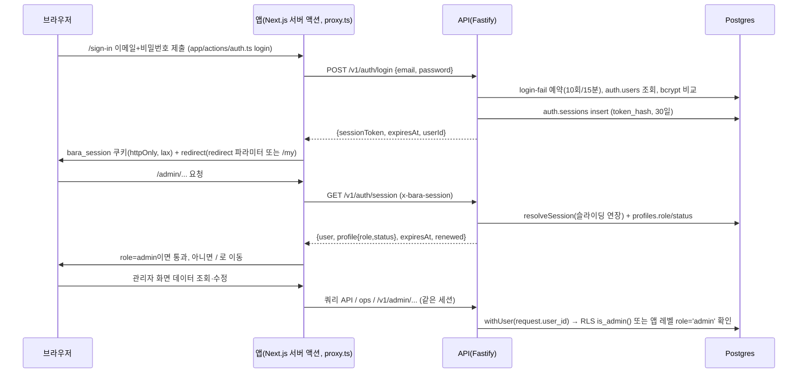
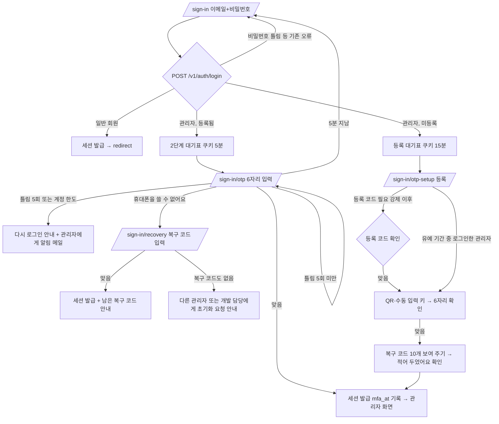

# 관리자 계정 2단계 인증(인증 앱 OTP) 기획서

- 작성일: 2026-11-26
- 작성: service-planner
- 근거: 대표 결정 2026-11-26 "인증 앱(OTP) 지금 기획". Google Authenticator 같은 인증 앱의 6자리 번호(TOTP, RFC 6238)를 쓴다.
- 배경: 개인정보·보안 점검 I-3. 지금은 메일함만 장악하면 재설정 링크(`/reset-password`)로 관리자 비밀번호를 바꾸고 관리자 권한까지 얻을 수 있다. 본인 확인 정책은 이메일만이고 휴대폰 본인인증은 하지 않는다(대표 결정 2026-11-26). 이 기능은 "메일함 탈취 = 관리자 탈취"를 끊는 것이 목표다.
- 법적 근거(검토 중): 개인정보의 안전성 확보조치 기준 제6조(접근통제)의 "외부에서 개인정보처리시스템에 접속할 때 안전한 인증수단 적용". 변호사 확인을 기다린다. 이 문서는 법적 의무 여부와 관계없이 보안 목적만으로도 성립하게 설계했다. 같은 조의 자동 접속 차단(일정 시간 미사용 시) 요구 여부도 함께 확인 요청한다(질문 2).
- 상태: **초안(대표 확인 대기)**. 문서만 만들었고 코드는 바꾸지 않았다.
- 다음 단계: 대표 확인(8장) → ux-writer(문구) → ui-ux-designer(와이어프레임) → backend-developer(API 계약 확정, 4장) → frontend-developer → privacy-security-officer 점검 → qa-reviewer. **인증 정보(비밀 키·복구 코드)를 새로 다루므로 privacy-security-officer 점검 없이 배포하지 않는다.**
- 문구: 이 문서의 문구는 초안이다. 최종 문구는 ux-writer가 정한다. 말투는 `bara-edu-lms.signup-enumeration-copy.md`(쉬운 `~해요`체, 이모지·느낌표 없음, 사용자를 탓하지 않기)를 따른다.
- 용어: 화면에서는 "2단계 인증", "인증 앱", "6자리 번호", "복구 코드"라고 쓴다. "TOTP", "OTP", "시크릿"은 화면에 쓰지 않는다.

---

## 0. 현재 구조 (코드 확인 결과)

### 0.1 로그인부터 관리자 화면까지

### 0.2 확인한 사실

| 항목 | 확인한 내용 | 위치 |
|---|---|---|
| 로그인 API | `POST /v1/auth/login {email, password}`. IP `login-ip` 50회/15분, 이메일 `login-fail` 10회/15분(성공하면 이번 예약을 풀어 준다). 성공하면 곧바로 세션을 만든다. 역할(role)은 보지 않는다 | `api/src/auth/routes.ts` 125~133행, `api/src/auth/service.ts` `login` 124~156행 |
| 세션 | 32바이트 무작위 토큰, `auth.sessions`에 SHA-256 해시만 저장. 기본 30일(`SESSION_TTL_DAYS`), 남은 기간이 절반 아래면 30일로 다시 늘린다(슬라이딩). 세션에 "어떻게 로그인했는지" 정보가 없다 | `api/src/auth/sessions.ts`, `api/src/config.ts` 61행, `api/db/01-auth.sql` 16~21행 |
| 세션 확인 | 모든 API 요청의 `onRequest` 훅이 `x-bara-session`을 `resolveSession`으로 풀어 `req.auth.userId`를 채운다. 역할·로그인 방식은 보지 않는다 | `api/src/http/guard.ts` |
| 세션을 만드는 곳 | (1) 로그인 성공, (2) 가입 마무리(`/v1/auth/signup-link/complete`, 미인증 계정만) 두 곳뿐이다. 재설정 성공은 세션을 만들지 않고 모든 세션을 지운다 | `service.ts`, `signup-link.ts`, `service.ts` `resetPassword` |
| 앱 쿠키 | `bara_session`(httpOnly, `sameSite=lax`, 운영 secure). 로그인 서버 액션이 `safeRedirect`로 검증한 경로로 보낸다(기본 `/my`) | `lib/db/auth.ts` `login`, `app/actions/auth.ts` 167~192행 |
| proxy 관리자 판단 | `/admin`으로 시작하는 경로에서 `GET /v1/auth/session`의 `profile.role !== 'admin'`이면 `/`로 보낸다. 세션이 죽었으면(401 `unauthenticated`) 쿠키를 지우고 `/sign-in?redirect=` | `proxy.ts` 66~98행 |
| 관리자 레이아웃 | proxy와 별도로 레이아웃에서 role을 다시 확인한다(이중 방어) | `app/(admin)/layout.tsx` |
| 관리자 권한 판단(DB) | `is_admin()` = `profiles.role = 'admin'` (`auth.uid()` = 트랜잭션의 `request.user_id`). 거의 모든 RLS 정책이 이것에 의존한다 | `api/db/02-schema.sql` 203~213행 |
| 관리자 권한 판단(앱 레벨) | `/v1/admin/...`은 `requireAdmin`(=`is_admin()`), ops는 각자 `select role from profiles`로 확인 | `routes.ts` 179~191행, `api/src/ops/admin-profile.ts` 80~84행 등 |
| 결론 | **관리자 권한은 "세션의 주인이 role=admin인가" 하나로만 정해진다.** 세션이 비밀번호만으로 발급되므로, 2단계 인증은 반드시 **세션 발급 시점(API)** 과 **세션 확인 시점(API guard)** 에 걸어야 한다. 앱 화면(proxy)에만 걸면 쿼리 API를 직접 부르는 경로가 남는다 |
| 역할 값 | `user_role`은 `learner`, `admin` 두 개뿐. `profiles.status`는 `active`/`withdrawn`. 관리자 지정·해제는 DB에서 직접 한다(화면 없음) | `02-schema.sql` 17·74~82·446~453행, `app/(admin)/admin/operators/page.tsx` 12~14행 |
| 재설정 | 재설정 링크 성공 시 비밀번호 변경, 모든 세션 삭제, 모든 메일 토큰 무효, `login-fail` 기록 삭제. 관리자 계정이면 같은 트랜잭션에서 `admin_access_logs`에 `action='비밀번호재설정'`, `detail='재설정 메일 링크'`, `admin_id=target_user_id=본인`, IP를 남긴다 | `service.ts` 183~217행 (`ADMIN_RESET_ACTION`) |
| 접속 기록 | `admin_access_logs(admin_id not null → profiles, target_user_id, action text, detail text, ip_address, created_at)`. update·delete 정책 없음, 2년 뒤 자동 삭제. action 값은 공백 없는 한국어(`조회`, `수정`, `정보수정`, `비밀번호재설정`) | `02-schema.sql` 1697~1717행 |
| 비밀 값 관리 | 서비스 키를 SSM Parameter Store(`/bara-edu/api/service-key`, SecureString, 인스턴스 역할)에서 `WithDecryption`으로 시작할 때 읽는다(`BARA_SERVICE_KEY_PARAM`). 읽기 실패·32바이트 미만이면 시작을 거절한다. 같은 방식으로 새 키를 늘릴 수 있다 | `api/src/secrets.ts`, `api/README.md` 76행 |
| 메일 | SES. `confirm`, `recovery`, `already_registered`, `password_changed`, `profile_changed` 템플릿. `deliver()`는 응답 뒤에 큐로 보내고 기다리지 않는다 | `api/src/mail/ses.ts`, `routes.ts` 62~66행 |
| `auth` 스키마 | `bara_edu_service` 소유. 관리자 쿼리 API(RLS 경유)로는 읽을 수 없다. 2단계 인증 데이터는 이 스키마에 둔다 | `api/db/01-auth.sql` |

---

## 1. 핵심 설계 (한눈에)

1. **대상**: `profiles.role = 'admin'`인 모든 계정. 선택이 아니라 필수다. 일반 회원(learner)에게는 이번에 제공하지 않는다(질문 6).
2. **세션은 2단계를 통과한 뒤에만 만든다.** 관리자는 비밀번호가 맞아도 세션 대신 5분짜리 "2단계 대기표(challenge)"를 받는다. 6자리 번호(또는 복구 코드)를 맞혀야 세션이 생긴다.
3. **두 번째 방어선**: 세션에 `mfa_at`(2단계 통과 시각)을 기록하고, API guard가 "role=admin인데 `mfa_at`이 비어 있는 세션"을 죽은 세션으로 취급한다. 도입 전에 만든 세션, 로그인 중에 관리자로 승격된 계정, 가입 마무리로 생긴 세션이 모두 이 규칙으로 막힌다.
4. **비밀번호 재설정은 2단계 인증을 건드리지 않는다.** 메일함을 가진 공격자는 비밀번호는 바꿀 수 있어도 인증 앱이 없어 세션을 받지 못한다. **메일로 2단계 인증을 해제·초기화하는 경로는 어디에도 만들지 않는다.**
5. **복구**: (1) 등록 때 받는 복구 코드 10개(1회용), (2) 다른 관리자의 "2단계 인증 초기화"(본인 6자리 번호로 재확인), (3) 관리자가 한 명뿐이면 개발 담당의 DB 직접 작업(정해진 명령, 접속 기록 필수). 초기화된 계정은 **등록 코드**(다른 관리자 또는 개발 담당이 전화·대면으로 전달)가 있어야 다시 등록할 수 있다(질문 1). 그렇지 않으면 초기화 직후가 "메일함만으로 관리자 탈취"가 되는 구멍이 된다.
6. **비밀 키 저장**: 인증 앱 비밀 키는 AES-256-GCM으로 암호화해 `auth` 스키마에 둔다. 암호화 키는 기존 방식 그대로 SSM Parameter Store SecureString에서 시작할 때 읽는다.
7. **재사용 방지**: 마지막으로 받아 준 30초 칸(time step)을 저장하고, 그 칸 이하의 번호는 다시 받지 않는다.
8. **시도 제한**: 대기표당 5회, 계정당 10회/15분, IP당 50회/15분. 계정 한도에 걸리면 관리자 메일로 알린다(비밀번호가 새었다는 신호).
9. **세션 기억**: "이 기기 기억하기"는 두지 않는다. 로그인할 때마다 6자리 번호를 묻는다. 관리자 세션 유지 기간은 일반 회원(30일)보다 짧게 한다(질문 2).

### 1.1 전체 흐름

---

## 2. 핵심 설계 (상세)

### 2.1 대상

| 계정 | 2단계 인증 | 비고 |
|---|---|---|
| `role='admin'`, `status='active'` | **필수.** 등록 전에는 세션을 받을 수 없다(강제 시작 이후, 7장) | 관리자도 강좌 수강 등 일반 회원 기능을 같은 계정으로 쓰지만, 로그인 자체가 2단계를 거치므로 구분하지 않는다 |
| `role='admin'`, `status='withdrawn'` | 해당 없음 | 기존대로 proxy가 세션을 끊는다. 탈퇴 시 2단계 인증 데이터도 지운다(2.11) |
| `role='learner'` | 없음 | 로그인 흐름·응답 변화 없음 |
| learner → admin 승격(DB 직접) | 승격 즉시 필수 | 승격 전 세션은 `mfa_at`이 없으므로 guard가 끊는다(2.3). 승격 작업 때 등록 코드를 함께 발급한다(2.7) |
| admin → learner 강등 | 2단계 인증 데이터 삭제 | 강등 작업 절차에 포함(2.7.4). 남아 있어도 learner 로그인에는 쓰지 않는다 |

### 2.2 로그인 흐름과 단계 사이의 상태

**원칙: 비밀번호 단계는 세션을 만들지 않는다. 단계 사이에는 "2단계 대기표"만 들고 간다.**

| 항목 | 정의 |
|---|---|
| 발급 시점 | `POST /v1/auth/login`에서 비밀번호가 맞고, 계정이 인증 완료이고, `role='admin'`일 때. 세션 대신 대기표를 준다 |
| 대기표 형식 | 32바이트 무작위(base64url). DB(`auth.mfa_challenges`)에는 SHA-256 해시만 저장. `purpose`: `verify`(등록된 관리자) / `enroll`(미등록 관리자) |
| 유효 시간 | `verify` 5분, `enroll` 15분(앱 설치·QR 촬영 시간을 고려). 1회용: 세션을 발급하면 즉시 `used_at` |
| 실패 횟수 | 대기표마다 `fail_count`. 5회 틀리면 대기표 폐기 → 비밀번호부터 다시 |
| 묶는 정보 | `user_id`, 발급 IP(기록용. IP가 바뀌어도 막지는 않는다: 모바일 망 전환이 잦다) |
| 브라우저 보관 | 앱이 httpOnly 쿠키 `bara_mfa`(secure, `sameSite=lax`, `path=/`, Max-Age = 대기표 남은 시간)로 보관한다. URL·hidden 필드·localStorage에 넣지 않는다. 이메일도 다음 화면으로 넘기지 않는다 |
| 2단계 성공 | 앱이 `bara_mfa`를 지우고 `bara_session`을 쓴다. 이동할 곳은 로그인 때의 `redirect` 값(경로만, `/sign-in/otp?redirect=`로 넘기고 마지막 단계에서 `safeRedirect`로 다시 검사). 없으면 관리자는 `/admin` |
| 비밀번호 실패 한도와의 관계 | 비밀번호가 맞으면 지금처럼 `login-fail` 예약을 풀어 준다. 6자리 번호는 별도 한도(2.9)로 센다 |
| 이메일 열거 | 관리자라는 사실(대기표 응답)은 **비밀번호가 맞은 사람에게만** 드러난다. 비밀번호가 틀리면 지금과 같은 `invalid_credentials` |
| JS 없이 | 모든 단계가 `<form action>` 서버 액션으로 동작한다(인앱 브라우저 대비, 기존 인증 화면과 같은 방식) |

대기표를 쿠키에 두는 이유: hidden 필드는 HTML·브라우저 기록·확장 프로그램에 남을 수 있고, URL은 접근 로그·Referer로 샌다. httpOnly 쿠키는 스크립트가 읽지 못하고 5분 뒤 스스로 사라진다. 대기표만으로는 아무 권한도 없고(6자리가 있어야 함) 5회 실패로 폐기되므로 탈취돼도 피해가 작다.

### 2.3 세션 단위 기억: 두 번째 방어선

| 항목 | 정의 |
|---|---|
| 세션 컬럼 추가 | `auth.sessions.mfa_at timestamptz null`. 2단계(번호·복구 코드)를 통과해 만든 세션만 값을 가진다 |
| guard 규칙 | `resolveSession`이 세션 주인의 `profiles.role`을 함께 읽는다. **`role='admin'`이고 `mfa_at is null`이면 세션이 없는 것으로 처리**(`userId=null`)하고 그 세션 행을 지운다. 앱은 기존 규칙(401 `unauthenticated` = 죽은 세션)대로 쿠키를 지우고 로그인으로 보낸다 |
| 막아 주는 경우 | (1) 도입 전에 비밀번호만으로 만든 관리자 세션, (2) 로그인해 있는 동안 관리자로 승격된 계정, (3) 가입 마무리 경로로 생긴 세션, (4) 앞으로 누가 실수로 세션 발급 경로를 하나 더 만드는 경우 |
| 비용 | 요청마다 `profiles` 조인 1회 추가(기본 키 조회). 대상 관리자가 소수라 영향은 작다. backend-developer가 실측 후 판단 |
| "이 기기 기억하기" | **두지 않는다.** 관리자는 소수이고, 기기 기억 쿠키는 기기 도난·공용 PC 위험을 되살린다 |
| 관리자 세션 기간 | 일반 회원과 같은 30일 슬라이딩이면 한 번의 2단계로 30일간 쓸 수 있다. **관리자 세션만 짧게**: 권장 최대 12시간(연장 없음) + 1시간 미사용 시 만료(질문 2). 미사용 판단을 위해 `auth.sessions.last_seen_at`을 추가하거나, 관리자 세션만 짧은 TTL로 슬라이딩한다. 정확한 방식은 backend-developer가 정한다 |

### 2.4 등록 흐름 (QR, 확인 번호, 복구 코드)

등록은 두 입구가 있다. 화면 단계는 같고, "누가 등록을 허락했는가"만 다르다.

| 입구 | 언제 | 허락 근거 |
|---|---|---|
| A. 관리자 화면 안에서 | 유예 기간(7장 1단계)에 이미 로그인해 있는 관리자. `/admin/security` | 기존 세션(비밀번호만). 유예 기간에만 허용한다. 오늘의 위험(비밀번호만)보다 나빠지지 않는다 |
| B. 로그인 중 | 강제 시작 이후, 미등록 관리자가 비밀번호를 맞혔을 때. `/sign-in/otp-setup` | `enroll` 대기표 + **등록 코드**(질문 1). 등록 코드는 다른 관리자의 초기화(2.7.2) 또는 개발 담당의 DB 작업(2.7.3)으로만 생긴다 |
| C. 기기 바꾸기 | 등록된 관리자가 새 휴대폰으로 옮길 때. `/admin/security` | 현재 세션 + 지금 휴대폰의 6자리 번호(재확인). 새 등록을 확인하기 전까지 옛 등록은 그대로 둔다 |

단계:

1. **준비 안내**: 인증 앱을 설치하라는 안내. 권장 앱 이름(질문 5)과 "이미 설치했어요" 버튼. 앱 스토어 링크는 공식 스토어 주소만.
2. **(입구 B만) 등록 코드 입력**: 8자리 숫자. 맞으면 다음 단계.
3. **QR 보여 주기**: API가 새 비밀 키(20바이트)를 만들고 "등록 대기" 상태로 암호화해 저장(10분). 앱 서버가 `otpauth://totp/바라평생교육원:{email}?secret=...&issuer=바라평생교육원&digits=6&period=30&algorithm=SHA1` 주소를 **서버에서 QR 이미지(SVG)로 그린다.** 외부 QR 생성 서비스는 쓰지 않는다(비밀 키가 외부로 나간다).
   - 같은 휴대폰으로 화면을 보고 있으면 QR을 찍을 수 없다. 그래서 (a) 수동 입력 키(4글자씩 띄어 쓴 32진 문자, [복사] 버튼), (b) "이 휴대폰의 인증 앱에 바로 추가" 링크(`otpauth://`, 지원하는 앱에서만 열림)를 함께 준다.
   - 화면 캐시 금지(`no-store`), 검색 제외(`noindex`), Referer 금지.
4. **확인 번호 입력**: 인증 앱에 뜬 6자리를 입력. 맞으면 등록 확정(`confirmed_at`), 그 30초 칸을 "마지막 사용"으로 기록(2.8).
5. **복구 코드 10개 보여 주기**: 한 번만 보여 준다. [인쇄], [복사], [파일로 받기(txt)] 제공. "복구 코드를 종이에 적거나 인쇄해 안전한 곳에 두었어요" 체크를 해야 [관리자 화면으로] 버튼이 켜진다.
6. 입구 B는 이 시점에 세션을 발급한다(복구 코드 화면을 보는 동안 대기표는 이미 쓰였으므로, 앱은 확정 응답의 세션 토큰으로 쿠키를 쓰고 복구 코드는 서버 액션 결과 상태로만 화면에 그린다. URL·쿠키·로그에 복구 코드를 남기지 않는다).

복구 코드 규칙:

| 항목 | 정의 |
|---|---|
| 개수 | 10개, 각각 1회용 |
| 형식 | 10글자, 헷갈리는 글자(0/O, 1/I/L)를 뺀 대문자+숫자 32종, `ABCDE-FGHJK`처럼 5글자씩 하이픈. 약 50비트 |
| 저장 | 원문 저장 안 함. HMAC-SHA256(키는 2.6의 별도 하위 키) 결과만 `auth.mfa_recovery_codes`에 저장. DB만 유출돼서는 원문을 추측할 수 없게 한다 |
| 입력 | 대소문자·하이픈·공백 무시 |
| 다시 받기 | `/admin/security`에서 6자리 번호로 재확인 후 새 10개 발급, 옛 코드 전부 무효 |
| 남은 개수 안내 | 3개 이하이면 관리자 화면 상단에 "복구 코드가 {n}개 남았어요. 새로 받아 두세요" 배너 |

### 2.5 비밀번호 재설정·변경과의 관계

| 동작 | 2단계 인증 데이터 | 이유 |
|---|---|---|
| 재설정 링크로 비밀번호 변경(`/v1/auth/reset-password`) | **그대로 둔다.** 세션 삭제(기존), `login-fail` 삭제(기존)는 유지. **2단계 실패 한도(`mfa-fail`)는 지우지 않는다** | 메일함 주인은 증명됐지만 메일함 탈취가 바로 이 기능이 막으려는 위협이다 |
| 관리자가 다른 사람에게 재설정 메일 발송(`send-reset`) | 그대로 | 위와 같음 |
| 로그인한 상태의 비밀번호 변경(`change-password`) | 그대로 | 이미 2단계를 통과한 세션에서만 가능 |
| 재설정 후 첫 로그인 | 새 비밀번호 + 6자리 번호 | 공격자는 여기서 막힌다 |
| 메일로 2단계 인증 해제 | **만들지 않는다** | 만들면 구멍이 되돌아온다. 화면·메일 어디에도 "메일로 초기화" 문구를 두지 않는다 |
| 재설정 완료 알림 메일 | 관리자 계정이면 본문에 한 줄 추가 권장: "2단계 인증은 그대로예요. 로그인할 때 인증 앱 번호가 필요해요." | 진짜 주인이 받으면 안심, 본인이 안 바꿨다면 신고 계기 |
| 접속 기록 | 기존 `비밀번호재설정` 그대로 | 변경 없음 |

### 2.6 비밀 키 저장과 암호화 키 관리

| 항목 | 정의 |
|---|---|
| 저장 위치 | `auth.mfa_factors`(확정된 등록), `auth.mfa_enrollments`(등록 대기, 10분). `auth` 스키마라 관리자 쿼리 API·RLS 경로로는 읽을 수 없다 |
| 암호화 | AES-256-GCM. 행마다 12바이트 무작위 IV. 추가 인증 데이터(AAD)에 `user_id`와 키 버전을 넣어, 다른 사람의 행으로 옮겨 붙여도 풀리지 않게 한다. 컬럼: `secret_ciphertext bytea`, `secret_iv bytea`, `key_version smallint` |
| 마스터 키 | **기존 SSM Parameter Store 방식 재사용.** 새 SecureString `/bara-edu/api/mfa-key`(32바이트 무작위, base64). 환경 변수 `BARA_MFA_KEY_PARAM`이 있으면 시작할 때 `WithDecryption`으로 읽는다(`secrets.ts`의 `resolveServiceKey`와 같은 패턴, 값·SDK 오류 문구는 로그에 안 남김). 로컬은 `BARA_MFA_KEY`(32바이트 이상) |
| 하위 키 | 마스터 키에서 HKDF로 용도별 키를 나눈다: `totp-secret`(암호화), `recovery-code`(HMAC). 한 키를 두 용도로 쓰지 않는다 |
| 시작 거절 | 운영(`NODE_ENV=production`)에서 키가 없거나 32바이트 미만이면 API 시작을 거절한다. 키 없이 뜨면 모든 관리자 로그인이 실패하므로, 배포 전 점검 목록에 넣는다 |
| 키 교체 | `key_version`으로 여러 키를 동시에 읽을 수 있게 한다(`/bara-edu/api/mfa-key-v2`). 교체는 새 키로 다시 암호화하는 일회성 명령으로 한다. 정기 교체 주기는 privacy-security-officer가 정한다 |
| KMS 직접 호출을 쓰지 않는 이유 | 로그인마다 KMS 호출이 생기고(지연·비용·장애 지점), 이미 SSM SecureString이 KMS로 보호된다. 키가 API 프로세스 메모리에만 있다는 점은 서비스 키와 같은 수준으로 받아들인다 |
| 키 분실 | 마스터 키를 잃으면 모든 등록을 풀 수 없다 → 모든 관리자가 재등록(2.7.3 절차). SSM 파라미터 삭제 보호·백업 방법을 운영 문서에 적는다 |
| 백업·로그 | DB 백업에는 암호문만 있다. 비밀 키·복구 코드·6자리 번호·대기표는 어떤 로그에도 남기지 않는다(오류 로그는 종류만) |

### 2.7 분실·기기 교체 시 복구

#### 2.7.1 본인이 할 수 있는 것

| 상황 | 방법 |
|---|---|
| 새 휴대폰으로 바꿈, 옛 휴대폰도 있음 | 로그인 → `/admin/security` → [인증 앱 바꾸기] → 옛 휴대폰 번호로 확인 → 새 휴대폰 등록(2.4 입구 C) |
| 인증 앱 백업 기능으로 새 휴대폰에 옮겨짐 | 그대로 쓰면 된다(같은 비밀 키) |
| 휴대폰 분실·초기화, 복구 코드 있음 | 로그인 2단계에서 [휴대폰을 쓸 수 없어요] → 복구 코드 입력 → 로그인 → `/admin/security`에서 새 휴대폰 등록 권장(배너로 안내) |
| 휴대폰도 복구 코드도 없음 | 본인은 할 수 없다. 다른 관리자 또는 개발 담당에게 초기화를 요청 |

#### 2.7.2 다른 관리자의 초기화

| 항목 | 정의 |
|---|---|
| 위치 | 관리자 회원 상세(`/admin/members/[id]`)에서 대상이 `role='admin'`일 때만 "2단계 인증" 카드가 보인다. 운영자 목록(`/admin/operators`)에 "2단계 인증" 열(등록됨/미등록/초기화됨)을 추가해 상세로 들어가게 한다 |
| 할 수 없는 경우 | 자기 자신은 초기화할 수 없다(본인은 `/admin/security` 사용). 탈퇴 계정, learner는 대상이 아니다 |
| 본인 확인(대상) | 대상 관리자와 **전화 또는 대면**으로 확인한다. 메일로 받은 요청만으로 초기화하지 않는다(화면 안내 문구로 명시). 관리자는 서로 아는 소수이므로 목소리·얼굴 확인이 현실적인 수단이다 |
| 재확인(초기화하는 관리자) | 초기화하는 관리자의 **현재 6자리 번호**를 다시 입력한다. 열어 둔 화면을 남이 쓰는 경우를 막는다 |
| 사유 | 필수 선택: 휴대폰 분실, 휴대폰 교체(옛 휴대폰 없음), 인증 앱 삭제, 기타(메모 필수, 200자, 개인정보 적지 않기 안내). `admin-profile-edit`의 정정 사유와 같은 방식 |
| 서버 동작(한 트랜잭션) | 대상의 등록·등록 대기·복구 코드 삭제, 대상의 모든 세션 삭제, 대상의 대기표 폐기, 등록 코드 1개 발급(24시간, 1회용, 해시 저장), 접속 기록 `2단계인증초기화` insert(실패하면 전체 롤백) |
| 결과 화면 | 등록 코드 8자리를 **한 번만** 보여 준다. "이 번호를 {대상 이름}님께 전화로 불러 주세요. 메일·문자로 보내지 마세요." 화면을 닫으면 다시 볼 수 없고, 필요하면 다시 초기화한다(옛 코드 무효) |
| 대상에게 알림 | 대상 가입 이메일로 "2단계 인증이 초기화됐어요" 메일(시각, 처리한 관리자 이름은 넣지 않고 "다른 관리자"로만, 링크 없음, 등록 코드 없음) |
| 대상의 다음 로그인 | 비밀번호 → 등록 화면(입구 B) → 등록 코드 → QR → 확인 → 복구 코드 |

등록 코드가 필요한 이유: 초기화 직후 대상 계정은 "인증 앱이 없는 관리자"다. 이때 등록에 비밀번호만 요구하면, 대상의 메일함을 가진 공격자가 재설정 링크로 비밀번호를 바꾸고 먼저 등록해 버릴 수 있다. 등록 코드는 전화로만 전달되므로 메일함만으로는 얻을 수 없다.

#### 2.7.3 관리자가 한 명뿐일 때: DB 직접 작업

다른 관리자가 없으면 개발 담당이 서버에서 정해진 명령으로만 처리한다. SQL을 손으로 치지 않는다.

| 단계 | 내용 |
|---|---|
| 1. 요청 접수 | 대표(대상 관리자)가 개발 담당에게 **전화 또는 대면**으로 요청. 메일·메신저 요청만으로는 진행하지 않는다 |
| 2. 본인 확인 | 개발 담당이 대표의 목소리·얼굴로 확인. 확인 방법과 일시를 운영 기록(아래 5)에 남긴다 |
| 3. 명령 실행 | `node dist/db/cli.js mfa-reset --email <대상> --operator "<작업자 이름>" --reason <사유키>` (이름 제안, `api/src/db/cli.ts`에 추가). 하는 일은 2.7.2의 서버 동작과 같다: 등록·복구 코드·세션·대기표 삭제, 등록 코드 발급, 접속 기록 insert. 대상이 `role='admin'`이 아니면 거절 |
| 4. 등록 코드 전달 | 명령이 터미널에 한 번만 출력한다. 개발 담당이 전화·대면으로 불러 준다. 터미널 기록(쉘 히스토리·로그)에 남지 않게 표준 출력만 쓰고, 화면을 지운다 |
| 5. 기록 | (a) `admin_access_logs`: `admin_id = target_user_id = 대상`(관리자 행이 하나뿐이어서 자기 자신을 기록 주체로 둔다. 기존 `비밀번호재설정` 기록과 같은 방식), `action='2단계인증초기화'`, `detail='by=db;operator=<작업자>;reason=<사유키>'`, `ip_address=null`. (b) 운영자 접근 기록 문서(기존 "비밀번호 찾기 배포 운영자 접근 기록"과 같은 형식)에 일시·작업자·요청자·본인 확인 방법·사유를 적는다 |
| 6. 알림 | 대상 이메일로 초기화 알림 메일(2.7.2와 같음) |
| 첫 관리자·승격 | 같은 명령의 `mfa-ticket --email <대상>` 하위 명령으로 등록 코드만 발급한다(강제 시작 이후 새 관리자를 만들 때). 기록 `action='2단계인증등록코드발급'` |

#### 2.7.4 강등·탈퇴

- 강등(DB에서 role을 learner로): 같은 CLI의 `mfa-clear --email` 실행을 강등 절차에 넣는다. 남아 있어도 learner 로그인에는 쓰이지 않지만 불필요한 인증 정보를 보관하지 않기 위해서다.
- 탈퇴: `withdrawAccount` 트랜잭션에서 등록·대기·복구 코드·대기표·등록 코드를 함께 삭제한다(`on delete cascade`만으로는 탈퇴가 행을 지우지 않으므로 명시 삭제).

### 2.8 재사용 방지

| 항목 | 정의 |
|---|---|
| 번호 규칙 | 6자리, 30초, HMAC-SHA1(인증 앱 호환성이 가장 좋다. Google Authenticator는 SHA256 QR을 무시하는 경우가 있다) |
| 시계 오차 | 현재 칸 ±1(앞뒤 30초, 총 90초) 허용 |
| 저장 | `auth.mfa_factors.last_used_step bigint`(마지막으로 받아 준 칸 번호 = floor(unix초/30)) |
| 판정 | 행을 `for update`로 잠근 뒤, 맞는 칸 `s`가 `s > last_used_step`일 때만 성공하고 `last_used_step = s`로 갱신. 같은 번호 재사용, 이미 쓴 칸보다 이전 칸의 번호도 거절 |
| 거절 응답 | 재사용은 "틀림"과 같은 응답(`wrong_code`)으로 준다. 단 실패 횟수에는 넣지 않는다(정상 사용자가 두 번 누른 경우가 대부분) |
| 같은 칸을 쓰는 다른 동작 | 로그인 직후 30초 안에 재확인(복구 코드 다시 받기, 다른 관리자 초기화 등)을 하면 같은 번호는 거절된다. 화면 문구: "방금 쓴 번호예요. 인증 앱에 새 번호가 나오면 입력해 주세요" |
| 복구 코드 | 1회용(`used_at`). 재사용 거절 |
| 비교 | 상수 시간 비교 |

### 2.9 시도 제한

| 한도 | 기준 | 값 | 걸렸을 때 |
|---|---|---|---|
| 대기표당 | `mfa_challenges.fail_count` | 5회 | 대기표 폐기. "비밀번호부터 다시 로그인해 주세요" |
| 계정당 | `rate_events` bucket `mfa-fail`, key `user_id` | 10회 / 15분 | 15분 동안 그 계정의 번호·복구 코드 입력 거절(429). **관리자 이메일로 알림 메일 1통**(1시간에 1통): "비밀번호는 맞았지만 인증 앱 번호가 여러 번 틀렸어요. 본인이 아니라면 비밀번호를 바꿔 주세요." 접속 기록 `2단계인증잠김` |
| IP당 | bucket `mfa-ip`, key `rateKeyForIp` | 50회 / 15분 | 429 |
| 등록 코드 | bucket `mfa-ticket-fail`, key `user_id` | 5회 / 1시간 | 등록 코드 폐기, 새로 발급받아야 함 |
| 등록 확인 번호 | 등록 대기 행 `fail_count` | 5회 | 등록 대기 폐기, QR부터 다시 |
| 성공 시 | 계정당 `mfa-fail` 예약은 풀어 준다(`login`의 reserve/release 패턴) | — | — |
| 재설정 | 비밀번호 재설정은 `mfa-fail`을 지우지 않는다(2.5) | — | — |

계정당 한도의 부작용: 비밀번호를 아는 공격자가 일부러 틀려 진짜 관리자를 15분씩 막을 수 있다. 비밀번호가 이미 샌 상황이므로 알림 메일로 알리고 비밀번호 변경을 유도하는 것으로 받아들인다. 6자리 번호(100만 가지)에 15분 10회면 추측 성공 확률은 무시할 수준이다.

### 2.10 접속 기록 action 값

기존 규칙(공백 없는 한국어, `admin_access_logs`, 실패하면 함께 롤백)을 따른다. 값(비밀 키·번호·복구 코드·등록 코드)은 남기지 않는다.

| action | admin_id | target_user_id | detail 예 | 언제 |
|---|---|---|---|---|
| `로그인` | 본인 | 본인 | `mfa=totp` / `mfa=recovery;left=7` | 2단계 통과로 세션을 만들 때 |
| `2단계인증등록` | 본인 | 본인 | `via=session` / `via=ticket` / `replace=1` | 등록 확정 |
| `복구코드재발급` | 본인 | 본인 | `count=10` | 새 복구 코드 발급 |
| `2단계인증초기화` | 처리한 관리자(DB 작업이면 본인) | 대상 | `reason=lost_phone;by=admin` / `by=db;operator=홍길동;reason=lost_phone` | 다른 관리자 초기화, DB 작업 |
| `2단계인증등록코드발급` | 본인(DB 작업) | 대상 | `by=db;operator=...` | 신규 관리자·강제 시작 때 |
| `2단계인증잠김` | 본인 | 본인 | `limit=account` | 계정당 한도에 걸린 순간(1회) |

- 로그인 기록은 제8조 접속기록(접속 일시·접속지)을 위한 것이다. 지금은 관리자 로그인 자체가 기록되지 않는다. 관리자 로그인을 기록하는 것이 맞는지, 대기표 실패(잠김 전 개별 실패)는 서버 로그로만 둘지는 privacy-security-officer가 정한다.
- `2단계인증잠김`의 `admin_id`가 공격자가 아니라 계정 주인이라는 점을 운영자가 오해하지 않도록, 화면에 보여 줄 때는 "이 계정에서 번호가 여러 번 틀렸어요"로 표시한다.

### 2.11 데이터 모델 초안 (backend-developer 확정)

| 테이블 (`auth` 스키마) | 주요 컬럼 | 비고 |
|---|---|---|
| `auth.mfa_factors` | `user_id pk fk→auth.users on delete cascade`, `secret_ciphertext`, `secret_iv`, `key_version`, `confirmed_at`, `last_used_step`, `last_used_at`, `created_at` | 사용자당 1개 |
| `auth.mfa_enrollments` | `id`, `user_id`, `secret_ciphertext`, `secret_iv`, `key_version`, `fail_count`, `expires_at`(10분), `created_at` | 등록 대기. 확정되면 factors로 옮기고 삭제. 매일 정리 |
| `auth.mfa_recovery_codes` | `id`, `user_id`, `code_hmac`, `used_at`, `created_at` | 10행 |
| `auth.mfa_challenges` | `token_hash pk`, `user_id`, `purpose('verify','enroll')`, `fail_count`, `ip`, `expires_at`, `used_at`, `created_at` | 1일 지나면 정리 |
| `auth.mfa_enroll_tickets` | `code_hash pk`, `user_id`, `issued_by`(관리자 id 또는 null=DB), `fail_count`, `expires_at`(24시간), `used_at` | 사용자당 유효 1개(새로 발급하면 이전 무효) |
| `auth.sessions` | `mfa_at timestamptz` 추가 (+ 질문 2 결과에 따라 `last_seen_at`) | |

락 순서: 기존 규칙(토큰 → 가입 시도 → 사용자 → profiles)에 `mfa_*`를 "사용자" 다음에 둔다. backend-developer가 `tokens.ts`의 락 순서 주석을 갱신한다.

### 2.12 라이브러리 후보 (버전은 개발 단계에서 확정)

| 용도 | 후보 | 이유·주의 |
|---|---|---|
| TOTP 계산·검증 | (1) `otpauth`, (2) `otplib`, (3) `node:crypto`로 직접 구현(RFC 6238, 30줄 내외) | (1) 의존성이 없고 `otpauth://` 주소 생성까지 지원. (2) 가장 널리 쓰였지만 메이저 버전 전환기라 API가 바뀌었는지 확인 필요. (3) 의존성 0, RFC 테스트 벡터로 검증 가능. 어느 쪽이든 재사용 방지(2.8)는 라이브러리 밖에서 직접 구현해야 한다(라이브러리의 "window" 검증은 칸 번호를 돌려주는지 확인) |
| QR 그리기 | `qrcode`(서버에서 SVG 문자열 생성) | 앱 서버에서만 그린다. 외부 QR API 금지. 브라우저 번들에 넣지 않는다 |
| 암호화·HMAC·HKDF | `node:crypto` | 추가 의존성 불필요 |
| 32진 인코딩 | 위 TOTP 라이브러리에 포함되거나 직접 구현 | RFC 4648 base32(패딩 없음) |

---

## 3. 화면 목록과 상태

공통 규칙(시니어 관리자 기준):

| 항목 | 정의 |
|---|---|
| 글자·터치 | 인증 화면은 기존 `(auth)` 카드 레이아웃의 `lg` 크기(입력·버튼 높이 56px 이상, 본문 16px 이상). 관리자 화면 카드는 관리자 기준(14~15px, 버튼 48px, `admin-profile-edit` D2) |
| 한 화면 한 할 일 | 입력 칸 하나, 주 버튼 하나 |
| 6자리 입력 칸 | **칸 하나**(6칸 쪼개기 금지: 붙여넣기·스크린리더·확대 시 불편). `inputMode="numeric"`, `autoComplete="one-time-code"`, `pattern="[0-9]*"`, `maxLength` 7(가운데 공백 허용), 보이는 `<label>`. 공백·하이픈은 자동 제거. 6자리가 되어도 자동 제출하지 않는다(시니어가 확인할 시간) |
| 오류 | 칸 아래 아이콘+글, `aria-invalid`·`aria-describedby`. 색만으로 구분하지 않는다. 오류 뒤 칸으로 포커스, 입력값은 지운다(번호는 30초마다 바뀌므로) |
| 남은 시간 | 인증 앱의 30초 카운트는 앱에 있으므로 화면에는 표시하지 않는다. 대기표 5분 만료만 "5분 안에 입력해 주세요"로 한 번 안내 |
| 상태 알림 | 화면이 바뀌면 제목에 포커스, 서버 오류는 `role="alert"` |
| 헤더 | 새 인증 화면 모두 `Cache-Control: no-store`, `X-Robots-Tag: noindex`, `Referrer-Policy: no-referrer`(`next.config.ts`의 `CONFIRM_PAGE_HEADERS` 재사용) |
| 전화 안내 | 관리자 대상 화면이므로 고객센터 번호 대신 "다른 관리자 또는 개발 담당에게 연락해 주세요"(연락처는 화면에 적지 않는다) |

### 3.1 화면 목록

| ID | 화면 | 경로(제안) | 누가 |
|---|---|---|---|
| M1 | 로그인 2단계: 6자리 입력 | `/sign-in/otp` | `bara_mfa`(verify) 쿠키가 있는 사람 |
| M2 | 로그인 2단계: 복구 코드 입력 | `/sign-in/recovery` | 같음 |
| M3 | 2단계 인증 등록(로그인 중) | `/sign-in/otp-setup` | `bara_mfa`(enroll) 쿠키 |
| M4 | 내 2단계 인증(보안 설정) | `/admin/security` | 로그인한 관리자 |
| M5 | 관리자 회원 상세의 "2단계 인증" 카드 + 초기화 | `/admin/members/[id]` | 로그인한 관리자, 대상이 관리자일 때 |
| M6 | 관리자 화면 상단 배너 | `AdminShell` | 유예 기간 미등록 관리자, 복구 코드 3개 이하, 복구 코드로 로그인한 직후 |
| (변경) | 로그인 | `/sign-in` | 관리자 응답 분기 추가(화면 변화 없음) |

`proxy.ts`: `/sign-in/*`는 공개 경로라 그대로 통과한다. `bara_mfa`가 없거나 만료된 상태로 M1~M3에 들어오면 서버 컴포넌트가 "로그인 시간이 지났어요" 상태를 보여 준다(리다이렉트 대신 안내 후 버튼).

### 3.2 M1 로그인 2단계: 6자리 입력

| 요소 | 내용 | 동작 |
|---|---|---|
| 제목 | 인증 앱 번호를 입력해 주세요 | `h1` |
| 안내 | 휴대폰의 인증 앱(예: Google Authenticator)을 열고 '바라 평생교육원'에 보이는 6자리 번호를 입력해 주세요. | 등록 때 정한 앱 이름을 넣지 않는다(서버가 모름) |
| 입력 칸 | 라벨 "6자리 번호" | 공통 규칙 |
| 주 버튼 | 확인 / 제출 중 "확인하는 중이에요" | 중복 제출 방지 |
| 보조 링크 1 | 휴대폰을 쓸 수 없나요? 복구 코드로 로그인 | M2 (대기표 유지) |
| 보조 링크 2 | 처음부터 다시 로그인 | `bara_mfa` 삭제 후 `/sign-in` |
| 도움말(접힘) | 번호가 계속 틀린다면: 휴대폰의 날짜와 시간을 '자동'으로 맞춰 주세요. / 번호가 바뀌기 직전이면 새 번호가 나올 때 입력해 주세요. | 시계 오차가 가장 흔한 원인 |

| 상태 | 표시 | 다음 |
|---|---|---|
| 기본 | 위 요소 | — |
| 형식 오류(6자리 숫자 아님) | 칸 아래 "숫자 6자리를 입력해 주세요"(서버 호출 없음) | 그대로 |
| 틀림(`wrong_code`, 남은 횟수 있음) | "번호가 맞지 않아요. 앱에 지금 보이는 번호를 입력해 주세요. ({n}번 더 시도할 수 있어요)" | 칸 비우고 포커스 |
| 방금 쓴 번호(재사용) | 틀림과 같은 문구(서버가 구분해 주지 않음) + 도움말 펼침 | 같음 |
| 대기표 5회 실패 | 제목 "다시 로그인해 주세요" / "번호가 여러 번 맞지 않았어요. 안전을 위해 처음부터 다시 로그인해 주세요." | [로그인 화면으로] |
| 계정 한도(429 `mfa_locked`) | "번호를 여러 번 틀려 잠시 막혔어요. 15분 뒤에 다시 시도해 주세요. 본인이 시도한 게 아니라면 비밀번호를 바꿔 주세요." | [로그인 화면으로], [비밀번호 찾기] |
| IP 한도(429) | "요청이 많아요. 잠시 후 다시 시도해 주세요"(`MSG_RATE_LIMITED`) | 입력 유지 |
| 대기표 만료·없음(401 `challenge_invalid`, 또는 쿠키 없음) | 제목 "로그인 시간이 지났어요" / "5분이 지나 다시 로그인해야 해요." | [다시 로그인] |
| 연결 불가(503) | "지금 연결이 원활하지 않아요. 잠시 후 다시 눌러 주세요"(`MSG_UNAVAILABLE`) | 입력 유지(번호가 바뀌었을 수 있다는 안내 한 줄) |
| 기타 실패 | "잠시 후 다시 시도해 주세요" | 입력 유지 |
| 성공 | — | `redirect` 값 또는 `/admin` |

### 3.3 M2 복구 코드 입력

| 요소·상태 | 내용 |
|---|---|
| 제목 | 복구 코드로 로그인 |
| 안내 | 2단계 인증을 등록할 때 받아 적어 둔 10자리 코드 중 하나를 입력해 주세요. 한 번 쓴 코드는 다시 쓸 수 없어요. |
| 입력 칸 | 라벨 "복구 코드", `autoComplete="off"`, `autocapitalize="characters"`, `spellcheck="false"`. 하이픈·공백·소문자 허용 |
| 주 버튼 | 로그인 |
| 보조 | 인증 앱 번호로 돌아가기(M1), 처음부터 다시 로그인 |
| 하단 안내 | 복구 코드도 없다면, 다른 관리자에게 2단계 인증 초기화를 부탁해 주세요. 관리자가 한 명뿐이라면 개발 담당에게 전화해 주세요. 메일로는 초기화할 수 없어요. |
| 틀림 | "코드가 맞지 않아요. 이미 쓴 코드인지 확인해 주세요. ({n}번 더 시도할 수 있어요)" (M1과 같은 대기표 실패 횟수를 같이 쓴다) |
| 잠김·만료·연결 불가 | M1과 같음 |
| 성공 | `/admin`으로 이동하고 M6 배너: "복구 코드로 로그인했어요. 남은 복구 코드는 {n}개예요. 휴대폰을 다시 쓸 수 있게 되면 [2단계 인증 설정]에서 인증 앱을 다시 등록해 주세요." (n이 0이면 "남은 복구 코드가 없어요. 지금 새 인증 앱을 등록해 주세요"로 강조) |

### 3.4 M3 2단계 인증 등록 (로그인 중, M4의 등록도 같은 단계 컴포넌트)

진행 표시: "1/4 앱 준비 → 2/4 등록 코드(입구 B만) → 3/4 QR 찍기 → 4/4 복구 코드 보관". 단계마다 [이전] 버튼(복구 코드 단계 제외).

| 단계 | 요소 | 상태·예외 |
|---|---|---|
| 앱 준비 | 제목 "관리자 계정은 2단계 인증이 필요해요" / 안내 "로그인할 때 비밀번호와 함께 휴대폰 인증 앱의 6자리 번호를 입력해요. 메일함이 남에게 넘어가도 관리자 화면은 안전하게 지킬 수 있어요." / 권장 앱 이름과 공식 스토어 링크 / [앱을 설치했어요] | 질문 5에 따라 앱 안내 문구 확정 |
| 등록 코드 | 라벨 "등록 코드(8자리)" / 안내 "다른 관리자나 개발 담당에게 전화로 받은 번호를 입력해 주세요." | 틀림: "등록 코드가 맞지 않아요({n}번 남음)". 5회 또는 만료: "등록 코드를 쓸 수 없어요. 새 등록 코드를 다시 받아 주세요." 코드가 없는 사람: "등록 코드가 없나요? 다른 관리자 또는 개발 담당에게 연락해 주세요." |
| QR | QR 이미지(가로 200px 이상, 대비 높은 흑백, `alt="인증 앱 등록용 QR 코드"`) / 순서 안내 "1. 인증 앱에서 [+] 또는 [코드 추가]를 눌러요. 2. [QR 코드 스캔]을 고르고 이 그림을 비춰요." / 접힘 "QR을 찍을 수 없나요?" → 수동 입력 키(4글자씩, 고정폭 글꼴, [복사]), 계정 이름 "바라 평생교육원", 종류 "시간 기준" / 휴대폰 화면 폭이면 [이 휴대폰의 인증 앱에 바로 추가] 버튼(`otpauth://`) / 아래 "앱에 보이는 6자리 번호" 입력 칸 + [등록 확인] | 틀림: "번호가 맞지 않아요. 앱에 '바라 평생교육원'이 추가됐는지, 휴대폰 시간이 자동으로 맞춰져 있는지 확인해 주세요({n}번 남음)". 5회 실패 또는 10분 경과: "등록 시간이 지났어요. QR을 새로 만들어 다시 등록해 주세요." [QR 새로 만들기](이전 QR은 무효) |
| 복구 코드 | 제목 "복구 코드를 적어 두세요" / 안내 "휴대폰을 잃어버렸을 때 이 코드로 로그인할 수 있어요. 지금 한 번만 보여 드려요. 각 코드는 한 번씩만 쓸 수 있어요." / 10개 목록(2열, 고정폭, 번호 매김) / [인쇄], [복사], [파일로 받기] / 체크 "복구 코드를 종이에 적거나 인쇄해 안전한 곳에 두었어요" / [관리자 화면으로](체크 전 비활성, `aria-disabled` + 이유) / 주의 "휴대폰 사진첩이나 메일에 저장하지 마세요." | 새로고침·뒤로 가기: 다시 보여 주지 않는다. "복구 코드는 처음 한 번만 보여 드려요. 적지 못했다면 [2단계 인증 설정]에서 새로 받아 주세요." + [관리자 화면으로] |
| 공통 | 등록 대기표(15분) 만료 시 "로그인 시간이 지났어요. 다시 로그인해 주세요" |

입구 A(유예 기간, M4에서 시작)는 "등록 코드" 단계가 없고, 확정 뒤 현재 세션에 `mfa_at`을 채운다(그 세션을 2단계 통과 세션으로 인정). 입구 C(기기 바꾸기)는 첫 단계 앞에 "지금 휴대폰의 6자리 번호" 확인이 붙고, 확정되면 옛 등록을 지운다. 복구 코드는 새로 발급할지 선택(기본: 그대로 유지, 체크하면 새로 발급).

### 3.5 M4 내 2단계 인증 (`/admin/security`)

관리자 사이드바(`AdminShell`)에 "내 보안 설정" 메뉴 추가.

| 요소 | 내용 | 동작 |
|---|---|---|
| 상태 | 등록됨(등록일 `2026년 12월 1일`, 마지막 사용 `오늘 오후 2시 12분`) / 미등록(유예 기간: "{날짜}까지 등록해 주세요") | 서버 렌더 |
| 남은 복구 코드 | "{n}개 남았어요" (3개 이하 경고색+아이콘) | — |
| 버튼 1 | 인증 앱 바꾸기(새 휴대폰) | 입구 C |
| 버튼 2 | 복구 코드 새로 받기 | 6자리 재확인 → 새 10개 표시(3.4 복구 코드 단계와 같은 화면) → 옛 코드 무효 안내 |
| 버튼 3(미등록일 때만) | 지금 등록하기 | 입구 A |
| 안내 | "2단계 인증은 끌 수 없어요. 휴대폰을 잃어버렸다면 복구 코드로 로그인하거나 다른 관리자에게 초기화를 부탁해 주세요." | 해제 버튼은 두지 않는다 |

| 상태 | 표시 |
|---|---|
| 로딩 | 서버 렌더(스피너 없음) |
| 상태 조회 실패 | "2단계 인증 정보를 불러오지 못했어요. 잠시 후 새로고침해 주세요" + 버튼 숨김 |
| 재확인 번호 틀림·재사용·잠김 | M1과 같은 문구 |

### 3.6 M5 관리자 회원 상세의 "2단계 인증" 카드

대상이 `role='admin'`이고 `status='active'`일 때만 보인다(대상이 관리자이면 이름·연락처 수정은 이미 `target_is_admin`으로 막혀 있다).

| 요소 | 내용 |
|---|---|
| 카드 제목 | 2단계 인증 |
| 상태 | 등록됨(등록일·마지막 사용일) / 미등록 / 초기화됨(등록 코드 대기, 만료 시각) |
| 버튼 | [2단계 인증 초기화] — 대상이 나 자신이면 숨기고 "내 설정은 [내 보안 설정]에서 바꿀 수 있어요" 링크 |
| 초기화 확인(대화상자 또는 같은 카드 안 단계) | (1) 안내 "초기화하면 이 관리자는 모든 기기에서 로그아웃되고, 다시 로그인할 때 인증 앱을 새로 등록해야 해요. 반드시 전화나 대면으로 본인임을 확인한 뒤 진행해 주세요. 메일로 받은 요청만으로는 초기화하지 마세요." (2) 체크 "{이름}님과 전화 또는 대면으로 본인임을 확인했어요"(필수) (3) 사유 선택(필수) + 기타 메모 (4) "내 인증 앱 번호 6자리"(필수) (5) [초기화] (위험 버튼 스타일) / [취소] |
| 결과 | "초기화했어요. 아래 등록 코드를 {이름}님께 전화로 불러 주세요. 이 화면을 닫으면 다시 볼 수 없어요." 등록 코드 8자리(큰 글씨, 4자리씩 띄움), 유효 "내일 오후 2시 12분까지" / [확인했어요] |
| 오류 | 내 번호 틀림: M1 문구 / 대상이 이미 탈퇴·강등됨(409): "이 계정은 더 이상 관리자가 아니에요. 새로고침해 주세요" / 접속 기록 실패(503 `log_failed`): "기록을 남기지 못해 초기화하지 않았어요. 잠시 후 다시 시도해 주세요" / 연결 불가 |
| 운영자 목록 | `/admin/operators`에 "2단계 인증" 열(등록됨 / 미등록 / 초기화됨) 추가 |

### 3.7 M6 관리자 화면 배너 (`AdminShell` 상단)

| 조건 | 문구 | 버튼 |
|---|---|---|
| 유예 기간, 미등록 | "{날짜}부터 관리자 로그인에 인증 앱 번호가 필요해요. 지금 등록해 주세요." | [지금 등록하기] |
| 복구 코드로 로그인한 세션 | 3.3 성공 문구 | [인증 앱 다시 등록] |
| 복구 코드 3개 이하 | "복구 코드가 {n}개 남았어요. 새로 받아 두세요." | [복구 코드 새로 받기] |
| 등록 후 7일 이내 첫 접속 | 없음(과한 안내 지양) | — |

---

## 4. API 계약 초안 (backend-developer 확정용)

공통: 앱 서버 → API. 헤더 `x-bara-service-key`(필수), `x-bara-client-ip`(있으면 IP 제한·기록에 사용), 로그인 후 동작은 `x-bara-session`. 오류 본문 `{ "error": { "code", "message", "field"?, ... } }`(기존 `sendError`). 대기표·등록 코드·복구 코드는 본문으로만 받는다(쿼리 금지, 접근 로그에 남지 않게).

### 4.1 `POST /v1/auth/login` (응답 확장)

| 항목 | 내용 |
|---|---|
| 요청 | 변경 없음 `{ email, password }` |
| 200 일반 회원 | 변경 없음 `{ sessionToken, expiresAt, userId }` |
| 200 관리자(등록됨) | `{ mfa: "required", challengeToken, challengeExpiresAt }` — 세션 없음 |
| 200 관리자(미등록) | `{ mfa: "enroll_required", challengeToken, challengeExpiresAt, ticketRequired: boolean }` — 유예 기간(강제 전)에는 미등록 관리자도 지금처럼 세션을 받는다(7장 1단계). 강제 이후에만 이 응답 |
| 오류 | 변경 없음 |
| 호환 | 앱의 `login()`은 `mfa` 필드가 있으면 쿠키 `bara_mfa`를 쓰고 2단계 화면으로 보낸다. 옛 앱이 새 API를 받으면 `sessionToken`이 없어 실패로 처리된다 → 앱을 먼저 배포한다(7장) |

### 4.2 `POST /v1/auth/mfa/verify`

| 항목 | 내용 |
|---|---|
| 요청 | `{ challengeToken: string(1~200), code: string(6자리 숫자) }` |
| 200 | `{ sessionToken, expiresAt, userId }` (세션 `mfa_at = now()`), 접속 기록 `로그인 mfa=totp` |
| 400 | `validation`, `field: "code"` (형식 오류, 실패 횟수 안 셈) |
| 401 | `{ code: "unauthenticated", message: "challenge_invalid" }` 없음·만료·사용됨·5회 초과 폐기·purpose 불일치 |
| 403 | `{ code: "forbidden", message: "wrong_code", attemptsLeft }` (재사용도 같은 응답, 재사용은 횟수 안 셈) |
| 429 | `{ code: "rate_limited", message: "mfa_locked" }` 계정 한도 / `rate_limited` IP 한도 |
| 503 | `unavailable` |

### 4.3 `POST /v1/auth/mfa/recover`

| 항목 | 내용 |
|---|---|
| 요청 | `{ challengeToken, recoveryCode: string(1~40) }` (서버가 대문자·하이픈·공백 정규화) |
| 200 | `{ sessionToken, expiresAt, userId, recoveryCodesLeft }`, 코드 `used_at`, 접속 기록 `로그인 mfa=recovery;left=n`, 알림 메일 `mfa_recovery_used` |
| 오류 | 4.2와 같음(`wrong_code`는 같은 대기표 실패 횟수 공유) |

### 4.4 등록

| 엔드포인트 | 요청 | 200 | 주요 오류 |
|---|---|---|---|
| `POST /v1/auth/mfa/enroll/start` | 로그인 중: `{ challengeToken, enrollTicket? }` / 세션(입구 A·C): `{ currentCode? }`(C는 필수) | `{ enrollmentId, otpauthUri, secretBase32, expiresAt }` (API가 주소를 만들고, 앱이 QR로 그린다) | 401 `challenge_invalid`, 403 `ticket_invalid`(+`attemptsLeft`) / `wrong_code`, 409 `already_enrolled`(입구 A에서 이미 등록), 409 `grace_over`(강제 이후 입구 A), 403 `forbidden`(관리자 아님), 429 |
| `POST /v1/auth/mfa/enroll/confirm` | `{ enrollmentId, code, challengeToken?, rotateRecoveryCodes?: boolean }` | `{ recoveryCodes: string[10] \| null, sessionToken?, expiresAt? }` 로그인 중이면 세션 발급, 세션 입구면 현재 세션 `mfa_at` 채움. 입구 C에서 `rotateRecoveryCodes=false`면 `null` | 403 `wrong_code`(+`attemptsLeft`), 409 `enrollment_expired`(10분·5회), 401 `challenge_invalid`, 429 |

`secretBase32`는 수동 입력용이다. 응답은 `Cache-Control: no-store`. 앱은 이 값을 로그·쿠키·URL에 남기지 않고 화면 렌더에만 쓴다.

### 4.5 로그인 후

| 엔드포인트 | 요청 | 200 | 주요 오류 |
|---|---|---|---|
| `GET /v1/auth/mfa/status` | 세션 | `{ enrolled, enrolledAt, lastUsedAt, recoveryCodesLeft, graceUntil \| null, signedInWithRecovery: boolean }` | 401, 403(관리자 아님) |
| `POST /v1/auth/mfa/recovery-codes` | `{ code }` | `{ recoveryCodes: string[10] }`, 옛 코드 무효, 기록 `복구코드재발급` | 403 `wrong_code`, 429 `mfa_locked` |
| `GET /v1/auth/session` | 변경 | `profile`에 `mfaEnrolled: boolean` 추가(배너용, 관리자일 때만 의미) | 변경 없음. 단 guard 규칙(2.3)으로 미통과 관리자 세션은 401 |

### 4.6 `POST /v1/admin/users/:id/mfa-reset`

| 항목 | 내용 |
|---|---|
| 권한 | `requireAdmin` + 요청한 관리자 세션에 `mfa_at` 있음(guard로 보장) |
| 요청 | `{ code: string(6), reason: "lost_phone" \| "new_phone" \| "app_deleted" \| "other", memo?: string(≤200, other면 필수), identityChecked: true }` |
| 200 | `{ ok: true, enrollTicket: "12345678", ticketExpiresAt }` |
| 400 | `validation`(`field`: code/reason/memo/identityChecked) |
| 403 | `wrong_code`(요청한 관리자의 번호), `forbidden`(관리자 아님) |
| 404 | `not_found` |
| 409 | `self_reset`, `target_not_admin`, `target_withdrawn` |
| 429 | `mfa_locked` |
| 503 | `unavailable` / `log_failed`(기록 실패 시 전체 롤백) |
| 부수 효과 | 2.7.2 서버 동작 + 대상에게 `mfa_reset` 메일 |
| `GET /v1/admin/users/:id/mfa` | 대상의 `{ enrolled, enrolledAt, lastUsedAt, ticketPendingUntil }`. 회원 상세·운영자 목록용. 조회 기록은 기존 회원 상세 `조회` 기록으로 충분 |

### 4.7 메일 템플릿 (신규, 링크 없음)

| 템플릿 | 제목(초안) | 담는 정보 |
|---|---|---|
| `mfa_enrolled` | [바라 평생교육원] 2단계 인증이 등록됐어요 | 받는 사람, 시각. "본인이 아니라면 다른 관리자 또는 개발 담당에게 바로 알려 주세요" |
| `mfa_reset` | [바라 평생교육원] 2단계 인증이 초기화됐어요 | 시각, "다른 관리자가 초기화했어요"(이름 없음) |
| `mfa_recovery_used` | [바라 평생교육원] 복구 코드로 로그인했어요 | 시각, 남은 개수 |
| `mfa_locked` | [바라 평생교육원] 인증 앱 번호가 여러 번 틀렸어요 | 시각, "비밀번호를 바꿔 주세요" + `/forgot-password` 안내(주소만, 링크 토큰 없음) |

메일함이 공격자 손에 있으면 이 메일은 공격자도 본다. 목적은 진짜 주인의 사후 감지이며, 메일에는 어떤 비밀 값도 넣지 않는다.

### 4.8 앱 쪽 함수·서버 액션 (frontend-developer)

- `lib/db/auth.ts`: `LoginResult`에 `{ ok: true; mfa: 'required' | 'enroll_required'; ticketRequired?: boolean }` 추가. 새 함수 `verifyMfa`, `recoverMfa`, `startMfaEnroll`, `confirmMfaEnroll`, `getMfaStatus`, `regenerateRecoveryCodes`, `adminResetMfa`, `adminGetMfa`. 실패 사유는 기존 `FailReason` 패턴 + `wrong_code`(attemptsLeft), `challenge_invalid`, `mfa_locked`, `ticket_invalid`, `enrollment_expired`.
- `lib/db/session-cookie.ts`: `writeMfaChallenge/readMfaChallenge/clearMfaChallenge`(`bara_mfa`).
- `app/actions/auth.ts`: `login`이 `mfa`이면 `bara_mfa`를 쓰고 `/sign-in/otp?redirect=` 또는 `/sign-in/otp-setup?redirect=`로 이동. 새 액션 `verifyOtp`, `verifyRecoveryCode`, `startOtpSetup`, `confirmOtpSetup`.
- `app/actions/admin-security.ts`(신규), `app/actions/admin-members.ts`(초기화 액션 추가).

---

## 5. 엣지케이스 표

### 5.1 로그인

| 상황 | 동작 | 화면 |
|---|---|---|
| 관리자 비밀번호 틀림 | 기존과 같음 | 기존 오류 |
| 관리자 비밀번호 맞음, 등록됨 | 대기표 | M1 |
| 6자리 맞음 | 세션(`mfa_at`) | `/admin` 또는 redirect |
| 6자리를 30초 경계에서 입력 | ±1칸 허용 | 정상 |
| 휴대폰 시간이 2분 이상 어긋남 | 계속 틀림 | 틀림 + 시간 자동 맞춤 도움말 |
| 같은 번호를 두 번 제출(더블 탭, 뒤로 가기 후 재제출) | 첫 요청 성공, 두 번째는 재사용 거절(횟수 안 셈) | 첫 요청의 redirect가 이기므로 보통 안 보임 |
| 두 기기에서 동시에 로그인 | 대기표는 기기별. 같은 30초 칸의 번호는 먼저 쓴 쪽만 성공 | 늦은 쪽 "새 번호가 나오면 입력" |
| 5분 지남 | 대기표 만료 | "로그인 시간이 지났어요" |
| 대기표 5회 실패 | 폐기 | 다시 로그인 |
| 15분 10회 실패(여러 대기표) | 계정 잠김, 알림 메일, `2단계인증잠김` | 잠김 안내 |
| 비밀번호를 아는 공격자가 일부러 잠금 | 진짜 관리자도 15분 막힘 | 알림 메일로 비밀번호 변경 유도. 반복되면 다른 관리자가 비밀번호 재설정 메일 발송 |
| `bara_mfa` 쿠키를 지우거나 쿠키 차단 브라우저 | 대기표 없음 | "로그인 시간이 지났어요". 쿠키가 꺼져 있으면 기존 로그인도 안 되므로 새 문제 아님 |
| 2단계 화면에서 뒤로 가기 → 로그인 화면 재제출 | 새 대기표(옛 것은 남지만 5분 뒤 만료) | 정상 |
| 다른 사람의 대기표 쿠키를 복사 | 6자리가 없으면 무의미, 5회 실패로 폐기 | — |
| 로그인 중 관리자에서 강등됨(DB) | `verify` 시 role 재확인: learner면 2단계 없이도 되는 계정이므로 대기표를 폐기하고 401 → 다시 로그인하면 일반 로그인 | "다시 로그인해 주세요" |
| 로그인 중 탈퇴 처리됨 | 대기표 삭제됨 → 401 | 다시 로그인 → 기존 탈퇴 흐름 |
| 인앱 브라우저·JS 꺼짐 | `<form action>`으로 동작 | 정상 |
| 비밀번호 관리자 앱이 6자리 칸에 비밀번호를 채움 | `autoComplete="one-time-code"`, 형식 검사로 서버 호출 없음 | "숫자 6자리를 입력해 주세요" |
| 문자 수신 번호 자동 채움 제안 | `one-time-code` 때문에 다른 서비스 문자가 제안될 수 있다 | 사용자가 무시. 안내 불필요 |

### 5.2 등록

| 상황 | 동작 | 화면 |
|---|---|---|
| 같은 휴대폰으로 화면을 보고 있어 QR을 못 찍음 | 수동 입력 키, `otpauth://` 바로 추가 | 3.4 |
| 인증 앱이 `otpauth://` 링크를 처리하지 못함 | 아무 일도 안 일어남 | 수동 입력 안내를 함께 둔다 |
| 수동 입력 키 오타 | 확인 번호가 틀림 | 틀림 안내, 5회 후 QR 새로 |
| 등록 대기 10분 경과 | 대기 폐기 | QR 새로 만들기 |
| QR 화면을 새로고침 | 새 비밀 키를 만들지 않고 같은 등록 대기를 다시 그린다(`enrollmentId`를 대기표에 묶어 둠). 만료됐으면 새로 | 같은 QR |
| 인증 앱에 "바라 평생교육원" 항목이 두 개(예전 등록 + 새 등록) | 예전 것은 맞지 않는다 | 복구 코드 화면에 "예전 항목은 앱에서 지워 주세요" 한 줄 |
| 확인 번호 맞음, 복구 코드 화면에서 창을 닫음 | 등록·세션은 확정. 복구 코드는 다시 볼 수 없다 | M6 배너 "복구 코드를 받아 두지 않았다면 새로 받아 주세요"(복구 코드 화면의 [확인] 체크를 하지 않은 경우만 서버에 표시) |
| 등록 코드 없이 강제 이후 등록 시도 | `ticket_invalid` | 등록 코드 단계에서 멈춤 |
| 등록 코드 24시간 경과 | 무효 | 다시 초기화(다른 관리자) 또는 DB 발급 |
| 유예 기간 중 이미 등록한 관리자가 [지금 등록하기]를 다시 누름 | 409 `already_enrolled` | "이미 등록돼 있어요" + 기기 바꾸기 안내 |
| 기기 바꾸기 도중 옛 휴대폰 번호 확인 후 새 등록을 끝내지 않음 | 옛 등록 유지 | 영향 없음 |
| Google Authenticator 클라우드 동기화가 켜져 있고, 그 Google 계정이 관리자 이메일(Gmail)과 같음 | 메일함(=Google 계정) 탈취 시 인증 앱 비밀 키도 함께 넘어갈 수 있다 | **등록 화면에 안내**: "인증 앱의 백업(동기화)을 쓴다면 관리자 이메일과 다른 계정으로 하세요"(질문 5) |
| 휴대폰에 인증 앱을 설치할 수 없음(구형 기기, 회사 정책) | 대안 없음 | PC용 인증 앱 또는 하드웨어 OTP는 이번 범위 밖. 대표에게 해당 관리자 여부 확인(질문 5) |

### 5.3 복구·초기화

| 상황 | 동작 | 화면 |
|---|---|---|
| 복구 코드 대소문자·하이픈 섞어 입력 | 정규화 | 정상 |
| 이미 쓴 복구 코드 | `wrong_code`(횟수 셈) | 틀림 |
| 마지막 복구 코드 사용 | 로그인 성공, 남은 0개 | 강조 배너 |
| 초기화된 관리자가 기존 세션으로 접속 | 세션 삭제됨 | 로그인 화면 |
| 초기화 직후 공격자가 대상 메일함으로 비밀번호 재설정 | 비밀번호는 바뀌지만 등록 코드가 없어 등록 불가 | 공격자는 등록 코드 단계에서 멈춤 |
| 초기화한 관리자가 등록 코드를 메일로 보냄(운영 실수) | 시스템은 막을 수 없다 | 결과 화면 문구로 금지 안내, 운영 교육 |
| 관리자 2명이 서로를 동시에 초기화 | 각 요청은 요청한 쪽의 6자리 재확인이 필요. 먼저 끝난 초기화가 상대 세션을 지우므로 늦은 요청은 401 | 늦은 쪽 다시 로그인 |
| 유일한 관리자가 휴대폰·복구 코드 모두 분실 | 2.7.3 DB 직접 작업 | — |
| 개발 담당 연락 불가 + 유일한 관리자 잠김 | 관리자 기능 정지(회원 서비스는 정상) | 질문 4: 두 번째 관리자 계정 또는 봉인한 복구 코드 보관 |
| 마스터 암호화 키 분실·잘못 교체 | 모든 등록 복호화 실패 → 모든 관리자 로그인 불가 | 시작 시 키 검증용 테스트 값 복호화로 조기 발견, 2.7.3로 전원 재등록 |
| SSM 읽기 실패로 API 시작 거절 | 관리자뿐 아니라 API 전체가 안 뜬다 | 의도된 동작(서비스 키와 같음). 배포 점검 목록 |

### 5.4 비밀번호·세션과의 상호작용

| 상황 | 동작 |
|---|---|
| 관리자가 재설정 링크로 비밀번호 변경 | 2단계 인증 유지, 세션 전부 삭제(기존), 다음 로그인에 6자리 필요 |
| 재설정 직후 `mfa-fail` 잠김 상태 | 풀리지 않는다(재설정은 `login-fail`만 지움) |
| 로그인한 관리자의 비밀번호 변경 | 2단계 인증 유지, 다른 세션 삭제(기존) |
| 도입 전 관리자 세션(`mfa_at` 없음) | 강제 시작 때 guard가 끊는다 + 배포 스크립트가 관리자 세션 일괄 삭제 |
| 관리자 세션 최대 시간 도달(질문 2) | 401 → `/sign-in?redirect=` "세션이 만료되었어요"(기존 배너) |
| learner가 관리자 URL 접근 | 기존대로 `/` |
| 관리자 계정으로 learner 화면(`/my`, `/learn`) 사용 | 같은 세션. 2단계 통과 세션이라 문제없음 |

---

## 6. 개인정보 영향 (privacy-security-officer 최종 판단)

| 항목 | 의견 |
|---|---|
| 정보주체 | 관리자(개인정보취급자)만. 일반 회원의 정보는 새로 처리하지 않는다 |
| 새로 처리하는 정보 | 인증 앱 비밀 키(암호화 저장), 복구 코드 HMAC, 마지막 사용 시각·칸 번호, 등록·초기화 일시, 2단계 대기표 해시와 발급 IP, 시도 제한 기록(`rate_events`의 `key`에 이메일이 아니라 `user_id`), 접속 기록 추가 항목(로그인 일시·IP 등) |
| 휴대폰 번호 | 받지 않는다. 문자 인증이 아니므로 기기 정보·전화번호를 수집하지 않는다 |
| 제3자 제공·위탁 | 없다. 비밀 키는 QR로 관리자 본인 휴대폰의 앱에만 들어간다. 인증 앱 회사(Google·Microsoft)의 클라우드 백업은 관리자 본인의 선택이며 회사가 제공하는 것이 아니다. 단 알림 메일 4종이 SES로 나가므로 처리방침 위탁 표의 SES 업무 문구("회원가입 인증·비밀번호 재설정·회원 정보 변경 안내 메일 발송" 등)에 "보안 알림"이 포함되는지 확인 필요 |
| 처리방침 개정 | **필요 없다고 본다.** 처리방침은 이용자(회원)의 개인정보에 관한 것이고, 새 정보는 관리자 계정의 인증 정보다. 다만 처리방침에 "안전성 확보 조치" 항목이 있다면 "관리자 접속 시 2단계 인증 적용"을 추가하는 것이 사실과 맞고 신뢰에도 도움이 된다(선택). SES 위탁 문구는 위 행 참고. 지금 준비 중인 처리방침 v8 CMS 게시와 묶을지는 officer가 정한다 |
| 내부 관리계획 | 접근통제(제6조) 항목에 2단계 인증, 초기화 절차(2.7), 마스터 키 관리(2.6)를 적는 것이 맞다고 본다 |
| 보관 기간 | 등록 정보: 관리자 권한이 있는 동안(강등·탈퇴 시 삭제). 대기표·등록 대기: 만료 후 1일 내 정리. 시도 제한: 기존 25시간. 접속 기록: 기존 2년 |
| 접속 기록 | 관리자 로그인을 새로 기록하면 제8조 접속기록 취지에 맞는다. 다만 `detail`에 비밀 값이나 회원 정보를 넣지 않는다 |
| 로그 | 6자리 번호·복구 코드·등록 코드·대기표·비밀 키·`otpauth` 주소를 서버·앱 로그, 오류 추적, 접근 로그에 남기지 않는다. API 접근 로그가 요청 본문을 남기지 않는지 qa-reviewer가 확인 |
| 화면 노출 | QR·수동 키·복구 코드 화면은 `no-store`, 스크린 공유·캡처 주의 안내 |

---

## 7. 도입 순서와 롤백

### 7.1 단계

| 단계 | 내용 | 설정 |
|---|---|---|
| 0. 준비 | SSM에 `/bara-edu/api/mfa-key` 생성(개발 담당), API 인스턴스 역할에 읽기 권한, 스키마 패치(`api/db/patches/<날짜>-admin-totp.sql`) 적용. **앱을 먼저 배포**(새 로그인 응답을 이해하는 앱) | `ADMIN_MFA_MODE=off` |
| 1. 유예(권장 7일, 질문 3) | API 배포. 관리자는 기존처럼 비밀번호로 로그인하고 M6 배너로 `/admin/security`에서 등록(입구 A). **등록을 마친 관리자는 다음 로그인부터 바로 6자리가 필요하다.** 미등록 관리자는 아직 비밀번호만으로 세션을 받는다 | `ADMIN_MFA_MODE=optional` |
| 2. 강제 전 점검 | 개발 담당이 `cli.js mfa-report`로 "활성 관리자 전원 등록 완료, 각자 복구 코드 10개 보유, 각자 6자리로 한 번 이상 로그인 성공"을 확인. 대표가 복구 코드를 종이로 보관했는지 확인 | — |
| 3. 강제 | 미등록 관리자는 세션을 받지 못하고 등록 코드가 필요. guard의 `mfa_at` 규칙 켬. 배포 직후 `mfa_at` 없는 관리자 세션 일괄 삭제 | `ADMIN_MFA_MODE=enforce` |
| 4. 안정화 | 1주간 `2단계인증잠김`·복구 코드 사용 기록 확인 | — |

실 운영 전이므로 1~3단계를 운영 시작 전에 끝내는 것을 권장한다(질문 3).

### 7.2 잠김 방지

- 강제 전 점검(2단계)을 통과하지 못하면 강제하지 않는다.
- 강제 시점에 **최소 두 사람이 복구 수단을 가진다**: 관리자가 한 명이면 그 관리자의 복구 코드(종이) + 개발 담당의 DB 작업 절차(리허설 1회, 스테이징에서).
- 마스터 키는 SSM에서 삭제 보호, 값의 오프라인 사본 보관 여부는 officer와 정한다.
- 시작 시 키 검증 실패면 API가 뜨지 않으므로 배포 직후 헬스 체크와 관리자 로그인 1회를 배포 점검 목록에 넣는다.

### 7.3 롤백

| 상황 | 방법 | 영향 |
|---|---|---|
| 강제 후 관리자들이 로그인하지 못하는 버그 | `ADMIN_MFA_MODE=optional`로 되돌림(재시작). guard 규칙 꺼짐, 미등록·초기화된 관리자도 비밀번호로 로그인 가능 | 등록된 관리자는 여전히 6자리 필요 |
| 6자리 검증 자체 버그(등록된 관리자도 못 들어옴) | `ADMIN_MFA_MODE=off`: 2단계를 묻지 않음. **비상용**, 켜고 끈 시각을 운영 기록에 남기고 대표에게 알린다 | 보호 해제(오늘 수준으로 복귀) |
| 스키마 롤백 | 새 테이블·컬럼은 추가만 하므로 그대로 두어도 옛 코드가 동작한다. 데이터 삭제는 하지 않는다 | 없음 |
| 앱만 롤백 | 옛 앱은 관리자 로그인 응답(`mfa`)을 실패로 본다 → API도 `off`로 함께 되돌린다 | 순서: API 모드 변경 → 앱 롤백 |

모드 값은 환경 변수(재시작 필요)로 두어 DB나 화면에서 바꿀 수 없게 한다. 관리자 화면에 "2단계 인증 끄기" 같은 스위치는 만들지 않는다.

---

## 8. 대표 확인이 필요한 질문

| # | 질문 | 추천안 | 영향 |
|---|---|---|---|
| Q1 | 휴대폰을 잃어 2단계 인증을 초기화한 관리자가 다시 등록할 때, **다른 관리자(또는 개발 담당)가 전화로 불러 주는 등록 코드**를 요구해도 될까요? 요구하지 않으면 초기화 직후에 메일함만으로 관리자 계정을 가져갈 수 있는 틈이 생깁니다 | **요구한다.** 초기화는 드문 일이라 전화 한 통의 수고가 작다 | 2.4, 2.7, 3.4 |
| Q2 | 관리자 로그인 유지 기간을 일반 회원(30일)보다 짧게 해도 될까요? | **최대 12시간, 1시간 쓰지 않으면 자동 로그아웃.** "이 기기 기억하기"는 두지 않는다. 변호사 확인(자동 접속 차단 규정) 결과에 따라 조정 | 2.3, 5.4 |
| Q3 | 언제부터 모든 관리자에게 강제할까요? | **배포 후 7일 유예, 모든 관리자 등록·로그인 확인 즉시 강제. 실 운영 시작 전에 끝낸다** | 7장 |
| Q4 | 관리자가 대표님 한 분일 때, 휴대폰과 복구 코드를 모두 잃으면 개발 담당이 서버에서 직접 초기화합니다. 그 외에 대비책을 둘까요? | **복구 코드를 인쇄해 사무실 금고 등 두 곳에 보관 + DB 직접 작업 절차를 문서로 두고 한 번 연습.** 가능하면 두 번째 관리자 계정(신뢰하는 직원)을 두는 것을 권장 | 2.7.3, 7.2 |
| Q5 | 관리자들이 쓸 인증 앱을 정해 안내할까요? 관리자 이메일이 Gmail이고 Google Authenticator 동기화를 같은 Google 계정으로 켜면, 메일 계정을 뺏길 때 인증 앱도 함께 넘어갈 수 있습니다. 휴대폰에 앱을 설치할 수 없는 관리자도 있나요? | **"Google Authenticator 또는 Microsoft Authenticator, 백업은 관리자 이메일과 다른 계정으로"라고 안내.** 앱을 설치할 수 없는 관리자가 있으면 알려 주세요(별도 대안 검토) | 2.4, 5.2 |
| Q6 | 일반 회원에게도 2단계 인증을 선택 기능으로 열까요? | **이번에는 관리자만.** 회원은 수요가 생기면 후속 과제로 | 2.1 |

---

## 9. 코드 변경이 필요한 곳

### 9.1 API

| 파일 | 변경 |
|---|---|
| `api/db/01-auth.sql` + `api/db/patches/<날짜>-admin-totp.sql` | `auth.mfa_factors`, `auth.mfa_enrollments`, `auth.mfa_recovery_codes`, `auth.mfa_challenges`, `auth.mfa_enroll_tickets` 생성, `auth.sessions.mfa_at`(+`last_seen_at`) 추가, 인덱스. 스키마-패치 동기화 테스트 |
| `api/src/auth/totp.ts`(신규) | TOTP 계산·±1칸 검증(칸 번호 반환), base32, `otpauth` 주소 생성. RFC 6238 테스트 벡터 |
| `api/src/auth/mfa-crypto.ts`(신규) | AES-256-GCM 암·복호화(AAD=user_id+버전), HKDF 하위 키, 복구 코드 HMAC, 시작 시 키 검증 |
| `api/src/auth/mfa.ts`(신규) | 대기표 발급·소모, verify/recover, 등록 start/confirm, 복구 코드 발급, 초기화, 등록 코드, 시도 제한, 접속 기록, 알림 메일 큐 |
| `api/src/auth/service.ts` | `login`: 관리자면 세션 대신 대기표(모드별 분기). `resetPassword`: 변경 없음 확인 + 관리자 알림 메일 문구 한 줄(선택) |
| `api/src/auth/sessions.ts` | `createSessionIn`에 `mfaAt` 인자, `resolveSession`에 role 조인과 `mfa_at` 규칙, 관리자 세션 TTL·미사용 만료 |
| `api/src/http/guard.ts` | 위 규칙 결과 반영(관리자 미통과 세션 = 세션 없음) |
| `api/src/auth/routes.ts` | 4.2~4.6 엔드포인트, 로그인 응답 확장, `/v1/auth/session`의 `mfaEnrolled` |
| `api/src/auth/signup-link.ts` | 변경 없음 확인(guard가 막음). 테스트로 "관리자 계정의 가입 마무리 세션은 관리자 권한 없음" 고정 |
| `api/src/auth/withdraw.ts` | 탈퇴 시 `mfa_*` 행 삭제 |
| `api/src/auth/tokens.ts` | 락 순서 주석에 `mfa_*` 추가 |
| `api/src/secrets.ts`, `api/src/config.ts` | `BARA_MFA_KEY_PARAM`/`BARA_MFA_KEY` 읽기, `ADMIN_MFA_MODE`(`off`/`optional`/`enforce`), 운영에서 키 필수 |
| `api/src/mail/mailer.ts`, `api/src/mail/ses.ts` | `mfa_enrolled`, `mfa_reset`, `mfa_recovery_used`, `mfa_locked` 템플릿 |
| `api/src/db/cli.ts` | `mfa-reset`, `mfa-ticket`, `mfa-clear`, `mfa-report` 명령(접속 기록 포함, 비밀 값 비출력 원칙의 예외는 등록 코드 1회 출력뿐) |
| `api/src/jobs/scheduler.ts` | 만료된 대기표·등록 대기·등록 코드 정리 작업 |
| `api/README.md` | 새 환경 변수, SSM 파라미터, 운영 절차 |
| `api/test/*` | 로그인 분기, 재사용 거절, 시도 제한, guard 규칙(도입 전 세션·승격·가입 마무리), 재설정 후 2단계 유지, 초기화 트랜잭션·기록 롤백, 키 검증, 로그에 비밀 값 없음 |

### 9.2 앱

| 파일 | 변경 |
|---|---|
| `lib/db/auth.ts` | `LoginResult` 확장, 4.8의 새 함수 |
| `lib/db/session-cookie.ts` | `bara_mfa` 쿠키 읽기·쓰기·삭제 |
| `app/actions/auth.ts` | `login` 분기, `verifyOtp`, `verifyRecoveryCode`, `startOtpSetup`, `confirmOtpSetup` |
| `app/(auth)/sign-in/otp/page.tsx`, `app/(auth)/sign-in/recovery/page.tsx`, `app/(auth)/sign-in/otp-setup/page.tsx`(신규) | M1~M3 |
| `components/auth/OtpCodeField.tsx`, `components/auth/OtpSetupSteps.tsx`, `components/auth/RecoveryCodeList.tsx`(신규) | 공통 입력 칸, 등록 단계, 복구 코드 표시·인쇄 |
| `app/(admin)/admin/security/page.tsx`, `app/actions/admin-security.ts`(신규) | M4 |
| `app/(admin)/admin/members/[id]/page.tsx`, `app/actions/admin-members.ts`, `components/admin/AdminMfaCard.tsx`(신규) | M5 |
| `app/(admin)/admin/operators/page.tsx`, `lib/supabase/admin-queries.ts` | "2단계 인증" 열 |
| `components/admin/AdminShell.tsx` | 메뉴 "내 보안 설정", M6 배너 |
| `next.config.ts` | 새 인증 화면과 `/admin/security`에 no-store·noindex·no-referrer 헤더 |
| `proxy.ts` | 원칙상 변경 없음(guard가 401을 주면 기존 죽은 세션 처리). `/sign-in/*`가 로그인 상태 리다이렉트 대상이 아닌지 확인 |
| `package.json` | QR 라이브러리(앱), TOTP 라이브러리(API) |

### 9.3 문서 동기화 (Do 단계 문서 동기화 원칙)

- `docs/02-design/features/bara-edu-lms.password-reset-request.md` 4장 "관리자 계정" 행: 재설정 후에도 2단계 인증 필요.
- 메뉴·기능 목록(menu-features), 플로우(flows), design, plan 문서의 로그인·관리자 콘솔 항목.
- 개인정보 내부 관리계획(접근통제), 처리방침 SES 위탁 문구(officer 판단 시).
- 운영 문서: DB 직접 초기화 절차와 운영자 접근 기록 양식, 마스터 키 관리, 강제 전 점검표.
