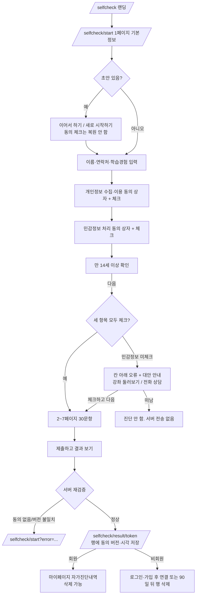

# 도형심리 자가진단 민감정보 별도 동의 기획·화면 정의서

- 작성일: 2026-11-26
- 작성: service-planner
- 근거: 대표 결정 2026-11-26 (변호사 검토 요청서 B2 / 정정·삭제 절차 문서 L3). 자가진단 응답과 결과를 민감정보(개인정보 보호법 제23조, 건강 관련)로 보고, 자가진단 화면에 민감정보 별도 동의를 추가하며, 처리방침을 v10으로 개정한다. 기록: `docs/01-plan/features/bara-edu-lms.diagnosis-correction-procedure.md` 8.3절.
- 상태: 초안. 10장 대표 질문 답을 받은 뒤 확정한다. 코드 변경 없음(문서만).
- **이 문서는 법률 자문이 아니다.** 2장의 법 해석은 기획자가 2차 자료와 조문 구조로 이해한 내용이며, 변호사 확인이 필요한 곳은 "확인 필요"로 적었다.
- 문구: 이 문서의 화면 문구는 초안이다. 최종 문구는 ux-writer가 정한다(쉬운 `~해요`체, 이모지·느낌표 없음). 동의 상자의 4개 고지 항목(3.2절)은 법정 고지 내용이라 ux-writer가 표현을 다듬더라도 항목과 사실관계는 바꾸지 않는다.
- 검토 필요: privacy-security-officer(민감정보 처리 전체), backend-developer(API·DB 패치 계약), qa-reviewer. 대표 답변이 필요한 것은 10장.
- 확인한 코드(2026-11-26 `main` 기준): `components/diagnosis/DiagnosisStepper.tsx`, `app/(public)/selfcheck/{page,start/page,result/[token]/page}.tsx`, `app/actions/diagnosis.ts`, `api/db/02-schema.sql` 1771~2379행, `api/src/query/rpc.ts`, `api/src/ops/admin-diagnosis.ts`, `api/src/auth/withdraw.ts`, `api/src/jobs/scheduler.ts`, `lib/supabase/admin-queries.ts` 1444~1620행, `app/(admin)/admin/selfcheck/**`, `app/(user)/my/page.tsx`, `app/actions/auth.ts`(가입 동의), `data/diagnosis/{questions,config}.ts`

---

## 0. 현재 구조 (코드 확인 결과)

### 0.1 무엇을, 언제, 누구에게서 받는가

| 시점 | 대상 | 받는 항목 | 저장 위치 | 위치(코드) |
|---|---|---|---|---|
| `/selfcheck/start` 1페이지(기본정보) | 회원·비회원 모두 | 이름(필수), 휴대전화·이메일(둘 중 1개 필수), 학습 경험(필수), 보유 자격 수준(선택), 개인정보 수집·이용 동의(필수), 만 14세 이상 확인(필수) | 제출 전에는 브라우저 `localStorage`(`bara_selfcheck_draft_v1`, 24시간) | `DiagnosisStepper.tsx` 237~316행 |
| 2~7페이지 | 같음 | 30문항 응답(0~4점) | 제출 전에는 같은 `localStorage` 초안 | 같은 파일 318~362행 |
| 제출 | 같음 | 위 전부 + 서버가 계산한 6영역 점수, 전체 점수, 추천 단계(tier), 강점·보완 영역 | `diagnosis_results` 1행, `diagnosis_answers` 30행 | `app/actions/diagnosis.ts` `submitDiagnosis` → RPC `submit_diagnosis` |
| 결과 화면(강사과정 사전 적합 후보만) | 같음 | 이름, 연락처, 문의 내용, 연락 동의 | `diagnosis_leads` | `submitDiagnosisLead` → `submit_diagnosis_lead` |

- 로그인 상태로 제출하면 `user_id`·`claimed_at`이 바로 채워진다(회원 결과). 로그인 상태면 이름·휴대전화·이메일을 `profiles`에서 미리 채워 준다(수정 가능).
- 비회원 결과는 `user_id is null`. 나중에 로그인·가입하면 결과 링크에서 연결(claim)된다. 제출한 그 브라우저(httpOnly 쿠키 `bara_selfcheck_recent_token`, 24시간)면 자동, 아니면 [이 결과를 내 계정에 연결하기] 버튼으로 연결한다.
- 결과 링크 `/selfcheck/result/{access_token}`: **로그인 없이 누구나** 추천 단계·전체 점수·추천 과정을 본다(`get_diagnosis_summary`). 영역별 점수·강점·보완은 소유 회원만 본다(`get_diagnosis_detail`). 30문항 원응답은 관리자만 본다.
- 관리자: `/admin/selfcheck` 목록은 이름 원문 + 연락처 마스킹 + 학습 경험·전체 점수·추천 단계·회원 여부를 보여 준다(목록 열람 자체는 접속 기록 없음). 상세 `/admin/selfcheck/[id]`는 이름·연락처 원문, 6영역 점수, 30문항 원응답을 보여 주며 열 때 `조회`가 기록된다(기록 실패 시 원문 없음).

### 0.2 지금 동의는 어디에 보이고 어떻게 저장되나

| 흐름 | 화면 | 저장 |
|---|---|---|
| 자가진단 | 1페이지 아래쪽 회색 상자(11.5px)에 항목·목적·보유기간·거부권 요약 → 체크박스 "개인정보 수집·이용에 동의합니다 (필수)" → "만 14세 이상입니다 (필수)". 요약의 항목에 "30문항 응답"이 이미 들어 있지만 **민감정보라는 표시나 별도 동의는 없다** | `diagnosis_results.consent_privacy`(항상 true), `consent_privacy_doc_version`(제출 시점 게시 중인 처리방침 버전, 없으면 null), `age_confirmed`(항상 true). 동의 시각은 따로 없고 `created_at`이 대신한다. 동의 상자 문구 자체의 버전은 저장하지 않는다 |
| 회원가입 | 이용약관·개인정보 수집·이용 체크박스 2개 | **저장하지 않는다.** `app/actions/auth.ts` 81행에서 체크 여부만 검사하고 API로 넘기지 않는다(참고: 이번 범위 밖, 7장 엣지케이스 마지막 줄) |
| 강사과정 문의 | 연락 동의 체크박스 | `diagnosis_leads.consent_contact`(항상 true) |

서버 재검증: `submit_diagnosis`는 `p_consent_privacy`, `p_age_confirmed`가 true가 아니면 예외를 던진다. 앱 액션도 먼저 확인한다.

**초안(localStorage) 문제**: `saveDraft`는 폼 전체(FormData)를 저장하고 `applyDraft`는 체크박스까지 복원한다. 즉 지금도 동의 체크가 초안에서 자동으로 다시 체크된다. 별도 동의를 추가하면 이것이 "기본값 미체크" 원칙을 깨므로 함께 고친다(4.2절).

### 0.3 보관·파기 동작

| 상황 | 지금 동작 | 위치 |
|---|---|---|
| 비회원 결과, 진단 90일 경과 | 이름·휴대전화·이메일·보유 자격·utm만 null. **행, 점수, 추천 단계, 30문항 응답, `access_token`은 남는다** → 결과 링크는 계속 열리고 요약이 보인다 | `purge_unclaimed_diagnosis_pii()`, 매일 03:20 |
| 회원 탈퇴 | 이름·연락처·보유 자격 null. **`user_id`는 그대로**(탈퇴 회원 `profiles` 행도 남음), 점수·응답 남음. 문의는 삭제 | `api/src/auth/withdraw.ts` 51~52행 |
| 강사과정 문의 | 접수 1년 뒤 행 삭제 | `purge_old_diagnosis_leads()` |
| 결과 행 삭제(정정·삭제 절차의 DB 직접 처리) | `diagnosis_answers` 함께 삭제, 문의의 `result_id`는 null | FK `on delete cascade` / `set null` |
| 관리자 접속 기록 | 2년 뒤 자동 파기(v9) | `purge_old_admin_access_logs()` |

### 0.4 이번 결정으로 무엇이 민감정보가 되나

| 데이터 | 민감정보로 다룸 | 이유 |
|---|---|---|
| 30문항 응답(`diagnosis_answers`) | 예 | 대표 결정의 대상 |
| 6영역 점수, 전체 점수, 강점·보완 영역, 추천 단계(`diagnosis_results` 점수 컬럼들) | 예 | 응답에서 계산한 결과도 같은 정보로 본다 |
| 학습 경험, 보유 자격 수준 | 아니오(일반 개인정보) | 학력·자격 정보에 가깝다. 지금처럼 일반 동의로 받는다 |
| 이름, 휴대전화, 이메일 | 그 자체는 아니오 | 하지만 이것들이 **같은 행에 붙어 있으면 그 행 전체가 "알아볼 수 있는 사람의 민감정보"**가 된다 |
| 강사과정 문의 | 그 자체는 아니오 | 다만 문의는 추천 단계가 "강사과정 사전 적합 후보"인 사람만 낼 수 있어, 문의가 있다는 사실이 결과를 드러낸다. 결과와 같은 보호 수준(접속 기록·마스킹)을 유지한다 |

이름·연락처가 붙어 있는지에 따라 바뀌는 것:
- 이름·연락처를 지워도 행은 `access_token`(결과 링크), 행 `id`, 회원이면 `user_id`로 계속 특정 개인과 이어질 수 있다. 결과 링크를 가진 사람은 그 결과를 연다. 따라서 **"이름·연락처만 지우면 민감정보가 아니게 된다"고 볼 수 없다**(가명 상태로 남음). 이것이 5.3절에서 파기 방식을 "행 삭제"로 바꾸자고 제안하는 이유다.
- 반대로 이름 없이 받는다고 민감정보 동의가 필요 없어지지도 않는다. 회원 결과는 `user_id`로 바로 식별된다.

## 1. 핵심 설계 (한눈에)

1. `/selfcheck/start` 1페이지(첫 문항 전)에 **민감정보 처리 동의**를 개인정보 수집·이용 동의와 **분리된 상자와 체크박스**로 추가한다. 기본은 미체크, 초안에서 복원하지 않는다. "전체 동의" 버튼은 두지 않는다.
2. 거부하면 진단을 진행할 수 없다(진단 자체가 민감정보 처리다). 대신 강좌 둘러보기와 전화 상담을 같은 자리에서 안내한다.
3. 동의 기록은 결과 행에 **동의 문구 버전 + 서버 시각**으로 남긴다(`sensitive_consent_version`, `sensitive_consented_at`). 주체는 그 행 자체(회원이면 `user_id`, 비회원이면 행 `id`). 문구 원문은 버전별로 코드 저장소에 고정 보관한다.
4. 변경 전 결과(별도 동의 없음)는 **배포 때 일괄 삭제**를 권한다(실 운영 전, 건수가 적음). 삭제 후 DB 제약으로 "동의 기록 없는 결과"가 다시 생기지 못하게 막는다.
5. 파기 방식을 바꾼다: 비회원 90일·회원 탈퇴 때 이름·연락처만 지우던 것을 **결과 행 전체 삭제**로(응답·점수 포함). 통계용 잔존 데이터를 남기지 않는다.
6. 동의 철회 = 그 결과 삭제. 회원은 마이페이지에서 직접 지울 수 있게 하고, 비회원은 기존 정정·삭제 절차(전화·이메일)로 처리한다.
7. 관리자 목록에서 이름을 마스킹하고, 상세에 동의 기록을 보여 준다. 저장 암호화는 RDS 스토리지 암호화 확인으로 갈음하고 컬럼 암호화는 하지 않는다.
8. 처리방침 v10: 제1조(3-1, 4), 제2조, 제3조, 제6조, 제8조를 고친다(8장 초안).

### 1.1 전체 흐름



### 1.2 시나리오

정상(비회원)
1. `/selfcheck`에서 [진단 시작하기].
2. 1페이지에서 이름·연락처·학습 경험을 적는다.
3. "개인정보 수집·이용" 상자를 읽고 체크한다.
4. 아래 따로 있는 "민감정보(자가진단 응답·결과) 처리" 상자를 읽고 체크한다.
5. 만 14세 이상 체크 → [다음] → 30문항 → [제출하고 결과 보기].
6. 서버가 두 동의와 동의 문구 버전을 다시 확인하고 저장한다. 결과 화면으로 간다.

거부
1. 3까지 하고 4를 체크하지 않은 채 [다음].
2. 민감정보 체크박스 아래에 "이 동의가 없으면 자가진단을 할 수 없어요"와 대안 두 가지가 보인다. 포커스는 그 체크박스로 간다.
3. 사용자가 [강좌 둘러보기]나 전화 상담을 고르면 떠난다. 서버에는 아무것도 보내지 않았다(초안은 4.2절대로 정리).

## 2. 법적 요건 (이해한 바, 법률 자문 아님)

### 2.1 근거 조문 정리

| 요건 | 내용(이해한 바) | 이 기능에서 할 것 | 상태 |
|---|---|---|---|
| 민감정보 처리 원칙 금지 | 제23조 제1항 본문: 건강 등 민감정보는 처리하지 못한다. 예외 제1호: 제15조 제2항(또는 제17조 제2항) 각 호의 사항을 알리고 **다른 개인정보의 처리에 대한 동의와 별도로** 동의를 받은 경우 | 별도 상자·별도 체크박스·별도 저장 | 2차 자료 기준, 확인 필요 |
| 알릴 사항(제15조 제2항) | ① 수집·이용 목적 ② 수집 항목 ③ 보유·이용 기간 ④ 동의를 거부할 권리가 있다는 사실과 거부 시 불이익 | 3.2절 문구에 4개 모두 | 2차 자료 기준 |
| 동의 받는 방법(제22조) | 각 동의 사항을 구분해 정보주체가 명확히 알 수 있게 알리고 각각 동의를 받는다. 민감정보 동의는 구분 대상이다 | 일반 동의와 다른 상자, "전체 동의" 없음 | 확인 필요 |
| 중요 내용 표시(제22조 제2항, 시행령 제17조, 처리 방법 고시) | 민감정보와 보유 기간 등 중요한 내용은 글씨 크기·색·굵기·밑줄 등으로 명확히 표시. 고시에 "최소 9포인트 이상, 다른 내용보다 20% 이상 크게" 같은 기준이 있는 것으로 안다 | 상자 본문 16px, 핵심 단어 굵게(4.1절). 지금 상자의 11.5px은 고친다 | **확인 필요**(고시 현행 문언) |
| 공개 가능성 고지(제23조 제3항) | 서비스 제공 과정에서 공개되는 정보에 민감정보가 포함돼 사생활 침해 위험이 있으면, 공개 가능성과 비공개 선택 방법을 알린다 | 결과 링크를 아는 사람은 요약(추천 단계·전체 점수)을 볼 수 있다는 사실을 동의 상자와 결과 화면에 알린다(10장 Q4) | 확인 필요 |
| 안전성 확보(제23조 제2항, 안전성 확보조치 기준) | 분실·도난·유출 등이 없도록 안전성 확보 조치. 접속 기록은 민감정보 처리 시스템이면 2년 이상으로 아는데, 이미 2년(v9) | 6장 | 접속 기록은 충족. 암호화 의무 범위는 **확인 필요**(고시상 저장 암호화 의무 대상은 고유식별정보·비밀번호·생체인식정보로 알고 있음, 민감정보 전반은 아님) |
| 만 14세 미만 | 제22조의2: 법정대리인 동의 필요 | 지금처럼 만 14세 미만은 온라인 접수를 받지 않는다 | 기존 유지 |
| 동의 철회 | 제37조: 처리정지 요구·동의 철회. 수집 방법보다 어렵지 않게(시행령 제41조 제2항 준용 취지) | 회원 셀프 삭제 + 전화·이메일(5.4절) | 확인 필요 |

### 2.2 참고: 해당 여부에 대한 기획자 관찰

`data/diagnosis/questions.ts`의 30문항은 응답자 **자신의** 심리·건강 상태를 묻지 않는다. "도형심리 검사를 설명할 수 있다", "검사지에서 도형을 구분할 수 있다"처럼 검사를 **다루는 역량**을 묻고, 결과 화면에도 "임상적 진단이 아니다"라는 고지가 있다. 그래서 법적으로는 민감정보에 해당하지 않는다는 해석도 가능해 보인다. 대표 결정은 보수적으로 민감정보로 다루는 것이고, 이 문서는 그 결정을 따른다. 해당하지 않는 정보에 별도 동의를 받는 것 자체는 위험이 작지만, 처리방침에 "민감정보를 처리한다"고 적으면 그에 맞는 보호 조치(6장)를 지켜야 하는 부담이 생긴다. 변호사 검토 때 함께 확인하길 권한다(10장 참고 항목).

## 3. 동의 상자 문구 초안

### 3.1 배치 원칙

- 1페이지 안, 기본정보 입력 칸 아래, 첫 문항(2페이지) 앞.
- 순서: ① 개인정보 수집·이용(필수) ② 민감정보 처리(필수) ③ 만 14세 이상(필수). 각각 별도 상자, 별도 체크박스, 별도 오류 문구.
- 기본은 모두 미체크. 초안 복원으로 체크되지 않는다. "모두 동의" 버튼 없음.
- 4개 고지 항목은 링크 뒤에 숨기지 않고 상자 안에 그대로 보인다(지금의 요약 방식 유지, 글씨만 키움).
- 동의 문구 버전: `sc-v1`(2026-12 배포 예정분). 문구를 한 글자라도 바꾸면 버전을 올린다(4.4절).

### 3.2 ② 민감정보 처리 동의 (신규, 정확한 초안)

> **민감정보(자가진단 응답·결과) 처리 동의** (필수)
>
> 바라 평생교육원은 도형심리 자가진단의 **응답과 결과를 민감정보로 보고** 아래와 같이 처리해요.
>
> - **처리 목적**: 자가진단 점수 계산, 결과와 추천 과정 안내, (강사과정 사전 적합 후보로 나온 경우) 강사과정 상담 연결
> - **처리 항목**: 30개 문항에 대한 응답, 영역별 점수와 전체 점수, 강점·보완 영역, 추천 과정
> - **보유 기간**: 회원 계정에 연결하지 않으면 **진단일로부터 90일 뒤 모두 삭제**해요. 회원 계정에 연결하면 **회원 탈퇴 또는 삭제를 요청할 때까지** 보관해요.
> - **동의를 거부할 권리**: 동의하지 않을 수 있어요. 다만 동의하지 않으면 **자가진단을 할 수 없어요.** 강좌 정보 보기와 전화 상담은 동의 없이 이용할 수 있어요.
>
> 결과 화면 주소(결과 링크)를 아는 사람은 추천 과정과 전체 점수를 볼 수 있어요. 결과 링크는 다른 사람에게 보내지 마세요.
>
> [ ] 위 민감정보(자가진단 응답·결과) 처리에 동의해요 (필수)

대표가 10장 Q2에서 "파기 방식 유지(이름·연락처만 삭제)"를 고르면 보유 기간 줄만 아래로 바꾼다.
> - **보유 기간**: 회원 계정에 연결하지 않으면 진단일로부터 90일 뒤 이름과 연락처를 지우고, 응답과 점수는 통계를 위해 남겨요. 회원 계정에 연결하면 회원 탈퇴 또는 삭제를 요청할 때까지 보관해요.
>
> (이 경우 남는 응답·점수도 결과 링크로 계속 열리므로 "누구인지 알 수 없게"라고 쓰지 않는다.)

### 3.3 ① 개인정보 수집·이용 동의 (기존 상자 수정)

민감정보 항목을 빼서 두 상자가 겹치지 않게 한다.

> **개인정보 수집·이용 동의** (필수)
>
> - **항목**: 이름, 휴대전화 또는 이메일(1개 이상), 도형심리 학습 경험, 보유 자격 수준(적은 경우)
> - **목적**: 자가진단 결과를 본인에게 연결, 추천 과정 안내, 강사과정 상담 연락
> - **보유 기간**: 회원 계정에 연결하지 않으면 진단일로부터 90일 뒤 삭제해요. 회원 계정에 연결하면 회원 탈퇴 때까지 보관해요.
> - 동의하지 않을 수 있어요. 동의하지 않으면 자가진단을 할 수 없어요.
>
> [ ] 개인정보 수집·이용에 동의해요 (필수)  [전체 내용 보기](/legal/privacy)

### 3.4 ③ 연령 확인 (문구 유지)

> [ ] 만 14세 이상이에요 (필수)

## 4. 화면 정의

### 4.1 `/selfcheck/start` 1페이지

| 요소 | 내용 | 동작 | 상태별 표시 |
|---|---|---|---|
| 단계 표시 | "1/7 · 기본정보" | — | — |
| 이름·휴대전화·이메일·학습 경험·보유 자격 | 기존 그대로 | 기존 검증 그대로 | 기존 |
| 동의 상자 ① | 3.3절. 상자 본문 16px, 항목 이름 굵게, 배경 `n-1` + 테두리 | — | — |
| 체크박스 ① | `name="consentPrivacy"`, 미체크 기본 | 체크 시 오류 해제 | 미체크로 [다음]: 칸 아래 "개인정보 수집·이용에 동의해야 진단을 시작할 수 있어요" |
| 동의 상자 ② | 3.2절. 제목에 "민감정보" 굵게. 상자 테두리를 ①과 같은 굵기로, 위아래 간격 24px 이상으로 분리 | — | — |
| 체크박스 ② | `name="consentSensitive"`, 미체크 기본. 숨은 칸 `name="consentSensitiveVersion" value="sc-v1"` | 체크 시 오류·대안 영역 해제 | 미체크로 [다음]: 아래 "거부 안내" 표시 |
| 거부 안내(조건부) | "이 동의가 없으면 자가진단을 할 수 없어요." + 버튼형 링크 [강좌 둘러보기](`/courses`) + "전화로 상담받기 `{siteConfig.phone}` (`{siteConfig.supportHours}`)"(`tel:` 링크) | 링크는 같은 탭 이동 | 체크박스 ② 오류일 때만 |
| 체크박스 ③ | 기존 `ageConfirmed` | 기존 | 기존 문구 |
| [다음] | 기존 | `validatePage(0)`에 `consentSensitive` 필수 추가. 첫 오류 칸으로 스크롤·포커스 | — |

- 오류 여러 개일 때 우선순위는 위에서 아래 순서(지금 동작과 같다).
- 터치 영역: 체크박스는 라벨 전체를 눌러도 체크되게 하고 높이 44px 이상. 지금의 16px 체크박스 + 12px 글씨는 시니어 기준에 못 미쳐 이 기회에 키운다(ui-ux-designer가 기존 가입 마무리 화면의 `lg` 규칙에 맞춰 확정).
- `aria-describedby`로 체크박스와 상자 본문을 연결해 스크린리더가 고지를 읽고 체크하게 한다. 오류는 `aria-invalid` + `role="alert"` 없이 칸 아래 텍스트(기존 패턴), 색만으로 구분하지 않는다.

### 4.2 초안(localStorage) 규칙 변경

| 항목 | 정의 |
|---|---|
| 키 | `bara_selfcheck_draft_v1` → `bara_selfcheck_draft_v2`. 배포 직후 옛 키는 읽지 않고 지운다(옛 초안은 별도 동의 전에 만든 것) |
| 저장 제외 | `consentPrivacy`, `consentSensitive`, `consentSensitiveVersion`, `ageConfirmed`는 저장하지 않는다 |
| 복원 | 복원 후에도 세 체크박스는 미체크. 복원된 페이지가 2페이지 이상이어도 1페이지로 돌려보내지 않으면 동의 없이 문항에 답할 수 있다 → **동의가 비어 있으면 1페이지부터 다시 시작**(입력값은 복원된 상태) |
| 안내 | 복원 다이얼로그 문구에 한 줄 추가: "동의 항목은 다시 체크해 주세요." |
| 공용 PC | 초안에는 응답이 들어 있다. 다이얼로그에 "다른 사람이 쓰던 기기라면 [새로 시작하기]를 눌러 주세요" 한 줄 추가. 제출 성공 시 삭제(기존) |

초안은 회사가 받지 않은 브라우저 안의 데이터이므로 동의 대상은 아니지만, 동의 전에 답한 응답이 저장되는 일이 없도록 1페이지 동의 → 문항 순서를 강제한다.

### 4.3 제출 오류 상태 (`/selfcheck/start?error=`)

| 코드 | 원인 | 문구(초안) | 동작 |
|---|---|---|---|
| `validation` | 기존(필수값·동의 누락) | 필수 항목을 확인해 주세요. | 기존 |
| `incomplete` | 기존 | 아직 응답하지 않은 문항이 있어요. | 기존 |
| `consent-outdated` (신규) | 제출한 동의 문구 버전이 서버의 현재 버전과 다르다(화면을 오래 열어 둔 사이 배포됨) | 동의 내용이 바뀌었어요. 바뀐 내용을 확인하고 다시 동의해 주세요. 입력하신 답은 남아 있어요. | 1페이지로. 초안 복원 다이얼로그가 뜨고 동의는 미체크 |
| `submit-failed` | 기존 | 제출에 실패했어요. 잠시 후 다시 시도해 주세요. | 기존 |

### 4.4 `/selfcheck/result/[token]`

| 요소 | 변경 |
|---|---|
| 요약 카드 아래(모든 열람자) | 안내 한 줄: "이 화면 주소를 아는 사람은 추천 과정과 전체 점수를 볼 수 있어요. 주소를 다른 사람에게 보내지 마세요." (`print-hide`) |
| 연결 확인 상자(로그인 + 미연결 + 제출 브라우저 아님) | 문구 강화: "본인이 직접 응답한 결과만 연결해 주세요. 연결하면 회원 탈퇴나 삭제 요청 때까지 보관돼요." |
| 상세(소유 회원) | 맨 아래 보조 버튼 [이 진단 기록 지우기] (10장 Q3 승인 시). 확인 대화상자: "지우면 되돌릴 수 없어요. 결과 링크로도 열리지 않아요." [지우기] [취소] → 성공 시 `/my?tab=diagnosis&deleted=1` |
| 결과 없음(삭제·파기됨 포함) | 기존 "결과를 찾을 수 없어요" 유지. 삭제됐는지·없는지 구분하지 않는다 |

### 4.5 마이페이지 자가진단내역 (`/my?tab=diagnosis`)

| 요소 | 변경 |
|---|---|
| 각 행 | 오른쪽 [지우기] 텍스트 버튼(Q3 승인 시). 확인 대화상자는 4.4절과 같다 |
| 삭제 성공 | 목록 위 배너 "진단 기록을 지웠어요." |
| 실패 | "지우지 못했어요. 잠시 후 다시 시도해 주세요." 목록 유지 |
| 빈 상태 | 기존 "아직 자가진단 이력이 없어요" |

### 4.6 관리자 `/admin/selfcheck`

| 화면 | 변경 |
|---|---|
| 목록 | 이름을 마스킹(첫 글자 + `*`, 예: `홍**`). 이름 원문은 상세(접속 기록 있음)나 "개인정보 보기"(기록 있음)에서만. 점수·추천 단계 열은 유지(문의 응대에 필요) |
| 목록 "개인정보 보기" | 기존처럼 연락처를 펼칠 때 이름 원문도 함께 펼친다(같은 접속 기록 1건, `detail`에 `fields=name,contact`) |
| 상세 | "동의 기록" 줄 추가: "민감정보 동의: sc-v1, 2026-12-03 14:02 / 처리방침: v10". 동의 기록이 없는 행(Q1에서 삭제 외를 고른 경우만 존재)은 "별도 동의 없음(변경 전 결과)" 경고 표시 |
| 빈 상태·오류 | 기존 |

### 4.7 `/selfcheck` 랜딩

"약 5분 · 30문항" 아래에 한 줄: "응답과 결과는 민감정보로 보고 따로 동의를 받아요." (선택. 시작 전에 알게 해 거부할 사람이 문항 입력 전에 판단하게 한다)

## 5. 동의 기록, 증명, 철회

### 5.1 저장할 것

| 컬럼(`diagnosis_results`) | 값 | 비고 |
|---|---|---|
| `sensitive_consent_version` text | 화면이 보낸 동의 문구 버전(`sc-v1`). 서버가 허용 목록과 대조 | 신규 |
| `sensitive_consented_at` timestamptz | 서버 `now()`(제출 트랜잭션 시각) | 신규. 클라이언트 시각은 쓰지 않는다 |
| `consent_privacy`, `consent_privacy_doc_version` | 기존 그대로(처리방침 버전 스냅샷) | 유지 |
| 주체 | 행 자체. 회원은 `user_id`, 비회원은 행 `id`(결과 링크 `access_token`과 1:1) | 별도 동의 테이블을 두지 않는다 |

제약: `check ((sensitive_consent_version is null) = (sensitive_consented_at is null))`. 기존 행 정리(Q1) 뒤에는 두 컬럼에 `not null`을 걸어 동의 없는 결과가 생길 수 없게 한다.

별도 동의 테이블을 두지 않는 이유: 동의 기록이 결과보다 오래 남으면 "이 사람이 자가진단을 했다"는 사실이 남는다. 결과를 지우면 동의 기록도 함께 사라지는 쪽이 최소 보관에 맞다. 처리가 끝난 뒤의 증명은 접속 기록(관리자 처리)과 정정·삭제 처리 대장이 맡는다.

IP·브라우저 정보는 저장하지 않는다(필요성 낮고 새 수집 항목이 된다).

### 5.2 동의 증명

증명은 세 가지를 합쳐서 한다.
1. 결과 행의 `sensitive_consent_version` + `sensitive_consented_at`(그 사람이 언제 어떤 문구에 동의했는지).
2. 버전별 문구 원문: `data/diagnosis/consent.ts`에 `{ 'sc-v1': { effectiveFrom, text } }` 형태로 두고, 한 번 배포한 버전의 문구는 **고치지 않고 새 버전을 추가**한다. git 이력이 게시 시점을 증명한다. 화면은 이 상수에서 문구를 그려서 저장 버전과 화면 문구가 어긋날 수 없게 한다.
3. 서버 강제: RPC가 동의 없이는 행을 만들지 않으므로(아래 5.3) 동의 기록 없는 결과는 존재할 수 없다(제약 포함).

### 5.3 서버 검증 순서 (`submit_diagnosis`)

1. `p_consent_privacy` true 아니면 `privacy consent required`(기존)
2. **`p_consent_sensitive` true 아니면 `sensitive consent required`**
3. **`p_consent_sensitive_version`이 허용 목록(`array['sc-v1']`)에 없으면 `sensitive consent version mismatch`**
4. `p_age_confirmed`(기존) 이하 기존 순서

앱 액션은 같은 검사를 먼저 하고, 3번 실패를 `consent-outdated`로, 나머지를 `validation`으로 돌려보낸다. RPC 예외 문자열로 3번을 구분할 수 있게 API의 DB 오류 매핑을 확인한다(지금은 RPC 오류를 모두 `submit-failed`로 묶는다).

### 5.4 동의 철회

동의 철회는 "그 결과의 처리를 멈춤"이고, 민감정보를 동의 없이 계속 보관할 근거가 없으므로 **결과 행 삭제**로 처리한다(응답 30건 함께 삭제, 문의는 `result_id`만 null).

| 대상 | 경로 | 처리 |
|---|---|---|
| 회원(연결된 결과) | 마이페이지·결과 상세의 [지우기](Q3 승인 시) | 신규 RPC로 본인 소유 행만 삭제. 관리자 개입 없음 |
| 회원, 셀프 삭제 미도입 시 | 전화·이메일 | 정정·삭제 절차 문서의 "삭제" 그대로 |
| 비회원 | 전화·이메일(info@ylia.io) | 정정·삭제 절차 문서 3장 본인 확인(결과 링크 + 이름 등) → 행 삭제 |
| 연결된 강사과정 문의 | 결과 삭제 시 문의는 남는다 | 셀프 삭제 확인 대화상자에서 "강사과정 문의도 함께 지울까요?" 체크(기본 체크). 관리자 절차는 기존대로 물어본다 |

비회원 셀프 삭제(결과 링크만으로 삭제)는 두지 않는다. 링크는 공유될 수 있어 남이 지울 수 있다(정정·삭제 절차 R6과 같은 이유).

## 6. 관리·보호 조치

| 조치 | 지금 | 제안 | 판단 |
|---|---|---|---|
| 접속 기록 | 상세 열람·연락처 펼침·문의 처리에 기록, 2년 보관 | 유지. 목록 "개인정보 보기"의 `detail`에 이름 포함 표시 | 이미 충족 |
| 목록 노출 | 이름 원문 + 점수·추천 단계(기록 없음) | 이름 마스킹 | **권장**. 기록 없이 "누구의 민감정보"를 보는 경로를 없앤다. 비용 작음 |
| 상세의 30문항 원응답 | 기록 후 원문 표시 | 유지 | 관리자가 응대·재채점에 쓰는 유일한 화면이고 이미 기록된다 |
| 저장 암호화(디스크) | 확인 기록 없음 | RDS 스토리지 암호화(KMS)와 스냅샷 암호화가 켜져 있는지 확인하고 기록. 꺼져 있으면 별도 작업(암호화 스냅샷 복원)으로 판단 | **권장(확인만)** |
| 컬럼 단위 암호화(응답·점수) | 없음 | 하지 않음 | 채점·판정이 SQL RPC 안에서 일어나고 관리자 화면·마이페이지가 값을 읽는다. 키가 같은 서버에 있으면 효과가 작고 복잡도는 크다. 고시상 의무 대상도 아닌 것으로 이해(확인 필요) |
| 비회원 90일 파기 | 이름·연락처만 null | **행 전체 삭제** | **권장**(Q2). 0.4절 이유 |
| 회원 탈퇴 | 이름·연락처만 null, `user_id`·점수 유지 | **그 회원의 결과 행 전체 삭제** | **권장**(Q2) |
| 백업 | RDS 자동 백업 보관 기간 동안 지운 행이 스냅샷에 남는다 | 보관 기간을 확인해 처리방침 제3조에 "백업에서는 최대 N일 뒤 사라져요"를 적을지 officer가 판단 | 확인 필요 |
| 관리자 2단계 인증 | 별도 기획 진행 중 | 이 기능과 같은 v10에 문장만 합친다(8장) | 별도 |
| 통계 | 90일 뒤 남는 점수·응답 | 필요하면 개인과 연결되지 않는 집계표(월별 추천 단계 건수 등)를 따로 만든다. 이번 범위 밖 | Q2 |

## 7. 기존 데이터 처리 (변경 전 결과)

변경 전 결과는 별도 동의가 없다. 사이트는 아직 실 운영 전이라 건수가 적다(배포 전 아래 쿼리로 확인, 값 출력 없음).

```sql
select count(*) as total,
       count(*) filter (where user_id is not null) as member,
       count(*) filter (where user_id is null and respondent_name is not null) as nonmember_with_pii,
       count(*) filter (where user_id is null and respondent_name is null) as nonmember_purged
  from diagnosis_results;
select count(*) from diagnosis_leads where result_id is not null;
```

| 선택지 | 내용 | 장점 | 단점 |
|---|---|---|---|
| A. 다음 열람 때 재동의 | 회원이 결과·마이페이지를 열면 동의 화면을 먼저 보여 주고, 동의하면 기록을 채우고 거부하면 삭제. 비회원은 결과 링크를 열 때 같은 방식 | 데이터 보존 | 다시 오지 않는 사람의 데이터는 동의 없이 계속 남는다. 화면·상태가 하나 더 생기고, 링크 주인이 본인인지 알 수 없어 비회원 재동의는 증명력이 약하다 |
| **B. 일괄 삭제(추천)** | 배포 패치에서 `sensitive_consent_version is null`인 결과 행을 모두 삭제(응답 함께), 그 뒤 not null 제약 | 단순하고 확실. 동의 없는 민감정보가 0건이 된다. 실 운영 전이라 영향 작음 | 테스트·내부 진단 기록이 사라진다. 회원 마이페이지 자가진단내역이 비게 된다 |
| C. 기존 근거 유지 | 일반 동의(`consent_privacy`)를 근거로 그대로 둔다 | 할 일 없음 | 대표 결정(민감정보)과 모순. 처리방침에 "별도 동의를 받아 처리한다"고 쓰면서 예외가 남는다 |

추천: **B.** 실행 전 위 쿼리 결과를 대표에게 보고한다. 외부 실사용자(직원·테스트 계정이 아닌 회원) 결과가 있으면 그 회원에게만 가입 이메일로 "자가진단 기록을 정리했어요, 다시 해 볼 수 있어요"를 회사 메일함에서 보낸다(선택). 비회원에게는 연락하지 않는다(연락 자체가 연락처를 새 목적에 쓰는 일이 된다).

삭제 실행은 운영 패치로 한다(정정·삭제 절차 5.2절 관례: 한 트랜잭션, 운영자 접근 기록에 건수만). 개별 건마다 `admin_access_logs`를 남기지 않고 운영자 접근 기록 한 줄(`diagnosis_results N건 삭제(별도 동의 도입 전 결과), diagnosis_leads.result_id M건 null`)로 갈음한다.

## 8. 처리방침 v10 개정 초안

주의:
- 이 저장소의 `bara-edu-lms.legal-privacy.md` 본문은 v9 게시본과 다르다(제3조 표와 제8조 제5항이 아직 "1년 이상"·"1년이 지난 기록"). 변경 이력에는 v9를 "2년"으로 적었다. **v10은 CMS의 v9 게시본을 기준으로** 아래 변경을 얹고, 이번에 저장소 본문도 v10과 똑같이 맞춘다.
- 이 처리방침에서 수집 항목은 제1조, 목적은 제2조다(요청서의 "제2조 수집 항목"은 제1조 3-1에 해당). 아래는 제1조·제2조·제3조·제6조·제8조를 모두 다룬다.
- 아래는 Q2(행 전체 삭제)·Q3(회원 셀프 삭제) 추천안 기준이다. 다르게 정하면 표시한 문장만 바꾼다.

### 8.1 제1조 3-1 (표의 한 줄 교체 + 문단 추가)

표에서
> | 진단 결과 산출 | 30개 문항에 대한 응답(0~4점) 및 산출된 영역별·전체 점수, 추천 과정 | - |

을
> | 진단 결과 산출 **(민감정보, 별도 동의)** | 30개 문항에 대한 응답(0~4점), 산출된 영역별·전체 점수, 강점·보완 영역, 추천 과정 | 필수 |

로 바꾸고, 표 아래 목록 맨 앞에 추가:
> - 회사는 자가진단의 응답과 결과를 「개인정보 보호법」 제23조의 민감정보로 보고, 다른 개인정보에 대한 동의와 별도로 민감정보 처리 동의를 받은 경우에만 처리합니다. 동의하지 않으면 자가진단을 이용할 수 없으며, 강좌 정보 확인과 전화 상담은 동의 없이 이용할 수 있습니다.
> - 결과 확인 코드(결과 링크)를 아는 사람은 로그인 없이 추천 과정과 전체 점수를 볼 수 있습니다. 결과 링크를 다른 사람에게 전달하지 않도록 주의해 주세요. 영역별 점수와 해석은 결과를 계정에 연결한 본인만 볼 수 있습니다.

### 8.2 제1조 4 (문장 교체)

> - **결제 카드 정보, 주민등록번호, 그 밖의 고유식별정보 및 민감정보**: 수집하지 않습니다.

를
> - **결제 카드 정보, 주민등록번호, 그 밖의 고유식별정보**: 수집하지 않습니다.
> - **민감정보**: 제1조 3-1의 도형심리 자가진단 응답·결과 외에는 수집하지 않습니다. 자가진단 응답·결과는 별도 동의를 받아 처리합니다.

### 8.3 제2조 (표의 한 줄을 두 줄로)

> | 도형심리 역량진단 결과 산출·안내, 적합한 과정 추천, 강사과정 상담 연결 (2026-09-14 추가) | 이름, 휴대전화번호, 이메일, 학습 경험, 보유 자격 수준, 진단 응답·점수, (강사과정 문의 시) 문의 내용 |

를
> | 도형심리 역량진단 결과의 본인 연결, 추천 과정 안내, 강사과정 상담 연락 | 이름, 휴대전화번호, 이메일, 학습 경험, 보유 자격 수준, (강사과정 문의 시) 문의 내용 |
> | 도형심리 역량진단 점수 계산, 결과·추천 과정 안내, 강사과정 상담 연결 **(민감정보, 별도 동의)** | 30개 문항 응답, 영역별·전체 점수, 강점·보완 영역, 추천 과정 |

### 8.4 제3조 제1항 (표 두 줄 교체 + 안내 상자 교체)

표에서 자가진단 두 줄을
> | 도형심리 역량진단 결과 중 **회원 계정에 연결되지 않은(비회원) 결과** — 이름·연락처·학습 경험·보유 자격 수준, 응답·점수·추천 과정(민감정보) | 진단일로부터 90일 | 목적 달성 후 지체 없는 파기 (개인정보 보호법 제21조) — 90일이 지나면 결과 전체를 삭제 |
> | 도형심리 역량진단 결과 중 **회원 계정에 연결된 결과**(민감정보 포함) | 회원 탈퇴 또는 삭제 요청 시까지 | 동의 (서비스 제공) |

로 바꾸고, 접속 기록 줄은 v9 게시본 문구("2년")를 그대로 둔다.

안내 상자 "비회원 자가진단 결과의 파기"를
> **비회원 자가진단 결과의 파기**: 로그인 없이 참여한 자가진단 결과가 90일 이내에 회원 계정과 연결되지 않으면, 사전 안내 없이 이름·연락처와 응답·점수를 포함한 결과 전체를 자동으로 삭제합니다. 삭제한 뒤에는 결과 링크로도 열리지 않습니다. 90일 이내에 회원가입·로그인을 통해 계정에 연결한 경우에는 회원 탈퇴 또는 본인이 삭제를 요청할 때까지 보관합니다.

로 바꾼다.

### 8.5 제3조 제2항 회원 탈퇴 (제2호에 추가)

> 2. **즉시 파기**: 학습 활동 정보(강의별 진도, 퀴즈 응시 기록, 과제 제출물, 자격시험 응시 기록·응시 횟수 리셋 이력)와 **도형심리 자가진단 결과(응답·점수 포함) 및 강사과정 관심 문의**는 탈퇴 즉시 파기합니다.

### 8.6 제6조 (제7항 신설)

> 7. 도형심리 자가진단의 민감정보 처리 동의는 언제든지 철회할 수 있습니다. 동의를 철회하면 해당 자가진단 결과(응답·점수 포함)를 지체 없이 삭제합니다. 회원은 마이페이지 '자가진단내역'에서 직접 삭제할 수 있고, 회원이 아니거나 직접 삭제가 어려우면 제9조의 연락처로 요청할 수 있습니다.

(Q3에서 셀프 삭제를 미루면 "회원은 마이페이지 … 삭제할 수 있고," 부분을 빼고 "제9조의 연락처로 요청할 수 있습니다"만 둔다.)

### 8.7 제8조 (제6호 신설, 제7호 자리 표시)

> 6. **민감정보 보호**: 도형심리 자가진단 응답·결과는 권한 있는 관리자만 조회할 수 있도록 접근을 제한하고, 관리자 목록 화면에서는 이름을 가려 표시하며, 응답·결과를 조회하거나 처리한 기록은 제5호에 따라 보관합니다. 데이터베이스와 백업은 저장 시 암호화된 상태로 보관합니다.

"데이터베이스와 백업은 저장 시 암호화" 문장은 6장의 RDS 암호화 확인 결과가 "켜져 있음"일 때만 넣는다.

> 7. **[관리자 2단계 인증 — 별도 기획 문서의 확정 문장을 여기에 넣는다]**

### 8.8 변경 이력·변경 사유

변경 이력 표에 추가:
> | 2026-12-XX | 도형심리 자가진단 응답·결과를 민감정보로 보고 별도 동의 도입, 비회원 90일·탈퇴 시 결과 전체 삭제, 동의 철회 방법, 민감정보 보호 조치, 관리자 2단계 인증(v10) |

변경 사유 및 고지 안내(v10) 초안:
> 이번 개정(v10)은 도형심리 자가진단의 응답과 결과를 민감정보로 보고 다른 개인정보와 따로 동의를 받도록 바꾼 것입니다. 회원 계정에 연결되지 않은 자가진단 결과는 90일이 지나면 이름·연락처뿐 아니라 응답과 점수까지 모두 삭제하고, 회원이 탈퇴하면 자가진단 결과도 바로 삭제합니다. 민감정보 처리 동의를 철회하는 방법(제6조 제7항)과 민감정보 보호 조치, 관리자 계정의 2단계 인증(제8조)을 함께 적었습니다. 이번 개정 전에 받은 자가진단 결과는 별도 동의가 없어 [YYYY-MM-DD]에 모두 삭제했습니다. 궁금한 점은 제9조의 연락처로 문의해 주세요.

- 제11조: "이용자의 권리에 중대한 변경"(30일 전 고지)인지는 officer 판단. 이전 대표 결정(실 운영 전 개정은 고지 기간을 문제 삼지 않음)이 이번에도 적용되는지 확인만 받는다.
- 게시 순서: v10을 CMS에 **먼저 게시**하고 앱을 배포해야 새 결과의 `consent_privacy_doc_version`이 10이 된다(9장 배포 순서).

## 9. API·데이터 모델 스케치

### 9.1 DB 패치 (`api/db/patches/2026-12-XX-diagnosis-sensitive-consent.sql`, 02-schema.sql에도 같은 내용 반영)

```sql
-- 1) 컬럼
alter table diagnosis_results add column if not exists sensitive_consent_version text;
alter table diagnosis_results add column if not exists sensitive_consented_at timestamptz;
alter table diagnosis_results add constraint diagnosis_results_sensitive_consent_pair
  check ((sensitive_consent_version is null) = (sensitive_consented_at is null));

-- 2) RPC 교체: rpc.ts의 카탈로그는 오버로드가 있으면 기동을 거부한다 → 옛 시그니처를 먼저 drop
drop function if exists public.submit_diagnosis(text, text, text, diagnosis_experience, text, boolean, integer, boolean, jsonb, text, text, text);
create function public.submit_diagnosis(
  p_name text, p_phone text, p_email text, p_learning_experience diagnosis_experience, p_certificate_level text,
  p_consent_privacy boolean, p_consent_privacy_doc_version integer,
  p_consent_sensitive boolean, p_consent_sensitive_version text,
  p_age_confirmed boolean, p_answers jsonb,
  p_utm_source text default null, p_utm_medium text default null, p_utm_campaign text default null
) ... -- 5.3절 검증 추가, insert에 sensitive_consent_version = p_consent_sensitive_version, sensitive_consented_at = now()
-- 기존 grant/revoke 다시 적용

-- 3) 파기 함수(Q2 추천안): 비회원 90일 → 행 삭제
create or replace function public.purge_unclaimed_diagnosis_pii() returns integer ... as $$
  delete from diagnosis_results where user_id is null and created_at < now() - interval '90 days';
$$;  -- 이름은 스케줄러 등록명 유지를 위해 그대로 둔다(주석으로 동작 변경 명시)

-- 4) 회원 셀프 삭제(Q3 승인 시)
create function public.delete_my_diagnosis_result(p_token uuid, p_delete_leads boolean) returns boolean
  -- auth.uid() 필수, user_id = auth.uid()인 행만 삭제. 없거나 남의 행이면 false(구분하지 않음).
  -- p_delete_leads면 diagnosis_leads where result_id = 그 행 and user_id = auth.uid() 먼저 삭제.
revoke execute on function public.delete_my_diagnosis_result(uuid, boolean) from bara_edu_anon;

-- 5) 기존 데이터(Q1 B안) — 별도 운영 스크립트로, 건수 확인 후
-- delete from diagnosis_results where sensitive_consent_version is null;
-- alter table diagnosis_results alter column sensitive_consent_version set not null, alter column sensitive_consented_at set not null;
```

### 9.2 API·앱 계약

| 경로 | 요청 | 응답·오류 | 변경 |
|---|---|---|---|
| `POST /v1/rpc/submit_diagnosis` | 기존 + `p_consent_sensitive: boolean`, `p_consent_sensitive_version: string` | 성공 `{ access_token, recommended_tier, total_score }`. 동의 없음·버전 불일치는 DB 예외 → 지금은 일반 오류. **버전 불일치를 앱이 구분할 수 있게** `toDbError` 매핑에 `sensitive consent version mismatch` → `400 validation, field: "consent_version"` 추가(backend-developer 확정) | 인자 추가 |
| `POST /v1/rpc/delete_my_diagnosis_result` | `{ p_token, p_delete_leads }`, 로그인 필수 | `true`/`false`. 비로그인 401 | 신규(Q3), `RPC_ALLOW`에 추가 |
| `admin.getDiagnosisResultDetail` | 기존 | 응답에 `sensitiveConsentVersion`, `sensitiveConsentedAt`, `privacyDocVersion` 추가 | 필드 추가 |
| 관리자 목록 조회(`getAdminDiagnosisResults`) | 기존 | `respondentName`을 마스킹해서 내려준다(reveal 토큰이 맞을 때만 원문) | 동작 변경 |
| 회원 탈퇴(`withdrawAccount`) | — | `diagnosis_results` update 대신 `delete from diagnosis_results where user_id = $1` | Q2 |

### 9.3 배포 순서

실 운영 전이므로 짧은 제출 불가 구간을 허용한다.
1. 처리방침 v10 CMS 게시(대표).
2. API 배포(`RPC_ALLOW`, 오류 매핑, 탈퇴·관리자 op 변경).
3. DB 패치 적용(1~4). 이 순간부터 옛 앱의 제출은 인자 불일치로 실패한다.
4. 앱 배포(동의 상자, 액션, 초안 v2, 관리자 화면).
5. 기존 데이터 정리 스크립트(Q1) → not null 제약.
6. 스모크: 비회원 제출, 회원 제출, 미체크 거부, 버전 불일치, 셀프 삭제, 관리자 상세 동의 줄.

3~4 사이를 줄이려면 2단계로 나눌 수 있다(새 인자를 기본값 null로 받고 검증을 꺼 둔 채 앱 배포 → 검증 켜는 패치). 실 운영 전이라 권하지 않는다.

## 10. 대표 확인이 필요한 정책 (추천안 포함)

1. **변경 전 결과를 어떻게 할까요?** (7장)
   - 추천: **B. 일괄 삭제.** 배포 전에 건수를 보고드리고, 외부 실사용자 회원이 있으면 그분께만 안내 메일을 보냅니다. 재동의(A)는 다시 오지 않는 사람의 데이터가 동의 없이 남고, 유지(C)는 이번 결정과 모순됩니다.
2. **파기 방식을 "결과 전체 삭제"로 바꿀까요?** (비회원 90일, 회원 탈퇴)
   - 추천: **바꾼다.** 지금은 이름만 지우고 응답·점수가 결과 링크와 함께 남아, 링크를 가진 사람이 계속 열 수 있고 "누구인지 알 수 없는 통계"라고 말하기 어렵습니다. 통계가 필요하면 개인과 연결되지 않는 월별 집계만 따로 만듭니다(이번 범위 밖). 정정·삭제 절차 문서의 "90일 뒤 점수 기록만 남아요" 안내도 함께 고칩니다.
3. **회원이 마이페이지에서 진단 기록을 직접 지울 수 있게 할까요?** (동의 철회)
   - 추천: **이번에 넣는다.** 동의는 화면에서 받는데 철회는 전화로만 하면 "받을 때보다 어렵게" 됩니다. 회원 본인 행만 지우는 작은 기능입니다. 비회원은 링크 공유 위험 때문에 셀프 삭제를 두지 않고 기존 전화·이메일 절차로 처리합니다.
4. **결과 링크로 요약(추천 과정·전체 점수)이 보이는 것을 어떻게 할까요?** (제23조 제3항 공개 가능성)
   - 추천: **고지만 한다.** 동의 상자와 결과 화면에 "링크를 아는 사람은 요약을 볼 수 있어요, 링크를 보내지 마세요"를 넣습니다. 요약까지 로그인 뒤로 숨기면 비회원은 결과를 하나도 볼 수 없게 되어 진단의 의미가 크게 줄어듭니다.
5. **관리자 화면 보호를 어디까지 할까요?**
   - 추천: **목록 이름 마스킹 + RDS 저장 암호화 확인**까지만. 접속 기록(2년)은 이미 충분합니다. 응답·점수 컬럼 암호화는 채점이 DB 안에서 이뤄지는 구조라 비용에 비해 효과가 작아 하지 않습니다. 암호화가 꺼져 있다고 확인되면 그때 별도로 보고드립니다.

참고(답 필요 없음, 변호사 검토 때 함께 물을 것): 30문항은 응답자 본인의 건강·심리 상태가 아니라 검사를 다루는 역량을 묻습니다(2.2절). 법적으로 민감정보가 아니라는 해석도 가능해 보입니다. 이번 결정대로 민감정보로 다루되, 변호사 답이 "해당 없음"이면 별도 동의를 유지할지 다시 정하면 됩니다.

동의를 거부했을 때 대안(강좌 둘러보기, 전화 상담)은 정책 결정이 아니라 화면 정의로 정했다(4.1절). "저장하지 않고 브라우저에서만 해 보기" 모드는 채점 로직을 화면에 하나 더 두게 되고 결과 연결·상담 흐름과 맞지 않아 이번에는 제안하지 않는다.

## 11. 엣지케이스

### 11.1 동의·제출

| 상황 | 동작 | 화면 |
|---|---|---|
| 민감정보 미체크로 [다음] | 다음 페이지로 가지 않음, 서버 호출 없음 | 체크박스 ② 오류 + 거부 안내(4.1절) |
| 개인정보만 체크, 민감정보 미체크로 JS 없이/조작해 제출 | 앱 액션이 막음 → RPC도 막음 | `?error=validation` |
| 민감정보만 체크, 개인정보 미체크 | 같음 | 체크박스 ① 오류 |
| 화면을 연 뒤 새 동의 버전이 배포되고 제출 | RPC `version mismatch` | `?error=consent-outdated`, 1페이지, 동의 미체크, 답은 초안에서 복원 |
| 옛 초안(v1 키)이 남아 있음 | 읽지 않고 삭제 | 빈 폼으로 시작 |
| 초안 복원 후 동의 미체크 상태로 3페이지가 복원됨 | 1페이지부터 시작(4.2절) | 다이얼로그 "동의 항목은 다시 체크해 주세요" |
| 브라우저 뒤로 가기로 1페이지에 돌아와 체크 해제 후 다시 진행 | 제출 시점 체크 상태로 판정 | 미체크면 제출 페이지에서 1페이지 오류로 이동 |
| 같은 연락처 5분 내 재제출 | 기존 `duplicate submission too soon` | 기존 `submit-failed` |
| 로그인 회원 제출 | 동의 기록 + `user_id`가 함께 저장 | 결과 상세 바로 표시 |
| 만 14세 미만 | 체크하지 않으면 진행 불가(기존). 민감정보 동의도 받을 수 없음 | 기존 문구 |
| 만 14세 이상 미성년자 | 법정대리인 동의 요건 없음(제22조의2는 14세 미만). 별도 처리 없음 | — |
| 만 14세 이상이라고 거짓 체크한 아동이 확인됨 | 처리방침 제6조 제6항대로 행 삭제(정정·삭제 절차 사용) | — |

### 11.2 결과 링크·연결(claim)

| 상황 | 동작 | 화면 |
|---|---|---|
| 변경 전 결과의 링크(Q1 B안 실행 후) | 행 없음 | "결과를 찾을 수 없어요" + [새로 진단받기] |
| 변경 전 결과의 링크(B안 실행 전 짧은 구간) | 그대로 열림 | 기존. 배포 당일 정리하므로 별도 화면 없음 |
| 비회원 결과를 나중에 가입·로그인해 연결 | 동의 기록은 제출 시점 값 그대로(주체가 회원으로 바뀌어도 동의한 사람은 같음). 보관 기간이 90일 → 탈퇴·삭제 요청 시까지로 바뀜(동의 문구에 이미 고지) | 연결 확인 상자 문구 강화(4.4절) |
| 링크를 공유받은 제3자가 로그인해 [연결하기] | 기존대로 연결 가능(첫 연결 1회). 남의 민감정보가 내 계정에 붙는 위험 | 확인 문구로 줄임. 본인이 요청하면 정정·삭제 절차로 삭제 |
| 이미 다른 계정에 연결된 결과 | 기존 거부 화면 | 기존 |
| 비회원 결과 90일 경과(Q2 추천안) | 행 삭제 | 링크는 "결과를 찾을 수 없어요" |
| 89일째 연결 시도 중 파기 배치가 돈다 | `claim_diagnosis`의 update와 배치의 delete 중 먼저 커밋된 쪽만 적용. 연결이 먼저면 `user_id`가 생겨 삭제 대상에서 빠짐. 삭제가 먼저면 연결은 `result not found` | 연결 실패 배너 → "결과를 찾을 수 없어요" |
| 강사과정 문의가 있는 비회원 결과가 90일에 삭제 | 문의는 `result_id` null로 1년까지 남음 | 관리자 문의 화면에서 결과 링크 없음 표시(기존) |

### 11.3 철회·삭제·탈퇴

| 상황 | 동작 | 화면 |
|---|---|---|
| 회원이 마이페이지에서 [지우기] | 본인 행만 삭제, 응답 함께 삭제, 선택 시 문의도 삭제 | 배너 "진단 기록을 지웠어요" |
| 남의 토큰으로 삭제 RPC 호출 | `false`(없음과 구분 안 함) | 실패 문구 |
| 삭제 직후 같은 링크 열기 | 행 없음 | "결과를 찾을 수 없어요" |
| 비회원이 철회 요청 | 정정·삭제 절차(본인 확인 → 행 삭제 → 이메일 통지) | — |
| 회원 탈퇴 | 결과 행 전체 삭제(Q2) + 문의 삭제(기존) | 탈퇴 안내 문구에 "자가진단 기록도 지워져요" 추가 |
| 결과를 지운 사람이 다시 진단 | 새 동의, 새 행 | 정상 |

### 11.4 관리자

| 상황 | 동작 | 화면 |
|---|---|---|
| 목록 진입 | 이름 마스킹, 기록 없음 | `홍**` |
| 개인정보 보기 | 이름·연락처 원문, `조회` 1건 | 기존 + 이름 |
| 상세 열람 | 원문 + 동의 줄, `조회` 1건. 기록 실패 시 원문 없음(기존) | 동의 줄 |
| 동의 기록 없는 행(Q1에서 B 외 선택 시만) | 표시만 | "별도 동의 없음(변경 전 결과)" |
| 관리자가 동의 기록을 고치려 함 | 화면에 기능 없음, DB 직접 수정도 절차 문서에 없음 | 동의 기록은 수정 대상이 아니다 |

### 11.5 범위 밖 발견 사항

| 상황 | 메모 |
|---|---|
| 회원가입 동의(이용약관·개인정보)가 DB에 저장되지 않는다 | 이번 기능과 무관하지만 "동의 증명" 관점에서 같은 문제다. privacy-security-officer에게 별도 과제로 넘긴다 |
| 이 저장소의 처리방침 본문이 v9 게시본과 다르다(제3조·제8조 접속 기록 기간) | 8장에서 v10 작성 때 맞춘다 |

## 12. 코드 변경이 필요한 곳 (문서만 작성, 코드 미변경)

| 영역 | 파일 | 변경 | 조건 |
|---|---|---|---|
| DB | `api/db/02-schema.sql`, 새 패치 `api/db/patches/2026-12-XX-diagnosis-sensitive-consent.sql` | 동의 컬럼 2개 + 짝 제약, `submit_diagnosis` drop/create(인자 2개, 검증 2단계), grant/revoke 재적용 | 필수 |
| DB | 같은 패치 | `purge_unclaimed_diagnosis_pii()`를 행 삭제로 | Q2 |
| DB | 같은 패치 | `delete_my_diagnosis_result(uuid, boolean)` 신규, anon 실행 권한 제거 | Q3 |
| DB | 운영 스크립트(일회성) | 기존 결과 삭제 → not null 제약 | Q1 |
| API | `api/src/query/rpc.ts` | `RPC_ALLOW`에 `delete_my_diagnosis_result` | Q3 |
| API | `api/src/query/db-error.ts`(`toDbError`) | `sensitive consent version mismatch` → 400 `field: consent_version` | 필수 |
| API | `api/src/auth/withdraw.ts` | 결과 update → delete | Q2 |
| API | `api/src/ops/admin-diagnosis.ts` | 상세 응답에 동의 필드 3개 | 필수 |
| API | `api/test/*`(rpc-quiz-diagnosis, scheduler, account-withdraw, admin-diagnosis, db-schema, migrate) | 새 인자·검증·파기·탈퇴·삭제 RPC 테스트 | 필수 |
| 앱 | `data/diagnosis/consent.ts`(신규) | 버전별 동의 문구 상수 `sc-v1`, 현재 버전 | 필수 |
| 앱 | `components/diagnosis/DiagnosisStepper.tsx` | 동의 상자 ②·체크박스·숨은 버전 칸, 상자 ① 문구 수정, 글씨·터치 크기, 거부 안내, `validatePage(0)`에 `consentSensitive`, 초안 키 v2·동의 필드 저장 제외·동의 없으면 1페이지부터 | 필수 |
| 앱 | `app/actions/diagnosis.ts` | `consentSensitive`·버전 검사, RPC 인자 추가, `consent-outdated` 분기 | 필수 |
| 앱 | `app/actions/diagnosis.ts` 또는 새 액션 | `deleteMyDiagnosisResult(token, deleteLeads)` | Q3 |
| 앱 | `app/(public)/selfcheck/start/page.tsx` | `ERROR_MESSAGE`에 `consent-outdated` | 필수 |
| 앱 | `app/(public)/selfcheck/page.tsx` | 랜딩 안내 한 줄 | 선택 |
| 앱 | `app/(public)/selfcheck/result/[token]/page.tsx` | 공개 가능성 안내, 연결 확인 문구, [이 진단 기록 지우기] | 필수 / Q3 |
| 앱 | `app/(user)/my/page.tsx` | 자가진단내역 [지우기], 삭제 배너. 탈퇴 안내 문구 한 줄 | Q3 / Q2 |
| 앱 | `lib/supabase/admin-queries.ts` `getAdminDiagnosisResults` | 이름 마스킹(reveal 시 원문), reveal 접속 기록 `detail`에 이름 포함 | Q5 |
| 앱 | `app/(admin)/admin/selfcheck/[id]/page.tsx`, 관련 `lib/db` 호출 | 동의 기록 줄 | 필수 |
| 앱 테스트 | `test/actions/*`, `test/app/*`, `test/lib/db/admin-diagnosis.test.ts` | 동의 검증·오류 코드·초안 규칙·마스킹·동의 줄 | 필수 |
| 인프라 확인 | RDS 콘솔 | 스토리지·스냅샷 암호화 여부, 자동 백업 보관 기간 기록 | Q5 |
| 문서 | `docs/01-plan/features/bara-edu-lms.legal-privacy.md` | v10 본문(8장), v9와의 차이 정리 | 필수 |

## 13. 구현 후 함께 갱신할 문서 (문서 동기화 원칙)

- `docs/01-plan/features/bara-edu-diagnosis.menu-features.md`: F-DIAG-3(기본정보·동의) 민감정보 동의, F-DIAG 결과 화면 삭제 기능, 보관 기간
- `docs/01-plan/features/bara-edu-diagnosis.flows.md`: 1페이지 흐름, 거부 분기, 90일 파기, 철회
- `docs/02-design/features/bara-edu-diagnosis.design.md`: Error Handling 표(`consent-outdated`), 동의 상자 스타일
- `docs/01-plan/features/bara-edu-lms.diagnosis-correction-procedure.md`: 0장 "알아 둘 DB 동작"(90일·탈퇴 파기 방식), 4장 결정표의 "90일이 지남" 줄, 6.3절 "이미 지워진 경우" 문구, 8.3절 B2 반영 상태
- `docs/01-plan/features/bara-edu-lms.menu-features.md`·`flows.md`: 마이페이지 자가진단내역 삭제, 회원 탈퇴 파기 항목
- `docs/01-plan/features/bara-edu-lms.legal-privacy.md`: v10(8장)


## 대표 결정

2026-11-26 대표 결정: 대표 질문 1~5 모두 추천안으로 확정. 기존 결과는 배포 때 모두 삭제, 비회원 90일 파기·회원 탈퇴 때 결과 행 전체 삭제, 회원은 마이페이지에서 결과 직접 삭제(동의 철회), 결과 링크 공개 범위는 동의 문구로 안내만, 관리자 목록 이름 가리기 + RDS 저장 암호화 확인(칸별 암호화 없음). 민감정보로 보고 별도 동의를 받는 결정은 유지(기획 담당의 '법적으로 민감정보가 아닐 수 있음' 의견은 기록만).

## 디자인 스펙

- 작성: ui-ux-designer, 2026-11-26. 입력: 위 문서 전체(대표 결정 확정), `components/diagnosis/DiagnosisStepper.tsx`, `components/ui/ConfirmDialog.tsx`, `app/(user)/my/page.tsx`, `app/(admin)/admin/selfcheck/page.tsx`, `bara-edu-diagnosis.design.md`(토큰·archetype 승계).
- 문구는 슬롯 이름 `{...}`로만 적는다. 실제 문구는 ux-writer의 `bara-edu-lms.diagnosis-sensitive-consent-copy.md`가 정한다(이 문서에서 문구를 확정하지 않음).
- 토큰: 신규 없음. `n-0~9`, `pink`, `indigo`, `danger`, `warning`, `info`, `rounded-md/lg/pill`(기존 design.md 2절 승계). Figma F1~F8 게이트는 이 기능에서는 기존 diagnosis 문서의 갈음 방식(텍스트 와이어프레임 + 코드 매핑)을 따른다. Figma 반영은 미수행(F9 승인 요청 전 확인 필요).
- 사용자: 시니어·해외 이주민, 비회원 다수. 기본값은 본문 16px, 터치 영역 48px 이상, 색만으로 상태를 구분하지 않기, 한 화면 한 결정.

### D1. 1페이지 동의 영역 (핵심 행동: 두 동의를 읽고 체크한 뒤 [다음])

배치 순서(위 3.1절과 동일): 기본정보 입력 칸 → 상자 ① 개인정보 → 상자 ② 민감정보 → 체크 ③ 만 14세 → [다음]. 각 상자는 독립된 카드(`rounded-lg border-2 border-n-3 bg-n-0 p-4`), 상자 사이 간격 24px(`gap-6`). 상자 ②만 왼쪽 4px `border-l-indigo`와 머리글 앞 작은 "필수" 배지로 구분한다(색 + 글자 두 가지로 구분). "모두 동의" 버튼·상위 체크박스는 두지 않는다. 체크 3개는 모두 미체크로 렌더하고 초안에서도 복원하지 않는다(4.2절).

```
[상자 ②]  민감정보 처리 동의  (필수 배지)      {consent.sensitive.title}
 {consent.sensitive.intro}                    (16px, n-8, 1~2줄)
 ┌ 처리 목적      {...purpose.summary}         ← 항상 보임
 ├ 처리 항목      {...items.summary}
 ├ 보유 기간      {...retention.summary}
 └ 거부할 권리    {...refusal.summary}  (불이익 포함)
 [ 자세히 보기 v ]                           ← 펼침 버튼(아래)
   펼치면 각 줄 아래 {...<item>.detail}가 나옴
 {consent.sensitive.linkNotice}   (결과 링크 공개 범위, n-7, 항상 보임)
 ☐ {consent.sensitive.check}                  ← 라벨 전체가 터치 영역
 (오류·거부 안내 자리: D2)
```

**요약 + 펼침 구조를 택한 이유**
- 360px에서 4개 항목 전문(위 3.2절 기준 약 14~16줄 @16px)을 한 번에 두면 시니어는 읽기 전에 건너뛰고 체크한다. 읽히지 않는 전문은 "명확히 알린다"는 목적에도 맞지 않는다.
- 그래서 4개 항목의 이름과 한 줄 핵심은 항상 보이게 한다. 항목 이름을 굵게 하고 핵심 값(예: 기간, 불이익)을 굵게 한다(3.1절이 요구한 "링크 뒤에 숨기지 않는다"는 지킴). 세부 문장(`.detail`)만 접는다.
- 펼침은 필수가 아니다(체크 전에 반드시 펼치게 강제하지 않음). 강제하면 체크 장벽이 되고 거부 사용자를 늘린다. 대신 체크박스 `aria-describedby`가 요약 4줄을 가리킨다.
- 상자 ①은 같은 구조(항목 3 + 거부 1)로 통일해 학습 비용을 줄인다. 일관성 원칙.

**펼침 컨트롤**: 네이티브 `<details>/<summary>` 사용(JS 없이도 동작, 키보드·스크린리더 기본 지원). `<summary>` 높이 48px, 텍스트 + 화살표 아이콘(화살표만 쓰지 않음), `aria` 추가 불필요. 기본 닫힘. 펼쳐도 체크 상태는 영향 없음.

**체크박스 행**: 체크박스 24x24px(`h-6 w-6`, accent `indigo`), 행 `min-h-[56px]`, 라벨 전체가 클릭 영역, 글자 16px `font-medium`. 기존 16px 체크 + 12px 글자는 폐기. 상자 ①·③도 같은 규격으로 맞춘다(③은 상자 없이 행만).

**키보드·포커스**: 탭 순서는 상자 ① 펼침 → ① 체크 → ② 펼침 → ② 체크 → ③ 체크 → [다음]. 포커스 링 2px `indigo` + 2px offset(제거 금지). 스페이스로 체크.

### D2. 거부·차단 상태

체크 없이 [다음]을 누르면 서버 호출 없이 클라이언트에서 막는다(`validatePage(0)`).

```
 ☐ {consent.sensitive.check}                 ← 테두리 danger, 오류 상태
 ⚠ {consent.sensitive.error.required}        ← 체크박스 바로 아래, danger 텍스트 + 아이콘(색만 사용 금지)
 ┌ 거부 안내 박스 (bg-n-1, border n-3, rounded-lg, p-4) ┐
 │ {consent.refusal.title}                              │
 │ {consent.refusal.body}                               │
 │ [ {consent.refusal.cta.courses} ]  ← /courses, 보조 버튼(테두리), 48px, 전폭 │
 │ [ {consent.refusal.cta.phone} ]    ← tel:, 보조 버튼, 전폭, 번호·운영시간은 siteConfig │
 └──────────────────────────────────────────────────┘
```

- 거부 안내 박스는 오류와 같이 오류 상태일 때만 나타나고(체크하면 즉시 사라짐), 박스 안 버튼은 모두 같은 탭 이동이다. 사용자가 입력한 값은 초안에 남는다(동의 필드만 제외).
- 거부 안내 박스는 오류 문구의 대체가 아니라 "다른 길"이다. 톤은 단정적이지 않게(`warning`/`danger` 배경을 쓰지 않고 중립 `n-1`). 거부가 잘못이 아님을 시각적으로도 드러낸다.
- 우선순위: 위 오류 순서는 위에서 아래. 민감정보 오류가 첫 오류가 아니어도 스크롤은 첫 오류 칸으로 가고, 거부 안내 박스는 민감정보 오류가 있을 때 항상 함께 보인다.
- 두 대안 버튼의 시각 위계: [다음]이 유일한 주 버튼(pink 채움). 대안은 테두리형이라 주 행동과 경쟁하지 않는다.
- 상자 ①을 미체크로 [다음]이면 ①에도 같은 오류 패턴(`{consent.privacy.error.required}`), 거부 안내 박스는 ② 전용이 아니라 ①·② 중 하나라도 오류일 때 가장 아래 오류 아래에 1번만 표시한다.
- 서버 오류 `consent-outdated`(4.3절): 1페이지 상단 `warning` 톤 배너 `{consent.error.outdated}`, 동의 3개 미체크. 배너는 `role="alert"`.

### D3. 결과 링크 고지

- 동의 상자 ② 안: `{consent.sensitive.linkNotice}`를 접히지 않는 영역에 둔다(공개 가능성 고지, 4번 결정 "안내만"). 
- 결과 화면(`/selfcheck/result/[token]`) 요약 카드 바로 아래에 `info` 톤 안내 박스(`bg-info/10`, 아이콘 + 글자) `{result.linkNotice}`. 비로그인·로그인 모두 표시, `print-hide`. 닫기 버튼 없음. 복사 버튼은 이번에 만들지 않는다(공유를 유도하지 않는다).
- 연결 확인 상자(로그인 + 미연결): `warning` 톤 유지, 문구 슬롯 `{result.claim.notice}`.

### D4. 마이페이지 진단 결과 삭제 (`/my?tab=diagnosis`)

핵심 행동: 지우기 전 한 번 더 확인하고 지운다. 

**행**: 기존 카드 `rounded-lg border border-n-3 p-4`. 오른쪽에 [결과 보기]와 [지우기]를 같은 줄에 두면 360px에서 터치가 좁으므로 360px에서는 세로 배치(`flex-col sm:flex-row`). 각각 `min-h-12` 전폭. [지우기]는 텍스트 색 `danger`, 테두리 `n-3`, 채움 없음(실수 방지, 주 버튼 아님). 라벨 `{my.diagnosis.delete.trigger}`. 접근성 이름은 날짜 포함("2026-12-03 결과 지우기")으로 스크린리더가 행을 구분하게 한다.

**확인 대화상자**: 기존 `ConfirmDialog` 재사용, `tone="danger"`, `size="lg"`, `confirmLabel`/`cancelLabel` 슬롯으로 지정.
- 제목 `{my.diagnosis.delete.title}`, 설명 `{my.diagnosis.delete.body}`(되돌릴 수 없음, 결과 링크로도 열리지 않음).
- 강사과정 문의가 연결된 행만 체크박스 `{my.diagnosis.delete.withLeads}`를 보인다(5.4절 기본 체크). 연결 문의가 없으면 이 체크를 렌더하지 않는다(필요 없는 선택 제거).
- 버튼 순서: [취소](왼쪽, 테두리) [지우기](오른쪽, `bg-danger`). 기본 포커스는 [취소]에 둔다(파괴적 동작의 우발 실행 방지). `<dialog>`의 `showModal`이 포커스 가두기와 Esc 닫기를 제공한다. 닫으면 포커스는 눌렀던 [지우기]로 돌아간다(네이티브 기본).
- 컴포넌트 갭: 현재 `ConfirmDialog`는 (a) 추가 체크박스 슬롯이 없고 (b) 열릴 때 기본 포커스를 취소 버튼에 두는 옵션이 없다. 이 둘을 선택 prop으로 추가(`extraField?`, 기본값은 기존 동작 유지)하는 것을 제안한다. frontend-developer 확정 필요.

**완료**: 삭제 후 `/my?tab=diagnosis&deleted=1`. 목록 위에 `success` 톤 배너 `{my.diagnosis.delete.done}`(`role="status"`, 페이지 로드 시 읽힘, 자동으로 사라지지 않음. 시니어가 놓치지 않게 새로고침 전까지 유지). 목록에서는 그 행이 사라진다. **실패**: `danger` 톤 배너 `{my.diagnosis.delete.error}`(`role="alert"`), 목록 유지.

**빈 상태(마지막 결과를 지운 뒤)**: 기존 빈 상태 그대로(안내 문구 + [도형심리 역량진단 받아보기] 버튼) 위에 완료 배너가 함께 있다. 빈 상태 문구는 "처음 방문한 사람"과 "지운 사람"이 같은 슬롯을 쓰고(`{my.diagnosis.empty}`), 지운 직후에만 배너가 추가로 보인다. 이모지·일러스트 없음. 대시보드 카드의 "최근 자가진단 결과"도 빈 값 문구로 돌아간다.

결과 상세의 [이 진단 기록 지우기]는 같은 대화상자를 쓰고, 성공 후 이동 위치가 같다. 비회원 화면에는 지우기 버튼이 없고 `{result.guest.deleteHelp}`(전화·이메일 안내)만 보인다.

### D5. 관리자 목록 이름 마스킹 (`/admin/selfcheck`)

핵심 행동: 목록에서 이름 없이 건을 식별·선택하고, 필요할 때만 원문을 연다.
- 이름 열: 마스킹된 값(예: `홍**`)을 링크로(`/admin/selfcheck/{id}`). 마스킹은 서버가 내려주므로(9.2절) 클라이언트에 원문이 없다.
- 이름 열 머리글 옆 또는 표 아래 안내에 "이름은 가려서 보여요. [개인정보 보기]를 누르면 이름·연락처 원문이 보이고 기록이 남아요" 슬롯 `{admin.list.maskNote}`. 기존 하단 안내문(`text-[11.5px]`)은 `text-[12px]`로 키우고 이름을 포함하도록 수정.
- [개인정보 보기] 누르면 그 행 이름과 연락처가 함께 원문으로 바뀌고 버튼은 [가리기]로 바뀐다(기존 동작에 이름 추가). 원문 상태 행은 `bg-warning/10`으로 구분해 어느 행이 열려 있는지 한눈에 보이게 한다. 한 번에 한 행만 열리는 기존 구조 유지.
- 마스킹된 이름은 동명이인을 구분하지 못하므로 일시 열을 이름 바로 앞에 두는 기존 순서를 유지한다(식별 보조).
- 상세 화면: 상단에 "동의 기록" 줄(`민감정보 동의 sc-v1 · 일시 · 처리방침 v10`, 슬롯 `{admin.detail.consentRecord}`). 동의 기록 없는 행은 `warning` 배지 `{admin.detail.noConsent}`.
- 빈 상태 문구와 오류 배너는 기존 유지. 관리자 밀도 우선 원칙에 따라 추가 장식 없음.

### D6. 포커스·aria

| 상황 | 동작 |
|---|---|
| 체크박스 ① ② | `<input type="checkbox" aria-describedby="{요약 영역 id}">`. 요약 영역은 `<div id>`로 제목 + 4항목 요약을 감싼다. 상자는 `role="group"` + `aria-labelledby`(상자 제목) |
| 필수 표시 | 라벨 글자 "(필수)" 포함 + `required` 속성(화면의 `required`는 브라우저 검증 말풍선을 쓰지 않으므로 `noValidate` 유지) |
| 오류 | `aria-invalid="true"`, 오류 문구 `id`를 `aria-describedby`에 추가(요약 id와 함께 두 개). 오류 문구는 라이브 영역 `aria-live="polite"`. 4.1절은 `role="alert"` 없이를 정했으므로 `polite`를 쓴다 |
| [다음] 후 오류 | 첫 오류 칸으로 스크롤 + `focus()`(지금은 스크롤만 하고 포커스는 옮기지 않음 → 포커스 이동 추가). 민감정보 오류만 있을 때는 체크박스 ②에 포커스 |
| 거부 안내 박스 | 오류가 나타날 때 박스를 `role="region"` + `aria-label`로 두고 포커스는 옮기지 않는다(체크박스에 있어야 바로 고칠 수 있음) |
| 펼침 | `<details>` 네이티브, 별도 aria 없음 |
| 대화상자 | `<dialog>` 네이티브: 포커스 가둠, Esc 닫기, 닫으면 트리거로 복귀. 제목 `h2`, 설명은 `aria-describedby` 연결(현재 ConfirmDialog는 연결 없음 → 함께 추가 제안) |
| 삭제 배너 | 성공 `role="status"`, 실패 `role="alert"` |
| 색 | 모든 상태에 아이콘 또는 글자 병행. 본문 대비 4.5:1 이상(`n-8`/`n-9` on `n-0`). `n-5` 이하는 보조 설명에 쓰지 않는다 |
| 모션 | 펼침·배너에 애니메이션 없음(감소 모션 설정 신경 쓸 필요 없게) |

### D7. 360px 레이아웃·터치

- 컨테이너 기존 `max-w-[520px] px-5`. 360px에서 내부 폭 320px. 상자 내부 패딩 16px → 본문 폭 약 286px. 16px 글자 기준 한 줄 약 18자.
- 항목 요약 행: 항목 이름(굵게)을 한 줄, 요약을 그 아래 줄(좌우 2열 배치 하지 않음 — 좁은 폭에서 줄바꿈이 어긋남).
- 모든 버튼·체크 행 높이 48px 이상(체크 행 56px), 인접 터치 영역 간격 8px 이상. 거부 안내 두 버튼은 세로 쌓기 전폭.
- 아래 고정 버튼 바는 쓰지 않는다(키보드가 올라올 때 가리고, 동의 안내를 지나치게 만든다). [다음]은 문서 흐름 안 맨 아래.
- 글자: 본문 16px, 항목 이름 16px 굵게, 보조 14px(`n-7` 이상). 상자 안에 12px 이하 글자 금지.
- 마이페이지 행·대화상자: 대화상자 폭 `min(320px, 100vw - 32px)`(기존 `lg` 규칙), 버튼 2개는 한 줄(각 48px 높이). 행 버튼은 위 D4처럼 360px에서 세로.
- 관리자 목록은 1280px 이상 데스크톱 우선(최소 지원폭). 모바일 대응 없음.

### D8. 컴포넌트·토큰 매핑

| 화면 요소 | 코드 컴포넌트 | 비고 |
|---|---|---|
| 동의 상자 ①② | 신규 `ConsentBox`(`components/diagnosis/`) 또는 Stepper 내부 마크업 | 기존에 동의 상자 전용 컴포넌트 없음, 인라인 마크업 컨벤션. 2곳 반복(①②)이라 작은 내부 컴포넌트로 추출 권장. 문구는 `data/diagnosis/consent.ts`에서 받음 |
| 요약/펼침 | 네이티브 `<details>` | 외부 라이브러리 없음 |
| 체크 행 | 인라인 `label + input[type=checkbox]` | 신규 Checkbox 컴포넌트 만들지 않음(`AuthForm` 컨벤션) |
| 오류 문구·박스 | 기존 필드 오류 패턴(`text-danger`) 키움 | |
| 거부 안내 박스 | `bg-n-1 rounded-lg` 마크업(랜딩 비임상 고지 박스와 같은 톤) | |
| 대안 버튼 | `Link`/`a` + 보조 버튼 클래스 | |
| 초안 복원 대화상자 | 기존 마크업 유지, 글자·버튼 크기만 `lg`로 키우고 문구 슬롯 `{draft.restore.consentNote}`, `{draft.restore.sharedPc}` 추가 | 현재 15px/12.5px, 38px 버튼은 시니어 기준 미달 |
| 삭제 확인 | `ConfirmDialog`(`tone=danger`, `size=lg`) + 선택 prop 2개 제안 | D4 갭 |
| 삭제 배너 | 신규 아님. 기존 `rounded-md border bg-*/10` 배너 마크업 | |
| 관리자 목록 | `AdminTable`, `StatusBadge`, 기존 reveal 폼 | 이름 열만 변경 |

토큰: 모든 색은 기존 토큰(`indigo`, `pink`, `danger`, `warning`, `info`, `success`, `n-*`). 신규 토큰 없음, TBD 없음. 글자 크기는 `text-[16px]`·`text-[14px]`을 쓰지만 이는 diagnosis.design.md의 문항 화면 14~14.5px보다 크므로 "동의 영역은 본문 16px"으로 이 문서에서 처음 규정(기존 12~13px 사용처는 이 기능에서 수정 대상).

### D9. 게이트·미결 사항

| 항목 | 상태 |
|---|---|
| F2 토큰 | 기존 승계, 완료 |
| F3~F6 화면 정의 | 이 절로 갈음(텍스트 와이어프레임) |
| F7 모바일 | D7 |
| F8 카피 | ux-writer 문서 작성 중. 슬롯 이름 합의 필요 |
| Figma 시안 | 미작성. F9 승인 요청 전 필요 여부를 PO에게 확인 |

미결·확인 필요
1. **요약+펼침과 3.1절 충돌 가능성**: 3.1절은 "4개 고지 항목을 상자 안에 그대로 보인다"고 했다. 이 스펙은 4항목의 요약은 항상 노출하고 세부만 접는다. privacy-security-officer가 "요약 노출 + 세부 펼침"이 제22조 명확 고지에 충분한지 확인해야 한다. 불충분하면 펼침을 기본 열림(`<details open>`)으로 바꾸면 되고, 나머지 스펙은 변하지 않는다.
2. 요약 슬롯 4개가 법정 4항목(목적·항목·보유기간·거부권/불이익)을 모두 담는지 ux-writer와 확인(`.summary`에 불이익 포함 필수).
3. `ConfirmDialog`에 `extraField`·기본 포커스·`aria-describedby` 추가는 기존 호출부(관리자 화면 다수)에 영향이 없게 선택 prop으로만 한다. frontend-developer·qa-reviewer 확인.
4. 초안 복원 대화상자 글자 크기 상향은 기존 화면 변경이라 PO 확인 필요(범위 확대 여부).
5. 요약 한 줄이 360px에서 몇 줄이 되는지는 문구 확정 후 실측해야 한다(2~3줄 초과하면 슬롯 문구를 줄이도록 ux-writer에 요청).

### 디자인 열린 문제 처리 (2026-11-26, 진행 결정)

1. 고지 4항목(목적·항목·보유기간·거부권과 불이익)은 접지 않고 항상 전부 보인다(기획 3.1 우선). 접는 것은 그 밖의 부연 설명뿐이다. 개인정보·보안 점검에서 다시 확인한다.
2. `ConfirmDialog`에 선택 props(추가 체크박스, 기본 포커스 취소, aria-describedby)를 더한다. 기존 사용처의 동작은 바꾸지 않는다.
3. 임시 저장 복원 대화상자 크기 조정은 이번 범위에 넣는다(접근성 개선, 동작 변화 없음).
4. Figma 시안은 만들지 않는다. 이 문서와 문구 문서로 구현한다.
5. 문구 슬롯 이름은 문구 문서(`-copy.md`, SC-*)를 기준으로 맞춘다.

### 문구·처리방침 열린 문제 처리 (2026-11-26)

- RDS 저장 암호화 확인: `ylia-pg-01` StorageEncrypted=True(2026-11-26 조회). 문구 문서 §9.3의 암호화 문장을 처리방침 v10 제8조에 넣는다.
- v10 시행일은 앱 배포일로 한다(7일 전 고지는 실 운영 전이라 대표 결정으로 생략).
- 제8조 (1)의 접근 통제(RLS) 문장: 이전 뒤 API도 행 수준 보안 정책(withUser + RLS)을 쓰므로 유지. 개인정보·보안 점검에서 재확인.
- 새 오류 코드 `SC-ERR-CONSENT`에 대응하는 API 오류(동의 없음)와 선택 문구 SC-SENS-WITHDRAW는 backend-developer가 API 계약에서 확정한다.
